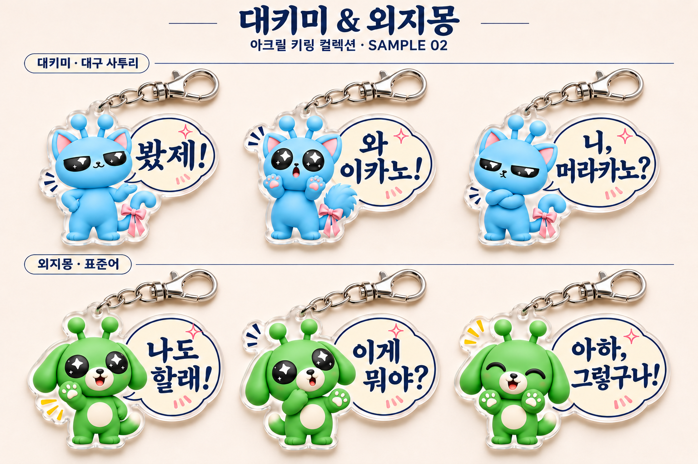
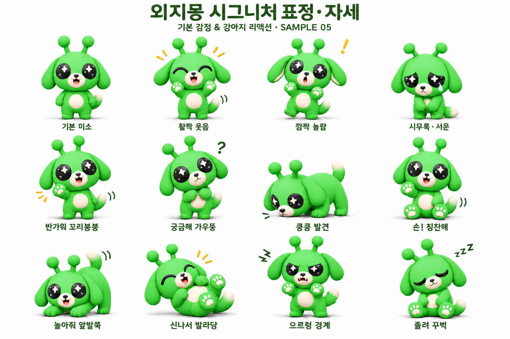

# 외지몽 아크릴 키링 3종 디자인시트 v02

상태: 선택안 기반 재현·제작 검토용. 정면 선택원본 확보 / 단독 정면·후면 상품 이미지는 생성 한도로 대기. 본 문서는 양산 승인서가 아니다.

## 상품별 고정 문구와 자세
| 상품 ID | 문구 원문 | 줄바꿈 기준 (/는 줄바꿈) | 표정·자세 |
|---|---|---|---|
| OM-01 | 나도 할래! | 나도 / 할래! | 기쁜 뜬 눈, 한 손바닥 들어 지원하기 |
| OM-02 | 이게 뭐야? | 이게 / 뭐야? | 고개 갸우뚱, 한 손 뺨 근처, 다른 손바닥 펼치기 |
| OM-03 | 아하, 그렇구나! | 아하, / 그렇구나! | 감은 웃음 눈, 양손바닥을 가슴 앞에서 살짝 펼치기 |

## 캐릭터 고정 외형
- 기준: 성체 표정·자세 확정본 v01에 포함된 SAMPLE 05. 초기 원본설정보드는 이번 제작 기준에서 제외한다.
- 초록색 강아지형 외계인, 긴 처진 귀, 짧고 통통한 몸과 팔다리, 얕은 크림색 주둥이. 몸색 #008C3A 계열, 크림 #F8F0E4. 최종 사진의 조명·중간톤을 우선한다.
- 배 중앙에 거의 원형이며 세로로 아주 조금 긴 크림색 무늬 1개. 별도 배지·두꺼운 패치가 아니다. 세 상품 모두 팔에 가리지 않게 배치한다.
- 통통하고 끝이 둥근 강아지 꼬리 1개. 초록에서 부드럽게 작은 크림색 끝으로 전환한다. 흰 캡·명확한 띠·고양이 나선·리본 금지.
- 노출된 손바닥/발바닥마다 크림색 큰 패드 1개+작은 타원 3개. 큰 패드는 둥근 삼각형 계열이며 아주 얕다. 총 묶음 폭은 표면 폭 약 55%를 기준으로 원근을 적용한다. 손등·발등에는 넣지 않는다.
- 눈을 완전히 뜨면 각 눈에 큰 네 갈래 별 1개+작은 반짝임 2개. 감은 눈은 별이 가려진다. 기본 홍조 없음.
- OM-01 한 손바닥, OM-02 펼친 손바닥, OM-03 양손바닥에서 패드가 읽혀야 한다. 손발을 키워 패드를 억지로 노출하지 않는다.
- 외지몽의 발화는 표준어만 사용한다. 대키미의 사투리 문구를 가져오지 않는다.

## 동일 외형을 재현하는 방법
정확한 픽셀 동일성은 재생성이 아니라 동봉 PNG 원본을 그대로 사용해야 얻을 수 있다. 생성형 AI는 이미지와 문서를 함께 주어도 픽셀·재단선·미세 얼굴을 완전히 동일하게 보장하지 않는다. 상품 사진은 재단선이나 인쇄 원본이 아니다.
- 이미지 1: 해당 캐릭터 정면/후면 상품 이미지. 외지몽 상품 이미지가 미생성인 현재는 6종 선택원본의 아래 행을 정면 기준으로 사용한다.
- 이미지 2: 캐릭터별 확정 표정·자세 레퍼런스. 새로운 캐릭터로 재디자인하지 않는다.
- 이 디자인시트를 함께 첨부하고 SKU 하나와 면 하나를 명시한다. 나머지 상품을 섞지 않는다.
- 첨부 순서·역할을 유지하고 이 시트 끝의 전체 프롬프트를 사용한다. 05_프롬프트에는 같은 원문을 별도 보관했다. 기존 이미지를 편집하는 방식이 재생성보다 기준 유지에 유리하다.
- 생성 후 문구, 더듬이 2개, 귀 2개, 꼬리 1개, 패드 개수·색, 앞뒤 방향을 확대 검수한다. 재생성의 미세 오차를 새 디자인으로 승격하지 않는다.

## 정면·후면 방향 계약
정면은 보는 사람 기준 캐릭터가 왼쪽, 말풍선이 오른쪽이다. 후면은 판을 세로축으로 뒤집어 캐릭터가 오른쪽, 말풍선이 왼쪽이 된다. 캐릭터·꼬리·손동작·장식·외곽·타공 좌표는 좌우 반전하고, 말풍선 글자만 다시 정상 방향으로 조판한다. 이는 캐릭터 등 모습이 아니라 같은 캐릭터를 양면에 인쇄하는 제안이다.
후면의 보이는 글자와 제조용 뒷면 필름의 미러링은 서로 다르다. 제조업체가 공급하는 인쇄면/관찰면 좌표계에 맞춰 변환하며 이중 반전하지 않는다. 동일한 벡터 재단선 1개를 공유해야 한다. 생성 상품 이미지의 앞뒤 실루엣은 시각 검토용이며 제작용 정합을 보증하지 않는다.

## 인쇄 그래픽·말풍선·서체
- 하나의 투명 아크릴 위에 캐릭터와 말풍선을 연결해 인쇄한다. 별도 말풍선 참, 입체 피규어, 봉제 소재로 바꾸지 않는다.
- 캐릭터는 매끈한 반무광 3D 음영을 가진 평면 인쇄다. 아크릴 표면 반사와 캐릭터 피부의 불규칙 얼룩을 구분한다.
- 말풍선은 따뜻한 크림색, 얇은 짙은 남색 외곽선과 글자, 작은 연분홍 반짝임과 사선 포인트다. 모양·포인트는 선택원본을 우선한다.
- 제작 팔레트 시작값(제안): 남색 #10234F / 말풍선 #FFF3D8 / 분홍 포인트 #F49AAD. PNG의 실측 고정 색상값이 아니며 출력 교정 후 확정한다.
- 서체 의도는 궁서체다. 현재 PNG는 생성된 궁서체풍 래스터 글자이며 실제 폰트 파일·정확한 글리프가 확정된 상태가 아니다. 시각 동일성을 우선하면 PNG 글자 형태를 유지하고, 양산 조판은 이용 가능한 정식 궁서체 폰트를 선택해 아웃라인 후 별도 승인한다. 기본 고딕체로 대체하지 않는다.
- 본체 로고를 새로 추가하지 않는다. 투명 테두리는 무색이며 흰색 외곽선으로 대체하지 않는다.

## 이미지 재현 작업 카드
- 입력: 이 문서+위 상품 시각 기준 PNG+위 캐릭터 기준 PNG.
- 대상 SKU와 정면/후면을 명시하고 해당 문구를 원문 그대로 인용한다.
- 구도: 상품 전체가 보이는 거의 정면, 은색 고리까지 프레임 안, 옅은 아이보리 배경, 부드러운 접촉 그림자.
- 유지: 기준 얼굴·비율·팔레트·문구·궁서체풍 글자·연결된 말풍선·투명 외곽·체결 구조.
- 변경: 요청한 면의 반전 및 정상 글자 조판만. 기존 정면을 새 포즈로 재해석하지 않는다.
- 결과가 기준과 다르면 파일명 v번호를 올리고 수정 이력을 남긴다. 기존 선택원본은 보존한다.

## 검수와 남은 확인
- 기준 문구·상품 수·캐릭터 종·더듬이와 꼬리·포즈·패드를 대조한다.
- 정면과 후면의 동일 재단선/타공 정합은 상품 사진이 아니라 벡터 도안에서 검수한다.
- 궁서체 실제 폰트 선정과 아웃라인, 300dpi 이상 1:1 인쇄 원본, 실제 치수·색상 교정·체결 내구성은 제작 전 확인한다.
- 외지몽 단독 정면/후면 상품 이미지가 미생성이다. 정면의 디자인 근거는 선택원본이며 후면은 문서상 설계안이다.

## 전체 이미지 재현 프롬프트 원문
HTML 안에는 위 기준 이미지들이 내장되어 있다. 이 시트와 상품 이미지를 함께 전달하며 내장된 캐릭터 기준 이미지를 참조로 사용한다. 아래 Image 1은 6종 선택원본, Image 2는 해당 성체 외형 기준이다.

Use case: product-mockup / precise-object-edit. Create a highly faithful PRODUCT FRONT/BACK presentation sheet from supplied approved six-product reference image. This is derivation of approved products, not redesign. Landscape 3 columns x 2 rows; EXACTLY SIX product views representing THREE keychain designs, FRONT row above and BACK row below. Same SKU vertically aligned. Each whole clasp, chain, acrylic silhouette, both antenna balls, feet and tail must be fully visible. Match each design exactly across front and back. Warm off-white clean studio backdrop, very soft contact shadows, precise near-orthographic frontal product view for legible Korean. Title and small row labels only, no paragraphs. All products same apparent scale. Silver lobster clasp and three-link jump-ring chains. Flat transparent acrylic 3mm with polished edge and clear margin, 3D shaded character PRINT not a sculpted toy. Match original cream navy outlined rounded speech bubbles, navy traditional GUNGSEO 궁서체 Korean brush-serif lettering and pink sparkles.
CRUCIAL PHYSICAL FRONT/BACK RULE: back row shows the very same asymmetric cut silhouette turned over about its vertical axis. Character, antenna shapes, pose, tail, hole, and bubble placement are HORIZONTALLY MIRRORED relative to matching front, while Korean text inside each bubble is RE-TYPESET NORMALLY READABLE, not mirrored. Thus front row has character LEFT of bubble and back row has character RIGHT of bubble, tail and raised hands reverse naturally. Never draw actual anatomical back of character: this is double-sided same-character artwork printing, with mirrored artwork but readable text on reverse. Clear outer contour, hole location and scale coincide exactly when front/back are mirrored for comparison. Do not create new poses on reverse. Tiny small navy labels "정면" above first row and "후면" above second row, and SKU IDs under each view. Subtitle "양면 인쇄 검토용". No dimension arrows.
Title "외지몽 아크릴 키링". Use ONLY green OEJIMONG products in bottom row of supplied collection reference. Reference 2 is FINAL approved adult SAMPLE 05 identity, never old incomplete green dog.
Three columns exact:
OM-01 "나도 할래!" happy open eyes and mouth, one forward palm raised with CREAM one central + THREE small pads, other arm at side.
OM-02 "이게 뭐야?" curious head tilt, one hand near cheek and other hand presenting palm with CREAM one central + THREE small pads.
OM-03 "아하, 그렇구나!" eyes closed happy understanding, two palms near chest spread to viewer with CREAM one central + THREE small pads EACH.
All three have centered nearly CIRCULAR slightly vertical cream belly color marking, and plump green dog tail with smooth gradient to small CREAM TIP clearly visible. Cream belly NOT a badge, smooth shallow skin color patch. Short adult plump body, round broad green face, long drooping green dog ears, cream shallow muzzle, exactly two green ball tipped antennae. NO cat ears, pink pads, ribbon, fur, claws, extra fingers. Cream #F8F0E4. Keep belly unblocked by arms. No pads on tops of feet or backs of hands. Closed eyes NO stars. Front row left-to-right OM-01 / OM-02 / OM-03; back row matching same IDs. Use ONLY STANDARD Korean text exactly as supplied, correctly readable on both rows.
