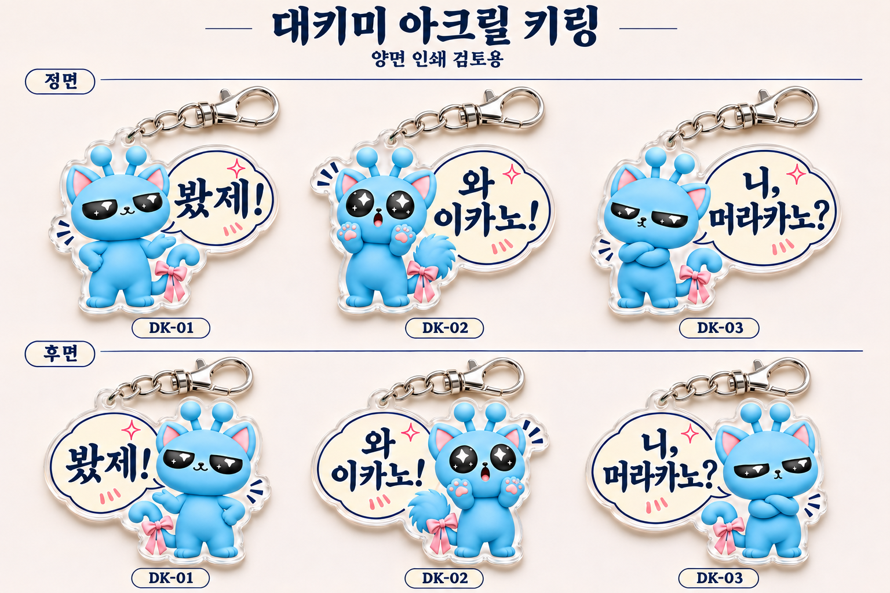

# 대키미 아크릴 키링 3종 제작 사양서 v02

## 적용 범위·상태
DK-01, DK-02, DK-03. 캐릭터+문구 말풍선 일체형 투명 아크릴. 선택원본은 6종 원페이지 v02다. 예전 루트 시트의 캐릭터형/사투리형 분리 8 SKU 구성은 이 패키지에 적용하지 않는다. 기존 초안은 이력으로 보존한다.
사용자가 선택한 외관과 아래 제작 제안값을 구분한다. 양면 방식·치수·두께·공정·공차는 제작사 확인과 샘플 승인 전 미확정이다. 수량·단가·납기·포장 규격은 미정이다.

## 상품 기준 이미지

## 공통 제작값 — 모두 제안값, 업체 확인 전
| 항목 | 제안값·지시 | 상태 |
|---|---|---|
| 기재 | 무색 투명 아크릴, 황변·스크래치 상태 검수 | 투명 아크릴 선택, 재료 등급 업체 확인 |
| 두께 | 3.0 mm | 제안 |
| 판 외곽 크기 | 가로 최대 70 × 세로 최대 60 mm, 금속 고리 제외·타공 탭 포함 | 제안, 그림 비율 유지하며 박스 안 맞춤 |
| 크기 적용 | SKU별 실제 외곽은 단일 벡터 칼선 작성 후 기입, 70×60에 억지로 늘리지 않음 | 실측 확정 대기 |
| 원본 수치와 관계 | 구형 시트의 50~60 mm 캐릭터 단독안에서 말풍선 일체형으로 확대 제안 | 사용자 치수 승인 전 |
| 투명 여백 | 인쇄 외곽에서 컷선까지 약 2 mm | 제안, 얇은 목 부위 보강 필요 |
| 타공 | 지름 3 mm 1개, 상단 무인쇄 탭 | 제안 |
| 타공 주변 | 구멍 가장자리부터 판 외곽까지 최소 3 mm를 시작값으로, 탭 폭 약 9 mm 이상 | 제안, 업체 구조 검토 |
| 인쇄 | 양면 컬러 UV+차폐용 백색 인쇄 후보 | 업체 잉크 적층·비침 테스트 필요 |
| 양면 내용 | 같은 캐릭터와 문구. 후면 외곽·도형 좌우 반전, 글자만 정방향 재조판 | 이번 문서의 설계 제안 |
| 글자 가독성 | 주요 한글 높이 5 mm 이상, 최소 획 0.3 mm를 검토 시작값으로 | 궁서 획과 업체 공법 확인 |
| 위치 정합 | 앞뒤·백색판·타공·칼선 위치 오차 목표 ±0.5 mm 이내 | 업체 수용 여부와 실물 확인 |
| 안전 여백 | 글자·얼굴 핵심 요소는 컷선/타공으로부터 2 mm 이상 | 제안, 실제 조판 확인 |
| 하드웨어 | 은색 회전 랍스터 고리+연결 링/짧은 체인, 고리 약 25~30 mm | 외관 기준, 규격·금속 등급 미정 |
| 로고 | 본체에는 추가하지 않음 | 선택원본 기준 |
| 포장 | 표면 보호+개별 포장, 포장 카드 별도 설계 | 제안, 이번 패키지 미포함 |

위 70×60 mm 박스 전체를 300dpi로 출력한다면 약 827×709 px 이상이 필요하다. 이는 산술상 최소치이며 상품 사진을 잘라 확대해 인쇄하라는 뜻이 아니다. 낱개 그래픽의 실효 해상도·칼선·타공·백색판을 별도로 준비한다.

## 업체 전달 레이어
- CUT: 1:1 mm 단위의 닫힌 벡터 외곽 1개. 투명 여백과 타공 탭을 포함한다. 안테나·말풍선·꼬리 연결부는 뾰족한 절단을 줄이고 동일 외곽으로 연결한다.
- HOLE: 타공 중심과 지름을 별도 벡터로 표기. 귀·더듬이·얼굴·글자와 겹치지 않는다.
- FRONT_COLOR: 정면 캐릭터·말풍선·문구. 사진 배경·하드웨어·바닥 그림자는 제외한다.
- BACK_COLOR: 동일 컷선의 반대면 관찰 기준. 도형 좌우 반전 후 문구 정방향 재조판. 업체가 인쇄면 미러를 요구하면 별도 변환한다.
- WHITE: 컬러 영역 뒤를 차폐하는 백색판. 투명 테두리·타공에는 백색 잉크를 넣지 않는다. 초크/확장 수치는 업체 RIP와 견본으로 결정한다.
- 인쇄용 AI/PDF/SVG 및 폰트 아웃라인은 이번 패키지에 포함되지 않았다. 생성 PNG를 제조용 벡터 원본으로 오인하지 않는다. 업체 템플릿을 받아 실제 파일을 작성한다.

## 캐릭터별 필수 검수
- 기준: 성체 대키미 v08 고양이 리액션 시트와 선택된 6종 원페이지 v02의 위 행.
- 하늘색 고양이형 외계인, 넓은 성체 얼굴과 짧은 몸·다리, 뾰족한 귀와 분홍 귀 안쪽. 몸색 #6DCFF5 계열, 실제 중간톤·음영은 선택원본 우선.
- 더듬이는 줄기 2개·구슬 2개. 작은 코와 입 주변은 하늘색이며 외지몽처럼 크림색으로 바꾸지 않는다.
- 둥글게 휜 고양이 꼬리와 분홍색 꼬리 리본을 유지한다. DK-02만 놀람에 맞는 작은 털 갈래를 허용한다.
- 노출된 손바닥/발바닥마다 분홍색 큰 패드 1개+작은 패드 4개. 외지몽의 크림색 1+3과 혼동하지 않는다.
- 뜬 눈의 별빛과 작은 반짝임을 기준 사진대로 유지한다. 반쯤 감은 눈은 눈꺼풀에 가려지는 양도 유지한다.
- 문구는 대구 사투리 컨셉으로 선택된 아래 3개를 한 글자도 바꾸지 않는다.

## 실물 샘플 승인 기준
- 문구·문장부호·줄바꿈을 디자인시트와 대조하고 궁서체 가는 획의 소실을 확인한다.
- 앞뒤 반전 방향과 한 개의 외곽·타공 정합, 백색 잉크 비침/번짐, 색상과 크림색 영역을 확인한다.
- 구멍 가장자리, 더듬이·꼬리 연결부, 말풍선 목 부분의 깨짐과 절단면의 날카로움을 확인한다.
- 금속 고리 작동·풀림·스크래치 및 실제 휴대 시 체결 상태를 확인한다. 성능 수치를 이미지로 인증하지 않는다.
- 생산 업체가 치수·공차·잉크 적층·폰트 사용권·재료·포장·수량·납기를 확인한 뒤 실물 샘플을 승인한다.

## 현재 파일 완성 범위
정면·후면 상품 이미지 생성 / 제조용 정합 확인 전. 제작 사양서와 디자인시트는 검토용으로 작성되었다. 제조 원본·실물 샘플·양산 승인은 아직 없다.
