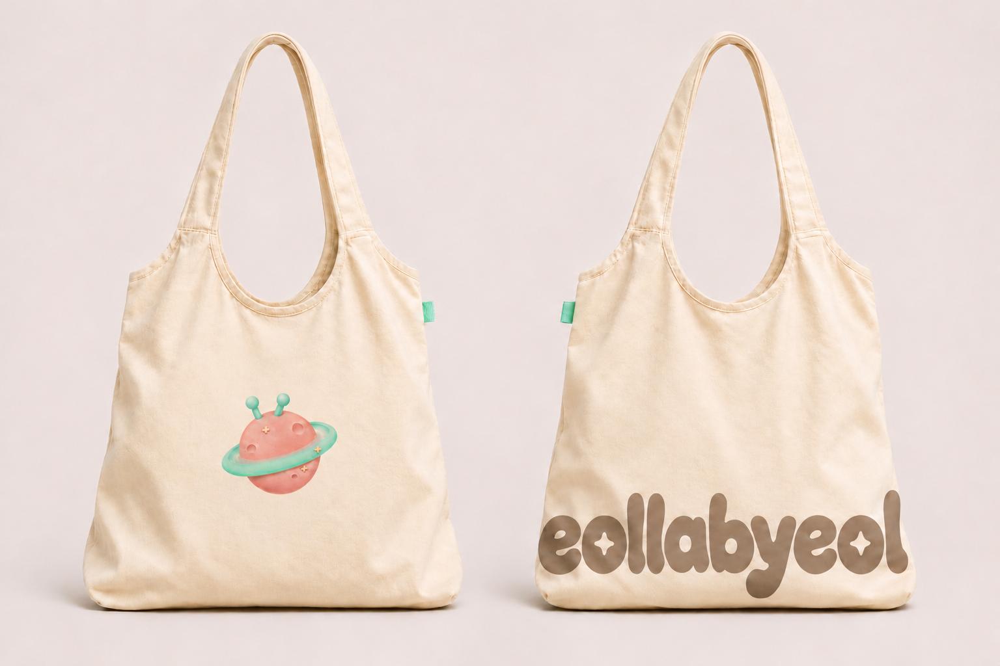
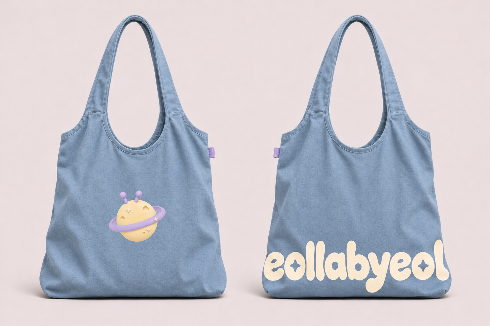

# 얼라별 에코백 디자인시트

버전 v01 | 2026-11-19 | 외형 확정 / 실물 수치·공정은 초도 샘플 검증 전

## 확정 범위와 사용법

얼라별 양면 숄더 에코백 / 디자인시트 v01
품번: EB-01-CI 크림 아이보리, EB-01-SB 스모키 블루
외형 확정일: 2026-11-19. 확정 기준: 상품샘플 v03의 마지막 두 장.

> 상태 표기: [확정] 사용자가 마지막 상품 이미지 두 장으로 승인한 외형. [관찰] 이미지에서 읽은 근사 좌표·비율. [제안] 제작 가능한 형태로 구체화한 시작 사양. [검증 전] 실물·인쇄·내구 시험 미실시. 외형 확정은 양산 승인이나 물성 검증을 뜻하지 않는다.

기준 우선순위: 이후 사용자의 명시적 수정 > 이 패키지의 확정 상품 이미지 두 장과 본문의 확정 외형 > 본문의 관찰 좌표 > 제작 제안 수치. 숫자와 사진이 충돌하면 승인 사진의 인상을 유지하도록 제작 도면을 수정하고 변경 내역을 남긴다. 이전 버전 상품 사진이나 초기 대화의 크기 수치는 재적용하지 않는다.

제품은 양면에 서로 다른 외관을 가진 하나의 숄더 에코백이다. 행성 면(F)과 레터링 면(B) 중 원하는 면을 바깥으로 향해 멘다. 안팎을 뒤집어 쓰는 리버서블 구조를 뜻하지 않는다. 색상별 사진의 두 가방은 동일 제품의 앞·뒤를 나란히 보여준 것이다.

| 자료 | 역할 |
| --- | --- |
| 01_크림아이보리_확정상품이미지.png | CI 색상·앞면 행성·뒷면 레터링·봉제 외관의 기준 |
| 02_스모키블루_확정상품이미지.png | SB 색상·동일 배치·색상 변형의 기준 |
| 03_얼라별_에코백_디자인시트_v01.pdf | 외형·그림·문자·배치·촬영과 AI 재현 기준 |
| 04_얼라별_에코백_제작사양서_v01.pdf | 샘플 제작 치수·소재·공정·오차·검수 기준 |

전달할 최소 구성은 위 네 파일이다. 두 문서에 두 확정 사진과 주요 확대도를 내장했으므로 원본 레터링 파일이나 이전 대화가 없어도 시각 기준을 확인할 수 있다. AI에는 문서 파일명만 언급하지 말고 두 PNG를 실제 이미지 입력으로 함께 첨부한다.

> 이 문서는 재현 편차를 줄이는 기준이다. 생성형 AI의 픽셀 단위 동일성, 사진만으로 복원한 재단 패턴의 정확성, 실물의 완전 동일 생산을 보장하지 않는다. 동일 외형의 실물은 원단 스와치·인쇄 원고·패턴·초도 샘플 검증으로 확정한다. 이 확인을 대신해 새 이미지를 임의의 정답으로 삼지 않는다.

## 크림 아이보리 / 확정 상품 외형

| 구성 | 확정 외형 |
| --- | --- |
| 몸판·끈 | 따뜻한 크림 아이보리. 원단과 끈은 같은 계열 색. 자연스러운 잔주름과 직조 결. |
| F 행성 | 코랄 핑크 본체 + 낮은 채도의 민트 고리·더듬이 + 크림 별. 작고 중앙에 배치. |
| B 레터링 | 웜브라운 단색 eollabyeol. 통통한 커스텀 글자, 하단 양끝까지 확대. |
| 옆선 라벨 | 무문구 민트색 직조 탭. F를 보았을 때 오른쪽, B를 보았을 때 왼쪽. |

하이라이트의 밝은 베이지, 주름의 짙은 베이지는 별도의 원단 배색이 아니다. 가방 전체를 노란색·백색·진한 살구색으로 바꾸지 않는다. 행성은 그림 속 입체 명암을 가진 평면 인쇄물이며, 실물 돌출 장식이나 패치가 아니다.

## 스모키 블루 / 확정 상품 외형

| 구성 | 확정 외형 |
| --- | --- |
| 몸판·끈 | 차분한 스모키 블루. 청회색을 포함한 낮은 채도, 원단과 끈의 색상 통일. |
| F 행성 | 크리미한 버터 옐로 본체 + 연한 라벤더 고리·더듬이 + 아이보리 별. |
| B 레터링 | 따뜻한 아이보리 단색. CI와 동일한 글자 구성·하단 크기. |
| 옆선 라벨 | 무문구 라벤더 직조 탭. CI와 같은 옆선·같은 높이. |

진한 로열블루·선명한 하늘색·네이비로 대체하지 않는다. 행성의 노란색과 보라색은 파스텔 계열을 유지한다. 별과 레터링의 아이보리는 형광색이나 차가운 백색으로 바꾸지 않는다. 두 색상은 프린트 크기와 구조가 동일한 한 라인이다.

## 실루엣·재질·양면 구조

### 가방 외형 [확정]

어깨에 걸 수 있는 길고 넓은 원단 끈, 깊고 부드러운 U자 입구, 위보다 아래가 넓은 몸판, 둥근 밑모서리. 바닥은 접힌 원단 두께와 가벼운 볼륨이 보이나 단단한 판처럼 각지지 않는다. 본체 옆선에서 끈으로 자연스럽게 이어지는 곡선이 핵심이다.

전체는 힘없이 얇게 찢어질 듯한 천이나 빳빳한 공구 가방이 아닌, 부드럽게 처지면서 몸판 윤곽을 유지하는 워싱 코튼 인상이다. 미세한 직조 조직, 자연스러운 주름, 어깨끈 끝과 입구의 봉제선이 보인다. 광택·코팅·가죽·나일론·니트·파일 원단으로 바꾸지 않는다.

| 요소 | 구성 원칙 |
| --- | --- |
| 끈 | 앞판과 뒤판 각각 하나의 어깨 루프를 갖는 구조 제안. 정면에서는 두 루프가 겹쳐 하나처럼 보일 수 있다. 폭과 외곽 곡선은 사진 인상 유지. |
| 입구 | U자 곡선과 동일 원단 마감. 직사각 토트의 일자 입구로 바꾸지 않는다. |
| 봉제 | 동색 실, 균일한 상침. 끈과 어깨 연결 부위에 보이는 짧은 가로 보강선 유지. |
| 표면 구성 | 앞면에는 행성 하나, 뒷면에는 레터링 하나. 추가 패턴·외부 포켓·키링·문구 없음. |
| 내부 | 내부 사진 없음. 안감·포켓·스냅·지퍼의 존재는 외형 승인으로 확정되지 않음. 기본 샘플 제안은 제작사양서 참조. |

> 가방 앞·뒤는 같은 물건이다. 라벨 두 개를 각각 부착하거나, 앞면의 행성을 뒷면에도 복제하거나, 끈 배색을 다르게 만드는 것은 변경 사항이다.

## 배치 좌표와 크기 기준

배치 설명도: 본문 좌표와 제안 규격 참조.

| 요소 | 정의·현재 기준 |
| --- | --- |
| 도면 원점 [제안] | 완성 몸판의 좌우 어깨점 높이를 잇는 수평선 Y0. X=0은 몸판 중심선에서 190mm 왼쪽. 끈과 시접은 몸판 H에 포함하지 않음. |
| 앞면 [관찰] | 사진상 행성 전체 외접상자 약 x340~519, y600~762. 더듬이·고리 포함. CI/SB의 약간의 생성 차이를 새 배치로 해석하지 않음. |
| 앞면 [제안] | W380 x H330mm 몸판에서 행성 외접상자 116 x 102mm, 중심 (190,165)mm. 상대 중심 (50%,50%), 외접상자 폭은 최대 몸판 폭의 약30.5%. |
| 뒷면 [관찰] | 글자 전체 약 x825~1405, y750~920. 첫 e와 마지막 l이 좌우 측면 가까이 닿고 y의 내려오는 부분은 밑선 위에 남음. |
| 뒷면 [제안] | 완성 인쇄 외접상자 약384 x 108mm, 중심 X190mm, 상단Y212mm/하단Y320mm. 밑선Y330mm에서 최저점10mm 띄움. |

> 사진 픽셀은 1536 x 1024 원본의 근사치이며 mm로 직접 환산한 실측값이 아니다. 이전 대화의 9~10cm, 15% 등의 축소 지시를 다시 누적하지 않는다. 현재 확정 사진의 작은 중앙 행성 비율을 유지한다.

## 얼라별 행성 / 형태와 인쇄 해석

원본 확대 영역: 01_크림아이보리_확정상품이미지.png, 좌표 (322, 588, 537, 779). CI 확정 인쇄의 확대. 실제 상품 이미지의 그림을 기준으로 사용한다.

| 요소 | 유지할 특징 |
| --- | --- |
| 본체 | 구형 느낌의 둥근 몸체 하나. 부드러운 입체 명암, 얕은 원형 분화구 세 개. 얼굴·눈·입·귀·팔다리 없음. |
| 고리 | 넓고 둥근 고리 하나. 왼쪽 아래에서 오른쪽 위로 올라가는 사선. 전면 고리는 본체 앞, 후면 부분은 본체 뒤로 가려짐. |
| 고리 연결 | 안쪽은 투명한 듯 본체·바탕이 비치고 바깥 가장자리로 색이 드러남. 인쇄에서는 바탕이 비치는 계조로 해석. 실제 구멍이나 흰 띠를 새로 만들지 않음. |
| 더듬이 | 공 끝을 가진 짧은 더듬이 두 개. 고리와 같은 계열 색. 두 부품의 크기와 형태는 유사하고 바깥쪽으로 살짝 기울어짐. |
| 별 | 따뜻한 색의 둥근 네 갈래 별 3개. 본체 위쪽 왼편 1개, 본체 아래쪽 오른편 1개, 고리 앞쪽 오른편 1개. |
| 표현 | 본체·고리 내부에만 부드러운 3D 음영. 가방 바깥으로 튀어나온 그림자나 두꺼운 실리콘 패치 금지. |

상품용 그림은 행성 정면 한 시점으로 고정한다. 행성 자체의 후면·측면을 새로 생성해 가방 후면에 적용하지 않는다. 두 색상 사이에서 형상·고리 방향·별 개수·더듬이 개수·위치가 바뀌지 않게 한다.

## 커스텀 레터링 / 철자와 별 디테일

원본 확대 영역: 01_크림아이보리_확정상품이미지.png, 좌표 (817, 742, 1410, 925). 최종 CI 상품 이미지에 적용된 레터링. 단독 원안보다 이 최종 적용 형태·세로 비율을 우선한다.

### 정확한 글자 [확정]

eollabyeol / 전부 소문자 / 공백 없음 / 10자
글자 순서: e - o - l - l - a - b - y - e - o - l
위치 번호: 1 e, 2 o, 3 l, 4 l, 5 a, 6 b, 7 y, 8 e, 9 o, 10 l.

부드럽게 부풀린 굵은 획, 둥근 모서리, 살짝 불규칙한 손그림 실루엣을 가진 단어 전용 레터링이다. 일반 산세리프·필기체·세리프나 설치형 폰트로 다시 타이핑해 대체하지 않는다. e의 열린 틈, l의 둥근 긴 기둥, a/b의 내부 공간, y의 내려오는 곡선을 식별 가능하게 유지한다.

| 규칙 | 유지 사항 |
| --- | --- |
| 별 카운터 | 2번째·9번째 글자 o 내부를 각각 네 갈래 별 모양으로 비움. 총 2개. 별은 바탕 원단색이 보이는 음각 공간이며 별색 잉크가 아님. |
| 나머지 내부 공간 | e, a, b의 틈과 구멍은 원본의 열린 모양 유지. 글자끼리 합쳐져 읽히지 않는 뭉침 금지. |
| 단색 인쇄 | CI 웜브라운 / SB 따뜻한 아이보리. 윤곽선·검정 그림자·입체 돌출·그라데이션 없음. |
| 하단 배치 | 전체 최저점은 y 하강부 기준. 중앙 글자 몸통만 보고 밑단 간격을 잡지 않음. |

> 최종 상품 사진에 맞춘 워드마크 외접상자 가로:세로 인상은 약 3.5:1이다. 기존 단독 레터링 PNG를 사용할 경우 단순 확대만으로 최종 높이가 달라질 수 있으므로 최종 적용 형태를 기준으로 윤곽 원고를 정리한다.

## 색상·원단·옆선 라벨

| 대상 | CI | SB |
| --- | --- | --- |
| 원단 [화면 참고] | #F7E3D0 / 따뜻한 크림 아이보리 | #899EBB / 차분한 청회색 블루 |
| 행성 본체 [시작 제안] | #E99D91 / 소프트 코랄 | #F0D69A / 크리미 버터 옐로 |
| 고리·더듬이 [시작 제안] | #A6D7C6 / 부드러운 민트 | #BEACD5 / 연한 라벤더 |
| 별 [시작 제안] | #FBE6C2 / 크림 | #FBE6C2 / 아이보리 |
| 레터링 [화면 참고] | #997961 / 웜브라운 | #FBEBD7 / 따뜻한 아이보리 |
| 라벨 [시작 제안] | #A1E0C9 / 민트 | #AA93C8 / 라벤더 |

원단·레터링의 화면 참고값은 확정 PNG의 대표 위치에서 읽은 조명 포함 sRGB 픽셀값이다. 원단 (560,600), 글자 (996,818) 주위 7 x 7px 중앙값을 사용했다. 그 외 값은 색상 관계를 설명하는 제작 시작 제안이며 정확한 색 측정값이 아니다. 전체 밝기·그림자·주름·화이트밸런스가 달라지면 같은 재질도 픽셀값이 달라진다.

> HEX는 팬톤·CMYK·실제 염색 배합값을 뜻하지 않는다. 인쇄소 임의의 HEX→CMYK 자동변환을 최종 승인으로 취급하지 않는다. 실제 원단 위 스트라이크오프와 원단 스와치로 색을 맞춘다.

### 라벨 [확정 외형 / 치수 제안]

동일 옆선에 무문구 직조 탭 하나만 부착. 앞면을 보았을 때 오른쪽, 뒤집어 후면을 보았을 때 왼쪽에 보인다. 노출 폭10mm x 높이20mm, 상단은 Y0에서22mm 아래를 시작안으로 한다. 접힌 끝은 둥글고 실밥이 없어야 한다. 안쪽 삽입분·원단 조직은 제작사양서에 따른다.

원단 전체에 체크·세로줄·도트·추가 별 패턴을 넣지 않는다. 라벨에 임의의 브랜드명·세탁기호·영문을 새로 쓰지 않는다. 두 색상 모두 끈과 몸판은 동색이다.

## AI 재현 입력과 촬영 지시

### 입력 순서

입력1: CI 확정 PNG. 입력2: SB 확정 PNG. 입력3: 본 디자인시트. 입력4: 제작사양서. PDF의 사진을 해석할 수 없는 도구에는 PNG를 반드시 별도 첨부한다. 파일을 보지 않은 채 파일명만 읽고 새 행성이나 새 글자를 그리지 않는다.

### 그대로 사용할 공통 프롬프트

첨부된 두 확정 상품 이미지를 최우선 시각 기준으로 얼라별 양면 숄더 에코백을 재현한다. 색상당 한 장의 가로형 스튜디오 사진을 만들고, 왼쪽에 행성 앞면, 오른쪽에 레터링 뒷면을 같은 크기·같은 밑선으로 나란히 둔다. 원본과 같은 부드러운 워싱 코튼 결, U자 입구, 길고 넓은 동색 어깨끈, 약간 벌어지는 몸판, 둥근 밑모서리, 작은 옆선 직조 탭을 유지한다. 끈 끝부터 밑단까지 잘리지 않게 전부 보여준다. 밝고 따뜻한 회색 무지 배경, 확산광, 자연스러운 접지 그림자로 실제 판매용 상품 촬영처럼 표현한다.

앞면에는 확정 이미지의 작은 얼라별 하나만, 끈을 제외한 몸판의 시각적 정중앙에 둔다. 더듬이와 고리를 포함한 전체 비율과 위치는 최종 사진을 그대로 따른다. 뒷면에는 확정 사진의 커스텀 eollabyeol 레터링을 아주 크게 하단 좌우 봉제선까지 채운다. 전부 소문자이고 글자 순서는 e o l l a b y e o l이다. 두 o의 내부는 네 갈래 별 모양으로 원단이 비친다. 하강하는 y의 최저점은 밑선보다 조금 위에 둔다. 위쪽 뒷면은 무지로 남긴다. 일반 글꼴로 대체하지 않는다.

인쇄는 천 위에 얇게 스며든 평면 그래픽이다. 행성 그림 내부의 부드러운 입체 명암은 유지하되 별도 3D 장식이나 패치로 만들지 않는다. 전체 천의 주름·직조 결을 자연스럽게 남긴다. 색상별 팔레트는 아래 지시를 결합하며, 사진에서 보이지 않는 포켓·안감·지퍼·스냅·패턴·악세서리는 새로 추가하지 않는다.

| 옵션 | 덧붙일 색상 지시 |
| --- | --- |
| CI | 크림 아이보리 원단과 끈. 코랄 본체·민트 고리와 더듬이·크림 별. 웜브라운 레터링. 민트 옆선 탭. |
| SB | 스모키 블루 원단과 끈. 버터 옐로 본체·라벤더 고리와 더듬이·아이보리 별. 아이보리 레터링. 라벤더 옆선 탭. |

금지: 행성 확대·상단 이동, 문자 철자 변경, 대문자, 줄바꿈, 후면 중앙의 작은 텍스트, 측면 여백 있는 작은 워드마크, 외곽선·검정 그림자, 행성 얼굴, 별 개수 증가, 원단 패턴, 인물·소품·워터마크·설명 라벨. 정확한 서체 재현이 안 되면 확정 이미지의 윤곽을 참조해 수정하며 다른 글꼴을 임의 승인하지 않는다.

## 재현 검수와 전달 기록

| 검수 항목 | 합격 판단 |
| --- | --- |
| 상품 정체성 | 두 색상 모두 같은 실루엣·몸판·끈·작은 옆선 탭을 갖는다. |
| 앞면 중앙 | 행성 전체 외접상자 중심이 몸판 시각 중심과 일치. 끈 포함 전체 높이의 중앙으로 옮기지 않는다. |
| 앞면 크기 | 최종 사진과 동일한 작은 비율. 과거 버전 크기나 축소 비율을 누적하지 않음. |
| 행성 형태 | 본체1·고리1·공끝 더듬이2·네갈래 별3·얕은 분화구3. 얼굴 없음. |
| 문자 | eollabyeol 정확히10자. 2/9번째 o에 별 모양 구멍 두 개. |
| 후면 위치 | 하단 전체 폭. 첫 e와 마지막 l이 양옆까지 이어짐. y 최저점과 밑단 사이 작은 여유. |
| 색상 | CI 코랄/민트/브라운, SB 버터옐로/라벤더/아이보리 관계 일치. |
| 사진 | 왼쪽F/오른쪽B, 같은 크기·밑선. 끈과 바닥 미잘림. 자연스러운 코튼과 접지 그림자. |

AI 결과 검수 시에는 원본과 결과의 몸판 최대 폭을 맞춘 뒤 행성 외접상자, 레터링 외접상자, 별 카운터, 라벨 위치를 비교한다. 원단의 우연한 미세 주름이나 조명의 픽셀 차이보다 디자인 형태·비율·배치의 동일성을 먼저 확인한다. 문자 오탈자는 작은 차이여도 불합격이다.

### 기준 파일 무결성

두 PNG는 사용자 승인 상품샘플 v03에서 바이트를 변경하지 않고 복사했다. 아래 SHA-256 값은 기준 파일 식별용이다. 파일을 재압축·보정하면 해시가 달라지므로 별도 버전으로 관리한다.

CI SHA-256:
6d52cc22f7a2a9fe2c44f808056bf6acd2b41e58daeecf997a9549b788c4f8ed

SB SHA-256:
971e50002b61353af17ee8410041ad6cda902d66bff56aa93041dc8bc0368132

> 이 문서는 재현 편차를 줄이는 기준이다. 생성형 AI의 픽셀 단위 동일성, 사진만으로 복원한 재단 패턴의 정확성, 실물의 완전 동일 생산을 보장하지 않는다. 동일 외형의 실물은 원단 스와치·인쇄 원고·패턴·초도 샘플 검증으로 확정한다. 이 확인을 대신해 새 이미지를 임의의 정답으로 삼지 않는다.
