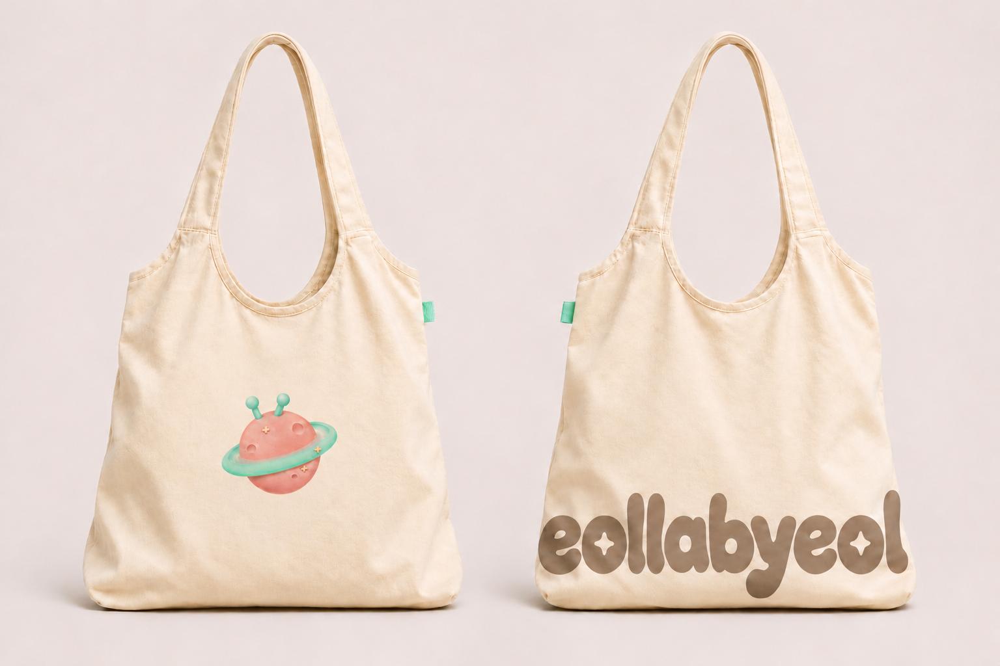
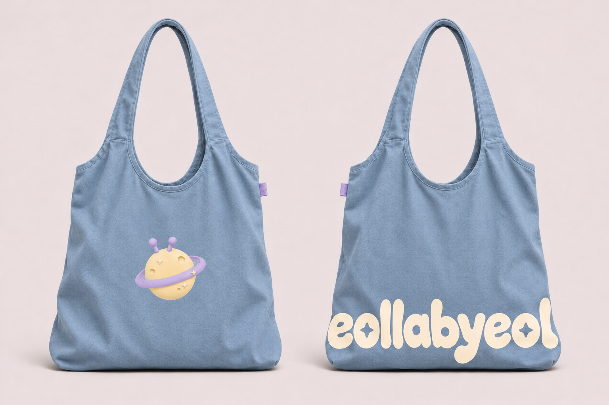

# 얼라별 에코백 제작사양서

버전 v01 | 2026-11-19 | 외형 확정 / 실물 수치·공정은 초도 샘플 검증 전

## 제작 범위와 사양 상태

얼라별 양면 숄더 에코백 / 제작사양서 v01
품번 EB-01-CI / EB-01-SB | 2026-11-19
외형: 확정. 실물 치수·공정: 초도 샘플 시작 사양.

> 상태 표기: [확정] 사용자가 마지막 상품 이미지 두 장으로 승인한 외형. [관찰] 이미지에서 읽은 근사 좌표·비율. [제안] 제작 가능한 형태로 구체화한 시작 사양. [검증 전] 실물·인쇄·내구 시험 미실시. 외형 확정은 양산 승인이나 물성 검증을 뜻하지 않는다.

기준 우선순위: 이후 사용자의 명시적 수정 > 이 패키지의 확정 상품 이미지 두 장과 본문의 확정 외형 > 본문의 관찰 좌표 > 제작 제안 수치. 숫자와 사진이 충돌하면 승인 사진의 인상을 유지하도록 제작 도면을 수정하고 변경 내역을 남긴다. 이전 버전 상품 사진이나 초기 대화의 크기 수치는 재적용하지 않는다.

제품은 양면에 서로 다른 외관을 가진 하나의 숄더 에코백이다. 행성 면(F)과 레터링 면(B) 중 원하는 면을 바깥으로 향해 멘다. 안팎을 뒤집어 쓰는 리버서블 구조를 뜻하지 않는다. 색상별 사진의 두 가방은 동일 제품의 앞·뒤를 나란히 보여준 것이다.

| 고정할 것 | 샘플로 검증할 것 |
| --- | --- |
| 최종 두 상품 사진의 실루엣, 양면 구성, 배색, 작은 중앙 행성, 큰 하단 워드마크, 옆선 탭 | 실제 mm 치수, 원단 중량·수축, 패턴, 끈 접합, 바닥 깊이, 인쇄 방식·배합·촉감·내구 |
| eollabyeol 철자, 2개의 별 카운터, 행성의 더듬이2·고리1·별3 | 인쇄 원고의 벡터 윤곽·계조 분판·해상도, 인쇄 오차, 봉제와 인쇄 순서 |

문서 내 모든 치수·성능 목표·오차는 제작 담당자가 제안한 초도 샘플용 내부 목표다. 사용자 실측 승인, 법정 기준, 공인시험 성적 또는 공장 확약을 의미하지 않는다. 원단·부자재 변경으로 외관이 달라지면 초도 샘플로 비교한다.

기본안은 안감 없는 단층 원단, 내부 포켓·여밈 없음으로 제안한다. 초기 대화에서 언급된 스냅·안주머니는 최종 사진으로 확인되거나 별도로 확정된 기능이 아니다. 필요 시 별도 옵션으로 추가하되 외형과 원가·무게 영향을 기록한다.

> 이 문서는 재현 편차를 줄이는 기준이다. 생성형 AI의 픽셀 단위 동일성, 사진만으로 복원한 재단 패턴의 정확성, 실물의 완전 동일 생산을 보장하지 않는다. 동일 외형의 실물은 원단 스와치·인쇄 원고·패턴·초도 샘플 검증으로 확정한다. 이 확인을 대신해 새 이미지를 임의의 정답으로 삼지 않는다.

## 확정 사진 / 크림 아이보리

원단과 끈은 동일한 따뜻한 크림 아이보리. 옆선 탭은 민트. 행성은 코랄 본체와 민트 고리·더듬이, 크림색 별. 인쇄물은 낮은 돌출감과 유연한 촉감이 목표다. 이미지의 원단 명암을 염색 얼룩으로 재현하지 않는다.

외부 포켓·지퍼·금속장식·끈 배색·추가 문구 없음. 별도 장식을 달지 않는다. 눈에 보이는 짧은 가로 보강선과 동색 상침을 유지한다. 후면 문자 시작/끝이 양옆 봉제선 가까이 닿는 배치를 가장 중요한 인쇄·봉제 결합 조건으로 본다.

## 확정 사진 / 스모키 블루

원단과 끈은 동일한 스모키 블루. 옆선 탭은 라벤더. 원단색이 프린트의 밝은 색을 지나치게 탁하게 만들지 않도록 바탕처리·백색 하도 여부를 시험한다. 하도를 쓰더라도 그림 주변에 흰 사각형이나 흰 테두리가 남으면 불합격이다.

CI/SB는 같은 패턴과 인쇄 배치 템플릿을 공유한다. 생산 로트별 원단 수축 차이가 있으면 재단 전 수축을 보정하되 완성 실루엣과 인쇄 비율은 통일한다. 색만 바꾼다는 이유로 행성의 그림 요소를 재배치하지 않는다.

## 완성 치수표와 측정법

| 코드·항목 | 제안 목표 | 초도 허용차·측정 |
| --- | --- | --- |
| W 최대 몸판 폭 | 380mm | ±5mm / 끈·시접 제외, 평평히 놓고 최대 폭 |
| Wt 어깨선 폭 | 300mm | ±5mm / 좌우 Y0 어깨점 사이 |
| H 몸판 높이 | 330mm | ±5mm / Y0에서 밑선까지 중심 수직 |
| D U자 중앙 깊이 | 30mm | ±3mm / Y0에서 입구 중앙 최저점 |
| S 끈 폭 | 45mm | ±2mm / 어깨에 닿는 구간 |
| L 어깨 드롭 | 280mm | ±5mm / 입구 중앙 최저점에서 끈 정점까지 |
| TH 전체 높이 | 약580mm | H-D+L. 누적 허용차 고려, 무리하게 늘려 측정 금지 |
| G 바닥 폭 | 60mm | ±5mm / 부드러운 접힘 방식, 실물로 확정 |
| R 밑모서리 | 약20~30mm 반경 | 각진 코너 없이 사진 인상으로 조정 |
| T 탭 노출 | 10 x 20mm | 각 ±1mm / 삽입분 제외 |

측정 상태: 인쇄 경화·후가공 후 원단이 안정된 상태, 내용물 없이 바닥에 평평히 놓고 손으로 가볍게 정리한다. 주름을 힘껏 당겨 펴지 않는다. 양면 모두 같은 측정법으로 기록하며 1차 샘플은 주요 지점별 실제 수치를 기입한다.

Y0는 끈이 시작되는 좌우 어깨점 높이의 수평 기준선이다. U자 입구 최저점을 Y0로 오인하지 않는다. 몸판 가로는 위쪽보다 아래쪽이 넓다. 직사각 W380 x H330 사각형을 그대로 잘라 일자 입구 토트로 봉제하면 승인 외형이 달라진다.

> 사진은 원근과 내용물 볼륨이 포함된 생성 이미지다. 이 mm표는 관찰된 형태를 제작 가능한 시작값으로 정리한 제안이며 실측 복원 도면이 아니다. 패턴의 실제 곡선·수축 여유는 봉제 샘플로 확인한다.

## 좌표·인쇄 면적·옆선 탭

배치 설명도: 본문 좌표와 제안 규격 참조.

| 부위 | 완성 기준 좌표·수치 [제안] |
| --- | --- |
| 좌표계 | 몸판 도면: X=0 왼쪽, X=380 오른쪽, Y=0 어깨선Y0, Y=330 밑선. F/B 각각 정면에서 본 좌표. 시접 제외. |
| F 행성 | 더듬이·고리·별 포함 116 x 102mm. 중심(190,165)mm. 외접상자 좌상단(132,114), 우하단(248,216). 위치 ±3mm, 크기 ±2mm 목표. |
| B 워드마크 | 외접상자 x=-2~382, y=212~320mm. 폭384mm/높이108mm 목표. 끝 글자가 측면 안쪽으로 소량 감길 수 있음. 첫/마지막 글자 판독 유지. |
| B 밑단 여유 | y 하강부 최저점에서 완성 밑선까지10mm, ±3mm. 글자 몸통 바닥 기준이 아님. |
| 탭 | F의 오른쪽/B의 왼쪽 한 옆선. 상단Y22mm, 높이20mm, 노출10mm. 삽입10mm 이상 확보 제안. |

> 워드마크 폭은 측면 곡선 때문에 실제 인쇄 높이의 봉제선 간 폭과 차이가 생길 수 있다. 종이 모형과 초도 실물에서 인쇄 높이의 실제 폭을 확인하고, 전체 단어의 좌우 끝을 해당 옆선까지 맞춘다. 문자 중간의 간격을 임의로 벌리거나 글자를 생략하지 않는다.

## 원단·실·부자재 명세

| 구성 | 초도 제작 제안 | 확인·금지 |
| --- | --- | --- |
| 겉감 | 면100% 평직 코튼, 230~260g/m² 범위에서240g/m²부터 비교. 선워싱·수축 안정화. | 표시 혼용률·실중량은 공급사와 확인. 과도한 비침·뻣뻣함·코팅광 금지. |
| 끈·어깨부 | 겉감과 동색·동일 계열 조직. 접힘/접합부를 포함해45mm 완성 폭 목표. | 폭이 좁은 테이프 끈이나 대비색 웨빙으로 대체 금지. |
| 봉제실 | 원단 동색 폴리에스터 봉제실, 두께는 공장 장비·원단에 맞춤. | 색 대비가 큰 상침 금지. 실번수는 샘플 후 기록. |
| 탭 | 무문구 직조 라벨. 노출10x20mm, 접음·삽입 포함 원자재 약30x20mm 시작안. | 앞뒤 한 옆선에1개. 피부에 거친 절단면이 닿지 않게 접어 마감. |
| 안감·포켓 | 기본 샘플 없음. | 사진에 없는 기능을 확정 제품 사양으로 광고하지 않음. |
| 여밈·보강판 | 기본 샘플 없음. 끈 뿌리에는 원단 보강 가능. | 금속 스냅·지퍼·단단한 바닥판은 별도 변경. |

겉감은 낮은 채도의 색과 잔주름이 자연스러운 워싱감이 목표다. 크림 원단을 과도하게 노랗거나 표백 백색으로 고르지 않는다. SB는 짙은 청색보다 회색기가 섞인 블루를 선택한다. 손잡이와 몸판의 로트색 차이를 비교한다.

목표 중량은 면적·패턴·실물 원단에 따라 달라지므로 총무게를 사진에서 확정하지 않는다. 완성 샘플 무게, 재단 원단 면적, 가공 후 수축률을 기록한 뒤 양산 자재 소요량을 계산한다. 친환경·유기농·재생 원단 인증은 별도 근거 없이 표기하지 않는다.

## 패턴 구성과 봉제 지침

### 패턴 원칙 [제안]

앞판1·뒤판1을 기본으로 하고 각 면에 어깨 루프가 형성되도록 일체형 연장부 또는 동색 접합 끈을 설계한다. 외곽에서 몸판 옆선과 끈이 자연스럽게 이어지는 곡선이 우선이다. 정면 사진에서는 두 루프가 겹쳐 보일 수 있다. 실제 끈 상부 접합 위치는 사진에 없어 내부 또는 정점 부근으로 정리해 외관을 유지한다.

바닥은 별도 대비색 패널 없이 동색 접힘 거싯으로60mm 깊이를 시도한다. 밑선과 둥근 코너 인상이 사진과 같아야 한다. 바닥 구조를 정할 때 레터링의 y 하강부가 거싯 접힘이나 봉제선에 먹히지 않게 한다. 최종 CAD 패턴은 원단 신축·수축을 반영해 샘플 검증 후 잠근다.

| 공정·부위 | 시작 지침 |
| --- | --- |
| 시접 | 옆선·밑선10mm 기본 제안. 완성선과 재단선을 별도 레이어로 표기. 입구·끈 접힘량은 마감 방식에 맞춰 산정. |
| 옆선·밑선 | 본봉 연결 후 오버록 또는 접어감침으로 올풀림 방지. 기본 스티치 길이2.8~3.2mm 제안. 인쇄면 주름·퍼커링 억제. |
| 입구·끈 | 동색 안단 또는 접어 마감. 상침은 가장자리에서2~3mm 위치 제안. 노출 봉제선은 균일하게. |
| 어깨 연결 | 사진의 짧은 가로 보강선 유지. 뿌리 안쪽에 동색 보강천 또는 숨은 보강박음 제안. 두꺼운 외부 X박음 추가는 외관 변경. |
| 라벨 끼움 | 앞면 오른쪽 옆선에 한 개 끼워 봉제. 탭이 비틀리거나 뒷면에도 두 개처럼 보이지 않게. |
| 곡선·모서리 | 둥근 곡선이 당겨지거나 뾰족해지지 않게 시접 정리. 봉제 후 뒤집어 코너 균형 확인. |

> 이 문서는 부품별 완성 목표와 조립 지침이며 1:1 재단 패턴 파일이 아니다. 임의로 컷팅 길이를 확정하지 않는다. 공장은 샘플 패턴·실사용 끈 길이·재단 수량·그레인 방향을 기입한 도면을 작성해 초도 샘플과 함께 확인한다.

## 인쇄 원고·색상·방식

### 원고 제작 원칙

후면은 단색 벡터 윤곽, 앞면은 투명 배경의 고해상도 풀컬러 아트로 원고를 준비하는 방식을 권장한다. 확정 상품 사진에는 천의 명암·주름·조명이 이미 들어 있으므로 사진의 사각 영역을 통째로 프린트하지 않는다. 천의 배경을 제거하고 그래픽 경계·내부 카운터를 정리한 원고를 따로 확인한다. 이 패키지의 문서 확대도는 시각 기준이지 인쇄용 분판 원본이 아니다.

앞면 116mm 폭에300ppi를 적용하면 약1370px 이상이 필요하다(116÷25.4×300). 현재 최종 상품 사진의 행성은 약178px 폭으로, 이를 단순 확대해도 세부정보는 늘지 않는다. 별·더듬이·분화구 위치를 유지한 고해상도 재구성 원고를 만들고 확정 이미지와 대조한다. 후면은 래스터 자동 추적의 울퉁불퉁함을 정리하되 커스텀 글자 형태를 바꾸지 않는다.

| 부위 | 권장 시작 방식 | 샘플 판단 |
| --- | --- | --- |
| F 풀컬러 | 면용 안료 디지털 프린트 또는 동등한 유연한 계조 인쇄. | 코랄/민트·옐로/라벤더 발색, 분화구 명암, 별3개, 흰 사각 바탕 없음. |
| B 단색 | 수성 계열 소프트핸드 스크린 인쇄 우선 비교. | 아주 큰 인쇄면도 유연해야 함. 광택 고무판·두꺼운 필름 느낌 억제. |
| SB 밝은 잉크 | 백색 하도 또는 고불투명 잉크를 시험 선택. | 원단 비침으로 아이보리가 푸르게 변하지 않게. 하도 테두리·색 번짐 금지. |
| 대체 방식 | 공장 장비에 맞게 제안 가능. | 전사 필름 등은 촉감·광택·크랙을 비교한 뒤 선택. 단순 공정 편의로 외관 변경 금지. |

잉크 경화 온도·시간·압력은 선택 잉크와 장비 공급사의 조건을 따르고 샘플 기록표에 실제값을 남긴다. 임의의 보편 온도를 강제하지 않는다. 고리 안쪽과 별 구멍은 바탕 원단이 자연스럽게 보이도록 처리한다. 화면색은 디자인시트8장 참고이며 실물 배합은 스와치와 인쇄 샘플로 확정한다.

## 하단 양끝 인쇄 / 재단·봉제 순서

원본 확대 영역: 02_스모키블루_확정상품이미지.png, 좌표 (814, 742, 1420, 936). 하단 레터링은 완성품의 좌우 측면까지 이어져야 한다. y의 최저점과 밑단 사이 여유도 유지한다.

### 권장 흐름: 수축 안정화 → 패널 선인쇄 → 정렬 재단 → 봉제

1. 원단 로트의 워싱·수축 안정화 상태를 확인한다.
2. 완성선·시접·원단 결 방향·앞뒤 방향이 표시된 인쇄 배치도를 만든다.
3. 레터링은 완성 옆선보다 좌우로 각각 약5mm 이상 연장 인쇄할 여유를 둔다. 이 값은 공정 오차 흡수용 제안이며 실제 재단 시접과 구분한다. 완성품에서 글자 양끝이 끊겨 읽히지 않는 과도한 잘림은 허용하지 않는다.
4. 재단 전 인쇄하거나 거친 재단 패널에 인쇄한 뒤 등록점을 맞춰 최종 재단한다. 인쇄 등록점은 시접 바깥 폐기부에만 둔다.
5. 상하 위치를 맞춰 봉제하고, 완성 시 글자 양끝이 봉제선에 자연스럽게 이어지는지 검사한다.

완성품에 작은 평판 프레스로 중앙만 찍는 방식은 옆선 주변의 비인쇄 여백·두께차·압력차가 생기기 쉬우므로 먼저 공정 적합성을 시험한다. 공장이 봉제 후 인쇄를 제안하면 측면 끝과 바닥 곡면까지 동일 품질로 가능한 샘플을 보여야 한다.

| 오차 | 대응 |
| --- | --- |
| 좌우 여백 발생 | 인쇄 폭·시접 소모·원단 수축을 함께 점검. 원본 글자 크기를 단순 축소하지 않음. |
| 끝 글자 과도한 잘림 | 패널 등록과 인쇄 외접상자 폭 재조정. 10자 전체 판독은 유지. |
| y 하강부 접힘 | 밑선·거싯 접힘선을 분리해 확인. 최저점 기준10mm 여유부터 조정. |

> 후면 레터링의 글자 형태와 하단 비율은 확정 사항이다. 인쇄 장비 때문에 측면 여백을 크게 넣거나 글자를 중앙으로 올리는 것은 동등 대체가 아니다. 원형을 유지하는 공정을 먼저 제안한다.

## 샘플 검증·검수 기준

| 검사 | 제안 시험·합격 목표 |
| --- | --- |
| 외관 전수 확인 | 철자10자·별 카운터2개·행성 별3개/더듬이2개/고리1개·앞뒤 위치 확인. 오탈자·누락·중복은 불합격. |
| 치수·정렬 | 완성 치수표 기준. F 중심 위치 ±3mm, 도안크기 ±2mm 목표. B 상하 위치 ±3mm, 옆선까지 연속 인쇄 여부 확인. |
| 유연성·접힘 | 큰 후면 프린트를 가볍게 구부리고 접어도 두꺼운 판처럼 버티지 않음. 별 카운터·글자 틈이 잉크로 메워지지 않음. |
| 세탁 시작 시험 | 별도 시험 샘플을30°C 중성세제 약한 코스로3회, 자연건조. 이후 치수·색·번짐·갈라짐·박리·좌우 대칭 기록. 확정 세탁표시 아님. |
| 수축 목표 | 검증 초기 목표: 주요 폭·높이 변화 각각3% 이내. (전값-후값)/전값×100 기록. 달성 안 되면 원단·공정 또는 관리 조건 조정. |
| 마찰 시험 | 흰 면포로 마른 상태·습한 상태 각20회 왕복해 원단색·잉크 전이와 오염 확인. 내부 비교시험이며 공인 등급 아님. |
| 하중 시작 시험 | 5kg 분산 적재30분 정지 +20회 들어올림. 끈뿌리·옆선·밑선 파손/영구변형 확인. 양산 보증하중을 뜻하지 않음. |
| 봉제·마감 | 실밥·오버록 노출·시접 삐져나옴·날카로운 라벨·오염·번짐 없음. 끈 꼬임과 앞뒤 길이차 확인. |

시험 수량 제안: 색상별 외관 승인 샘플1개와 시험용 샘플1개 이상을 분리한다. 세탁·하중으로 변형된 제품을 승인 외관 기준품으로 쓰지 않는다. 모든 시험은 전/후 사진, 치수, 조건, 이상 여부를 남기며 시험하지 않은 항목을 통과로 표기하지 않는다.

> 위 수치와 시험은 제품 개발용 내부 목표이며 법정 적합성·공인시험·판매 표시 근거를 대신하지 않는다. 실제 판매용 혼용률·제조정보·세탁표시는 최종 자재와 검증 결과에 맞춰 별도로 확정한다.

## 작업지시·양산 전 확인·변경 관리

### 공장에 전달할 작업 지시

확정 상품 PNG2장과 두 문서를 함께 검토한다. CI/SB는 동일 패턴을 사용한다. 작은 행성은 앞면 몸판 중앙, 레터링은 뒷면 하단 좌우 끝까지. eollabyeol의 두 o 별 카운터를 유지한다. 동일 옆선에 무문구 탭 하나. 기능을 임의로 추가하지 않는다. 이 문서의 mm·공정은 초도 시작안이며 사진 외형과 비교해 패턴·색·인쇄 원고를 샘플로 정리한다.

| 양산 전 기록할 항목 | 기록 내용 |
| --- | --- |
| 패턴 | 완성 치수, 부품별 패턴, 그레인 방향, 재단선/시접, 끈 접합 위치, 거싯/코너 방식 |
| 원단·부자재 | 공급사, 혼용률, 실측중량, 로트, 수축률, 색상 스와치, 실·탭 사양 |
| 인쇄 원고 | 행성 고해상도 투명 원고, 후면 벡터 윤곽, 실제 인쇄 외접상자, 하도·분판·배합 |
| 공정 | 재단 전후 인쇄 여부, 등록법, 경화 조건, 봉제·상침 조건 |
| 초도 샘플 | 정면/후면/옆면/내부/끈뿌리 사진, 실측, 시험 전후 결과, 색상별 승인 상태 |
| 보관·포장 | 완전 경화·건조 후 포장. 인쇄면 장기 밀착·무거운 압착 피함. 포장 방식과 개별 수량 별도 기록 |

변경 시에는 바뀐 부위, 이유, 이전/이후 사진, 치수와 원고 버전을 기록한다. 소재·인쇄 방식 변경이 외관·촉감·내구에 영향을 주면 해당 항목을 다시 확인한다. 승인 기준 PNG는 덮어쓰지 않고 새 버전과 구분한다. 검사 불일치는 수정 후 재확인하고 미확정 항목을 양산 완료 상태로 표시하지 않는다.

### 이 패키지만으로 가능한 일과 남은 제작 자료

두 상품 이미지와 문서는 외형을 해석하고 AI 이미지·초도 샘플 작업을 지시하는 기준으로 사용할 수 있다. 실제 대량 생산에는 정리된 인쇄 원고·최종 패턴·원단/잉크 실물 기준·검증된 샘플이 추가로 필요하다. 이는 숨겨진 기존 파일을 요구한다는 뜻이 아니라, 공장이 본 기준에 따라 작성·검증해야 할 생산 자료다.

> 이 문서는 재현 편차를 줄이는 기준이다. 생성형 AI의 픽셀 단위 동일성, 사진만으로 복원한 재단 패턴의 정확성, 실물의 완전 동일 생산을 보장하지 않는다. 동일 외형의 실물은 원단 스와치·인쇄 원고·패턴·초도 샘플 검증으로 확정한다. 이 확인을 대신해 새 이미지를 임의의 정답으로 삼지 않는다.
