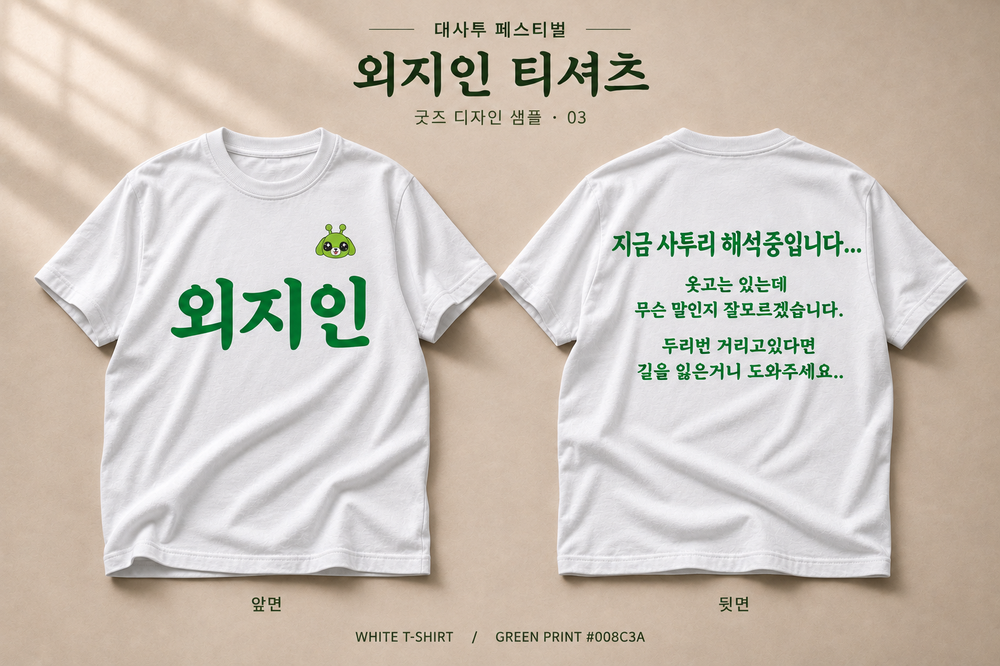

# 외지몽 외지인 티셔츠 디자인시트

상품 v03 / 문서 v01 · 2026-11-18 · ID D-03-06-OJ-WHT-03

## 1. 기준 상품이미지



- 기준 파일: 외지인_티셔츠_화이트_원페이지_v03.png
- SHA-256: `1331753a0ff8ea9f4f8bcb03ec554aff84c3c82504a747b47ecd8255854bd5a0`
- 1536×1024 px, 앞면 왼쪽·뒷면 오른쪽.
- 흰색 티셔츠 / 글자 #008C3A, RGB(0, 140, 58).
- 페이지 편집 문구는 옷 프린트가 아니다.

## 2. 문구 원문

앞면: **외지인** (한 줄, 테두리 없음)

뒷면은 아래 빈 줄·줄바꿈 포함 그대로 쓴다.

```text
지금 사투리 해석중입니다...

웃고는 있는데
무슨 말인지 잘모르겠습니다.

두리번 거리고있다면
길을 잃은거니 도와주세요..
```

## 3. 캐릭터

둥근 초록색 강아지 머리. 머리 좌우로 아래로 처진 둥근 귀 2개. 머리 위로 짧은 막대 더듬이 2개, 끝은 둥근 공. 큰 검정 눈 2개에 밝은 별 하이라이트. 크림색 타원형 주둥이, 작은 검정 코, 웃는 입과 붉은 혀. 목·몸·꼬리는 넣지 않는다. 고양이의 뾰족한 귀로 바꾸지 않는다.

얼굴은 착용자 왼쪽 가슴, 화면 오른쪽 위. 얼굴 내부 원래 색을 유지한다. 자수·패치·단색 로고로 바꾸지 않는다. 목·몸은 포함하지 않는다.

## 4. 좌표와 크기

1536×1024 원본의 몸판 프레임: 앞면 (165,198)~(660,888), 뒷면 (860,198)~(1365,888). u=중심x, v=상단y, w=폭, h=높이를 해당 몸판 폭·높이로 나눈 비율. 원점은 좌상단. 육안 근사 관찰값이며 재단 실측이 아니다.

| 요소 | 중심 u / 상단 v | 폭 w / 높이 h | 56×72cm 환산 [제안] |
| --- | --- | --- | --- |
| F1 글자 | 0.506 / 0.326 | 0.624 / 0.165 | 폭 350 × 높이 119mm / 상단 235mm |
| F2 얼굴 | 0.711 / 0.212 | 0.125 / 0.078 | 폭 70 × 높이 56mm / 상단 152mm |
| B1 | 0.541 / 0.226 | 0.768 / 0.059 | 폭 430 × 높이 43mm / 상단 163mm |
| B2 | 0.545 / 0.328 | 0.325 / 0.041 | 폭 182 × 높이 29mm / 상단 236mm |
| B3 | 0.543 / 0.384 | 0.634 / 0.042 | 폭 355 × 높이 30mm / 상단 277mm |
| B4 | 0.550 / 0.464 | 0.479 / 0.041 | 폭 268 × 높이 29mm / 상단 334mm |
| B5 | 0.549 / 0.520 | 0.634 / 0.043 | 폭 355 × 높이 31mm / 상단 375mm |

56×72cm 환산은 L 시제품에 새로 제안한 값이며 확정 생산 규격이 아니다. 중심·상단의 이미지 목표 허용범위 ±0.015, 크기 ±3%. 소매와 바닥은 몸판 프레임에서 제외한다.

## 5. 타이포그래피

폰트 파일과 이름은 미확인. 원본의 둥글고 굵은 손글씨 획을 보존한다. 일반 고딕체로 교체하지 않는다. 문서의 본문용 글꼴은 제품 인쇄용 글꼴이 아니다. 정확한 재사용에는 글자 윤곽 트레이싱/원본 레이어 확정이 필요하다. 최신 이미지의 얼굴 비율이 과거 프롬프트의 4cm 지시보다 우선한다.

## 6. 렌더링

실제 면 저지 질감·봉제·리브·이중 밑단, 자연스러운 주름, 베이지 바닥, 좌상단 확산광, 수직 탑뷰. 전체 셔츠를 표시한다. 인쇄는 무광이며 원단 주름을 따른다.

## 7. 보존과 제외

옷 바탕·문구·줄바꿈·얼굴·인쇄색·배치를 유지한다. 타원·배지·가슴 포켓·전신 캐릭터·자수·행거·인물·새 슬로건은 넣지 않는다.

픽셀 단위 동일성은 새 생성으로 보장되지 않는다. 같은 픽셀은 원본 이미지 재사용, 인쇄 정밀성은 확정 아트워크 재사용으로 확보한다.
