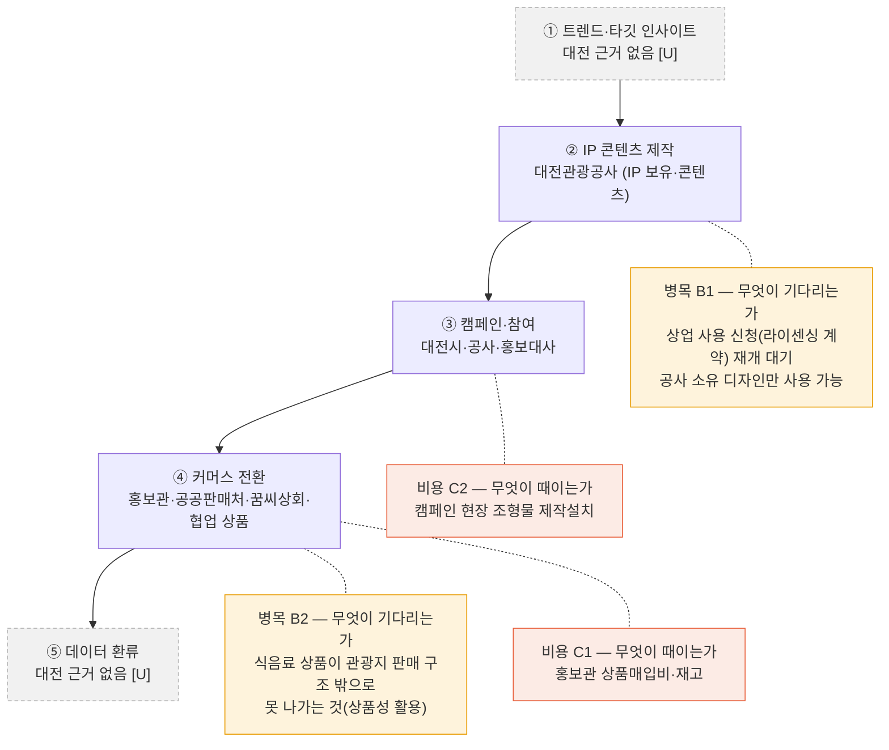
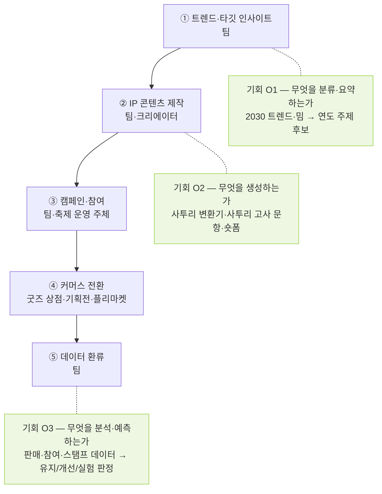

# 단계별 분석 — 병목 · 비용 · 기회 세 렌즈 (analysis_v01)

> 작성 2026-11-08 · 틀: 그려 놓은 체인을 단계마다 세 질문으로 훑어 마커를 붙이는 방법. 병목은 비용을 만들고, 비용이 큰 곳은 기회예요. 체인은 팀 5단계(① 트렌드·타깃 인사이트 → ② IP 콘텐츠 제작 → ③ 캠페인·참여 → ④ 커머스 전환 → ⑤ 데이터 환류).
> 근거: [onepager.md](../onepager.md), [flows_mermaid_v01.md](flows_mermaid_v01.md), [stakeholders_v01.md](stakeholders_v01.md), `../sources/`(출처 번호는 `sources/sources.md` 기준, 7은 `local_candidates_v05.md`의 S번호, 8은 팀 문서 `life_메인-v01.md`)
> 라벨: **[F]** 원문 사실 · **[I]** 해석·가설 · **[U]** 미확인. 숫자는 공시·기사에서 확인된 것만 원문 표기로 적었고 추정 금액은 쓰지 않았어요. 아래 Mermaid 코드 2개는 Mermaid 10.9.1로 렌더링해 문법 오류가 없는 것을 확인했어요.

## 1. 세 렌즈 (이미지 규칙)

| | 병목 BOTTLENECK | 비용 COST | 기회 OPPORTUNITY |
|---|---|---|---|
| 한 줄 | 흐름이 막히거나 느려지는 곳 | 돈과 시간이 가장 많이 새는 곳 | AI·자동화·데이터로 바꿀 수 있는 곳 |
| 정의 | 상품·정보·결정이 다음 단계로 넘어가지 못하고 기다리는 지점 | 단계 안에서 또는 단계 사이에서 떼이는 비용(수수료·인건비·재고·반품·폐기) | 병목을 풀거나 비용을 줄이거나 새 가치를 더할 수 있는 지점 |
| 신호 | 대기·재입력·수작업 반복·품질 편차·승인 지연·한 사람에게 몰림 | 중간 차감이 여러 번, 재고·반품이 쌓임, 사람 손이 많이 감 | 재입력 자동화·분류·추천·예측·생성(콘텐츠·이미지)·모니터링·알림 |
| 질문 | 이 단계가 하루 멈추면 뒤 단계가 어떻게 되는가 | 이 비용은 가치를 더하는가, 단지 마찰인가 | 우리 팀 자산(IP·데이터)과 Claude Code로 11/16 MVP까지 구현 가능한가 |
| 근거 | 최근 동향(지연·품질·오배송 보도), 리뷰 분석의 불만 키워드 | 원페이지 '얼마나 들어' 칸, 공시의 주요 비용 항목(수치는 원문만) | 데이터 흐름 중의 비대칭, Local 페르소나의 불편 |
| 표시 | 주황 테두리, 라벨은 "무엇이 기다리는가" | 코랄 테두리, 라벨은 "무엇이 때이는가" | 라임 배경, 라벨은 "무엇을 자동화·생성·예측하는가" |

**규칙**: 마커는 단계당 최대 2개, 전체 체인에 병목 2 · 비용 2 · 기회 3 이내. 마커마다 "왜(근거) + 출처 번호" 한 줄을 아래 2장에 기록했어요. 마커는 에이전트의 생성·추천 판단 규칙, 대시보드의 감시·알림 규칙 후보가 돼요(3장).

**어느 체인에 붙였나** (선택하신 대로): 병목·비용은 **대전 꿈돌이 as-is**(근거가 있는 쪽), 기회는 **우리 대키미·외지몽 to-be**(우리 팀 자산 기준, 모두 가설 [I]).

## 2. 마커 목록 — 마커마다 왜(근거) + 출처 한 줄

| ID | 렌즈 | 단계 | 마커(무엇이) | 왜(근거) + 출처 | 상태 |
|---|---|---|---|---|---|
| B1 | 병목 | ② IP 콘텐츠 제작 | **무엇이 기다리는가**: 상업 사용 신청(라이센싱 계약) 재개 | 공사 사이트가 "상업적 사용 신청 서비스는 2026. 4. 6.부터 재개될 예정"이라고 적고(신청이 멈춰 있던 구간), 상업 사용은 공사 소유 디자인에 한하고 민간 개발 디자인은 불가함 [출처 1]. 2026-11-05에 읽을 때도 문구가 "재개 예정"이라 **재개 여부는 [U]** | [F] 문구 · [U] 재개 여부 |
| B2 | 병목 | ④ 커머스 전환 | **무엇이 기다리는가**: 식음료 상품이 관광지 중심 판매 구조 밖으로 나가지 못하는 것(상품성 활용) | 시는 상품별 성과 차이의 원인을 유통 구조에서 찾고(라면은 전국 판매 가능, 식음료는 관광지 중심 판매 구조), 외부는 명품 김·누룽지 등 일부 식음료가 기대에 못 미쳤다고 분석함(주체 불특정) [출처 9]. 컵라면은 대전에서만 구매 가능한 오프라인 한정판 [출처 13] | [F] 시 측 설명·외부 분석 |
| C1 | 비용 | ④ 커머스 전환 | **무엇이 때이는가**: 홍보관 상품 매입·재고 | 홍보관 상품매입비 결산 707,339,875원(예산 합계 708,000,000원), 재고 기말 잔액 180,685,548원(전기이월 160,189,305원) [출처 2]. 매입은 판매 상품의 원가라 가치를 더하는 쪽이고, 재고 잔액이 전기이월보다 늘었다는 점이 마찰 신호 [I]. 반품·폐기 내역은 [U] | [F] 수치 · [I] 판단 · [U] 반품·폐기 |
| C2 | 비용 | ③ 캠페인·참여 | **무엇이 때이는가**: 캠페인 현장 조형물 제작설치 | 꿈돌이 조형물 제작설치 2025 예산 집행액 40,300,000원+17,355,000원(금액 열은 36,636,364원+15,777,273원) [출처 2]. 방문객 216만 명(잠정, 0시 축제) 접점이 되지만 조형물이 매출·참여로 이어졌는지는 근거가 없어 가치인지 마찰인지 판단 불가 [출처 7, S1] [I] | [F] 수치 · [U] 효과 |
| O1 | 기회 | ① 트렌드·타깃 인사이트 | **무엇을 분류·요약하는가**: 2030 트렌드·밈 조사 → 연도 주제 후보 | 대전은 이 단계 근거가 없어 비어 있고(원페이지에 활동 없음), 우리 팀 추천안의 ① 활동이 "2030 트렌드·밈 조사, 타깃 정의, 연도 주제·핵심 메시지 설정" [팀 추천안]. 페르소나(20~30대·숏폼·테스트형 콘텐츠 공유) [출처 8] | [I] |
| O2 | 기회 | ② IP 콘텐츠 제작 | **무엇을 생성하는가**: 사투리 변환기·사투리 고사 문항·숏폼 | 팀 자산 = 마스터 프롬프트 1개 + 작업별 프롬프트 5개(축제 기획·이미지·영상·굿즈·SNS)와 IP 가이드 [출처 8]. 팀 추천안 ②가 "숏폼, 사투리 고사·변환기". 사투리를 처음 접하는 사람이 겪는 낯섦이 페르소나의 불편 [출처 8] | [I] |
| O3 | 기회 | ⑤ 데이터 환류 | **무엇을 분석·예측하는가**: 판매·참여·스탬프 데이터 → 유지/개선/실험 판정 | 데이터 흐름의 비대칭: 대전은 판매 결과가 공사 결산에만 남고 앞 단계로 되돌리는 체계·전담 조직이 없다는 지적, 단계별 전환 수치 비공개 [출처 9] [출처 10] [출처 11]. 우리는 측정 지표(응시자·인증 수·스탬프 완주율·재구매율·알림 신청 수)를 이미 정의 [출처 8], 후보 지표는 `../dashboard_산업지표후보.md` | [I] |

### 단계 × 렌즈 한눈에

| 단계 | 병목 | 비용 | 기회 | 단계당 마커 수 |
|---|---|---|---|---|
| ① 트렌드·타깃 인사이트 | [U] 대전 근거 없음 | [U] 대전 근거 없음 | **O1** | 1 |
| ② IP 콘텐츠 제작 | **B1** | [U] IP 수수료 금액·수수료율 없음 [출처 10] | **O2** | 2 |
| ③ 캠페인·참여 | [U] 참여·모집 대기 근거 없음 | **C2** | (후보: 참여·스탬프 모니터링·알림 — 상한 3개 때문에 선택 안 함) | 1 |
| ④ 커머스 전환 | **B2** | **C1** | — | 2 |
| ⑤ 데이터 환류 | [U] 대전 근거 없음 | [U] 대전 근거 없음 | **O3** | 1 |
| 합계 | 2 | 2 | 3 | 단계당 최대 2 ✓ |

## 3. 마커 체인 그림

### 3-1. 대전 꿈돌이 (as-is) — 병목 B1·B2, 비용 C1·C2

### 3-2. 대키미·외지몽 (to-be, 가설) — 기회 O1·O2·O3

### 3-3. 마커 → 에이전트·대시보드 규칙 후보 `[I]`

| 마커 | 에이전트 판단 규칙 후보 | 대시보드 규칙 후보 |
|---|---|---|
| B1 상업 사용 신청 재개 대기 | 라이센싱 계약 요청이 들어오면 신청 서비스 상태를 먼저 확인하고 대기 상태면 알림 | 신청 서비스 상태·대기 건수 감시 |
| B2 식음료 판매 구조 | 신규 식음료 협업 상품 제안 시 판매처가 관광지 한정인지 먼저 점검 | 상품군별 판매처 범위 표시(수치는 확보 후) |
| C1 홍보관 매입·재고 | 매입 제안 시 전기 대비 재고 증감을 함께 제시 | 매입비·재고 잔액 카드(결산 기준) |
| C2 조형물 제작설치 | 조형물 비용 제안 시 참여·매출 연결 근거가 있는지 질의 | 조형물 비용 ↔ 방문·참여 지표 병기 |
| O1·O2·O3 | 트렌드 분류·요약, 사투리 변환·고사 문항 생성, 데이터 분석·판정을 생성·추천 규칙으로 | 판정 결과를 감시·알림 임계치로 연결 |

## 4. 기회 3개의 구현 가능성 (11/16 MVP) `[I]`

> 11/16 MVP의 범위는 받은 정보가 없어서 **[U]**예요. 아래는 팀 자산과 Claude Code로 만들 수 있는지에 대한 가설이고, MVP 범위가 정해지면 우선순위를 다시 정해요.

| 기회 | 구현 가능성(가설) | 필요한 입력 | 막히는 점 |
|---|---|---|---|
| O2 사투리 변환기·사투리 고사·숏폼 생성 | 가장 가까움: 프롬프트 6개 자산이 이미 있음 [출처 8] | 대키미·외지몽 IP 가이드, 사투리 표현 자료 | 사투리 정확도 검수 기준 [U], 숏폼 제작 도구 [U] |
| O1 트렌드·밈 조사 분류·요약 | 분류·요약은 가능하나 데이터 수집원이 없음 | 트렌드·밈 데이터(수집 경로 미정) | 수집원·수집 방법 [U] |
| O3 판매·참여 데이터 분석·판정 대시보드 | 지표 정의는 있음 [출처 8], 데이터는 행사 이후에야 생김 | 판매·참여·스탬프 로그 | 축제 전에는 실데이터가 없어 샘플 데이터로만 시연 가능 [I] |

## 5. 근거를 못 구한 것 `[U]`

| 항목 | 이유 | 영향 |
|---|---|---|
| 지연·품질·오배송 보도, 리뷰 분석의 불만 키워드 | 대전 꿈돌이 자료에 리뷰·배송 데이터가 없음 | 병목 근거는 시 측 설명·외부 분석·공사 사이트 문구로 대신함 |
| 상업 사용 신청 서비스의 실제 재개 여부 | 공사 사이트 문구가 2026-11-05에도 "재개 예정" | B1이 현재도 유효한지 불명 |
| 홍보관 반품·폐기 내역, 조형물의 매출 효과 | 결산서에 항목이 없음 | C1·C2의 "가치인가 마찰인가" 판단이 약함 |
| 11/16 MVP 범위 | 받은 정보 없음 | 기회 우선순위 |
| 병목 B2 선택 해석 | 선택하신 문구 "축제 마스코트 캐릭터의 디자인성과 상품성을 활용할 수 있는 것"을 B1(디자인 한정 규정)과 B2(상품성: 식음료 판매 편차)로 나눠 읽음 | 해석이 다르면 B2를 바꿔요 |

## 6. 규칙 점검

| 규칙 | 상태 |
|---|---|
| 마커는 단계당 최대 2개 | 충족 (② 2개, ④ 2개, 나머지 1개) |
| 전체 병목 2 · 비용 2 · 기회 3 이내 | 충족 (2 · 2 · 3) |
| 마커마다 "왜(근거) + 출처 번호" 한 줄 | 충족 (2장) |
| 숫자는 원문 확인분만, 추정 금액 금지 | 충족 (수치는 `sources/02`·기사 원문 표기) |
| 표시: 병목 주황 · 비용 코랄 · 기회 라임 | 충족 (`classDef` 3종, 마커 라벨 포함) |

## 7. 기회 포인트 우선순위 — 영향 × 실현 가능성 (2026-11-08)

> 기회 마커가 셋(O1·O2·O3)이라 어느 것을 11/10 AX 기회·11/12 spec.md로 가져갈지 고르는 표예요. **11/16 MVP 범위와 팀 인원·도구 제약을 아직 몰라서 아래 점수는 가정 위에서 매긴 가설 `[I]`**이고, 팀과 맞춰 보며 고쳐야 해요.

### 7-1. 가정 (점수의 바탕)

| # | 가정 | 상태 |
|---|---|---|
| A1 | 11/16 MVP의 범위 | **[U] 받은 정보 없음** — 그래서 "11/16까지 구현 가능"은 작은 범위(문서·텍스트·샘플 데이터 수준)로 가정 |
| A2 | 팀 3~4인 | [I] 이미지의 "흔한 실수" 문구 기준(팀 3~4인), 실제 인원은 [U] |
| A3 | 무료 툴과 Claude Code로 만든다 | [I] 이미지 규칙 기준 |
| A4 | 축제 전에는 실제 판매·참여 데이터가 없다 | [I] 축제는 2027-08-20~22 예정 [출처 8] |

### 7-2. 점수 매기기 (각 1~3, 기준 3개씩)

- **영향**: ① 몇 단계에 걸치는가 ② 돈 흐름의 큰 차감을 건드리는가 ③ Local 페르소나의 불편과 직결되는가
- **실현 가능성**: ① 필요한 데이터가 팀에 있거나 공개 자료로 가능한가 ② Claude Code + 무료 툴로 가능한가 ③ 외부 파트너 없이 시작할 수 있는가
- 합계 6 이상이면 "높음", 5 이하면 "낮음".

| 기회 | 영향 ①②③ | 영향 합 | 실현 ①②③ | 실현 합 | 사분면 |
|---|---|---|---|---|---|
| **O2** 사투리 변환기·사투리 고사·숏폼 생성 | 2 · 2 · 3 | **7 (높음)** | 3 · 2 · 2 | **7 (높음)** | **먼저 간다** |
| **O3** 판매·참여 데이터 분석·판정 대시보드 | 3 · 2 · 1 | **6 (높음)** | 1 · 3 · 1 | **5 (낮음)** | 큰 기회·지금은 어려움 |
| **O1** 트렌드·밈 조사 분류·요약 | 1 · 1 · 1 | **3 (낮음)** | 1 · 2 · 2 | **5 (낮음)** | 보류 |

### 7-3. 점수 이유 (한 줄씩)

| 기회 | 영향 이유 | 실현 이유 |
|---|---|---|
| O2 | ① ②에서 시작해 ③ 사투리 고사·참여로 이어짐(2). ② 협찬·브랜디드 콘텐츠와 제작비 절감은 가설이라 큰 차감을 건드리진 않음(2). ③ 사투리를 처음 접하는 사람의 낯섦이 페르소나의 불편과 직결(3) [출처 8] [팀 추천안] | ① 프롬프트 6개 + IP 가이드가 이미 있음(3) [출처 8]. ② 텍스트 변환·문항 생성은 가능하지만 숏폼 영상 제작 도구는 [U](2). ③ 사투리 정확도 검수 기준이 [U]라 팀 내 검수로 시작(2) |
| O3 | ① ④ 커머스 전환·⑤ 환류·① 연도 주제까지 되돌림이 걸침(3). ② 데이터 기반 라이선싱·제휴 수익과 수수료 차감 가시화(2) [팀 추천안]. ③ 페르소나가 직접 느끼는 불편은 아님(1) | ① 지표 정의만 있고 실데이터는 축제 이후에야 생김(1) [출처 8]. ② 대시보드·샘플 데이터 시연은 가능(3). ③ 데이터가 판매 채널·운영 주체(미정)에 의존해 외부 없이 시작 불가(1) |
| O1 | ① ① 한 단계, 연도 주제만 간접(1). ② ① 단계는 직접 수익 없는 투자 단계(1) [팀 추천안]. ③ 타깃 맞춤으로 간접만(1) | ① 트렌드·밈 수집원이 [U](1). ② 분류·요약은 가능(2). ③ 수집은 공개 자료 수동으로 시작 가능(2) |

### 7-4. 사분면 배치

| | **실현 가능성 낮음(≤5)** | **실현 가능성 높음(≥6)** |
|---|---|---|
| **영향 높음(≥6)** | **큰 기회·지금은 어려움**: O3 — 데이터·파트너 확보 뒤 재검토, 11/18 피칭의 '다음 단계'로 | **먼저 간다**: **O2** — 11/10 AX 기회 → spec.md, 11/16 MVP 후보 |
| **영향 낮음(≤5)** | **보류**: O1 — 지도에는 남기지 않고 근거만 이 파일에 둠 | 빠른 성과·연습용: 해당 없음 |

### 7-5. 우선 기회 `[I]`

- **우선 기회 = O2 사투리 변환기·사투리 고사·숏폼 생성** (영향 7 · 실현 7). 크리에이티브 트랙은 브랜드 스킬 기반 생성·추천이 "먼저 간다" 칸에 자주 오는데 이번에도 같은 결과예요.
- **O3**은 영향은 높지만 축제 전에는 실데이터가 없어서 "다음 단계"로 두었고, 돈·데이터 후보를 붙일 때는 O2의 데이터 이름(응시자·변환 횟수·공유 같은 후보)을 먼저 정의해 두면 O3로 이어져요.
- **O1(보류)** 처리: 이미지 규칙은 "지도에는 남기지 않고 근거만 기록"이에요. 3-2의 to-be 그림과 2장 마커 표에서 O1을 뺄지는 팀 확인 후에 바꾸기로 하고 **이번에는 그림·표를 고치지 않았어요**(기회 3개 상태 그대로).

### 7-6. 흔한 실수 점검

| 실수 | 점검 |
|---|---|
| 영향만 보고 큰 기회를 고름 | 영향이 가장 컸던 O2·O3 중 O3는 실현 가능성이 낮아 우선에서 뺌 ✓ |
| 11/16 MVP 일정·팀 3~4인·무료 툴 제약을 무시 | 가정 A1~A3로 명시, 범위가 정해지면 점수 재조정 ✓ (A1은 [U]) |
| '먼저 간다' 칸을 채울 것 | O2 1개 ✓ |

### 7-7. 다음에 필요한 것

| # | 필요한 정보 | 쓰임 |
|---|---|---|
| 1 | 11/16 MVP 범위 | 실현 가능성 점수(특히 O2 ②, O3 ①) 재조정 |
| 2 | 팀 인원·역할, 사용 가능한 무료 툴 | 실현 가능성 ②③ |
| 3 | 사투리 정확도 검수 방법 | O2 실현 ③ |
| 4 | O1 보류를 지도에서 뺄지 결정 | 3-2 그림·2장 표 수정 여부 |
