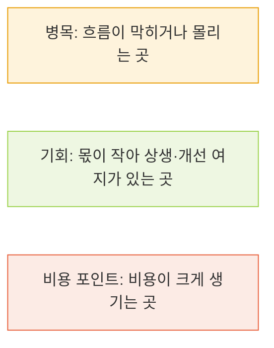
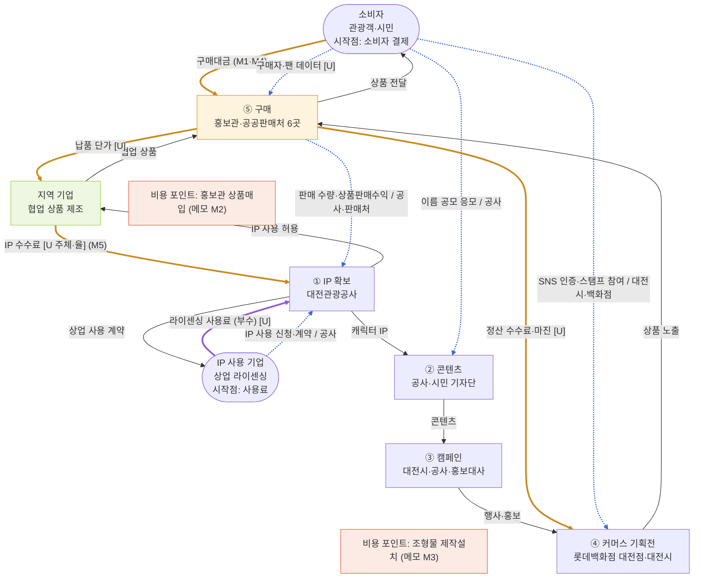
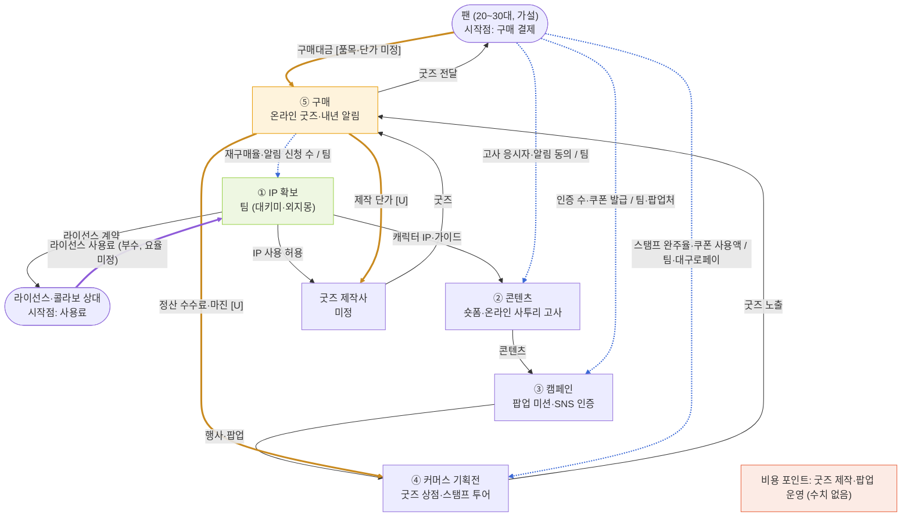

# 세 흐름 겹쳐 그리기 — 표기 약속 + Mermaid v0 (대전 꿈돌이 as-is · 우리 to-be)

> 작성 2026-11-06 · 근거: [onepager.md](../onepager.md), [activities_v0.md](activities_v0.md), [stakeholder_map_v0.md](stakeholder_map_v0.md), `sources/`(출처 번호는 `sources/sources.md` 기준, 7은 `local_candidates_v05.md`의 S번호, 8은 팀 문서 `life_메인-v01.md`)
> 라벨: **[F]** 원문 사실 · **[I]** 해석·가설 · **[U]** 미확인. 이 파일의 Mermaid 코드는 렌더링해 문법 오류가 없음을 확인했어요(GitHub·VS Code Mermaid 미리보기에서 그림으로 보여요).

## 1. 표기 약속 — 상품은 앞으로, 돈은 뒤로, 데이터는 양쪽으로

| 흐름 | 방향 | Mermaid 표기 | 라벨에 적는 것 | 모양 |
|---|---|---|---|---|
| 상품·활동 | 앞으로 (원천 → 소비자) | `A --> B` | 무엇이 넘어가는지(상품·IP·콘텐츠) | 실선 |
| 돈 | 뒤로 (소비자 → 원천) | `B ==> A` | **수수료·정산 항목 이름**(금액은 쓰지 않음) | 굵은 선(주황) |
| 데이터 | 양쪽 | `B -.-> A` | **데이터 이름 / 보유자** | 점선(파랑) |
| 부수 흐름 | 본류와 별도 수익(멤버십·구독·광고·굿즈·라이선스) | `==>` + 다른 색 | 별도 수익 이름 | 굵은 선(보라) |

**병목·기회·비용 마커** (`classDef`):

**돈 흐름을 읽는 순서** (이미지 규칙):
1. **시작점**: 소비자 결제·고객사 대금·광고주 집행비·라이선스 사용료 중 무엇인지 먼저 표시 → 노드 이름에 "시작점"을 적었어요.
2. **중간 차감**: 플랫폼 수수료·결제 수수료·물류비·대행 수수료·제작비·납품 단가 → 선 라벨에 항목 이름만 적고 값은 `[U]`.
3. **끝점**: 원천(생산자·IP 보유자)에 남는 몫. 작을수록 '상생' 기회 포인트 → 기회 마커.
4. **부수 흐름**은 다른 색(보라)으로.
5. **적지 않는 것**: 금액·비용은 **공시에서 확인된 수치만 아래 '메모란'에** 쓰고, 그림에는 쓰지 않아요. 추정 금액은 쓰지 않아요.

## 2. 대전 꿈돌이 (as-is)

단계 이름은 팀 밸류체인 5단계(① IP 확보 → ② 콘텐츠 → ③ 캠페인 → ④ 커머스 기획전 → ⑤ 구매)예요. 세로(TB) 레이아웃이라 그려진 위치는 화살표에 맞춰 자동 배치되고, 순서는 노드 앞 번호를 따라 읽어 주세요.

- 마커: ⑤ 구매 = 병목(시 측 설명: 식음료는 관광지 중심 판매 구조에 묶임 [출처 9]), 지역 기업 = 기회(시가 "지역업체와 상생 모델"로 설명 [출처 10], 해석 [I]), 비용 포인트 2곳(금액은 메모란).
- 시작점 2개: 소비자 결제(본류), IP 사용 기업의 라이센싱 사용료(부수 흐름, 보라).

### 메모란 — 공시·기사로 확인된 수치만 (추정 없음)

| 메모 | 값(원문 표기) | 기준 | 출처 |
|---|---|---|---|
| M1 | 상품판매수익 1,085,425,261원 | 2025 공사 결산(재무제표(A) 열) | [출처 2] |
| M2 | 홍보관 상품매입비 결산 707,339,875원 | 2025 | [출처 2] |
| M3 | 조형물 제작설치 예산 집행액 40,300,000원+17,355,000원 | 2025 | [출처 2] |
| M4 | 협업 상품 7종 6개월 23억 원 (시 측 설명) | 2025-12 보도 | [출처 10] |
| M5 | 관광공사 IP 수수료 등 수익 3배 증가 (시 측 설명, **금액·수수료율·지급 주체 없음**) | 2025-12 보도 | [출처 10] |

- 위 외의 금액·비용·수수료율은 그림과 메모란에 쓰지 않았어요. 수수료율·납품 단가·정산 조건은 `[U]`예요.

### 선·노드 근거표 (대전)

| 구분 | 선·노드 | 근거 원페이지 칸 | 출처 | 상태 |
|---|---|---|---|---|
| 상품 | ① IP → ② 콘텐츠 → ③ 캠페인 → ④ 커머스 기획전 → ⑤ 구매 | 2-A | [출처 6] [출처 5] [출처 4] [출처 7, S4] [출처 11] [출처 1] | [F] |
| 상품 | ⑤ 구매 → 소비자 상품 전달 | 2장 ③ | [출처 1] [출처 7, S2] | [F] |
| 상품 | IP → 지역 기업(IP 사용 허용) → ⑤ 구매(협업 상품) | 2장 ⑤, 3장 | [출처 7, S3·S4] | [F] |
| 상품 | IP → IP 사용 기업(상업 사용 계약) | 2-A ① | [출처 1] | [F] |
| 돈 | 소비자 ⇒ ⑤ 구매 (구매대금) | 2장 ④ | [출처 2] [출처 10] | [F] 메모 M1·M4 |
| 돈 | ⑤ 구매 ⇒ 지역 기업 (납품 단가) | 2장 ⑤ [U] | — | [U] 값·구조 없음 |
| 돈 | 지역 기업 ⇒ IP (IP 수수료) | 5-A 이슈 1 | [출처 10] | [U] 지급 주체·율 없음, 방향은 [I] |
| 돈 | ⑤ 구매 ⇒ ④ 기획전 (정산 수수료·마진) | 4-A, 5-A 이슈 3 | [출처 11] | [U] 정산 조건 없음 |
| 부수 | IP 사용 기업 ⇒ IP (라이센싱 사용료) | 2-A ① | [출처 1] | [U] 사용료율 없음 |
| 데이터 | 소비자 -.-> ④ (SNS 인증·스탬프 투어 / 대전시·백화점) | 2-A ④ | [출처 11] | [F] |
| 데이터 | 소비자 -.-> ② (이름 공모 응모 / 공사) | 4장 | [출처 6] | [F] |
| 데이터 | 소비자 -.-> ⑤ (구매자·팬 데이터) | 2장 ③ [U] | [출처 1] | [U] 앱·멤버십 확인 안 됨 |
| 데이터 | ⑤ -.-> ① (판매 수량·상품판매수익 / 공사·판매처) | 2장 ④ | [출처 2] [출처 10] | [F] 공사 결산·시 설명. 기획에 되돌려 쓴다는 공개 근거는 [U] |
| 데이터 | IP 사용 기업 -.-> ① (IP 사용 신청·계약 / 공사) | 2-A ① | [출처 1] | [F] |
| 마커 | ⑤ 구매 = 병목 | 5-A 이슈 2 | [출처 9] | [F] 시 측 설명 |
| 마커 | 지역 기업 = 기회 | 5-A 이슈 2 | [출처 10] | [I] |
| 마커 | 비용 포인트 2곳 | 2장 ⑥ | [출처 2] | [F] 메모 M2·M3 |

## 3. 대키미·외지몽 (to-be, 가설) — 모두 [I], 출처 [출처 8]

- [I] 시작점: 팬의 구매 결제(본류), 라이선스·콜라보 상대의 사용료(부수, 보라). 지역 소상공인은 무료·외부는 유료이고 요율은 미정이에요. [출처 8]
- [I] 마커는 모두 가설이에요: ⑤ 구매 = 병목(판매 채널이 아직 미정), IP 확보 = 기회(IP를 팀이 직접 보유해 끝점 몫이 남는 구조), 비용 포인트 = 굿즈 제작·팝업 운영(수치 없음).
- [I] 데이터는 ① 퍼널 측정 지표를 그대로 옮겼고(응시자 명단·인증 수·스탬프 완주율·재구매율·알림 신청 수), ⑤ → ① 되돌림은 "내년 알림 신청이 다음 해 콘텐츠로 이어진다"는 구조예요. [출처 8]
- **메모란: 확인된 수치 없음.** to-be에는 금액·비용을 쓰지 않았어요(품목·단가 미정).

## 4. 읽는 법·한계

- 이 그림은 개념도예요. 실측 데이터가 아니고, 대전 쪽 돈 흐름은 수수료·납품 단가·정산이 `[U]`라 **누가 얼마를 떼는지는 아직 그릴 수 없어요**. 추정 순서만 `stakeholder_map_v0.md` 2-3장에 [I]로 있어요.
- 선 라벨의 `[U]`는 "항목은 있는데 값이 없다"는 뜻이에요. 자료가 생기면 `[U]`를 지우고 메모란에 수치를 추가해요.
- 병목·기회·비용 마커는 근거 수준이 달라요: 대전 병목은 시 측 설명([F]), 기회는 해석([I]), 비용은 결산서([F]).
