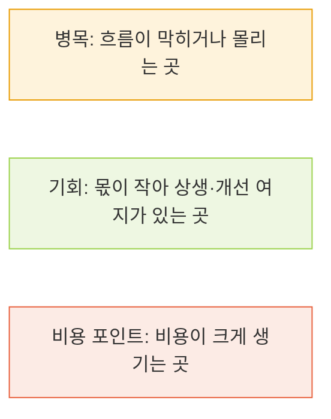
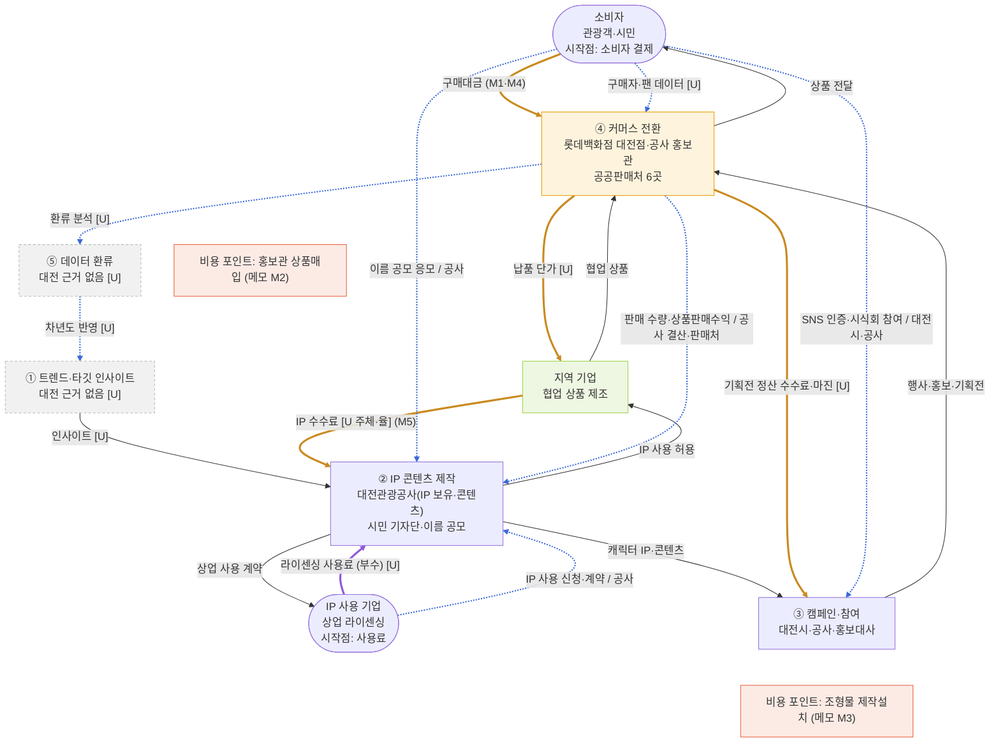
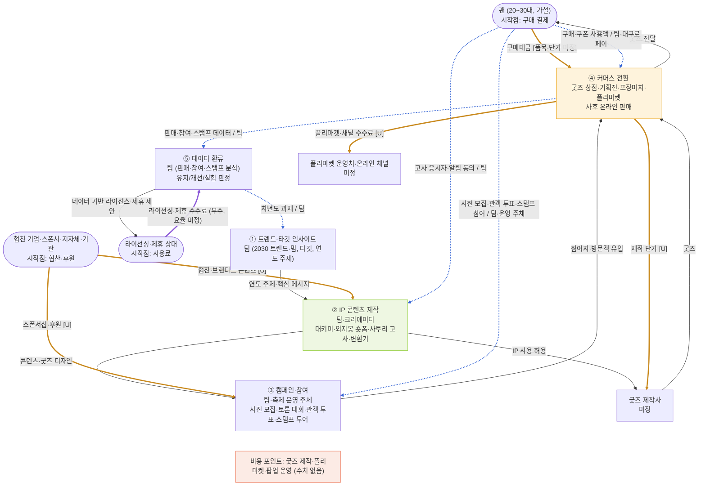

# 세 흐름 겹쳐 그리기 — 표기 약속 + Mermaid v01 (대전 꿈돌이 as-is · 우리 to-be)

> 작성 2026-11-06 · v0(`flows_mermaid_v0.md`)를 **우리 to-be의 새 5단계**(트렌드·타깃 인사이트 → IP 콘텐츠 제작 → 캠페인·참여 → 커머스 전환 → 데이터 환류)에 맞춰 개정한 판이에요. 근거: [onepager.md](../onepager.md), [activities_v0.md](activities_v0.md), [stakeholder_map_v01.md](stakeholder_map_v01.md), [valuechain_diagram_v01.html](valuechain_diagram_v01.html), `sources/`(출처 번호는 `sources/sources.md` 기준, 7은 `local_candidates_v05.md`의 S번호, 8은 팀 문서 `life_메인-v01.md`)
> 라벨: **[F]** 원문 사실 · **[I]** 해석·가설 · **[U]** 미확인 · **[팀 추천안]** 팀이 정한 추천 5단계 표. 이 파일의 Mermaid 코드 2개는 Mermaid 10.9.1로 렌더링해 문법 오류가 없고 선·노드가 그려지는 것을 확인했어요(GitHub·VS Code Mermaid 미리보기에서 그림으로 보여요).

## v0에서 달라진 점

| # | v0 | v01 |
|---|---|---|
| 1 | 단계 = IP 확보 → 콘텐츠 → 캠페인 → 커머스 기획전 → 구매 | **새 5단계**. 대전은 가장 가까운 단계에 연결(IP+콘텐츠 → ②, 기획전+구매 → ④), ① 인사이트와 ⑤ 환류는 대전 근거 없음 [U]라 회색 점선 노드(`gap`)로 표시 |
| 2 | 우리 to-be 돈 흐름이 구매·정산·사용료 3개 | 팀 추천안의 수익 포인트를 반영: 협찬(②)·스폰서십(③)·굿즈 매출(④)·플리마켓 채널 수수료(④)·라이선싱·제휴(⑤) |
| 3 | 데이터 피드백이 ⑤ → ① 한 줄 | 새 ⑤ 데이터 환류 노드를 두고 ④ → ⑤ → ①(차년도 과제)로 연결 |
| 4 | `classDef` 3종 | 사용자 지정 3종(병목·기회·비용)을 그대로 쓰고, 근거 없는 단계 표시용 `gap` 1종만 추가 |

## 1. 표기 약속 — 상품은 앞으로, 돈은 뒤로, 데이터는 양쪽으로

| 흐름 | 방향 | Mermaid 표기 | 라벨에 적는 것 | 모양 |
|---|---|---|---|---|
| 상품·활동 | 앞으로 (원천 → 소비자) | `A --> B` | 무엇이 넘어가는지(상품·IP·콘텐츠) | 실선 |
| 돈 | 뒤로 (소비자 → 원천) | `B ==> A` | **수수료·정산 항목 이름**(금액은 쓰지 않음) | 굵은 선(주황) |
| 데이터 | 양쪽 | `B -.-> A` | **데이터 이름 / 보유자** | 점선(파랑) |
| 부수 흐름 | 본류와 별도 수익(멤버십·구독·광고·굿즈·라이선스) | `==>` + 다른 색 | 별도 수익 이름 | 굵은 선(보라) |

**병목·기회·비용 마커** (`classDef`, 사용자 지정 그대로):

**돈 흐름을 읽는 순서** (이미지 규칙):
1. **시작점**: 소비자 결제·고객사 대금·광고주 집행비·라이선스 사용료 중 무엇인지 먼저 표시 → 시작 노드 이름에 "시작점"을 적었어요(대전: 소비자 결제, IP 사용 기업 사용료 / 우리: 팬 구매 결제, 협찬·후원, 라이선싱·제휴 사용료).
2. **중간 차감**: 플랫폼 수수료·결제 수수료·물류비·대행 수수료·제작비·납품 단가 → 선 라벨에 항목 이름만 적고 값은 `[U]`.
3. **끝점**: 원천(생산자·IP 보유자)에 남는 몫. 작을수록 '상생' 기회 포인트 → 기회 마커(`opp`).
4. **부수 흐름**은 다른 색(보라)으로.
5. **적지 않는 것**: 금액·비용은 **공시에서 확인된 수치만 아래 '메모란'에** 쓰고, 그림에는 쓰지 않아요. 추정 금액은 쓰지 않아요.

## 2. 대전 꿈돌이 (as-is)

새 5단계 기준이라 대전의 IP 확보·콘텐츠가 ②에, 캠페인이 ③에, 기획전과 구매가 ④에 합쳐졌어요. ①과 ⑤는 대전 자료가 없어 회색 점선 노드예요. 세로(TB) 레이아웃이라 위치는 자동 배치되니 노드 앞 번호를 따라 읽어 주세요.

- 마커: ④ 커머스 전환 = 병목(시 측 설명: 식음료는 관광지 중심 판매 구조에 묶임 [출처 9]), 지역 기업 = 기회(시가 "지역업체와 상생 모델"로 설명 [출처 10], 해석 [I]), 비용 포인트 2곳(금액은 메모란).
- 시작점 2개: 소비자 결제(본류), IP 사용 기업의 라이센싱 사용료(부수 흐름, 보라).
- 회색 점선 노드(① 트렌드·타깃 인사이트, ⑤ 데이터 환류): 대전에서 하는 주체·데이터가 확인되지 않은 단계예요 [U]. ⑤ 쪽 선은 "환류 체계가 있는지 모른다"는 표시이고 존재를 뜻하지 않아요.

### 메모란 — 공시·기사로 확인된 수치만 (추정 없음)

| 메모 | 값(원문 표기) | 기준 | 출처 |
|---|---|---|---|
| M1 | 상품판매수익 1,085,425,261원 | 2025 공사 결산(재무제표(A) 열) | [출처 2] |
| M2 | 홍보관 상품매입비 결산 707,339,875원 | 2025 | [출처 2] |
| M3 | 조형물 제작설치 예산 집행액 40,300,000원+17,355,000원 | 2025 | [출처 2] |
| M4 | 협업 상품 7종 6개월 23억 원 (시 측 설명) | 2025-12 보도 | [출처 10] |
| M5 | 관광공사 IP 수수료 등 수익 3배 증가 (시 측 설명, **금액·수수료율·지급 주체 없음**) | 2025-12 보도 | [출처 10] |

- 위 외의 금액·비용·수수료율은 그림과 메모란에 쓰지 않았어요. 수수료율·납품 단가·정산 조건은 `[U]`예요.

### 선·노드 근거표 (대전)

| 구분 | 선·노드 | 근거 원페이지 칸 | 출처 | 상태 |
|---|---|---|---|---|
| 상품 | ① 인사이트 → ② 콘텐츠 | 근거 없음 | — | [U] |
| 상품 | ② IP 콘텐츠 제작 → ③ 캠페인·참여 → ④ 커머스 전환 | 2-A | [출처 6] [출처 5] [출처 4] [출처 7, S4] [출처 11] [출처 1] | [F] |
| 상품 | ④ → 소비자 상품 전달 | 2장 ③ | [출처 1] [출처 7, S2] | [F] |
| 상품 | ② IP → 지역 기업(IP 사용 허용) → ④(협업 상품) | 2장 ⑤, 3장 | [출처 7, S3·S4] | [F] |
| 상품 | ② IP → IP 사용 기업(상업 사용 계약) | 2-A ① | [출처 1] | [F] |
| 돈 | 소비자 ⇒ ④ (구매대금) | 2장 ④ | [출처 2] [출처 10] | [F] 메모 M1·M4 |
| 돈 | ④ ⇒ 지역 기업 (납품 단가) | 2장 ⑤ [U] | — | [U] 값·구조 없음 |
| 돈 | 지역 기업 ⇒ ② IP (IP 수수료) | 5-A 이슈 1 | [출처 10] | [U] 지급 주체·율 없음, 방향은 [I] |
| 돈 | ④ ⇒ ③ (기획전 정산 수수료·마진) | 4-A, 5-A 이슈 3 | [출처 11] | [U] 정산 조건 없음 |
| 부수 | IP 사용 기업 ⇒ ② IP (라이센싱 사용료) | 2-A ① | [출처 1] | [U] 사용료율 없음 |
| 데이터 | 소비자 -.-> ③ (SNS 인증·시식회 참여 / 대전시·공사) | 2-A ③·④ | [출처 11] [출처 13] | [F] |
| 데이터 | 소비자 -.-> ② (이름 공모 응모 / 공사) | 4장 | [출처 6] | [F] |
| 데이터 | 소비자 -.-> ④ (구매자·팬 데이터) | 2장 ③ [U] | [출처 1] | [U] 앱·멤버십 확인 안 됨 |
| 데이터 | ④ -.-> ② (판매 수량·상품판매수익 / 공사 결산·판매처) | 2장 ④ | [출처 2] [출처 10] | [F] 공사 결산·시 설명. 기획에 되돌려 쓴다는 공개 근거는 [U] |
| 데이터 | ④ -.-> ⑤ -.-> ① (환류 분석·차년도 반영) | 5-A 이슈 1 | [출처 9] | [U] 전담 조직·로드맵이 없다는 외부 지적(주체 불특정) |
| 데이터 | IP 사용 기업 -.-> ② (IP 사용 신청·계약 / 공사) | 2-A ① | [출처 1] | [F] |
| 마커 | ④ 커머스 전환 = 병목 | 5-A 이슈 2 | [출처 9] | [F] 시 측 설명 |
| 마커 | 지역 기업 = 기회 | 5-A 이슈 2 | [출처 10] | [I] |
| 마커 | 비용 포인트 2곳 | 2장 ⑥ | [출처 2] | [F] 메모 M2·M3 |

## 3. 대키미·외지몽 (to-be, 가설) — 모두 [I], 출처 [팀 추천안] [출처 8]

- [I] 시작점 3개: 팬의 구매 결제(본류), 협찬 기업·스폰서·지자체·기관의 협찬·후원(②③), 라이선싱·제휴 상대의 사용료(부수, 보라). 지역 소상공인은 무료·외부는 유료이고 요율은 미정이에요. [출처 8] [팀 추천안]
- [I] 마커는 모두 가설이에요: ④ 커머스 전환 = 병목(판매 채널·플리마켓 운영처가 아직 미정), ② IP 콘텐츠 제작 = 기회(IP를 팀이 직접 보유해 끝점 몫이 남는 구조), 비용 포인트 = 굿즈 제작·플리마켓·팝업 운영(수치 없음).
- [I] 데이터는 ④ 퍼널 측정 지표(응시자 명단·인증 수·스탬프 완주율·쿠폰 사용액·재구매율)와 팀 추천안의 데이터 환류(⑤ 분석 → 차년도 과제 → ① 연도 주제)를 옮겼어요. [출처 8] [팀 추천안]
- **메모란: 확인된 수치 없음.** to-be에는 금액·비용을 쓰지 않았어요(품목·단가 미정). 팀 추천안 표에 "플리마켓 수수료 5.3%"가 있으나 근거 출처를 확인하지 못해 그림과 메모란에 쓰지 않고 선 라벨을 `[U]`로 뒀어요.

### 선·노드 근거표 (우리 to-be)

| 구분 | 선·노드 | 근거 | 상태 |
|---|---|---|---|
| 상품 | ① 연도 주제·핵심 메시지 → ② 콘텐츠·굿즈 디자인 → ③ 참여자·방문객 → ④ 굿즈 → 팬 | 팀 추천안 5단계 표(활동·핵심 산출물) | [I] |
| 상품 | ② IP → 굿즈 제작사(IP 사용 허용) → ④ 굿즈 | 팀 문서 [출처 8] 4장(굿즈·라이선스) | [I] 제작사 미정 |
| 상품 | ⑤ → 라이선싱·제휴 상대(데이터 기반 제안) | 팀 추천안 ⑤ 수익 포인트 | [I] |
| 돈 | 팬 ⇒ ④ (구매대금) | 팀 추천안 ④ 굿즈 매출, [출처 8] 4장 BM 후보 | [I] 품목·단가 미정 |
| 돈 | ④ ⇒ 굿즈 제작사 (제작 단가) | 일반 구조 | [U] |
| 돈 | ④ ⇒ 플리마켓 운영처·채널 (수수료) | 팀 추천안 ④ 수익 포인트(플리마켓 수수료) | [U] 율 근거 미확인 |
| 돈 | 스폰서 ⇒ ③ (스폰서십·후원), 협찬 ⇒ ② (브랜디드 콘텐츠) | 팀 추천안 ②③ 수익 포인트 | [I] 금액 없음 |
| 부수 | 라이선싱·제휴 상대 ⇒ ⑤ (사용료) | 팀 추천안 ⑤, [출처 8] 4장 라이선스(지역 무료 / 외부 유료) | [I] 요율 미정 |
| 데이터 | 팬 -.-> ② ③ ④ (응시자·인증·스탬프·쿠폰) | [출처 8] 4장 퍼널 측정 지표 | [I] |
| 데이터 | ④ -.-> ⑤ -.-> ① (판매·참여·스탬프 데이터 → 차년도 과제) | 팀 추천안 ⑤ 활동·산출물 | [I] |
| 마커 | ④ 병목 · ② 기회 · 비용 포인트 | 일반 구조 + [출처 8] | [I] 모두 가설 |

## 4. 읽는 법·한계

- 이 그림은 개념도예요. 실측 데이터가 아니고, 대전 쪽 돈 흐름은 수수료·납품 단가·정산이 `[U]`라 **누가 얼마를 떼는지는 아직 그릴 수 없어요**. 추정 순서만 `stakeholder_map_v01.md` 2-3장에 [I]로 있어요.
- 선 라벨의 `[U]`는 "항목은 있는데 값이 없다"는 뜻이에요. 자료가 생기면 `[U]`를 지우고 메모란에 수치를 추가해요.
- 병목·기회·비용 마커는 근거 수준이 달라요: 대전 병목은 시 측 설명([F]), 기회는 해석([I]), 비용은 결산서([F]).
- 세로(TB) 레이아웃에서 화살표가 많이 겹쳐요. 필요하면 단계별로 그림을 나누거나 `LR`로 바꿔 볼 수 있어요.

## 5. 필요한 정보·질문 (이 그림을 채우려면)

| # | 필요한 정보 | 왜 필요한가 | 어디서 확인 | 담당 |
|---|---|---|---|---|
| 1 | 플리마켓 수수료 5.3%의 근거 | 우리 ④ 돈 선을 `[U]`에서 값으로 바꾸는 데 필요 | 팀 추천안 표를 만든 쪽 | |
| 2 | 협찬·스폰서·지자체·기관 후보 | ②③의 돈 시작점이 유형뿐 | 팀 | |
| 3 | 굿즈 제작사·플리마켓 운영처 후보 | ④의 하는 사람이 미정 | 팀 | |
| 4 | 라이선스 요율(지역 무료 / 외부 유료) | 부수 흐름 값 | 팀 | |
| 5 | 대전의 수수료·납품 단가·정산 조건 | 대전 돈 선 `[U]` 해소 | 라이센싱 플랫폼 안내·정보공개 청구·협약 보도자료 | |
| 6 | 대전의 ① 인사이트·⑤ 환류 주체 | 회색 노드 채우기 | 대전시·공사 자료 추가 검색 | |
