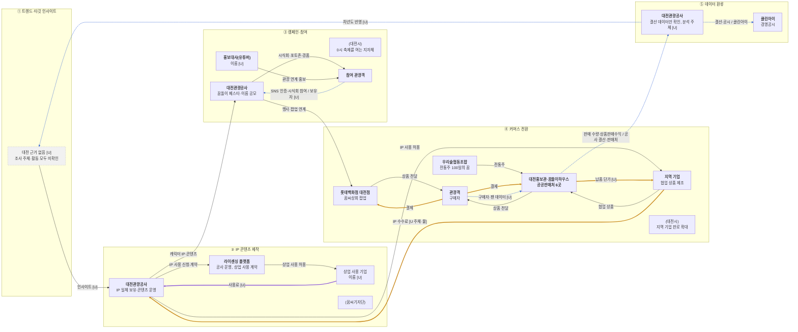

# 밸류체인 초안 v0 — Mermaid flowchart LR (대전 꿈돌이&꿈씨 패밀리, as-is)

> 작성 2026-11-08 · Day 10 슬라이드 17쪽 시연 프롬프트로 만든 **초안(v0)**이에요. 검증 전이라 8장 대조 결과([analysis_v01.md](analysis_v01.md) 8장)가 반영되지 않았어요.
> 입력: [onepager.md](../onepager.md) (출처 번호는 `sources/sources.md` 기준, 7은 `local_candidates_v05.md`의 S번호) · 이해관계자 이름은 [stakeholders_v01.md](stakeholders_v01.md)와 같은 규칙(원페이지에 나온 이름만, 없으면 유형 + [U]).
> **단계**: 프롬프트에 붙은 풀무원 예시 단계(지역 생산자 → … → 물류·배송)가 아니라 **팀이 FigJam에서 정한 5단계**를 썼어요 — ① 트렌드·타깃 인사이트 → ② IP 콘텐츠 제작 → ③ 캠페인·참여 → ④ 커머스 전환 → ⑤ 데이터 환류.
> **표기**: 하는 사람 = **굵게**, 영향 주는 사람 = (괄호) · 상품 흐름 `-->` · 돈 흐름 `==>`(라벨: 결제·수수료·정산·납품 단가) · 데이터 흐름 `-.->`(라벨: 데이터 이름 / 보유자) · 회색 점선 상자 = 대전 근거 없음 `[U]`.
> **숫자 규칙**: 그림에는 숫자를 쓰지 않았어요(수수료율·금액은 원페이지에 [출처]가 있어도 값이 아니라 아래 표에만 적음). 라벨의 `[U]`는 "항목은 있는데 값·주체가 없다"는 뜻이에요.

## 1. 밸류체인 (Mermaid flowchart LR)

- 상품 흐름은 실선, 돈 흐름은 굵은 주황선(소비자 → 원천 방향), 부수 흐름(라이센싱 사용료)은 보라, 데이터 흐름은 파란 점선이에요.
- ⑤ → ① 환류선은 "환류 체계가 있는지 모른다"는 표시이고 존재를 뜻하지 않아요 [U].
- 지역 기업·롯데백화점 대전점 사이 정산 같은 근거 없는 돈 선은 그리지 않았어요(근거 없음은 아래 3장).

## 2. 단계별 근거 — onepager.md의 어느 칸인지

| 단계 | 노드·선 | onepager.md 칸 | 출처 | 상태 |
|---|---|---|---|---|
| ① 트렌드·타깃 인사이트 | 대전 활동 없음(회색 상자), 소비자 유형만 2장 ① | 원페이지에 이 단계 활동 없음. 2장 ① "관광객 겨냥", 20~30대 비중은 원문에 없음 | [출처 7, S1·S3] | [U] |
| ② IP 콘텐츠 제작 | 대전관광공사 IP 보유 | 1장, 2장 ⑤, 2-A ① | [출처 7, S5] [출처 1] | [F] |
| ② | 콘텐츠 운영 (꿈씨기자단 18명, 이름 공모, 과학 북 마스터) | 2-A ②, 3장, 4장 | [출처 4] [출처 5] [출처 6] | [F] (본문은 hwp라 제목 수준) |
| ② | 라이센싱 플랫폼 · 상업 사용 기업 · IP 사용 신청·계약 데이터 | 2-A ① | [출처 1] | [F] 기업 이름 [U] |
| ② | 라이센싱 사용료 (부수, 보라 선) | 2-A ①, 8-3 | [출처 1] | [U] 사용료율 문장 없음 |
| ③ 캠페인·참여 | 꿈돌이 페스타(5개 테마)·컵라면 출시 행사 (시식회·포토존·경품) | 2-A ③ | [출처 7, S4] [출처 13] | [F] 성과 수치 [U] |
| ③ | 이름 공모 | 2-A ②, 4장 | [출처 6] | [F] |
| ③ | 홍보대사(유튜버) — 관광 연계 효과 전망 | 5-A 이슈 3 | [출처 13] | [F] 이름 [U] |
| ③ | 대전시 (0시 축제를 여는 지자체) | 1장 | [출처 7, S5] | [F] 꿈돌이 페스타 주최는 [U] |
| ③ | SNS 인증·시식회 참여 데이터, 보유자 | 2-A ③·④ | [출처 11] [출처 13] | [F] 활동 / 보유자 [U] |
| ④ 커머스 전환 | 홍보관(대전신세계백화점 7층)·꿈돌이하우스·공공판매처 6곳 | 2장 ③, 2-A ⑤ | [출처 1] [출처 7, S2] | [F] |
| ④ | 롯데백화점 대전점 꿈씨상회 팝업 (대전시가 지역 기업 판로 확대 목적) | 2-A ④, 4-A | [출처 7, S6] [출처 11] | [F] 참여 기업 수·매출 [U] |
| ④ | 지역 기업 협업 상품 제조 + IP 사용 허용 | 2장 ②·⑤, 3장 | [출처 7, S3·S4] | [F] 라면 제조사 이름 [U] |
| ④ | 우리술협동조합 전통주 '100일의 꿈' | 2장 ②, 3장 | [출처 7, S3] | [F] |
| ④ | 돈 ④ 소비자 ⇒ 판매처 (결제) | 2장 ④ (상품판매수익 1,085,425,261원, 협업 상품 6개월 23억 원) | [출처 2] [출처 10] | [F] |
| ④ | 돈 판매처 ⇒ 지역 기업 (납품 단가) | 원페이지에 납품 단가 문장 없음. 홍보관 상품매입비 결산 707,339,875원은 있음 | [출처 2] | [U] 단가·방향 |
| ④ | 돈 지역 기업 ⇒ 공사 (IP 수수료) | 4-A, 5-A 이슈 1: 관광공사 IP 수수료 등 수익 3배(금액 없음) | [출처 10] | [U] 지급 주체·율, 방향은 [I] |
| ④ | 구매자·팬 데이터 | 2장 ③ (앱·멤버십은 확인 안 됨) | [출처 1] | [U] |
| ⑤ 데이터 환류 | 판매 수량·상품판매수익 → 공사 결산 | 2장 ④ | [출처 2] [출처 9] [출처 12] | [F] 결산·보도 / 환류 사용은 [U] |
| ⑤ | 클린아이 경영공시 | 1장 | [출처 2] [출처 0] | [F] |
| ⑤ | 전담 조직·중장기 로드맵 부재 (외부 지적, 주체 불특정) | 5-A 이슈 1 | [출처 9] | [F] 분석 주체 [U] |

## 3. 쓰지 않은 것 (원페이지에 근거 없음)

| 항목 | 이유 |
|---|---|
| 지역 기업/판매처 ⇒ 꿈씨상회 기획전 정산 수수료·마진 선 | 주체·방향·정산 조건 문장이 없음(검증 A7과 같은 이유) |
| 수수료율·납품 단가 숫자 | 원페이지에 값이 없음. IP 수수료 금액·율도 없음 |
| 결제·물류·배송 파트너, 굿즈·조형물 제작 업체, SNS 플랫폼 이름 | 원페이지에 이름이 없음 → 노드를 만들지 않음 |
| 공시 계열회사 | 타법인출자 2021~2025 "해당사항 없음" [출처 2] |

## 4. 다음 단계

- v0 → v1: 원페이지 대조에서 나온 불일치([analysis_v01.md](analysis_v01.md) 8장)를 팀이 정하면 이 그림을 고쳐 `valuechain_v1.md`로 확정해요(슬라이드 18쪽).
- 같은 5단계 그림이 `flows_mermaid_v01.md`에도 있어요(대전 as-is + 우리 to-be, 마커 포함). 이 파일은 프롬프트 형식(subgraph 안에 이해관계자 노드)으로 새로 그린 **마커 없는 v0**예요.
