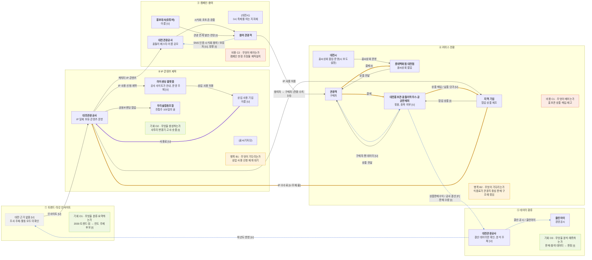

# 밸류체인 v1 — Mermaid flowchart LR (대전 꿈돌이&꿈씨 패밀리, as-is)

> 작성 2026-11-08 · [valuechain_v0.md](valuechain_v0.md)에 **원페이지 대조 결과([analysis_v01.md](analysis_v01.md) 8-6)의 제안을 적용**하고 병목·비용·기회 마커를 붙인 판이에요(슬라이드 18쪽 "검증 → v1 확정").
> **⚠ 확정이 아니라 "제안 적용, 팀 확인 대기"예요.** 팀 결정은 내일 하기로 해서 8장 표의 "팀 결정·이유" 칸은 아직 비어 있어요. 팀이 다르게 정하면 이 파일을 다시 고쳐요.
> 근거: [onepager.md](../onepager.md), `../sources/`(출처 번호는 `sources/sources.md` 기준, 7은 `local_candidates_v05.md`의 S번호), 마커 근거는 [analysis_v01.md](analysis_v01.md) 2장.
> **표기**: 하는 사람 **굵게** · (영향 주는 사람) 괄호 · 상품 `-->` · 돈 `==>` · 데이터 `-.->` · 병목 주황 · 비용 코랄 · 기회 라임 · 회색 점선 = 대전 근거 없음 [U]. 라벨 **[F]** 원문 사실 · **[I]** 해석 · **[U]** 미확인. 그림에는 숫자를 쓰지 않았어요(값은 표에만).
> **범위**: 대전 as-is만 그렸어요. 마커 중 기회(O1·O2·O3)는 우리 대키미·외지몽 쪽 가설 [I]이고 해당 단계에 붙였어요(analysis_v01 1장 규칙: 병목·비용=대전, 기회=우리).

## 1. 밸류체인 + 마커

- 돈 흐름은 소비자 → 원천 방향(굵은 주황), 부수 흐름(라이센싱 사용료)은 보라, 데이터 흐름은 파란 점선이에요.
- ⑤ → ① 환류선은 "환류 체계가 있는지 모른다"는 표시이고 존재를 뜻하지 않아요 [U]. 슬라이드 23쪽의 "피드백 화살표 1개 이상"은 이 선이 맡지만 근거는 [U]예요(8-5 우선순위 1번).

## 2. 마커 — 단계당 최대 2개, 병목 2 · 비용 2 · 기회 3

| ID | 렌즈 | 단계 | 그림의 라벨 | 근거 위치(자세한 한 줄은 analysis_v01 2장) | 상태 |
|---|---|---|---|---|---|
| B1 | 병목 | ② | 상업 사용 신청 재개 대기 | `sources/01` 30줄 [출처 1] · signals_v02 #1 | [F] 문구 · [U] 재개 여부 |
| B2 | 병목 | ④ | 식음료가 관광지 중심 판매 구조에 묶임 | `sources/09` 10줄(시 측 설명) [출처 9] · 원페이지 5-A 이슈 2 | [F] 시 측 설명 · 신호는 "판매 실적 편차"로 대체(품질 근거 없음) |
| C1 | 비용 | ④ | 홍보관 상품 매입·재고 | 클린아이 결산서 [출처 2] (매입비 707,339,875원, 재고 기말 180,685,548원) | [F] 수치 · [U] 반품·폐기 |
| C2 | 비용 | ③ | 조형물 제작설치 | 클린아이 결산서 [출처 2] (집행액 40,300,000원+17,355,000원) | [F] 수치 · [U] 효과 |
| O1 | 기회 | ① | 트렌드·밈 → 연도 주제 후보 | 대전 ① 근거 없음 + 팀 추천안 [팀 추천안] | [I] 보류(매트릭스 3점) |
| O2 | 기회 | ② | 사투리 변환기·고사·숏폼 생성 | 팀 문서 [출처 8] · **우선 기회**(매트릭스 영향 7·실현 7) | [I] |
| O3 | 기회 | ⑤ | 판매·참여 데이터 분석·판정 | signals_v02 #2·#3·#4 (데이터 단절) | [I] 큰 기회·지금은 어려움 |

| 단계 | 마커 | 개수 |
|---|---|---|
| ① | O1 | 1 |
| ② | B1, O2 | 2 |
| ③ | C2 | 1 |
| ④ | B2, C1 | 2 |
| ⑤ | O3 | 1 |

- 우선 기회 1개 = **O2** (매트릭스: [analysis_v01.md](analysis_v01.md) 7장). O1은 규칙상 "지도에 남기지 않음"이지만 팀 확인 전이라 그림에는 남겼어요(analysis 7-5).

## 3. 단계별 근거 — onepager.md의 어느 칸인지

| 단계 | 노드·선 | onepager.md 칸 | 출처 | 상태 |
|---|---|---|---|---|
| ① | 대전 활동 없음(회색), 소비자 유형만 2장 ① | 원페이지에 이 단계 활동 없음 | [출처 7, S1·S3] | [U] |
| ② | 대전관광공사 IP 보유 | 1장, 2장 ⑤, 2-A ① | [출처 7, S5] [출처 1] | [F] |
| ② | 콘텐츠 운영 (꿈씨기자단 18명, 이름 공모, 과학 북 마스터) | 2-A ②, 3장, 4장 | [출처 4] [출처 5] [출처 6] | [F] (본문은 hwp라 제목 수준) |
| ② | 라이센싱 플랫폼 · 상업 사용 기업 · 신청·계약 | 2-A ① (`sources/01` 28줄) | [출처 1] | [F] 운영 주체 [U] · 기업 이름 [U] |
| ② | 우리술협동조합 '100일의 꿈' 공동브랜딩 | 2장 ②, 3장, 8-2 충돌 8 | [출처 7, S3] [출처 10] | [F] |
| ③ | 꿈돌이 페스타(5개 테마)·컵라면 출시 행사 (시식회·포토존·경품) | 2-A ③ | [출처 7, S4] [출처 13] | [F] 성과 수치 [U] |
| ③ | 이름 공모 · 홍보대사(유튜버) 발언 | 2-A ②, 4장, 5-A 이슈 3 | [출처 6] [출처 13] | [F] 이름 [U] · 홍보 활동은 [I] |
| ③ | 대전시 (0시 축제를 여는 지자체) | 1장 | [출처 7, S5] | [F] 페스타 주최 [U] |
| ④ | 홍보관·꿈돌이하우스·공공판매처 6곳 | 2장 ③, 2-A ⑤ | [출처 1] [출처 7, S2] [출처 10] | [F] 6곳이 꿈돌이하우스를 포함하는지 [U] |
| ④ | 대전시 꿈씨상회 팝업 운영, 롯데백화점 대전점 | 2-A ④, 4-A | [출처 11] [출처 7, S6] | [F] 참여 기업 수·매출 [U] |
| ④ | 지역 기업 협업 상품 + IP 사용 허용 | 2장 ②·⑤, 3장 | [출처 7, S3·S4] | [F] 제조사 이름 [U] |
| ④ | 돈 ④ 관광객 ⇒ 판매처 (결제) | 2장 ④ (상품판매수익 1,085,425,261원, 협업 상품 6개월 23억 원) | [출처 2] [출처 10] | [F] |
| ④ | 돈 판매처 ⇒ 지역 기업 (상품 매입 / 납품 단가) | 상품매입비 결산 707,339,875원 있음, 납품 단가 문장 없음 | [출처 2] | [F] 매입 사실 · [U] 단가 |
| ④ | 돈 지역 기업 ⇒ 공사 (IP 수수료) | 4-A, 5-A 이슈 1 (수익 3배, 금액 없음) | [출처 10] | [U] 주체·율, 방향 [I] |
| ④ | 구매자·팬 데이터 | 2장 ③ (앱·멤버십 확인 안 됨) | [출처 1] | [U] |
| ⑤ | 상품판매수익 → 공사 결산, 클린아이 경영공시 | 1장, 2장 ④ | [출처 2] [출처 0] | [F] 환류 사용은 [U] |
| ⑤ | 전담 조직·중장기 로드맵 부재 (주체 불특정 외부 지적) | 5-A 이슈 1 | [출처 9] | [F] |

## 4. 숫자가 들어간 라벨의 [출처] 여부

그림 안의 숫자 표기는 "전통주 100일의 꿈"(상품명, [출처 7, S3] [출처 10] 있음)과 "0시 축제"(축제 이름, [출처 7, S5] 있음)뿐이에요. 수수료율·금액·비율 숫자는 없어요. 값이 필요한 선은 모두 `[U]`예요. (v0의 "공공판매처 6곳"은 중복 여부가 불명이라 그림에서 뺐고 위 3장에 [출처 7, S2] [출처 10]과 함께 남겼어요.)

## 5. v0 → v1 변경 (8-6 제안 적용)

| 검증 # | v0 | v1 | 상태 |
|---|---|---|---|
| V2 | ③ 공사 → 꿈씨상회 "행사·팝업 연계" | **대전시 → 꿈씨상회 "꿈씨상회 운영"** (시 보도 설명 [출처 11]). ③ → ④ 연결은 "참여자 → 구매자 (전환 수치 [U])"로 대체 | 제안 적용 · 팀 확인 대기 |
| V3 | 라이센싱 플랫폼 "공사 운영" | "공사 사이트가 안내, 운영 주체 [U]" | 제안 적용 |
| V6 | 홍보대사 "관광 연계 홍보" | "관광 연계 발언·전망 [I]" | 제안 적용 |
| V11 | 우리술협동조합 → 판매처 "전통주" 선 | **삭제**, 공사 → 우리술협동조합 "공동브랜딩 협업" 선으로 교체(근거: 8-2 충돌 8, [출처 7, S3]) | 제안 적용(교체는 제안 외 보완) |
| V12 | 판매처 노드 "…공공판매처 6곳" | 숫자 제거, "묶음, 중복 여부 [U]" 추가 | 제안 적용 |
| V13 | 협업 상품 선 | "[I]" 추가 | 제안 적용 |
| V17 | 관광객 ⇒ 꿈씨상회 "결제" | "결제 [I]" | 제안 적용 |
| V18 | "납품 단가 [U]" | "상품 매입 / 납품 단가 [U]" | 제안 적용 |
| V21 | 데이터 "보유자 [U]" | "보유자 [U], 방향 [I]" | 제안 적용 |
| V22 | "판매 수량·상품판매수익 / 공사 결산·판매처" | "상품판매수익 / 공사 결산 [F] · 판매 수량 [I]" | 제안 적용 |
| (신규) | 마커 없음 | 병목 2·비용 2·기회 3 마커 노드 추가 | p17 5단계 |

## 6. 아직 정해지지 않은 것 (팀 확인, 내일)

| 순서 | 항목 | 현재 v1 처리 |
|---|---|---|
| 1 | ⑤ → ① 환류선의 근거(FigJam 팀 추천안 확인) | [U] 점선으로 유지 |
| 2 | 발표에서 쓸 단계 프레임(팀 5단계 vs 세일즈 퍼널) | 팀 5단계, 대응표는 analysis 8-3 |
| 3 | 8장 나머지 불일치의 "팀 결정·이유" 칸 | 제안대로 적용, 칸은 비움 |
| 4 | O1 보류를 지도에서 뺄지 | 그림에 남김 |
| 5 | 10/29 리뷰 분석 파일 위치 | 없음 — B2의 품질 근거와 신호 3종이 비어 있음 |

## 7. 슬라이드 20~23쪽 점검 (2026-11-08)

> `valuechain_v1.html`(1280×720 한 장)을 슬라이드의 완료 기준에 대조했어요. ✓ 충족 · △ 부분 충족(이유 적음) · ✗ 못 채움.

### 7-1. 20쪽 — AX 크리에이티브 트랙 과제

| 기준 | 상태 | v1.html에서의 처리 |
|---|---|---|
| IP 단계에 팀 캐릭터·세계관 배치 | ✓ | ② 단계 상자와 이해관계자 칸에 틸 색으로 "대키미·외지몽 IP · 세계관(2027 주제 「타지에서 온 말손님」) · IP 가이드 [출처 8]" |
| 기획전 단계에 어제 리서치한 기업을 실명으로 배치 | △ | ④ 단계에 롯데백화점 대전점·대전시·지역 기업 실명 배치. 대전은 뷰티가 아니라 콘텐츠·IP 사례라 "뷰티 커머스 기업"은 해당 없음 |
| 돈 흐름에서 'IP 보유자에게 돌아오는 몫'이 어느 화살표인지 표시 | ✓ | 돈 화살표 끝점에 "IP 보유자(공사)에게 돌아오는 몫 = IP 수수료 [U 주체·율]". 화살표는 있으나 값·주체가 없어 [U] |
| 데이터 흐름에서 팬 반응이 기획으로 돌아가는 피드백 유무 표시 | ✓ | ⑤ → ① 점선 화살표 + "[U] 환류 체계 근거 없음(전담 조직·로드맵 부재 [출처 9])" |
| 우선 기회 1개 — 브랜드 스킬·캐릭터 자산으로 Claude Code가 만들 수 있는 것 | ✓ | O2 사투리 변환기·고사·숏폼 생성, 영향 7·실현 7, 근거 문장 포함 |
| 완료 기준: 5단계 모두 이해관계자 실명 | △ | ①은 대전 근거가 없어 유형 + [U]. 원페이지에 없는 이름은 쓰지 않는 규칙 때문 |
| 완료 기준: 돈 끝점 표시 · 피드백 화살표 · 우선 기회 1개 + 근거 | ✓ | 위와 같음 |
| 공통: 실명은 원페이지·공시에 있는 기업만, 그룹 관련 기업명은 쓰지 않음 | ✓ | 쓴 이름은 stakeholders_v01 3장의 "쓴 이름" 목록뿐. 파일에 그룹 관련 기업명 없음(문자열 검색) |

### 7-2. 21~22쪽 — 예시 장 (구조 확인용)

- 21쪽 크리에이티브 예시(로컬 IP → 콘텐츠 → 캠페인 → 뷰티 커머스 기획전 → 구매)는 **가상 예시**라서 단계 이름이 우리 팀 5단계와 달라요. 층(이해관계자·돈·데이터·마커 후보)과 마커 색(병목 주황·비용 코랄·기회 라임) 구성만 따랐어요.
- 22쪽은 AX 데이터·서비스 트랙(식재료) 예시라 우리 트랙에는 해당 없어요.

### 7-3. 23쪽 — HTML 버전 완료 기준 8개

| # | 기준 | 상태 | 확인 방법·메모 |
|---|---|---|---|
| 1 | 네 층이 위에서 아래로 구분되어 보임 | ✓ | 활동 · 이해관계자 · 돈 · 데이터(+ 마커) 가로 띠 |
| 2 | 단계 5개 내외, 이름이 원페이지 판매 경로와 일치 | △ | 5개는 충족. 이름은 **팀이 정한 5단계**라 원페이지 판매 경로(IP → 콘텐츠 → 캠페인 → 커머스 기획전 → 구매)와 다름 — `analysis_v01.md` 8-3 대응표로 설명. 발표 프레임은 팀 결정 대기 |
| 3 | 돈 화살표 방향이 소비자 → 원천(역방향) | ✓ | ④ 시작점에서 ② 끝점으로 오른쪽 → 왼쪽 주황 화살표 |
| 4 | 데이터 흐름에 피드백 화살표 1개 이상 | △ | 있음(⑤ → ①), 그러나 근거가 [U] — 환류선 근거는 내일 팀 확인 |
| 5 | 마커(병목·비용·기회)가 범례와 같은 색 | ✓ | 병목 주황 테두리 · 비용 코랄 테두리 · 기회 라임 배경, 범례는 오른쪽 아래 |
| 6 | 팀 자산이 들어가는 상자가 팀 색(틸)으로 표시 | ✓ | ② 단계 상자 · 팀 자산 칩 |
| 7 | 숫자는 [출처] 있는 것만, 없으면 없음 | ✓ | 금액 3개와 "수익 3배"는 [출처 2]·[출처 10]. 영향 7·실현 7 등 점수는 팀 가설 점수라 [I] 표시와 `analysis_v01` 7장 참조 |
| 8 | 잘린 글자·겹침 없음(브라우저에서 확인) | ✓ | 1280×720 폭에서 글자 상자 전부 내용이 상자 안에 들어감(자동 점검 + 화면 확인). 화살표선과 글자 사이 8px 이상 간격 |

- 프롬프트 속 "팀 자산(지역 생산자)"은 데이터·서비스 예시의 표현이라, 우리 트랙에서는 **IP 단계의 대키미·외지몽 자산**으로 바꿔 적용했어요.
- 수정 요청 팁(글자가 잘리면 "단계 상자를 넓히고 이해관계자는 두 줄로")은 그대로 반영할 수 있어요.
