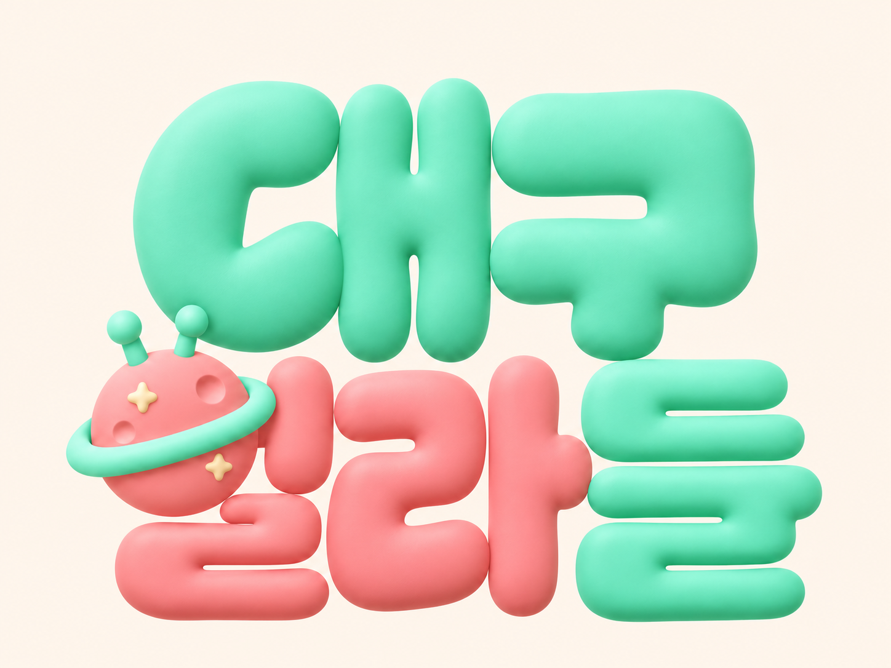
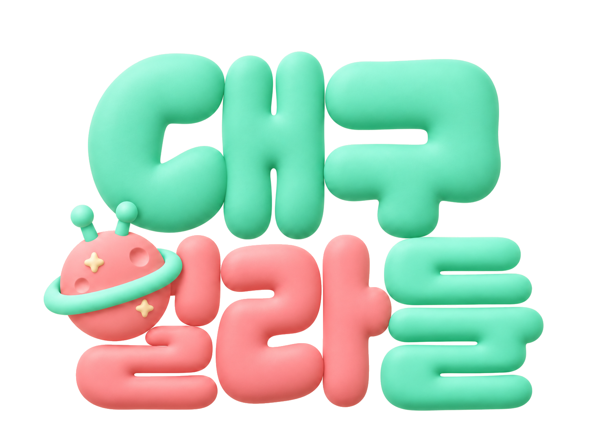
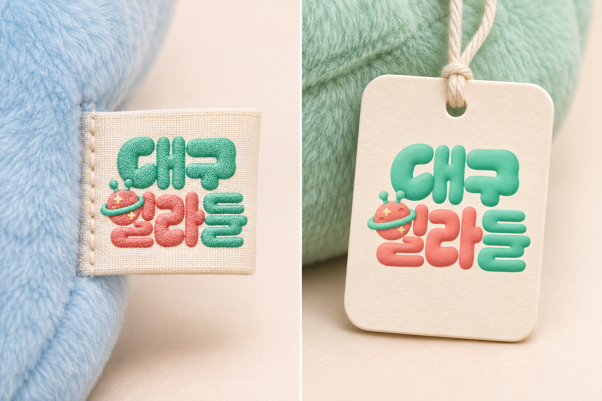

# 대구 얼라들 브랜드 로고 디자인 시트 v1

- 확정일: 2026-11-11
- 브랜드명: **대구 얼라들**
- 소속 캐릭터: **대키미 · 외지몽**
- 용도: 두 캐릭터를 함께 부르는 브랜드명 및 인형 라벨·행택·무드등 패키지 등에 사용하는 브랜드 로고
- 상태: 사용자가 승인한 로고 디자인을 기준으로 정리한 시트. 인쇄·직조 생산 수치는 실물 샘플 확인 전 제안값이다.

## 1. 승인 기준 이미지



**디자인 판단은 위 승인 이미지를 우선한다.** 텍스트 설명만으로 이미지를 다시 생성하면 글자 윤곽과 위치가 달라질 수 있으므로, 승인 이미지를 항상 함께 사용한다.

- 기준 이미지: `대구_얼라들_로고_승인원본.png`
- 기준 해상도: **1448 × 1086px**, 가로:세로 **4:3**
- 기준 원본 배경: 따뜻한 아이보리 계열
- 흰 배경 전달본: `대구_얼라들_로고_흰배경.png`, **#FFFFFF**. 승인 이미지의 배경 픽셀만 흰색으로 바꾸었으며, 로고를 재생성하지 않았다.
- 기존 배경 전달본: `대구_얼라들_로고_기존배경.png`. 승인 원본과 동일한 이미지다.
- 현재 승인 아트워크는 PNG 이미지이며, 편집 가능한 벡터 원본이나 전체 한글 입력용 폰트 파일이 아니다.

### 흰 배경 전달본



## 2. 브랜드 표기와 기본 구성

표준 브랜드 표기는 **대구 얼라들**이다. 로고는 아래의 **2단 조합**을 기본형으로 사용한다.

```text
  대구
 얼라들
```

- 위 줄: `대구`
- 아래 줄: `얼라들`
- 위 줄과 아래 줄이 가깝게 모여 통통한 하나의 덩어리처럼 보이는 구성이다.
- `대구`가 위쪽 중심을 잡고, `얼라들`이 아래쪽을 더 넓게 받친다.
- 글자별 크기·위치·줄 간격은 승인 이미지의 상대 비율을 유지한다.
- 가로 1단·세로형·원형 배지형 등은 이 시트의 확정 기본형에 포함하지 않는다.

## 3. 레터링의 고정 특징

### 전체 인상

**둥글고 두껍고 말랑한, 캐릭터 굿즈에 어울리는 레터링.** 넓은 획과 둥글게 부푼 끝, 좁고 부드러운 내부 공간이 특징이다. 지나치게 얇은 손글씨나 각진 고딕으로 바꾸지 않는다.

### 글자별 특징

| 요소 | 유지할 특징 |
|---|---|
| 대 | 넓게 부푼 ㄷ과 두툼한 세로획. 승인 이미지의 둥근 내부 공간과 실루엣 유지 |
| 구의 ㄱ | 크게 휘감기는 꼬리 대신 둥근 블록에 가까운 꺾임. 끝을 물방울·쉼표 모양의 긴 말림으로 바꾸지 않음 |
| 구의 ㅜ | 위쪽 ㄱ과 가깝게 놓인 두꺼운 가로획과 짧고 통통한 아래 세로획. 자소 간 읽힘 유지 |
| 얼의 ㅇ | 일반 글자 ㅇ을 별도로 그리지 않고, 고향 행성이 같은 위치에서 둥근 ㅇ의 역할을 함 |
| 얼의 ㅓ | 행성 오른쪽에 놓인 코랄색 자소. 고리·행성에 완전히 가려지지 않게 유지 |
| 얼의 받침 ㄹ | 행성 아래에서 얼을 완성하는 코랄색 계단형 받침 |
| 라의 ㄹ | 두툼한 층과 둥근 꺾임이 구분되는 계단형. 길게 흐르는 리본·뾰족한 사선 틈으로 바꾸지 않음 |
| 라의 ㅏ | 코랄색의 넓은 세로획과 짧은 오른쪽 돌출획 |
| 들 | 민트색. ㄷ·ㅡ·받침 ㄹ의 층을 유지하며, 전체가 하나의 두툼한 글자로 읽혀야 함 |

별도의 녹색 억양 화살표와 꺾임 기호는 초기 시안의 요소이며, **이번 확정 로고에는 포함하지 않는다.**

## 4. ‘얼’에 들어가는 고향 행성

### 역할

행성은 로고 옆에 붙이는 별도 장식이 아니라 **‘얼’의 초성 ㅇ을 대체하는 글자 구성 요소**다. 행성의 둥근 몸체가 ㅇ의 자리를 차지하고, 오른쪽 ㅓ와 아래 받침 ㄹ이 함께 `얼`로 읽힌다.

### 고정 요소

- 둥근 **코랄색 행성 몸체**
- 몸체를 비스듬하게 가로지르는 **민트색 고리**
- 위쪽의 **민트색 더듬이 2개**, 각 끝에 **구슬 1개씩**
- 승인 이미지에 보이는 작은 **크림색 별 2개**와 둥근 분화구 표현
- 글자와 동일한 부드러운 무광 입체 질감

### 배치 규칙

- 행성 몸체는 둥근 ㅇ처럼 인식되는 크기와 위치를 유지한다.
- **행성 중앙에 ㅇ 모양의 구멍을 뚫지 않는다.** 둥근 행성 자체가 ㅇ 역할을 한다.
- 고리와 더듬이는 인접 글자와 구분되도록 하되, 승인 이미지의 전체 균형을 따른다.
- `얼`의 ㅓ와 받침 ㄹ을 빼거나 별도 단어처럼 멀리 배치하지 않는다.
- 행성을 사진 그대로 새로 삽입하거나 다른 캐릭터 얼굴로 교체하지 않는다.
- 로고의 별·분화구 배치와 원래 행성 참고 이미지의 배치는 같지 않다. **로고 재현에는 승인 로고의 배치를 우선한다.**

## 5. 배색

### 반드시 유지하는 색상 구분

| 위치 | 기본 색상 |
|---|---|
| 대 | 민트 |
| 구 | 민트 |
| 얼의 ㅓ·받침 ㄹ | 코랄 |
| 라 | 코랄 |
| 들 | 민트 |
| 행성 몸체 | 코랄 |
| 행성 고리·더듬이·구슬 | 민트 |
| 행성의 작은 별 | 크림 |

### 제작용 참고 팔레트

아래 수치는 승인 PNG의 중간톤 일부를 읽은 **화면용 참고색**이다. 사용자가 별도로 확정한 단색 브랜드 규격이나 인쇄용 잉크색은 아니다. 이미지에는 입체 음영이 있어 모든 픽셀이 같은 색이지 않다.

| 색상 | 참고 HEX | 참고 RGB | 용도 |
|---|---|---|---|
| 민트 | `#54CFA0` | 84, 207, 160 | 대구·들·행성 고리와 더듬이 |
| 코랄 | `#F68081` | 246, 128, 129 | 얼라·행성 몸체 |
| 크림 | `#FDE6BB` | 253, 230, 187 | 행성의 별 |
| 흰 배경 | `#FFFFFF` | 255, 255, 255 | 흰 배경 로고 전달본 |

인쇄·원단·실의 색은 화면과 다를 수 있다. CMYK·별색·직조 실 번호는 제작 업체의 소재 샘플을 보고 별도로 정한다. 대구시 녹색 `#008837`은 초기 시안의 색이며 이번 민트 배색을 대체하는 값이 아니다.

## 6. 재질과 빛

- 대키미·외지몽의 부드러운 캐릭터 질감과 어울리는 **은은한 무광 입체감**.
- 둥근 모서리에서 넓고 부드러운 하이라이트와 음영이 이어진다.
- 표면은 매끈하고 차분하며, 과한 유광·금속·투명 젤리 질감으로 바꾸지 않는다.
- 큰 돌출 두께·강한 그림자·검은 외곽선을 임의로 추가하지 않는다.
- 크기·레이아웃을 유지하면서 배경만 바꾸는 작업은 색상과 내부 음영을 바꾸지 않는다.

## 7. 라벨과 패키지 적용



이 이미지는 사용자가 확인한 **적용 분위기 참고 목업**이다. 로고를 다시 따거나 글자 윤곽을 확정하는 기준으로 쓰지 않는다. 실제 제작에는 1절의 승인 로고를 사용한다.

### 인형 봉제 라벨

- 아이보리·흰색 바탕에 민트·코랄 로고를 배치하는 방향.
- 기본 2단 조합과 행성 ㅇ을 유지한다.
- 3D 음영을 그대로 직조할지, 단색 면으로 정리할지는 제작 업체와 샘플 확인 후 정한다.
- 작은 별·분화구·더듬이가 뭉개지면 제작용 단순화안을 별도로 만든다. 현재 PNG를 임의로 단순화한 결과를 새로운 승인 로고로 취급하지 않는다.
- 목업에서 제안했던 약 **45 × 35mm**는 검토 시작용 예시이며, 최종 실측 규격이 아니다.

### 종이 행택·무드등 패키지

- 흰색·따뜻한 아이보리 바탕을 우선 검토한다.
- 충분한 크기에서는 기존 입체 음영과 행성의 작은 디테일을 살린다.
- 재단선·접힘선·펀칭 구멍·박음질 위치가 로고에 닿지 않게 한다.
- 필요한 해상도는 인쇄 크기에 따라 확인한다. 현재 PNG를 확대했다고 해서 실제 디테일이 늘어나는 것은 아니다.

### 여백·축소 제안

- 로고 외곽에는 전체 로고 높이의 약 **10%**를 시작점으로 여백을 확보한다.
- 최소 사용 크기는 아직 확정하지 않았다. `얼`의 ㅓ와 받침 ㄹ, `들`의 층, 행성 더듬이 2개가 구분되는지 실제 출력물로 확인한다.
- 가로·세로를 같은 비율로 확대·축소한다. 눌러 펴거나 늘이지 않는다.

## 8. 피해야 할 변경

- `대구` 또는 `들`을 코랄로 바꾸거나, `얼라`를 민트로 바꾸는 배색 변경
- 행성 ㅇ을 일반 원형 글자로 되돌리거나 고향 행성의 구멍을 새로 만드는 변경
- 더듬이 개수·별 개수·고리 유무를 임의로 바꾸는 변경
- ㄱ·ㄹ을 초기의 긴 말림·리본형 획으로 되돌리는 변경
- 로고를 기존 상용 글꼴로 다시 타이핑해 대체하는 작업
- 목업 사진에서 추출한 로고를 원본으로 사용하는 작업
- 그림자나 질감을 과하게 추가하여 작은 글자 공간을 메우는 변경

## 9. 다시 생성하거나 편집할 때의 전달 문구

> 첨부한 대구 얼라들 승인 로고를 기준으로 작업한다. 둥글고 두꺼운 2단 레터링, 글자별 윤곽·위치·비율·줄 간격을 유지한다. 위 줄은 대구, 아래 줄은 얼라들이다. 대구와 들은 민트, 얼라는 코랄이다. 얼의 초성 ㅇ 자리에는 코랄 행성 몸체·민트 고리·민트 더듬이 2개와 구슬 2개·작은 크림색 별 2개가 있는 고향 행성이 들어간다. 행성에는 중앙 구멍을 만들지 않으며, 오른쪽 ㅓ와 아래 받침 ㄹ을 유지해 얼로 읽히게 한다. ㄱ은 둥근 블록형, ㄹ은 층이 구분되는 말랑한 계단형이다. 부드러운 무광 입체감과 내부 음영을 유지한다. 별도의 억양 화살표나 꺾임 기호를 추가하지 않는다. 변경이 요청된 부분만 편집하고 나머지는 보존한다.

## 10. 파일과 버전 관리

- `대구_얼라들_로고_승인원본.png`: 사용자 승인 기준 아트워크. 따뜻한 아이보리 배경 원본 보존본.
- `대구_얼라들_라벨_적용참고.png`: 패브릭 라벨·종이 행택 분위기 참고.
- `대구_얼라들_로고_디자인시트_v1.md`: 이 문서.
- `대구_얼라들_로고_흰배경.png`: 순백색 배경 PNG.
- `대구_얼라들_로고_기존배경.png`: 기존 아이보리 배경 PNG.
- 현재 폴더는 `Mascot/Brand logo/01_확정_로고`이며, 이전 시안과 목업은 상위 폴더의 별도 하위 폴더에 보존한다.
- 기존 자모 설계 시안, 대구북성로 로고, 흑백·차콜 초기 시안은 이번 확정 디자인의 원본으로 사용하지 않는다.
