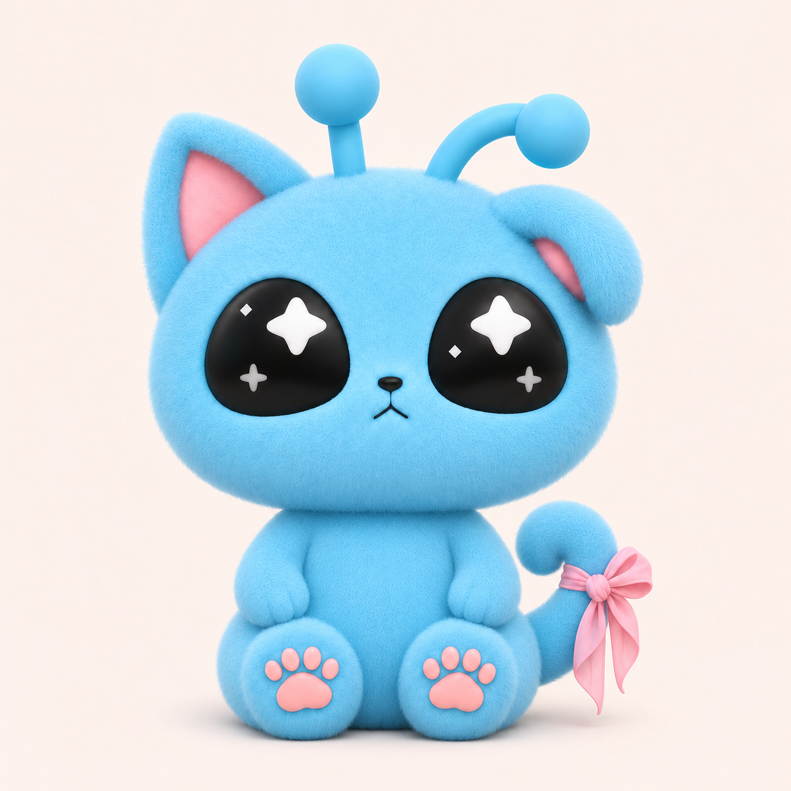

# 대키미 아기 시팅 버전 디자인 측정시트 v01

작성일 2026-11-12 · 적용: 봉제 시팅인형 / 무드등 / 인스타그램 · **앉은 버전만**

## 0. 확정 범위와 파일 우선순위

사용자는 `무표정_꼬리리본_팔내림_시안_v02/01_SITTING_FRONT.png`의 앉은 디자인을 확정했다. 이 폴더의 `reference/01_FRONT.png`는 그 파일의 무변경 사본이다. 서 있는 버전·이전 부화 리본 버전은 이번 기준에서 제외한다.

1. **승인 정면 + 이 문서의 명시 규칙**: 얼굴형, 몸 비율, 팔내림, 접힌 귀, 휜 안테나, 꼬리의 묶인 리본.
2. 새 좌우45도·측면·후면: 승인 정면을 회전 해석한 **보완 레퍼런스**, 별도 정밀3D 스캔이나 봉제 패턴이 아니다.
3. SVG/EPS 표정·동작: 편집 가능한 **평면 응용 제안**. 승인된 보송털 3D 외형을 대체하지 않는다. 파생안은 추가 검수 대상이다.
4. 무드등·로고 조합·제작 치수: 컨셉/작업 제안. 실물 샘플이나 최종 금형 승인으로 간주하지 않는다.

이 MD와 실제 PNG를 별도로 첨부해야 한다. 상대 링크만으로 다른 AI에 이미지가 전달되지 않는다. 같은 픽셀·3D 형상을 자동 보장하지 않으며, 재현 결과는 승인 정면과 비교 검수한다.

## 1. 기본형·턴어라운드·그리드 비율표

| 파일 | 방향 | 적용 |
|---|---|---|
| `reference/01_FRONT.png` | 정면 | 최종 승인 원본, 변경 금지 |
| `reference/02_45_LEFT.png` | 캐릭터 왼쪽45도 / 코 화면왼쪽 | 접힌 왼귀가 가까움 |
| `reference/03_45_RIGHT.png` | 캐릭터 오른쪽45도 / 코 화면오른쪽 | 선 오른귀가 가까움 |
| `reference/04_SIDE_LEFT.png` | 왼쪽 측면 / 코 화면왼쪽 | 뒤통수·머리 깊이 보완 |
| `reference/05_SIDE_RIGHT.png` | 오른쪽 측면 / 코 화면오른쪽 | 좌우 비대칭 보완 |
| `reference/06_BACK.png` | 후면 | 접힌 귀와 휜 안테나는 화면왼쪽 |

PDF 1P에 6방향과 정면 그리드를 수록했다. `vector/front_grid_raster_reference.svg`는 승인 PNG 위에 편집 가능한 그리드만 얹은 도해이며, **캐릭터 자체의 순수 벡터 파일이 아니다.**

### 측정 정의

- 정면1254×1254px, 좌상단 원점, x오른쪽/y아래. 최고 안테나 구슬 y≈71, 바닥 지지면 y≈1174. 그림자/여백 제외.
- 앉은 투영 전체 높이 **H=1103px=100**. 10등분 격자, **1U=H/10=110.3px**. 1U는 cm가 아니다.
- 아래는 수동 판독한 **2D 투영 근사**. 털 경계±5~10px, 팔·몸통 가림은 오차가 더 크다. 수치 표보다 승인 실루엣이 우선한다.
- ‘황금비’ 1.618에 맞춰 재설계하지 않는다. 이 캐릭터의 실제 관측 비율을 기록한다.
- 캐릭터 설정상 서 있는 키53cm는 기존 설정이다. **봉제 시팅인형은 앉은 상태에서 바닥 지지면부터 가장 높은 안테나 구슬까지 전체35cm를 목표 크기로 한다. 무드등 크기는 미정**이다. 안테나를 잡아 펴거나 눌러 목표 높이를 맞추지 않고 자연 착좌/충전 상태로 잰다. 제품35cm는 캐릭터 설정53cm와 별개이며, 머리만35cm로 해석하지 않는다. 기존49cm는 미승인 제안이며 이번에 확정하지 않았다. 외지몽의 약50cm를 대키미에 대입하지 않는다.
- 봉제 목표35cm에서 `부위cm = (부위px/1103)×35`, 환산계수 약0.03173cm/px로 계산한다. 아래 cm는 원본의 투영 비율을35cm에 맞춘 목표 근사값이며, 재단 치수·시접·솜 압축량·생산 허용오차는 아니다. 1U는 목표3.5cm다. 목표 전체35cm의 허용오차는 가봉 후 별도 확정한다. 부위 둘레·가려진 깊이·관절 길이는 별도 실측/CAD가 필요하다.

| 부위 | 투영 폭×높이 px | H=100 대비 폭×높이 | 봉제35cm 환산 목표 근사 |
|---|---:|---:|---:|
| 머리 본체 (귀·안테나 제외) | 750 × 545 | 68.0 × 49.4 | 23.8 × 17.3cm |
| 귀 포함 최대 머리 폭 | 801 × 641 | 72.6 × 58.1 | 25.4 × 20.3cm |
| 몸통 본체 (팔·발 경계 일부 추정) | 372 × 322 | 33.7 × 29.2 | 11.8 × 10.2cm |
| 앉은 하체·두 발 묶음 | 512 × 194 | 46.4 × 17.6 | 16.2 × 6.2cm |
| 화면 왼쪽 검정 눈 | 229 × 223 | 20.8 × 20.2 | 7.3 × 7.1cm |
| 화면 오른쪽 검정 눈 | 222 × 225 | 20.1 × 20.4 | 7.0 × 7.1cm |
| 검정 코 | 40 × 27 | 3.6 × 2.5 | 1.3 × 0.9cm |
| 닫힌 입 | 58 × 42 | 5.3 × 3.8 | 1.8 × 1.3cm |
| 화면 왼쪽 손 영역 | 121 × 111 | 11.0 × 10.1 | 3.8 × 3.5cm |
| 화면 오른쪽 손 영역 | 119 × 111 | 10.8 × 10.1 | 3.8 × 3.5cm |
| 화면 왼쪽 발 | 240 × 193 | 21.8 × 17.5 | 7.6 × 6.1cm |
| 화면 오른쪽 발 | 231 × 193 | 20.9 × 17.5 | 7.3 × 6.1cm |
| 선 안테나 구슬 | 136 × 129 | 12.3 × 11.7 | 4.3 × 4.1cm |
| 휜 안테나 구슬 | 123 × 118 | 11.2 × 10.7 | 3.9 × 3.7cm |
| 정면에 보이는 리본 묶음 | 184 × 270 | 16.7 × 24.5 | 5.8 × 8.6cm |
| 정면에 보이는 꼬리 부분 | 193 × 297 | 17.5 × 26.9 | 6.1 × 9.4cm |

머리 본체 폭:몸통 폭≈2.02:1, 머리 본체 폭:높이≈1.38:1. 몸통 경계는 일부 가려진 근사다. 머리·몸을 별도 원/타원으로 단순 재설계하거나 숫자를 새 확대율로 적용하지 않는다.

### 좌우 비대칭과 외형 고정

- 왼귀가 접히고 왼안테나가 휜다. 정면에서 둘 다 화면오른쪽. 오른귀와 오른안테나는 상대적으로 선다.
- 안테나2개, 각 둥근 구슬1개. 가림으로 안 보일 수 있지만 누락/추가하지 않는다.
- 고개는 바로 세운 기본 무표정. 현재 승인된 작은 닫힌 고양이 입을 사용한다. 기본형에 웃음·혀·홍조를 추가하지 않는다.
- 각 눈: 큰 밝은 네 갈래 별1개 + 작은 회색 반짝임1개 + 작은 밝은 마름모1개. 모양·밝기 차이를 지킨다.
- 큰 머리와 작은 몸이 부드러운 어깨·가슴으로 이어진다. 가느다란 목·과도한 배/넓은 엉덩이로 바꾸지 않는다.
- 팔은 내려 허벅지 옆에 둔다. 손발은 둥글고, 개별 손가락/발가락 홈은 거의 없다.
- 양손·양발 실제 바닥면에 각각 분홍 큰패드1+작은패드4. 보이지 않는 손바닥 패드를 손등에 복제하지 않는다.
- 꼬리는 몸 뒤 하단에서 나오는 짧고 말린 하늘색 고양이 꼬리. 정면 화면오른쪽, 후면 화면왼쪽.

### 리본의 물리적 묶임

리본은 꼬리에만 하나. **연속된 천 띠가 꼬리를 감싸 하나의 매듭으로 이어지고 고리2개·자락2개가 생기는 구조**다. 고리는 접힌 안쪽 공간과 부드러운 주름이 있으며, 자락은 중력에 따라 늘어진다. 앞뒤에 각각 별도 장식을 붙이거나 납작한 정면 리본 배지로 만들지 않는다. 각도에 따라 겹침·가림·뒷면이 달라져야 한다. 머리·귀·손·어깨의 긴 부화 리본은 이번 기본형에 없다.

개별 AI 회전 컷에서 리본 접힘은 근사 표현이다. 실제 제작에는 매듭/고리/자락 개수와 감싼 띠의 연결 규칙을 우선하여 천 또는 성형 시제품으로 검수한다. 모든 컷의 매듭이 동일한 천 토폴로지로 증명되었다고 간주하지 않는다.

## 2. 컬러 시스템 · 라인 규정

몸 하늘색과 분홍은 기존 대키미 지정값을 계승한다. 검정/별/회색/마름모의 수치는 평면 응용용 제안색이며 최종 정면의 인상과 밝기 차이를 함께 따른다. 모니터 명암 픽셀을 원단의 고정 염색값으로 해석하지 않는다.

| 부위 | HEX | RGB | CMYK % 참고(C/M/Y/K) | Pantone TCX / 인쇄 별색 |
|---|---|---|---|---|
| 하늘색 몸·안테나 | `#6DCFF5` | 109, 207, 245 | 44 / 5 / 2 / 0 | 미정 / 스와치 대조 |
| 귀 안·패드·리본 | `#FDB6C1` | 253, 182, 193 | 1 / 32 / 8 / 0 | 미정 / 스와치 대조 |
| 검정 눈·코·입 | `#171B1F` | 23, 27, 31 | 80 / 72 / 60 / 67 | 미정 / 스와치 대조 |
| 큰 별 | `#F7F7F5` | 247, 247, 245 | 2 / 2 / 2 / 0 | 미정 / 스와치 대조 |
| 작은 회색 별 | `#A0A0A0` | 160, 160, 160 | 36 / 30 / 27 / 0 | 미정 / 스와치 대조 |
| 작은 마름모 | `#DADDE0` | 218, 221, 224 | 12 / 8 / 5 / 0 | 미정 / 스와치 대조 |

**CMYK 변환 조건:** macOS `sRGB Profile.icc` → `Generic CMYK Profile.icc`, 상대 색도계 렌더링. 수치는 이 프로파일에서의 변환 참고이며 모든 인쇄기의 정답이 아니다. 용지와 인쇄소 ICC를 받아 재변환·실물 교정한다. 프로파일 파일의 해시는 data에 남긴다. [Adobe 인쇄 색 프로파일 안내](https://helpx.adobe.com/photoshop/desktop/print/color-profiles-for-print-output.html)

**Pantone:** 공식 물리 스와치와 비교하지 않은 상태에서 가장 가까워 보이는 번호를 확정 번호로 꾸며 적지 않는다. TCX는 원단 대조용, TPG/TPX는 종이 매체 계열이며 재질 간 같은 색을 무조건 보장하지 않는다. 원단 공급사 실북·염색 샘플과 D65 등 합의된 조명 아래 비교하여 BODY/PINK/실 번호를 채운다. 실리콘은 실제 수지·안료·벽 두께로 조색판을 별도 승인한다. [Pantone 원단 색 시스템](https://www.pantone.kr/colorsystems2018/for-textiles.html)

### 라인/패스 원칙

- 승인 3D 기본형에는 새 검정 외곽선을 추가하지 않는다. 털 경계는 짧고 촘촘한 보송함, 얼굴 물결·뭉친 장모는 금지.
- 평면 응용은 컬러 면과 필요한 눈·코·입으로 구성한다. 이번 SVG/EPS의 캐릭터 선은 채운 면으로 만들어 **live stroke를 사용하지 않음**. 확대/축소는 전체 비율을 유지한다.
- 다른 디자이너가 stroke를 추가하는 경우 전체 크기에 비례하도록 유지하고, 출고용 복사본은 Outline Stroke/Expand한다. 편집 원본은 별도 보존한다. [Adobe Expand 안내](https://helpx.adobe.com/illustrator/desktop/manage-objects/arrange-objects/expand-objects.html)
- CMYK는 색상표 참고값이다. PDF/SVG/EPS 모두 최종 인쇄용 CMYK 분판 파일이라고 주장하지 않는다.

## 3. 봉제인형 특화 가이드

| 항목 | 제안 | 제조사 검증/확정 필요 |
|---|---|---|
| 원단 | 짧은 보아·극세사 후보, 고르고 부드러운 결 | 원단명, 털길이, 중량, 신축, 색상랩딥 |
| 눈 | 검정 면과 별·회색·마름모를 자수/아플리케로 비교 | 크기별 자수 밀도, 수축, 실번호, 시접 간섭 |
| 코·입 | 작은 컴퓨터 자수 후보 | 최소 선폭과 실 색상, 실제 축소 가독성 |
| 패드 | 낮은 볼륨 분홍 아플리케/자수 후보 | 1+4 개수, 피부처럼 매끈한 표면, 테두리 최소 |
| 접힌 귀 | 접힌 모양을 고정할 숨은 박음질 후보 | 세탁 후 복원·연결 강도, 뒤집기 가능성 |
| 안테나 | 겉감/내부 지지 구조 후보 비교 | 구슬 모양, 연결부 꺾임, 사용 대상에 맞는 구조 |
| 목·사지 | 목을 노출하지 않는 충분한 어깨 연결, 둥근 손발 | 솜 주입·뒤집기·주름·봉제 여유, 실제 최소 두께 |
| 리본 | 실제 천을 꼬리에 감싸 묶고 숨은 고정 봉제 후보 | 매듭 구조, 고리2/자락2, 이탈·풀림, 탈착 여부 |
| 착좌 | 엉덩이 지지면·충전량으로 혼자 앉기 검토 | 무게중심, 펠릿 사용 여부/봉입, 전도 시험 |

절개선 후보는 머리 뒤/하단, 몸통 뒤, 팔다리 안쪽이다. 얼굴 중앙과 눈·입을 가로지르는 봉제선은 피한다. 이 문서는 **실제 재단 패턴·시접·봉제 순서·충전량**을 확정하지 않으며, 6방향 PNG를 그대로 2D 재단선으로 사용하지 않는다. 무게중심 점은 충전구조 없는 그림만으로 실측할 수 없으므로 CAD/가봉에서 표시한다.

## 4. 무드등 특화 가이드

- 위 이미지는 **컨셉 비교**다. 실제 재질의 광학 시뮬레이션·빛 분포 계산·색 측정이 아니다. 밝기/색변화가 그대로 생산된다고 보장하지 않는다.
- 베이스는 엉덩이·양발이 안정적인 같은 지지 평면을 이루도록 설계 후보를 잡는다. 원형을 망가뜨리는 큰 받침을 임의 추가하지 않는다.
- 몸 안료·실리콘/PVC·벽두께·표면 마감·LED 위치에 따라 소등/점등 색이 달라진다. 투명도·경도·LED 색온도·밝기·내부 디퓨저는 아직 미정.
- 눈은 불투명 마스크 후보. 크림/분홍 도장·안료가 점등 뒤 변하는 정도를 실제 조색판/시제품에서 비교한다.
- 꼬리·안테나·리본은 작은 돌출부이므로 탈형·연결 강도·찢김·빛 투과를 검토한다. 리본의 자연스러운 실루엣을 살린 일체형 연질 성형이 제안이며 승인 구조가 아니다.
- 충전 단자/버튼은 후면 아래 또는 바닥 후보. 앞면 눈·배·패드를 가리지 않도록 한다. 단자 형식·배터리·기판·발열 구조·이격 치수는 제조사 설계 후 확정.
- 전기·제품시험·대상 연령에 필요한 사항은 제품 사양이 결정된 뒤 해당 제조사/시험기관에서 검토한다. 이 시트는 인증서가 아니다.

## 5. 인스타 표정 8종 · 앉은 동작 6종 · 벡터 소스

| 자료 | 내용 | 상태 |
|---|---|---|
| `vector/expressions_review_v01.svg`, `.eps`, `.pdf` | 기본/기쁨/놀람/당황/졸림/슬픔/윙크/쑥스러움 | 평면 표현 검토안 8종 |
| `vector/poses_review_v01.svg`, `.eps`, `.pdf` | 기본앉기/인사/환호/별소품/손모음/살짝기대기 | 앉은 범위 응용 검토안 6종 |
| `vector/face_*.svg` | 고정 머리·눈·입 구성의 개별 표정 파츠 | 독립 편집 가능한 벡터 8개 |

이 파일들은 실제 채워진 도형·베지어 패스이며 PNG를 확장자만 바꾼 것이 아니다. 털의 3D 질감과 리본의 입체 접힘을 벡터가 완전히 복원하는 것은 아니다. 새 2D 해석은 승인 정면과 비교하여 별도 검수한다. **Adobe Illustrator 네이티브 `.ai` 파일은 제공하지 않으며**, EPS/SVG를 Illustrator에서 열어 필요 시 AI로 저장할 수 있다.

얼굴 윤곽·귀의 비대칭·안테나·기본 눈 모티프는 공통 파츠로 유지한다. 감은 눈/윙크에서는 하이라이트가 가려질 수 있다. 기본형 이외 감정은 콘텐츠 장면용이며 기본 무표정 기준을 덮어쓰지 않는다. 부화 단계의 소심함과 별개로 과장 분노·혐오·공포를 기본 캐릭터로 확정하지 않는다.

인스타 권장 작업 캔버스: 피드1080×1350, 정사각형1080×1080, 릴스1080×1920을 시작점으로 사용하되 플랫폼 최신 규격을 보장하는 기술 명세는 아니다. 캐릭터의 양쪽 구슬·발·꼬리가 잘리지 않도록 여백을 남긴다. 작은 화면 최소 높이160px, 인쇄 가로30mm는 **검토 시작값**, 세부 모티프 유지 여부를 실제 크기로 보고 최종 최소값을 정한다. 임의로 '15mm 이상이면 모두 가능'이라고 확정하지 않는다.

## 6. 로고 조합·여백·최소 사용 규정

브랜드 폴더에 있는 승인 `대구 얼라들` PNG를 `sources/대구_얼라들_승인로고.png`로 보관했다. 로고를 새로 타이핑·재배색·벡터 트레이싱해 승인 로고로 대체하지 않는다. 사용자가 **‘대구 얼라들’ 라벨 기준으로 검토**하도록 지정했다. 따라서 해당 승인 로고를 조합 기준으로 사용하며, 아래 간격·크기·가로/세로 배치는 여전히 검토안이다. 라벨 목업을 로고 원본 대신 재추출하지 않는다.

- 로고 원형은 2단 ‘대구 / 얼라들’, 행성은 얼의 ㅇ을 대체한다. 자세한 로고 규칙은 기존 브랜드 로고 디자인시트를 따른다.
- 가로조합: 캐릭터 왼쪽, 승인 로고 오른쪽. 세로조합: 캐릭터 위, 로고 아래.
- 시작점 제안: 캐릭터-로고 간격≥0.1H. 로고 자체 외곽에는 로고 높이의0.1배 이상 여백. 캐릭터 H와 로고 H를 혼동하지 않는다.
- 캐릭터가 로고 글자/행성/더듬이를 가리지 않게 한다. 두 요소 각각의 가로세로 비율은 그대로 유지한다.
- 로고 PNG의 이미지 캔버스 여백은 아트워크 외곽 여백과 다르므로 실제 아트워크 외곽을 기준으로 배치한다.
- 캐릭터/로고의 최종 최소 사이즈, 라벨 치수, 칼선·재단·봉제 여유는 실물 출력·직조 샘플에서 확정한다. 이번 제안으로 임의 생산하지 않는다.

## 7. 금지 규정 — 시각 사례는 PDF 6P

1. 머리와 몸을 따로 늘여 체형 변경, 하체만 퍼뜨리기, 가느다란 목 만들기.
2. 이미지 좌우 뒤집기로 접힌 귀·휜 안테나·꼬리 방향 바꾸기.
3. 구슬 추가/누락/귀와 융합, 고양이 귀를 강아지 귀로 바꾸기.
4. 눈의 작은 회색 별을 모두 흰 별로 바꾸거나 마름모를 없애기.
5. 패드 개수를 변경하거나 손등/발등에 복제하기.
6. 하늘색을 임의 녹색으로 바꾸기, 크림색 주둥이·배 무늬·기본 홍조 추가.
7. 꼬리 리본을 납작한 장식으로 붙이거나 두 개로 복제, 머리·손에 긴 부화 리본을 복구하기.
8. 승인 기본형에 검정 외곽선을 새로 두르거나 거친 물결 장모를 추가하기.
9. 로고 왜곡/재타이핑/무단 색상 변경, 식별하기 어려운 축소, 승인되지 않은 부적절한 합성.

## 8. 납품 구성·보완 조건

- MD: 이 파일. PDF: `pdf/대키미_아기_시팅_통합디자인시트_v01.pdf` (6P,16:9).
- 개별 PNG: `reference/01_FRONT.png`부터 `06_BACK.png`, 무드등 컨셉1장.
- 편집 가능한 평면 원본: SVG/EPS, 표정 파츠 SVG. 그리드SVG는 래스터 참고와 분리 표시.
- 관측값/색상/프로파일/해시: `data/`.
- 아직 미확정: 무드등 제품크기·캐릭터 설정상 앉은물리cm·팬톤·실번호·제조소재·시접·가봉패턴·무드등CAD/전기/벽두께·최소크기·최종 로고조합·신규2D 파생안 승인.
- 기존 부화 장면용 시트와 원본은 변경하지 않았다. 꼬리에 리본을 묶는 이번 시팅 제품의 적용 범위만 따로 기록한다.

## 9. 외주 전달 프롬프트

첨부한 승인 앉은 정면을 최우선으로 동일한 대키미 아기 시팅 디자인을 재현한다. 큰 둥근 고양이형 머리와 작고 통통한 몸통, 짧은 팔다리, 목이 드러나지 않는 자연스러운 연결, 팔을 내리고 두 발을 앞으로 둔 앉은 자세, 바로 세운 고개와 기본 무표정을 유지한다. 하늘색 짧고 고른 보송털, 분홍 귀 안·손발패드, 눈마다 큰 밝은 네갈래별1·작은회색별1·작은마름모1, 왼귀접힘·왼안테나휨·끝구슬2개를 유지한다. 꼬리는 짧게 말린 고양이 꼬리이며 분홍 천이 꼬리를 감싸 매듭1·고리2·자락2로 자연스럽게 묶인다. 머리·손·귀의 리본은 없다. 원본 체형을 바꾸거나 납작한 리본 배지를 붙이지 않는다. 패드는 손바닥/발바닥 각1+4이고 매끈하며 손등/발등에는 없다. 봉제제품은 앉은 바닥부터 가장 높은 안테나 구슬까지35cm 목표이며 무드등 크기는 미정이다. 제조 치수와 색상은 본문의 확정/제안/미정 구분을 따른다. 변경할 장면: [입력].
