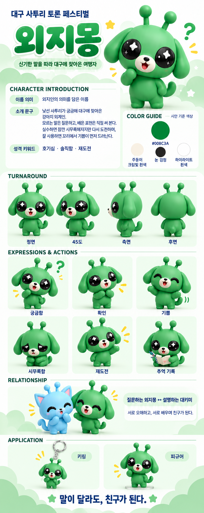

# 외지몽 원본 기반 세부 캐릭터 시트

**SOURCE DETAIL 01 / 2026-11-03 / 전체 키 105cm**

원본 유지 · 4시점 외곽 · 눈 앞머리 · 엄지 · 얼굴·몸통 곡선 · 명암 기록

## 01. 원본과 좌표·근거

외지몽의 반복 활용을 위한 원본 관측 시트다. 캐릭터 디자인을 바꾸지 않고 제공된 설정 보드의 픽셀 외곽·얼굴·손·음영을 기록했다. v4에서 임의로 줄였던 눈·몸통·귀·구슬 값은 이번 측정의 근거로 사용하지 않았다. 전체 키 105cm는 사용자 지정값이다.

정면 환산 기준은 위쪽 y=705부터 발바닥 y=915까지 210px=100u=105cm다. 1px≈0.500cm. 원본 좌상단이(0,0), 오른쪽+x·아래쪽+y다. 정면 중심축 x=120. 모든 사각형의 오른쪽·아래 좌표는 미포함이다.

수치의 종류를 구분한다. 자동 추출값=색·밝기 임계값에서 얻은 픽셀 경계. 수동 판독값=겹친 부위의 외곽·이음선·엄지 위치를 원본에서 읽은 근사점. 사용자 확정값=키·개수·색 영역 등. 가려진 구조와 원본 3D 모델의 정확한 곡률·깊이는 임의로 만들지 않는다.

| 시점 | 원본 분석 영역 | 검출 외곽 경계 | 투영 높이px |
|---|---|---|---|
| 정면 | [20, 695, 214, 927] | [31, 705, 211, 913] | 208 |
| 45도 | [214, 695, 406, 927] | [218, 701, 387, 915] | 214 |
| 측면 | [410, 695, 580, 927] | [419, 700, 554, 918] | 218 |
| 후면 | [580, 695, 777, 927] | [586, 706, 760, 917] | 211 |

검출 경계와 수동 키 기준은 밝은 구슬 끝·발 가장자리의 색과 그림자 때문에1~2px 차이 날 수 있다. 이는 키를 변경한 것이 아니다. 시점마다 크기·원근이 달라 공통 축척의 정밀 직교도라고 가정하지 않는다. 측면 폭을 바로 실제 머리 깊이로 승인하지 않는다.

원본 확인: **정면 원본**, 영역 [20, 695, 214, 927]. 확대·겹침 확인은 [측정 뷰어](measurement_viewer.html)를 사용한다.

원본 확인: **45도 원본**, 영역 [214, 695, 406, 927]. 확대·겹침 확인은 [측정 뷰어](measurement_viewer.html)를 사용한다.

원본 확인: **측면 원본**, 영역 [410, 695, 580, 927]. 확대·겹침 확인은 [측정 뷰어](measurement_viewer.html)를 사용한다.

원본 확인: **후면 원본**, 영역 [580, 695, 777, 927]. 확대·겹침 확인은 [측정 뷰어](measurement_viewer.html)를 사용한다.

## 02. 얼굴형·귀: 외곽과 이음선

원본에 없는 매끈한 타원이나 원형으로 바꾸지 않는다. 원본 픽셀 외곽을 보존한 SVG·CSV가4시점별로 제공된다. 픽셀 계단을 임의로 다듬지 않았으며, 이 선은 원본 벡터 경로나3D 곡면을 복원한 것이 아니다.

머리 외곽점은 직접 보이는 경계와 귀 부착 이음선을 수동으로 읽었다. 귀에 가려진 머리 경계는 검증된 실측선이 아니다. 아래 점들을 이어 그린 선은 측정 확인용 보조선이며 캐릭터에 그리는 선이나 새 디자인이 아니다.

| 점 | 원본(x,y) | 정면 좌표(xu,yu) |
|---|---|---|
| 0 | 121, 743 | 0.48, 18.10 |
| 1 | 145, 747 | 11.90, 20.00 |
| 2 | 164, 759 | 20.95, 25.71 |
| 3 | 177, 777 | 27.14, 34.29 |
| 4 | 181, 799 | 29.05, 44.76 |
| 5 | 175, 820 | 26.19, 54.76 |
| 6 | 163, 835 | 20.48, 61.90 |
| 7 | 145, 844 | 11.90, 66.19 |
| 8 | 120, 848 | 0.00, 68.10 |
| 9 | 94, 844 | -12.38, 66.19 |
| 10 | 77, 835 | -20.48, 61.90 |
| 11 | 65, 818 | -26.19, 53.81 |
| 12 | 61, 796 | -28.10, 43.33 |
| 13 | 66, 776 | -25.71, 33.81 |
| 14 | 79, 759 | -19.52, 25.71 |
| 15 | 99, 748 | -10.00, 20.48 |

원본 확인: **얼굴·귀 수동 판독점**, 영역 [20, 695, 214, 927]. 확대·겹침 확인은 [측정 뷰어](measurement_viewer.html)를 사용한다.

귀 모서리와 테두리의 실제 노출 경계는 원본을 따른다. 대키미는 끝으로 좁아지는 고양이 삼각형, 외지몽은 아래로 늘어진 강아지형이다. 귀 외곽·부착점의 원본 좌표 전체는 measurements.json의 front_ear_landmark_loops에 기록했다.

## 03. 눈 앞머리·눈 윤곽

정면의 검정 눈 영역을 max(R,G,B)<100으로 분리하고 가장 큰 연결영역을 사용했다. 밝은 별 때문에 뚫린 내부는 채우되 바깥 윤곽은 타원으로 대체하지 않았다. 임계값80·100·120 경계도 기록했다. 좌우 차이는 원본 관찰값이며 임의로 대칭화하지 않는다.

| 항목 | 화면 왼쪽 눈 | 화면 오른쪽 눈 |
|---|---|---|
| 경계 | [64, 776, 104, 819] | [137, 779, 178, 821] |
| 크기px | 40×43 | 41×42 |
| 크기cm 환산 | 20.0×21.5 | 20.5×21.0 |
| 안쪽 아래 모서리 | [98, 814] | [141, 815] |
| 모서리 전후 기준점 | [102, 806] / [90, 818] | [149, 819] / [138, 806] |
| 유한 구간 진단 각도 | 143.1° | 135.0° |

날카로움은 한 점의 각도만으로 고정하지 않는다. 아래쪽65~96%·코 쪽35% 영역에서 앞뒤12개 픽셀 외곽 에지를 기준으로 가장 좁게 꺾이는 지점을 찾았다. 표의 각도는 이 분석 구간의 투영 진단값이며 원본 베지어 접선 각도나3D 모서리 각도가 아니다. 실제 경계 좌표와 원본 위의 표시를 함께 사용한다.

원본 확인: **눈 윤곽과 안쪽 아래 모서리 지지점**, 영역 [56, 770, 186, 828]. 확대·겹침 확인은 [측정 뷰어](measurement_viewer.html)를 사용한다.

눈 경계 중심 간격 73.5px≈36.8cm, 눈 사이 빈 간격 33px≈16.5cm. 전체 눈 외곽 좌표는 eye_left_outline.csv·eye_right_outline.csv에 있다. 정면의 값과 기울어진 대표 이미지의 투영 눈 크기를 평균내지 않는다.

## 04. 눈 하이라이트의 위치·크기·밝기

각 눈의 의도된 하이라이트3개를 수동 작은 영역 안에서 분리했다. 큰 별·작은 회색 반짝임·아주 작은 마름모/반사 형태를 구분한다. 자연 광택의 밝은 성분을 모두 추가 디자인 점으로 세지 않는다. 작은 반짝임까지 모두 흰색으로 올리면 원본 인상이 달라진다.

| 눈·요소 | 중심: 눈 내부% | 크기px | 관찰색 |
|---|---|---|---|
| 왼쪽 큰 별 | 55.3, 31.7 | 16×16 | #F2F2F2 |
| 왼쪽 작은 회색 반짝임 | 24.7, 67.6 | 5×7 | #A8A8AA |
| 왼쪽 아주 작은 반사·마름모 | 20.4, 22.9 | 3×3 | #BCB6B6 |
| 오른쪽 큰 별 | 52.7, 32.2 | 15×16 | #F6F5F6 |
| 오른쪽 작은 회색 반짝임 | 72.0, 72.6 | 4×6 | #A6A6A6 |
| 오른쪽 아주 작은 마름모 | 20.7, 51.2 | 4×4 | #CAC9C9 |

원본 확인: **원본 하이라이트 분리 영역**, 영역 [56, 770, 186, 828]. 확대·겹침 확인은 [측정 뷰어](measurement_viewer.html)를 사용한다.

중심 좌표는 각 눈 경계 사각형의 좌상단(0,0)·우하단(100,100) 기준이다. 관찰색은 렌더링된 원본 픽셀의 중앙값이며 브랜드색이나 원본 셰이더의 기본색이 아니다. 좌우 눈에 동일 좌표를 무조건 복사하지 않는다.

## 05. 몸통 너비·곡선·팔 연결

몸통 너비는 전체 캐릭터 외곽 폭과 다르다. 외곽에는 팔·꼬리가 포함되므로, 아래는 몸통과 팔의 분리 이음선을 수동 판독한 폭이다. 가려진 접합부 때문에 양쪽 경계 각각 약±2px 판독 범위를 권장한다. 이것은 통계적 신뢰구간이나 제조 공차가 아니다. 배의 명암을 실제 돌출 경계로 오인하지 않는다.

| 원본y | 왼쪽x / 오른쪽x | 몸통 폭px | 100u 대비 / cm 환산 |
|---|---|---|---|
| 848 | 97 / 146 | 49 | 23.3u / 24.5cm |
| 856 | 92 / 152 | 60 | 28.6u / 30.0cm |
| 864 | 88 / 157 | 69 | 32.9u / 34.5cm |
| 872 | 86 / 159 | 73 | 34.8u / 36.5cm |
| 880 | 86 / 158 | 72 | 34.3u / 36.0cm |
| 888 | 92 / 155 | 63 | 30.0u / 31.5cm |

원본 확인: **몸통 폭 판독선·팔·다리 연결**, 영역 [68, 839, 178, 920]. 확대·겹침 확인은 [측정 뷰어](measurement_viewer.html)를 사용한다.

목은 드러나지 않고 머리 아래와 자연스럽게 연결된다. 어깨를 구형 관절처럼 분리하지 않는다. 배는 짧은 둥근 볼륨이며 하단에서 다리로 이어진다. 표의 판독점을 이은 선은 위치 확인선이지 캐릭터에 추가하는 옆선이 아니다. 전 시점의 실제 외곽 곡선은 매 픽셀 행과 경계 에지 좌표로 제공한다.

## 06. 손·엄지의 구분

기본 정면에서 팔을 내렸을 때는 손가락 윤곽이 가려져 있다. 엄지가 보이는 동작을 별도 관측한다. 손바닥의 큰 둥근 덩어리와 측면의 작은 엄지 돌출, 그 사이의 얕은 오목점을 유지한다. 다섯 손가락을 펼친 사람 손으로 바꾸거나 모든 자세에서 엄지를 강제로 밖으로 빼지 않는다.

참조 동작: retry raised hand. 다음은 해당 동작의 원본 픽셀 수동 판독값이다. 원근과 자세가 다른 정면 전체 키 기준으로 cm를 바로 환산하지 않는다.

| 요소 | 원본 좌표 | 크기px / 의미 |
|---|---|---|
| 손바닥 경계 | [445, 1337, 465, 1361] | 20×24 |
| 엄지 돌출 경계 | [436, 1334, 450, 1344] | 14×10 |
| 손바닥·엄지 사이 오목점 | [450, 1338] | 겹침·명암으로 보이는 얕은 분리 위치 |
| thumb_tip | [442, 1335] | 수동 확인점 |
| thumb_outer | [436, 1341] | 수동 확인점 |
| thumb_notch | [450, 1338] | 수동 확인점 |
| palm_outer | [464, 1349] | 수동 확인점 |
| palm_bottom | [450, 1361] | 수동 확인점 |

원본 확인: **원본의 손바닥·엄지 구분**, 영역 [425, 1328, 480, 1378]. 확대·겹침 확인은 [측정 뷰어](measurement_viewer.html)를 사용한다.

표의 엄지 경계는 해당 동작에서 엄지로 읽히는 노출 돌출부의 관측 영역이다. 손바닥·팔에 겹친 전체 엄지 길이와 부피를 이 사각형으로 확정하지 않는다. 정면에서 이 형태가 가려지면 엄지를 강제로 추가하지 않는다. 짧은 원본 픽셀 때문에1~2px의 판독 변화도 크다.

## 07. 부위별 경계·귀·안테나·꼬리

| 부위 | 원본 수동 경계 | 너비×높이px | 100u / cm 환산 |
|---|---|---|---|
| 머리 본체 | [60, 744, 180, 848] | 120×104 | 57.1×49.5u / 60.0×52.0cm |
| 몸통 근사 | [86, 844, 159, 899] | 73×55 | 34.8×26.2u / 36.5×27.5cm |
| 크림색 주둥이 | [97, 800, 142, 840] | 45×40 | 21.4×19.0u / 22.5×20.0cm |
| 코 | [113, 805, 125, 814] | 12×9 | 5.7×4.3u / 6.0×4.5cm |
| 기본 열린 입 | [110, 814, 130, 832] | 20×18 | 9.5×8.6u / 10.0×9.0cm |
| 화면 왼쪽 팔 | [73, 849, 93, 883] | 20×34 | 9.5×16.2u / 10.0×17.0cm |
| 화면 오른쪽 팔 | [148, 850, 166, 886] | 18×36 | 8.6×17.1u / 9.0×18.0cm |
| 화면 왼쪽 다리·발 | [87, 889, 119, 915] | 32×26 | 15.2×12.4u / 16.0×13.0cm |
| 화면 오른쪽 다리·발 | [125, 889, 157, 915] | 32×26 | 15.2×12.4u / 16.0×13.0cm |
| 화면 왼쪽 구슬 투영 | [85, 705, 111, 733] | 26×28 | 12.4×13.3u / 13.0×14.0cm |
| 화면 오른쪽 구슬 투영 | [139, 706, 166, 734] | 27×28 | 12.9×13.3u / 13.5×14.0cm |
| 화면 왼쪽 줄기 투영 | [96, 730, 110, 750] | 14×20 | 6.7×9.5u / 7.0×10.0cm |
| 화면 오른쪽 줄기 투영 | [137, 731, 152, 751] | 15×20 | 7.1×9.5u / 7.5×10.0cm |
| 화면 왼쪽 귀 투영 | [31, 758, 74, 834] | 43×76 | 20.5×36.2u / 21.5×38.0cm |
| 화면 오른쪽 귀 투영 | [160, 760, 212, 837] | 52×77 | 24.8×36.7u / 26.0×38.5cm |

이 표는 경계 사각형이지 형태를 대체하는 도형이 아니다. 코·입·발의 고유 윤곽은 원본을 따른다. 다리와 발은 구분되지만 원본에 있는 발등 명암을 임의의 신발 테두리나 발목 띠로 바꾸지 않는다.

안테나2개·끝 구슬2개를 유지한다. 측면에서 안테나 하나가 다른 하나에 가려져도 실제 개수를 줄이지 않는다. 구슬과 줄기가 같은 색으로 이어져 있으므로 원본 픽셀만으로 접합부의 정확한3D 구 지름을 분리했다고 주장하지 않는다. 전 시점의 관측 외곽은 SVG·CSV에 보존했다.

대키미는 긴 말린 고양이 꼬리, 외지몽은 짧고 뭉툭한 강아지 꼬리를 유지한다. 정면에서 가려진 꼬리 뿌리·손의 뒤쪽·귀 뒤 구조는 후면과 측면에서 보이는 범위까지만 판단한다. 후면의 꼬리 방향을 정면과 기계적으로 좌우 반전하여 새 구조로 만들지 않는다.

## 08. 전 시점 실루엣·높이별 폭

각 시점에 원본색 마스크와 얼굴의 검정·크림색 돌출부를 포함하고, 원본 외부와 이어진 다리 사이 틈은 유지했다. 닫힌 눈·주둥이 같은 내부 구멍만 채워 외곽을 얻었다. 색 임계값의 등고선이므로 미세한 가장자리 차이를 원본 벡터의 정확한 곡률로 해석하지 않는다.

| 시점 | 높이25% 부근 폭px | 높이50% 부근 폭px | 높이75% 부근 폭px |
|---|---|---|---|
| 정면 | 101 | 179 | 110 |
| 45도 | 100 | 169 | 106 |
| 측면 | 90 | 133 | 98 |
| 후면 | 108 | 174 | 92 |

위 폭은 귀·팔·꼬리를 포함한 화면상의 전체 외곽 폭이다. 몸통 폭으로 사용하지 않는다. scanlines CSV에는 매 행의 바깥 폭과 분리된 실제 점유 구간을 모두 저장하여 다리 사이 틈을 검정으로 채우는 오류를 막는다.

원본 확인: **측면 원본 위 픽셀 외곽선**, 영역 [410, 695, 580, 927]. 확대·겹침 확인은 [측정 뷰어](measurement_viewer.html)를 사용한다.

원본 확인: **후면 원본 위 픽셀 외곽선**, 영역 [580, 695, 777, 927]. 확대·겹침 확인은 [측정 뷰어](measurement_viewer.html)를 사용한다.

## 09. 기본색·눈 광택·배 아래 음영

| 부위 | 관찰 또는 명시값 | 근거 |
|---|---|---|
| 대표 몸색 | #008C3A | 보드에 명시된 HEX |
| body | #028437 | 견본 내부9×9px 중앙값 |
| muzzle_and_inner_ear | #F8F0E4 | 견본 내부9×9px 중앙값 |
| eyes | #262524 | 견본 내부9×9px 중앙값 |
| highlights | #FEFEFE | 견본 내부9×9px 중앙값 |

기본 홍조는 없다. 대키미 코·입 주변은 하늘색, 외지몽 주둥이와 보이는 귀 안쪽은 같은 크림빛 흰색을 유지한다. 보드 일부 감정 장면의 패치·홍조는 기본형에 상시 적용하지 않는다. 브랜드 기본색과 조명 아래 피부의 관찰색은 구분한다.

| 위치 | 원본 중심(x,y) | 관찰색 | 선형 상대휘도Y |
|---|---|---|---|
| 머리 아래 연결부 | [120, 849] | #026622 | 0.0963 |
| 배 중앙 | [120, 870] | #49B262 | 0.3414 |
| 배 하부 중간 | [120, 885] | #399A50 | 0.2456 |
| 배 하단 | [120, 893] | #268A41 | 0.1897 |
| 화면 왼쪽 다리 안쪽 | [111, 899] | #026B24 | 0.1066 |
| 화면 오른쪽 다리 안쪽 | [129, 899] | #09772D | 0.1344 |
| 다리 사이 틈 | [121, 905] | #C2D6C0 | 0.6337 |
| 바닥 접지 음영 | [121, 915] | #D8EAD5 | 0.7825 |
| 바닥 배경 | [121, 922] | #E3F4E3 | 0.8658 |

원본 확인: **배 아래·다리 사이·바닥 샘플**, 영역 [68, 839, 178, 920]. 확대·겹침 확인은 [측정 뷰어](measurement_viewer.html)를 사용한다.

색은5×5px 채널 중앙값이고 Y는 sRGB 가정 아래 계산한 선형 상대휘도다. 원본 셰이더의 빛 세기·거칠기·재질 기본색을 역산한 값이 아니다. 배 하단에는 부드러운 피부 음영을 유지하고, 다리 사이의 밝은 배경·발밑의 접지 그림자와 구분한다. 별도 검정 반달·배의 수평 홈·봉제선·색 띠를 추가하지 않는다.

몸 표면의 부드러운 낮은 광택과 검정 눈의 광택을 분리한다. 작은 반짝임·큰 별의 밝기를 구분하고, 원본보다 과도하게 쨍한 색·강한 반사·거친 점토 결·솜털을 추가하지 않는다. 이번 시트에는 원본에서 복원할 수 없는 roughness 같은 재질계수를 임의로 넣지 않았다.

## 10. 반복 활용 방법과 판정

원본 보드와 이 시트의 해당 시점 자료를 함께 사용한다. 먼저 기본형을 맞추고 그다음 포즈·표정을 확장한다. 원본 얼굴형·눈 앞머리·엄지 돌출·몸통 곡선·배 명암이 맞는지 각각 검수한다. 텍스트·수치만으로 생성형 모델이 동일한 픽셀과3D 구조를 보장하는 것은 아니므로 결과를 곧바로 공식 기준으로 등록하지 않는다.

정확한 외곽이 필요한 일러스트·모델링 작업에서는 해당 시점 SVG·좌표를 실제 가이드로 사용한다. 원본 픽셀 외곽은 충분히 확대하면 계단이 보이므로, 원본 해상도 이상으로 임의의 곡면이 확정된 것으로 해석하지 않는다. 더 높은 해상도 원본이나 원본3D가 생기면 같은 좌표 체계에서 갱신한다.

첨부된 외지몽 원본 설정 보드의 TURNAROUND 시점을 기준으로 동일 캐릭터를 재현한다. 새로 귀엽게 재디자인하지 않는다. 눈은 눈앞 안쪽 아래가 좁아지는 원본 윤곽을 유지하고 단순한 원·타원으로 바꾸지 않는다. 각 눈3개 하이라이트의 위치와 밝기를 원본처럼 구분한다. 손을 든 자세에서 손바닥·작은 엄지 돌출·얕은 오목점을 유지하고 나머지 손가락을 추가하지 않는다. 몸통 폭은 머리와 구분되는 원본의 높이별 곡선을 유지하며 배·볼·어깨를 부풀리지 않는다. 배 아래 피부 명암, 다리 사이의 밝은 틈, 발밑 접지 음영을 구분한다. 안테나2개, 전체 키105cm, 기본 홍조 없음. 주둥이와 보이는 귀 안쪽은 동일한 크림빛 흰색을 유지한다.

첨부 파일: 원본 PNG, measurements.json, 각 시점 outline.csv·scanlines.csv·source_trace.svg, 눈 외곽 CSV2개, 몸통 폭 CSV, 얼굴 기준점 CSV, 원본 확대·측정 표시 HTML. 이전 임의 조정값을 사용하지 않았으며 원본 이미지와 PART별 원문을 변경하지 않았다.

## 원본 보드

