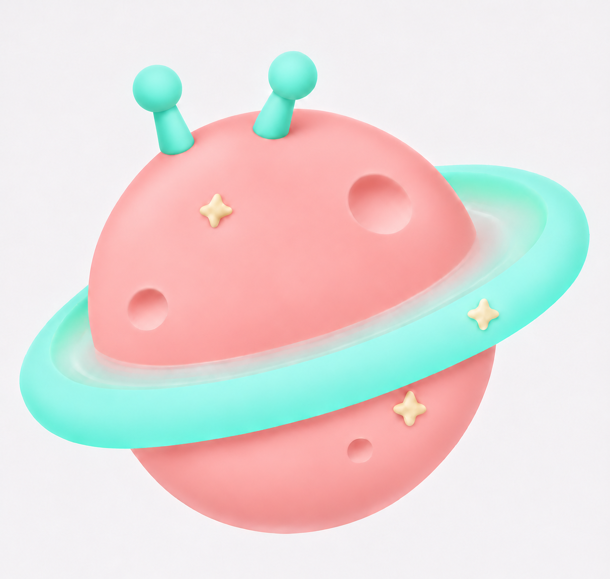

# 얼라별 디자인시트 v01

- 작성일: 2026-11-11
- 대상: 대키미·외지몽의 고향 행성 ‘얼라별’
- 목적: 이 문서와 동봉된 레퍼런스만으로 같은 디자인을 해석하고 이미지·영상·실물 제작에 활용하기 위한 기준.
- 상태: 사용자가 확정한 디자인 요구사항을 기록한 1차 문서. 수치·색상 제안과 미검증 사항은 별도로 표시한다.
- 재현 범위: 형태·배색·구성·재질의 일관성을 목표로 한다. 생성형 이미지의 픽셀 단위 동일성이나 정밀 3D 형상은 보장하지 않는다.

## 1. 이름과 브랜드의 관계 — 확정

행성의 이름은 **얼라별**이다. 대키미와 외지몽의 고향이다.

**행성 이름 ‘얼라별’에서 브랜드명 ‘대구 얼라들’로 확장되었다.** ‘얼라’라는 이름은 대구 사투리 등 지역의 언어적 정서와도 연결된다. 브랜드명에서 행성 이름이 파생되었다고 설명하지 않는다.

그 외 탄생 이야기, 주민, 지형, 생태, 행성의 능력이나 고리의 기능은 아직 정하지 않았다. 임의로 공식 설정을 추가하지 않는다.

## 2. 자료 우선순위와 사용법

상충하는 내용은 다음 순서로 판단한다.

1. 사용자가 확정한 규칙과 이후의 명시적 수정 지시.
2. 이 문서의 **확정** 항목.
3. 정면 기준 원본 `01_front_master_v15.png`: 전체 인상, 색감, 질감, 고리, 장식 위치의 최우선 시각 자료.
4. `02_six_views_review_v02.png`: 옆면·후면과 회전 방향을 이해하는 보조 자료. 정밀 투영 도면이 아니다.
5. 대키미·외지몽의 v04 이미지: 행성에 적용할 그림체·몸체 재질·빛반사의 참고 자료.
6. 이 문서의 제안 수치: 검증 또는 별도 승인 전에는 확정 규격으로 취급하지 않는다.

특히 더듬이는 원본에 보이는 미세한 비대칭보다 **동일한 부품을 좌우 반전한다는 확정 규칙**을 우선한다. 여섯 방향에서 다르게 그려진 부분을 각각 별도 디자인으로 해석하지 않는다.

### 동봉 레퍼런스

| 파일 | 역할 | 주의 |
|---|---|---|
| [01_front_master_v15.png](reference/01_front_master_v15.png) | 정면 최우선 원본 | 더듬이의 정확한 대칭은 확정 문구 우선 |
| [02_six_views_review_v02.png](reference/02_six_views_review_v02.png) | 6방향 보정 검토본 | 고리 투영·더듬이·장식의 3D 일관성은 미검증 |
| [03_oejimong_style_v04.png](reference/03_oejimong_style_v04.png) | 외지몽 그림체 참고 | 눈이 아닌 몸체 표면의 질감 참고 |
| [04_daekimi_style_front_v04.png](reference/04_daekimi_style_front_v04.png) | 대키미 정면 그림체 참고 | 캐릭터의 얼굴·귀·팔다리를 행성에 추가하지 않음 |
| [05_daekimi_style_seated_v04.png](reference/05_daekimi_style_seated_v04.png) | 대키미 입체·재질 참고 | 리본·젤리패드는 행성 구성 요소가 아님 |

문서와 `reference` 폴더를 함께 전달한다. 생성 도구에 이미지 입력 기능이 있다면 정면 원본을 반드시 실제 입력으로 첨부한다. 파일 이름만 프롬프트에 적는 것으로 대체하지 않는다.

## 3. 기본 형태 — 확정

- 둥글고 말랑한 인상의 구형 본체 하나.
- 본체 위쪽에 공 모양 끝을 가진 짧은 더듬이 두 개.
- 본체를 둘러싸는 넓고 둥근 고리 하나.
- 얕고 둥근 분화구와 작은 크림색 별 장식.
- 얼굴, 눈, 입, 귀, 팔다리는 구성 요소에 포함하지 않는다.
- 본체는 길쭉한 타원이나 납작한 원반으로 바꾸지 않는다. 고리와 장식 때문에 가려지는 실루엣은 허용한다.

## 4. 고리 — 확정

고리는 **본체에서 실제로 떨어진 구조가 아니다.** 본체와 고리의 안쪽이 연속적인 투명 연결면으로 붙어 있다. 연결 부분이 투명해서 멀리서 보면 바깥쪽 고리가 떠 있는 것처럼 보인다.

- 고리는 하나의 연속된 구조이다. 여러 개의 분리된 고리를 겹치지 않는다.
- 본체에 가까운 안쪽은 무색 투명하고, 바깥쪽으로 갈수록 민트색이 드러난다.
- 바깥 가장자리는 부드럽고 둥글다.
- 투명 연결면 너머로 본체나 배경이 비쳐야 한다. 흰 띠나 불투명한 회색 띠로 대체하지 않는다.
- 정면에서는 왼쪽 아래에서 오른쪽 위로 향하는 사선 배치이다. 정면 원본의 폭과 전체 인상을 따른다.
- 고리 앞쪽은 본체 앞을 지나고 뒤쪽은 본체 뒤로 가려진다.
- 최신 원본에는 이전보다 10% 확대한 고리가 반영되어 있다. 재현 시 원본에서 다시 10% 확대하지 않는다.
- 고리의 크림색 별은 앞쪽 오른편에 하나만 있다. 뒷면에 복제하지 않는다.

## 5. 더듬이 — 확정

- 두 더듬이 모두 고리와 같은 계열의 민트색이다. 코랄색·하늘색·초록색·살구색의 과거 시안은 사용하지 않는다.
- 오른쪽 더듬이를 기준 부품으로 삼아 **동일 부품을 좌우 반전한 형태**를 왼쪽에 사용한다.
- 공의 지름, 줄기 길이, 두께, 테이퍼와 연결 방식이 같다. 서로 다른 부품처럼 그리지 않는다.
- 오른쪽은 오른쪽으로, 왼쪽은 왼쪽으로 살짝 기울어진다. 두 부품의 기준 기울기는 거울 대칭으로 해석한다.
- 정면에서 왼쪽의 부착 위치는 오른쪽보다 조금 낮다. 같은 부품이어도 배치 높이는 다를 수 있다.
- 한 쌍은 정면에서 본체 상단 중심보다 조금 왼쪽에 놓이고, 사이에는 분명한 간격이 있다.
- 최종 크기와 간격은 정면 원본의 인상을 기준으로 한다. 대화 중의 확대·축소 퍼센트를 다시 누적 적용하지 않는다.
- 단일 3D 모델에서는 두 부품의 실제 치수를 같게 만든다. 회전 시 원근과 가림 때문에 보이는 크기가 달라지는 것은 허용한다.
- 더듬이 끝을 별·하트·납작한 타원으로 바꾸지 않는다.

## 6. 배색과 재질

### 6.1 확정된 배색 관계

| 요소 | 확정된 색감 |
|---|---|
| 본체 | 부드러운 코랄 핑크 |
| 고리 바깥쪽 | 밝은 아쿠아 민트 |
| 더듬이 2개 | 고리와 동일한 민트 계열, 서로 같은 기본색 |
| 별 장식 | 따뜻한 크림색 |
| 고리 안쪽 연결면 | 무색 투명, 바깥으로 갈수록 민트 발색 |

초기 보색 아이디어보다 최종 코랄·민트 배색을 우선한다. 라벤더 본체나 살구·민트로 나뉜 더듬이는 폐기된 탐색안이다.

### 6.2 색상 코드 — 제안 / 일부 출처 확인

| 요소 | 제안 기본색 | 상태 |
|---|---|---|
| 본체 | `#ED9E97` | 제작자가 제안한 값. 원본의 재질 기본색을 측정·확정한 값이 아님 |
| 고리·더듬이 | `#91EAED` | 사용자가 초기 고리 포인트로 제시한 `#91EAEDFF`의 RGB 값. 최종 렌더에서의 정확한 기본색은 미확정 |
| 별 | `#FFF0D7` | 제작자가 제안한 값. 별도 색상 검증 전 |

`#91EAEDFF`의 마지막 `FF`는 해당 색상 코드의 알파값이다. 고리 전체가 불투명하다는 의미가 아니며 안쪽 투명 연결 구조는 별도로 유지한다.

현재 코드들을 최종 실물 인쇄·도색용 확정 색상으로 사용하지 않는다. 조명이 포함된 이미지의 픽셀색과 3D 재질 기본색도 구분한다. CMYK·팬톤·소재별 도색값은 아직 지정하지 않았다.

### 6.3 그림체·빛반사 — 확정

대키미·외지몽 v04의 **몸체**처럼 매끈하고 부드러운 3D 마스코트 표현을 사용한다. 둥근 볼륨과 부드러운 명암으로 입체감을 만든다.

- 은은한 반사는 남기되 큰 흰 반사 얼룩이나 번쩍이는 광택 띠는 억제한다.
- 완전 무광 클레이로 바꾸지 않는다. 유광 플라스틱·도자기처럼 과도하게 번쩍이게 만들지도 않는다.
- 캐릭터의 검은 눈처럼 강한 광택을 몸체 전체에 적용하지 않는다.
- 거친 입자, 복숭아 껍질, 털, 금속 표면 표현은 사용하지 않는다.
- 투명 연결면은 비침과 약한 경계 표현으로 읽히게 한다. 강한 반사로 존재를 강조하지 않는다.
- 조명에 따라 명암은 변할 수 있지만 코랄·민트의 배색 정체성은 유지한다.
- 재질의 수치화된 거칠기·굴절률·투명도는 아직 확정하지 않았다.

## 7. 장식 배치 — 확정

아래의 왼쪽·오른쪽은 **해당 정면 또는 후면 이미지를 보는 관찰자의 화면 기준**이다. 장식은 표면의 고정 위치에 붙어 있으며 회전할 때 함께 움직인다.

| 면 | 요소 | 개수와 위치 |
|---|---|---|
| 정면 본체 | 크림색 별 | 2개: 위쪽 왼편, 아래쪽 오른편 |
| 정면 본체 | 분화구 | 3개: 위쪽 오른편의 큰 것, 왼편 중간의 중간 크기, 아래쪽 오른편의 작은 것 |
| 고리 | 크림색 별 | 1개: 정면에서 보이는 고리 오른편 |
| 후면 본체 | 작은 크림색 별 | 1개: 후면을 바라볼 때 위쪽 왼편 |
| 후면 본체 | 작은 얕은 분화구 | 1개: 후면을 바라볼 때 아래쪽 오른편 |

- 전체 본체의 별은 총 3개, 분화구는 총 4개이다. 고리 별을 포함한 전체 별은 총 4개이다.
- 모든 방향마다 이 개수를 새로 채우지 않는다. 가려지는 장식은 보이지 않는 것이 정상이다.
- 별은 끝이 부드럽게 둥근 네 갈래 입체 장식이다. 날카로운 다섯 갈래 별로 바꾸지 않는다.
- 분화구는 얕고 둥근 오목한 형태이며 관통 구멍이나 검은 구멍으로 표현하지 않는다.
- 뒷면 장식은 앞면보다 적고 작게 두어 앞뒤를 구분한다. 정확한 크기 비율과 표면 좌표는 아직 미확정이다.

## 8. 6방향과 회전 규칙

- 정면은 `01_front_master_v15.png`에 보이는 면이다.
- 필요한 뷰: 정면, 왼쪽 45도, 오른쪽 45도, 왼쪽 측면, 오른쪽 측면, 후면.
- 문서상 LEFT는 카메라가 정면에서 대상의 왼쪽 측면을 향해 이동한 시점, RIGHT는 반대 시점으로 정의한다. 각도 표기는 정면에서의 수평 방위각이다. 이 용어 정의는 문서의 작업 규칙이며 생성된 이미지의 각도가 검증됐다는 뜻은 아니다.
- 동일한 모델에서 카메라 시점 또는 본체 전체 회전을 바꾼다. 고리·장식·더듬이를 각 이미지마다 따로 재배치하지 않는다.
- 구형 본체와 고리의 실제 치수는 유지하고, 고리의 투영 타원과 앞뒤 가림은 시점에 따라 바뀐다.
- 뒤에서 보면 고리의 사선 방향이 정면과 반대로 보이는 관계를 유지한다.
- 측면에서는 더듬이와 장식이 서로 가려질 수 있다. 보이게 하려고 임의로 벌리거나 추가하지 않는다.
- 기준 시트는 동일한 축척, 흰 배경, 전체 실루엣이 잘리지 않는 여백으로 구성한다.

**검증 한계:** 동봉된 6방향 이미지는 생성형 이미지 보정 검토본이다. 정확한 ±45도·±90도 투영, 더듬이의 완전한 동일 형상, 고리의 고정 평면, 장식의 일관된 3D 좌표가 모두 검증된 모델 시트는 아니다. 정밀 모델링에서는 이 문서의 고정 규칙과 정면 원본을 우선하고 회전 결과를 별도로 확인한다.

## 9. 치수와 좌표 — 제안 / 미확정

실제 크기를 정하지 않고 **본체 지름 D = 100**으로 표현하는 방식은 문서의 비율 표기 기준으로 사용한다. 아래 수치는 이전 검토에서 제안한 시작값이며, 정면 이미지를 정밀 측정한 결과나 사용자가 확정한 치수가 아니다.

| 요소 | 시작 제안값 | 확정 상태 |
|---|---|---|
| 고리 바깥 실제 지름 | 약 1.50D | 미확정. 화면에 보이는 가로폭과 혼동하지 않음 |
| 더듬이 한 개의 전체 길이 | 약 0.21D | 미확정 |
| 더듬이 공 지름 | 약 0.12D | 미확정 |
| 두 더듬이의 부착 간격·좌표 | 정면 원본 참고 | 수치 미확정 |
| 더듬이 기울기 | 서로 반대 방향의 작은 각도 | 정확한 각도 미확정 |
| 고리 평면 기울기·두께·투명 영역 폭 | 정면 원본 참고 | 수치 미확정 |
| 별·분화구의 크기·높이·깊이·표면 좌표 | 정면 원본 및 승인한 후면 배치 참고 | 수치 미확정 |

프롬프트에 수치를 넣을 경우 ‘시작 제안값’임을 유지한다. 이미지로 확인되는 인상과 충돌하면 숫자를 강제하지 않고 다시 검토한다. 근거 없는 정밀값을 추가하지 않는다.

## 10. 매체별 활용과 허용 범위 — 확정

카카오프렌즈와 같은 온라인·오프라인 활용 범위를 예시로 삼는다. 해당 브랜드의 그림체나 디자인을 모방하라는 뜻은 아니다.

| 활용 | 지킬 것 | 허용 범위 |
|---|---|---|
| 이미지·영상·온라인 콘텐츠 | 형태·배색·더듬이·고리 연결·장식의 고정 위치 | 시점·구도·배경·조명 변경 |
| 회전·애니메이션 | 같은 모델의 표면 요소가 일관되게 회전 | 카메라 이동과 본체 전체 회전 |
| 작은 인쇄물·아이콘 | 본체·고리·더듬이 실루엣과 색상 관계 | 별·분화구의 표현 단순화. 임의로 새로운 장식을 만들지 않음 |
| 실물·굿즈·공간 연출 | 정체성을 유지하는 전체 비율과 실루엣 | 제작에 필요한 두께·연결부·강도 보강 |
| 투명 소재 구현이 어려운 제품 | 본체와 고리가 연결된 구조 | 투명 부분을 반투명 소재로 대체 |

보강·소재 변경은 허용되었지만, 고리를 삭제하거나 더듬이를 다른 모양으로 바꾸는 권한까지 포함하지 않는다. 외관에 큰 영향을 주는 변경은 별도로 검토한다. 제품별 실제 치수와 소재·내구성 사양은 해당 제품 설계 시 정한다.

## 11. 생성·수정용 기본 프롬프트

아래 프롬프트와 정면 원본 이미지를 함께 제공한다. 6방향 검토본은 구조를 이해하는 보조 입력으로만 사용한다. 캐릭터 참고 이미지는 몸체 재질 참고라는 역할을 명시한다.

> 첨부한 정면 원본을 최우선 시각 기준으로 대키미·외지몽의 고향 행성 ‘얼라별’을 재현한다. 둥근 코랄 핑크 구형 본체, 밝은 아쿠아 민트 고리 하나, 같은 민트색의 공 모양 끝 더듬이 두 개를 유지한다. 고리는 본체에 무색 투명한 연속 연결면으로 실제로 붙어 있고 바깥으로 갈수록 민트색이 드러나며, 연결 부분이 투명해서 떠 있는 듯 보인다. 실제 빈틈이나 분리된 여러 고리를 만들지 않는다. 더듬이는 동일 부품을 좌우 반전한 한 쌍으로 공 크기·줄기 길이·두께·형태가 같고 살짝 바깥으로 기울어진다. 정면에서 한 쌍은 상단 중심보다 조금 왼쪽에 있고, 왼쪽 부착점이 조금 낮으며 서로 간격을 유지한다. 앞면 본체에는 원본 위치 그대로 크림색 네 갈래 별 두 개와 얕은 분화구 세 개, 고리 앞쪽 오른편에는 별 한 개를 유지한다. 뒤에서 봤을 때 본체 위쪽 왼편에는 작은 별 하나, 아래쪽 오른편에는 작은 분화구 하나가 있다. 장식들은 표면에 고정되어 회전할 때 함께 움직이고, 가려지는 요소를 복제하지 않는다. 대키미·외지몽 v04 몸체와 어울리는 매끈하고 부드러운 3D 마스코트 질감, 적당히 은은한 반사, 부드러운 입체 음영을 사용한다. 큰 흰 반사 얼룩, 번쩍이는 광택 띠, 완전 무광 클레이, 입자와 털 표현은 피한다. 얼굴·귀·팔다리·추가 장식은 만들지 않는다. 원본의 비율과 배색을 유지한다.

### 부분 수정 원칙

수정할 부위와 바꿀 속성만 지정한다. 예를 들어 더듬이 색상 변경이면 본체·고리·질감·크기·위치·장식은 유지한다고 명시한다. 과거 시안을 섞지 않고 최신 승인 원본을 입력한다. 새 시안을 승인받기 전에는 원본 파일을 덮어쓰지 않는다.

### 회전 시트 추가 지시

> 동일 모델을 정면, 좌우 45도, 좌우 측면, 후면으로 보여준다. 동일한 축척과 카메라 높이를 유지한다. 고리 평면·더듬이 부착점·장식 표면 좌표가 고정된 하나의 모델이어야 한다. 정면 이미지를 단순 반전하거나 장식 위치를 각도마다 다시 구성하지 않는다. 좌우 방향은 이 문서의 시점 정의를 따른다.

## 12. 결과 확인 기준

- [ ] 이름과 브랜드 설명이 ‘얼라별 → 대구 얼라들’ 방향으로 쓰였는가?
- [ ] 정면 원본과 본체·고리·더듬이의 전체 인상이 맞는가?
- [ ] 더듬이 두 개가 동일 부품의 좌우 반전이며 왼쪽은 조금 낮은가?
- [ ] 본체는 코랄, 고리와 더듬이는 같은 민트 계열인가?
- [ ] 투명 연결면이 실제로 이어지고 바깥으로 갈수록 민트색이 드러나는가?
- [ ] 반사가 과하지 않으면서 캐릭터 몸체와 어울리는 부드러운 3D 질감인가?
- [ ] 전체 모델의 장식 수와 앞뒷면 배치가 맞는가?
- [ ] 회전 시 고리·더듬이·장식이 고정된 구조로 움직이는가?
- [ ] 제안 색상과 미확정 치수를 확정값으로 오인하지 않았는가?
- [ ] 실물 제작 변경이 허용된 보강·반투명 대체 범위 안에 있는가?

## 13. 문서 작성 시 확인된 상태

확정된 사용자 요구사항과 제안·미확정 사항을 구분하는 작성 방식은 승인되었다. 레퍼런스 보정은 별도로 승인되었으며, 보정 시안의 모든 형상이 최종 승인된 정밀 도면이라는 뜻은 아니다.

원본의 색상·치수 정밀 측정, 3D 모델 기반 투영 검증, 실물 색상·소재 검증은 아직 수행되지 않았다. 이 작업이 완료되면 문서 버전을 올리고 검증된 값과 새 기준 이미지를 함께 갱신한다.
