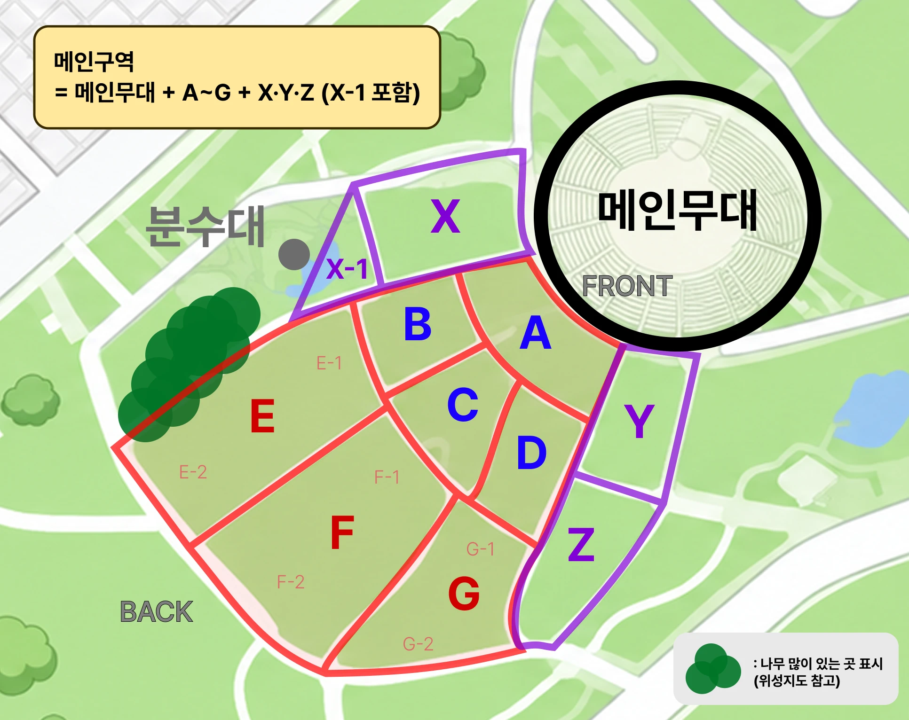

# P0-3 장소 — 세부 지침

> 구분: 고정 + 조사 · 기본 지침: 1장, 3장 (+ 9장) · 진행: **확정 v14 (2026-11-19) — 지도 원본은 Y.지도(지도 담당), 편의시설·그늘은 Y 작성 중** · 최종 수정: 2026-11-19
> 기준 문서: **main `Y.지도/` (지도 담당, 커밋 96be46e, Y v2) — `Y_축제전체_지도.md`·`Y_메인구역_지도.md`**, 기본 지침 v1.1, main `세부지침안/B파트v5` B-1·B-8, main `세부지침안/C파트v3` C-1, main `세부지침안/A파트v4` A-1·A-6·A-9, 노션 A 세부 지침안 A-7(이전 근거), `local리서치v2/통합_조사결과.md` 5-1

## 1. 이 파트의 역할
- 개최 장소(두류공원)와 축제가 쓰는 구역·쓰지 않는 구역, 구역마다 확인할 시설 조건, 교통을 고정해요. 주차장은 일단 다루지 않아요 (팀 결정 2026-11-17).
- 읽는 PART: A(무대), B(먹거리 배치), C(플리마켓 배치), D(굿즈 상점), H(운영·안전), K(지도)

## 2. 확정 값

### 2-1. 장소

| 항목 | 값 | 구분 | 근거 |
| --- | --- | --- | --- |
| 개최지 | 두류공원 (대구 달서구) | 고정 | 기본 지침 1장 |
| 면적 | 1,589,339㎡ (두류공원 1,185,289㎡ + 이월드 404,050㎡) | 조사 | `[확인]` 대구시 공원현황 (통합본 5-1, 요약 기반) |
| 사용 범위 | 코오롱 야외음악당 ~ 공원순환로 | 고정 | B-1 |

### 2-2. 축제 지도 — 원본은 Y.지도 (지도 담당)

> **지도 원본은 main `Y.지도/`예요.** 지도 파트를 따로 분리했어요 (담당자 결정 2026-11-18). P0-3은 Y 지도를 가져와 모든 파트가 쓰는 값만 요약해요. **P0-3과 Y가 다르면 Y가 우선**이고, `/p-sync` 때 Y 커밋을 보고 이 장을 맞춰요.
> 가져온 버전: main `Y.지도/` 커밋 96be46e (Y v2, 2026-11-18 — 안내도에 바리게이트 ⑶ 추가, 허가·공문 목록 5-1). 버전 이력은 Y `Y_수정이력.md`. 아래 그림 두 장은 Y 파일을 그대로 복사한 것이에요.

| 지도 | Y 파일 | 쓰는 법 |
| --- | --- | --- |
| 축제 전체 안내도 | `Y_축제전체_지도.md`, `Y_축제전체_1안내도.webp`(GPT 제작, 업그레이드 중), `Y_축제전체_2위성.webp` | 구역 위치·순서는 안내도, 실제 길 모양·거리는 위성지도 기준 (Y 0장). **안내도의 메인구역 부분(10미·굿즈/이벤트·운영·안전 위치)은 아직 수정 전**이라 메인구역은 아래 구획 지도가 최신이에요 (Y 미확정 6번) |
| 메인구역 구획 | `Y_메인구역_지도.md`, `Y_메인구역_2구획.webp`, `Y_메인구역_3위성.webp` | 구역 이름·배치는 구획 지도, 경계 모양은 위성지도 기준 |

- 그림 안내도라서 **축척·실제 면적·길이는 이 지도에서 재지 않아요.** 실제 길이는 위성지도 거리 재기(2-5-4)와 현장 실측(4-1)으로 채워요.
- **안내도 제목에는 축제 이름 "대사투"를 넣어요** (팀 결정 2026-11-17, 예: "대사투 — 두류공원 축제 안내도" `[가설]`, 정확한 문구는 지도 담당). Y 안내도 제목은 아직 "두류공원 축제 안내도"예요 (7장 12번).

### 2-3. 사용 구역 (Y 지도 요약)

방문객 동선 `[확인]` (Y_축제전체 2장): **축제 출입로 → 운영·안전 부스 → 플리마켓 → 7구 맛집거리 → 메인구역**. 식사존은 이 줄 옆(플리마켓·7구 맛집거리가 만나는 곳 북쪽 2공영주차장)에서 7구 음식을 먹고 쉬는 곳이에요 `[해석]`.

| Y 번호 | 구역 | 위치 (Y 기준) | 프로그램·역할 | 최소 규모 | 담당 PART | 근거 |
| --- | --- | --- | --- | --- | --- | --- |
| 0 | 축제 출입로 | 두류공원로와 공원순환로가 만나는 곳, 두류도서관 아래. **공식 출입로는 1곳** | 입·퇴장. 공원순환로는 원래 차도라 축제 기간 차량 통제 후 축제거리로 씀 | 1곳 | H | Y 전체 3장 |
| 1 | 운영·안전 부스 | ① 공원순환로 초입 부근 + **2·28 자유광장 앞 광장 일부** ② 메인구역 X구역 (2027 기준) | 운영진 부스, 안내데스크·의료실 등 안전 부스. **스탬프 북 배부·완성 보상 교환과 정보 안내** (스탬프 운영은 H-10, 축제 팔찌는 없앰 — H파트v3) | 2곳 | H | Y 전체 3장, Y 메인 2장, A-1 |
| 2 | 플리마켓 | 운영·안전 부스가 있는 길 ~ 두류공원2공영주차장 앞 공원순환로 | 소상공인 플리마켓 | **최소 50~최대 60부스** (셀러 요청 부스 수 합계, 판매:체험 비율은 참고값) | C | Y 전체 3장, C-1 2-2 (담당자 결정 2026-11-19: 파트 값 채택) |
| 3 | 7구 맛집거리 | 플리마켓 끝 ~ 임시 바리게이트 ⑴까지 이어진 공원순환로 | 대구 7구 맛집거리 | **최소 60~최대 70부스** (구별 최소 배정 50동 + 제과점·대구 본점 프랜차이즈 후원사 약 10곳 포함, 업소 요청 부스 수 합계) | B | Y 전체 3장, B-1 2-1·B-4 2-2·B-5 2-6 (담당자 결정 2026-11-19: 파트 값 채택) |
| 4 | 메인구역 | 코오롱 야외음악당(메인무대) + 앞 잔디광장 = 메인무대 + A~G + X·Y·Z (2-3-1) | 메인무대, 10미 포장마차, 굿즈·이벤트, 운영·안전 부스. 메인 프로그램과 부대 프로그램 | 메인 무대 1개 (무대 수는 7장 2번) | A, E | Y 메인, A-9 |
| 5 | 식사존 | **두류공원2공영주차장** (광장휴게소 옆). 차량 통제 후 사용 | 테이블 + 의자, 앞쪽에 메인무대 중계 대형 디스플레이. 7구 음식 먹기·휴식, 메인구역 혼잡 분산 | 확인 필요 | 확인 필요 (B 관할 아님, B-1 2-1-2) | Y 전체 3장 |
| 6 | 임시 바리게이트 | ⑴ 7구 맛집거리 끝, 오르막길 시작 부근 ⑵ 야외음악당로와 공원순환로가 만나는 길(식사존 서쪽), 두류공원3공영주차장 입구 근처 ⑶ 플리마켓이 꺾이는 갈림길(2·28 자유광장 서남쪽)에서 남동쪽으로 이어지는 공원순환로 (Y v2 안내도에 표시. 막아도 되는지 팀 확인은 Y 미확정 7번) | ⑴·⑶ 통행 제한. **⑵는 비상 차량 진입이 필요할 때와 폐장 때 열어요** (출입로 혼잡 줄이기) | 3곳 | H | Y 전체 6-1, 담당자 결정 2026-11-18 (Y 값 채택) |
| — | 비상 차량 이동로 | **임시 바리게이트 ⑵를 열어** 사용 | 구급·소방 차량 진입 | 1곳 | H | Y 전체 6-1 |
| **합계 (부스)** | | | | **150~170부스 (10미 40 + 7구 60~70 + 플리마켓 50~60) + 운영·안전 부스 2곳 + 굿즈샵·이벤트 부스(X구역)** | | |

- 코오롱 야외음악당 건물은 **메인무대 스태프·방송 장비·섭외자(연예인·뮤지컬 배우 등)가 들어오는 곳**이에요 (Y 전체 3-2).
- Y 전체 3장 표의 "참고 파트"는 플리마켓 B, 7구 맛집거리 C로 적혀 있어요. C-1·B-1과 반대라 P0-3은 **플리마켓 C, 7구 B**로 써요 (7장 15번).
- 10미 40동은 **최소 기준**이에요. 7구 맛집거리(60~70)와 플리마켓(50~60)은 **범위**이고, 업소·셀러가 계획서에 적은 **요청 부스 수**의 합계로 그해 부스 수가 정해져요. 합계가 최소에 못 미치면 보충 규칙(B-5 2-4, C-3 2-6), 최대를 넘으면 심사 점수 상위만 골라요. 첫해는 최소 규모로 시작하고, 판매·대기·방문객 데이터로 매년 조정해요 (B-1, C-1).
- 구역의 **총 부스 수를 늘리거나 줄이려면 팀 승인**이 필요해요. 같은 총량 안에서 옮기는 재배치는 B 담당 확인으로 해요 (B-1 3절 6번, 2-1-3). 단, 7구 맛집거리가 60~70 범위 안에서 달라지는 것은 설계된 범위라 승인이 필요 없고, 범위 자체(60·70)를 바꿀 때만 승인을 받아요 (B-1 3절 6번 예외).
- 대구 본점 프랜차이즈 후원사 부스는 별도 구역 없이 **7구 맛집거리 안**에 함께 둬요. 7구 안에서 일반 업소 구간과 프랜차이즈 구간을 어떻게 나눌지는 미정이에요 (B-1 7절 5번, 7장 17번).
- 부스 규격: 음식 부스(10미·7구·제과점) 5m × 5m, 플리마켓 부스 3m × 3m (B-1 2-1-1). 통로 폭은 실제 배치 때 정해요.
- 구역 역할은 고정이고, 구역 안 부스 배치는 조건부로 바꿀 수 있어요 (B-1 5절). 메인구역 X·Y·Z 용도는 해마다 바뀔 수 있어요 (Y 메인 2장).
- "확인 필요"로 둔 칸은 7장 회의 안건이에요. 에이전트가 임의로 채우지 않아요.

#### 2-3-1. 메인구역 구획 (Y_메인구역_지도)

| 구역 | 용도 (2027 기준) | 비고 |
| --- | --- | --- |
| A · B · C · D | 돗자리 존 | A파트v5 A-6은 "A구역 = 골든벨 예선 장소"였지만, **A-9 v6은 골든벨 참가자가 무대 앞 의자석에서 풀고 결승 진출자만 무대**로 적음. 의자석 위치는 Y 구획에 아직 없음 (7장 18번) |
| E · F · G | 앞쪽(n-1) 테이블 존, 뒤쪽 외곽(n-2) 10미 포장마차 | 테이블 존은 B 손님과 선착순 자유 사용 (A-1). n-1 / n-2 구분선은 지도 담당이 정함 (Y 메인 미확정 2번) |
| X (X-1 포함) | 운영·안전 부스, 굿즈샵·이벤트 부스 | X-1 = 분수대 앞 평지. 토론대회 리허설 때 신분증 확인도 여기 (A-1, A-10) |
| Y | X구역·Z구역 부스 혼합 | |
| Z | 10미 포장마차 | |

- 부르는 법 (Y 메인 3장): 메인무대에 가까우면 **앞쪽**, 멀면 **뒤쪽** (예: "C구역 앞쪽"). E·F·G는 앞쪽 n-1 / 뒤쪽 n-2. X·Y·Z는 C구역에 가까운 쪽 **내부**, 먼 쪽 **외곽**.
- "광장"과 "잔디광장" 중 공식 표현은 팀 회의 안건이에요 (Y 메인 미확정 1번).

#### 2-3-2. 사용하지 않는 구역

| 구역 | 처리 | 근거 |
| --- | --- | --- |
| 2·28 자유광장 안쪽 동그라미 구역 (타원형 경기장) | 사용하지 않음. **앞 광장 일부는 운영·안전 부스로 써요** | Y 전체 3-1, 담당자 결정 2026-11-18 (Y 값 채택) |

### 2-4. 수용 규모 참고값 (목표치 아님)

| 항목 | 값 | 라벨 |
| --- | --- | --- |
| 대구치맥페스티벌 2024 첫날 방문객 | 약 20만 명 (5일 약 100만 명) | `[확인]` 대구시 뉴스룸 2024-07-08 |
| 대구치맥페스티벌 사용 구역 | 2024·2025: 2.28 자유광장(메인), 2주차장, 코오롱 야외음악당, 잔디광장 / 2026: 2·28 자유광장, 2·28 기념탑 주차장(두류공원 2공영주차장), **두류공원 로드 일대, 코오롱 야외음악당** 4구역 | `[확인]` 대구시 뉴스룸 2024·2025, 경북매일 2025-06-15·2026, 대한민국구석구석(한국관광공사) 2026 축제 정보 |
| 인파 중점관리 기준 | 순간 최대 3만 명 이상 예상 행사 | `[확인]` 행안부 (통합본 5-1) |

- 치맥과 **겹치는 구역은 코오롱 야외음악당, 두류공원 로드(공원순환로) 일대, 2공영주차장(우리 식사존)**이에요. 치맥 메인인 2.28 자유광장은 우리는 앞 광장 일부(운영·안전 부스)만 써요. 그래서 겹치는 구역의 운영 방식(2-5)은 참고하고, 방문객·부스 수는 목표로 쓰지 않아요.
- 두류공원의 공식 수용 인원과 구역별 수용 인원은 확인하지 못했어요.

### 2-5. 치맥페스티벌이 같은 구역을 쓴 방식 (참고 조사, 2026-11-17)

안내도는 그림이라 실제 면적·길이를 잴 수 없어요. 그래서 **치맥페스티벌이 같은 구역(코오롱 야외음악당, 두류공원 로드)을 쓴 자료**에서 먼저 찾았어요. 목표치가 아니라 참고값이에요.

#### 2-5-1. 면적·길이

| 우리 구역 | 치맥에서 같은 곳 | 값 | 라벨·출처 |
| --- | --- | --- | --- |
| 메인 구역 (코오롱 야외음악당) | 코오롱 야외음악당 — 2024 '치맥 선셋 가든', 2025 '에그돔', 2026 '치상낙원 EGG섬' | 대지면적 **32,330㎡**, 고정 객석 **1,080석**, 최대 수용 **27,000명** | `[확인]` 대구문화예술회관 공식 영문 안내 (Kolon Open Air Music Hall) |
| 메인 구역 잔디 (돗자리 존·테이블 존) | 같은 곳 | 잔디광장 **23,141㎡(7,000평)** — 한국어 소개글은 "1만여 평"으로 달라요 | `[확인·출처 불일치]` 대구문화예술회관 영문 안내 / 한국어 관광 소개. 관리 주체에 확인 필요 |
| 메인 구역 객석 운영 | 2026 야외음악당 1천 석 무료 좌석, 티켓링크 '무료 우선입장제' | 1,000석 | `[확인]` 2026 언론 보도 |
| 7구 맛집거리·플리마켓 (공원순환로) | 2026 '두류공원 로드 일대' — K-치맥 스트리트, 웰컴로드, 놀이동산, 플리마켓존 | **공개 자료 없음 → 지도에서 직접 잼 (2-5-4)** | 공원 외곽 산책로 한 바퀴 약 4.5km라는 러닝 안내는 있지만 공원순환로 길이인지 불분명 `[확인 안 됨]` |
| 7구 맛집거리 필요 길이 | — | 60~70부스 × 5m = **약 300~350m(한쪽 줄)**, 양쪽 줄이면 **약 150~175m** | `[추정]` B-1 부스 규격 5m × 5m, 7구 존 60~70부스(B-1 2-1), 부스 사이 간격·통로 제외 |
| 10미 포장마차 필요 길이 | — | 40동 × 5m = **약 200m(한 줄)** | `[추정]` 같은 규격 |
| 플리마켓 필요 길이 | 2026 플리마켓존 (두류공원 로드) | 50~60부스 × 3m = **약 150~180m(한쪽 줄)**, 양쪽 줄이면 **약 75~90m** | `[추정]` B-1 플리마켓 3m × 3m, C-1 2-2 50~60부스 |
| 전체 부스 규모 | 치맥 전체 | 2023 224부스, 2025 253부스(3구역·4개 테마존) — 같은 해 "치킨업체 31곳 80여 부스" 보도도 있어 집계 기준이 다름 | `[확인]` 이코노미스트 2024-06, 경북매일 2025-07-03 |

- 우리 부스 150~170부스는 음악당 둘레와 공원순환로에 나뉘므로, **공원순환로 구간 길이가 7구 약 150~350m + 플리마켓 약 75~180m 이상 나오는지**를 먼저 확인해요. 방법은 2-5-4.

#### 2-5-2. 그늘·냉방 공간

| 치맥 연도 | 그늘·냉방 시설 | 위치 | 우리 구역에 대응 | 출처 |
| --- | --- | --- | --- | --- |
| 2017 | 쿨링포그 로드 2곳 | 위치 미기재 | 7구 맛집거리·플리마켓 길 | 뉴시스 2017-07-20 |
| 2024 | 하와이안 아이스펍: TFS 텐트(더위·비 막음) + 실링팬 + 공조 순환구 | 2.28 주차장 (= 두류공원2공영주차장, 우리 식사존과 같은 곳, 2-4 표) | 식사존 (같은 곳), 테이블 존 | 이코노미스트 2024-06 |
| 2025 | 그늘막, 쿨링포그, 살수차 / 냉방쉼터 확대 | 행사장 전체 (위치·수량 미기재) | 전 구역 | 경북매일 2025-07-01·07-03 |
| 2025 | **에그돔**: 달걀 모양 대형 투명 돔, 가족이 시원하게 음식·음악 즐김 | **코오롱 야외음악당** | 메인 구역 (돗자리 존·테이블 존) | 경북매일 2025-07-03 |
| 2026 | **치상낙원 EGG섬**: "우천·폭염에도 쾌적하게" (2025 만족도 1위 공간) | **코오롱 야외음악당** | 메인 구역 | 2026 언론 보도 |
| 2026 | 쿨링포그 확충, 냉방쉼터 | 2·28 자유광장과 두류공원 곳곳 | 7구·플리마켓 길, 식사존 | 2026 언론 보도 |

- `[해석]` 치맥은 **야외음악당에 덮개 있는 대형 공간(에그돔·EGG섬)**을 두고, **길(로드) 쪽은 쿨링포그·그늘막**으로 대응했어요. 우리에게 옮기면: 메인 구역 돗자리 존·테이블 존 일부를 덮개 있는 그늘·냉방 공간으로, 7구 맛집거리·플리마켓 길과 식사존은 쿨링포그·그늘막으로 하는 안이에요. **확정 아님 — 7장 3번.**
- 그늘막·쿨링포그의 수량·간격, 에그돔 크기는 찾지 못했어요.

#### 2-5-3. 구역끼리 잇는 방식 (7구 맛집거리 ↔ 메인 구역)

| 치맥 방식 | 내용 | 우리에게 옮기면 `[해석]` | 출처 |
| --- | --- | --- | --- |
| 연결 거리 자체를 프로그램으로 | 2026 '두류공원 로드 일대'에 **K-치맥 스트리트** — "행사장 전역을 연결하며 이동·체류하는 거리" | 7구 맛집거리 자체가 플리마켓·식사존과 메인 구역을 잇는 길. 7구 길 끝에서 메인 구역 입구까지 이어지는 짧은 연결 구간을 따로 지도에 그림 | 대한민국구석구석 2026 축제 정보 |
| 입구 쪽 환영 구간 | 치맥 웰컴로드 | 주 출입로 → 플리마켓 시작점에 환영 구간(안내·포토존) | 2026 언론 보도 |
| 위치 안내 | 카카오맵 연계 QR로 공연 일정·부스 위치 확인 | K(웹)에서 같은 QR 안내 | 2026 언론 보도 |

- 치맥이 두 구역을 어떤 길로 몇 m 이었는지는 공개 자료에 없어요. **치맥 도면은 따로 구하지 않아요** (팀 결정 2026-11-17). 방문객은 안내도와 안내판을 보고 이동하므로, 우리는 아래처럼 연결해요.

**우리 연결 방식 (팀 결정 2026-11-17)**

| 할 일 | 내용 | 담당 |
| --- | --- | --- |
| 안내도에 연결 구간 그리기 | 7구 맛집거리 끝 → 메인구역 입구까지 이어지는 길을 Y 안내도에 표시 | 지도 담당 (Y) |
| 안내판 두기 | 갈림길마다 "메인 구역(토론 무대·10미) →", "7구 맛집거리 →", "플리마켓·출입로 →" 방향 안내판. 사투리 문구를 쓰면 표준어 병기 (P0-10) | H(설치), F(문구) |
| 웹 안내 | K 웹 지도에 같은 연결 구간과 구역 이름 표시. 치맥처럼 현장 QR로 지도 열기 | K |

#### 2-5-4. 공원순환로 길이 재는 법 (팀 결정 2026-11-17)

공개 자료를 더 찾지 않고 **지도 거리 재기**로 먼저 잡아요. 정확한 값은 대관 신청·현장 답사 때 두류공원관리소에서 받아요.

| 단계 | 방법 | 결과 적는 곳 |
| --- | --- | --- |
| 1. 대략 길이 | 카카오맵 또는 네이버지도 "거리 재기"로 안내도의 7구 맛집거리(주황) 길, 플리마켓(분홍) 길, 10미 포장마차(노랑) 둘레를 따라 찍음. 구간마다 1~2분 | 4-1 "면적·길이" 칸에 `[추정] 지도 거리 재기, 날짜` |
| 2. 부스가 들어가는지 | 잰 길이 ≥ 필요 길이인지 비교 — 7구 약 130m(양쪽 줄)~255m(한쪽 줄), 10미 약 200m(한 줄), 플리마켓 약 45m(한쪽 줄) | 모자라면 7장에 "부스 배치 조정 필요"로 올리고 B·C 담당에게 알림 |
| 3. 정확한 값 | 대관 신청·현장 답사 때 두류공원관리소 도면·실측값 | 4-1 칸을 `[확인]`으로 바꿈 |

- 길이는 부스가 들어가는지 확인하는 용도예요. 방문객 이동 경로를 정하려는 게 아니에요.

## 3. 에이전트 행동 규칙
- 2-2 지도와 2-3의 구역 배치를 기본값으로 써요. 구역을 말할 때는 Y 지도 이름(축제 출입로, 운영·안전 부스, 플리마켓, 7구 맛집거리, 메인구역과 A~G·X·Y·Z, 식사존, 임시 바리게이트 ⑴~⑶)을 그대로 써요. **지도는 Y(지도 담당)가 원본**이라 다른 배치를 제안하려면 사유와 대안을 적고 지도 담당·팀에게 확인받아요.
- **대관·사용 가능 여부를 가정하지 않아요.** 확인 전에는 "대관 미확인"으로 표시해요.
- 구역마다 4장 확인 항목을 표로 관리하고, 확인 안 된 칸은 비워 두지 말고 "확인 안 됨 / 확인할 곳"을 적어요.
- 화기 부스는 야외음악당 관람석 반대편·바람 방향을 고려해 배치하고, 생식 품목은 냉장 설비 확인 여부로 위치를 정해요. 화기 배치 원칙은 B-8 소관이에요 (B파트v5).
- B 먹거리 부스 구역(10미·7구)에서는 불꽃 연출(화염쇼·폭죽)을 하지 않아요. 무대 등 다른 구역의 공연은 해당 파트가 안전관리계획으로 따로 검토해요 (B-8 2-4).
- 공원순환로는 일방향 보행 동선과 별도로 **비상 차량 이동로**(임시 바리게이트 ⑵ 개방)를 확보해요. 도로 사용 구간은 차량 통제·점용 허가 여부를 먼저 확인해요 (B-1, B-8).
- 예상 순간 최대 인원이 3만 명을 넘는지 먼저 판단하고, 그에 맞는 안전관리계획 범위를 정해요. 인원 추정은 `[추정]`과 계산 근거를 함께 적어요. 법적 기준은 **순간 최대 1천 명 이상이면 지역축제 안전관리계획 대상**, 5천 명 이상이면 다중운집 실태조사 대상이에요 (H-11 2-1 `[확인]`, 재난안전법 시행령). 3만 명은 행안부 인파 중점관리 기준이에요. 인원 추정·전문가 검토는 H-4, 법적 의무는 H-11이 원본이에요.
- 지도는 Y(지도 담당), 웹 화면의 지도 표시는 K를 따라요. 실제 면적·길이는 위성지도 거리 재기와 현장 실측으로 채워요.

## 4. 매년 받을 입력 · 조사할 항목

### 4-1. 구역별 확인 항목

| 확인 항목 | 메인구역 X구역 (운영·안전·굿즈/이벤트) | 메인 구역 무대 | 메인 구역 (10미·돗자리·테이블 존) | 공원순환로 (7구·플리마켓·식사존) | 확인할 곳 |
| --- | --- | --- | --- | --- | --- |
| 면적·길이 | | 음악당 대지 32,330㎡ (2-5-1) | 잔디 23,141㎡ 또는 1만여 평 (불일치), 10미 둘레 길이는 지도 거리 재기 (2-5-4) | 지도 거리 재기로 먼저 채움 (2-5-4), 필요 길이 7구 150~350m + 플리마켓 75~180m `[추정]` | 지도 거리 재기 → 두류공원관리소(대관·답사 때), 대구문화예술회관 |
| 대관 조건·사용료·신청 시기 | 2·28 자유광장 앞 광장 사용 (Y 5-1 12번) | 야외음악당·잔디광장 대관 (Y 5-1 13번) | 같음 | 광장휴게소·관광정보센터 개방 시간 (Y 5-1 14번) | 두류공원관리소, 코오롱 야외음악당 운영 주체 |
| 전기 (용량·분전반 위치) | | | | | 공원관리소, 주관사 전기 공사 견적 |
| 급수·배수 (조리 부스) | | | | | 공원관리소 |
| 화기 사용 가능 여부 | | | | | 공원관리소, 관할 소방서 |
| 차량 통제·도로 점용 | | | | 공원순환로 차량 통제, 2공영주차장(식사존) 사용, 3공영주차장 입구(바리게이트 ⑵) — Y 5-1 9~11번 | 달서구청, 관할 경찰서 (H 정리 여부 먼저 확인, Y 5-1) |
| 그늘·야간 조명 | | | | | 현장 답사 |
| 화장실 (기존·이동식) | | 야외음악당 화장실 있음만 확인 | 사람이 가장 많이 모여 이동식 추가 검토 `[해석]` | 출입로~운영·안전 쪽은 두류도서관·2·28 화장실, 식사존 옆 광장휴게소. **7구 중간 ~ 바리게이트 ⑴ 구간은 기존 화장실 없음** → 이동식 후보. 2·28 화장실은 등록상 18:00 닫힘 → 저녁 개방 연장 공문 (Y 미확정 8번) | Y 전체 4-2 (공공데이터, 앞 200곳만), 공원관리사무소 (Y 미확정 3번) |
| 객석 수 (음악당) | — | 고정석 1,080석 `[확인]` | — | — | 대구문화예술회관 |

- 처음 채운 값은 매년 다시 확인해요. 바뀐 값은 기준일과 함께 고쳐요.

### 4-2. 교통

| 항목 | 조사 내용 | 상태 |
| --- | --- | --- |
| 대중교통 | 가까운 도시철도역과 도보 시간, 버스 노선. 이동 구간 4개(역↔축제장, 축제장↔시내 야간, 축제장↔숙박, 일요일 귀가)는 G-6에서 관리 | 역·노선 이름은 원문 확인 필요 (G-6도 조사 전) |
| 시티투어 | 대구시티투어 도심순환 ⑥번 정류장 두류공원·이월드, 매일 9:30~17:50·1일 7회 → **저녁 동선에는 못 쓰고 다음 날 오전용** | `[확인]` G-6 2-2 (hyunhee #23, 공식) |
| 야간 귀가 | 폐막(금·토 22:00, 일 20:00) 뒤 대중교통 막차 시간, 셔틀 필요 여부 | 확인 안 됨 (기본 지침 v1.1 9장 "야간 귀가 동선") |
| 숙박 이동 | 두류공원 → 주요 숙박 밀집지 이동 수단, 셔틀은 H 운영·G-6 노선 | G-5·G-6 (조사 전) |

## 5. 다른 파트 연결

| 연결 파트 | 넘겨주는 것 |
| --- | --- |
| P0-4 기간·운영 시간 | 구역별 운영 시간 제약 (야간 조명·소음) |
| A 토론대회 | 무대 위치, 객석 조건 |
| B 맛집 | 10미·7구 구역, 화기·생식 배치 조건 |
| C 플리마켓 | 플리마켓 구간 |
| D 굿즈 | 굿즈 상점 위치 |
| G 관광 | 교통, 숙박 이동, 시티투어 정류장 |
| H 운영 | 수용 규모 참고값, 안전관리계획 범위(법적 기준 1천 명은 H-11), 전기·급수·차량 통제. 받는 것: 수용 태세·편의시설·식사존 운영(H-6), 안전·퇴장 동선(H-4), 관할 기관 확인 목록(H-5) |
| Y 지도 (지도 담당, main `Y.지도/`) | 받는 것: 구역·동선·바리게이트·메인구역 구획·편의시설 위치 (지도 원본). 넘겨주는 것: 구역별 최소 부스 수, 운영 시간(P0-4) |
| K 웹 | Y 지도의 구역 이름 (웹 지도도 같은 이름·색 사용) |
| E 부대 프로그램 | 굿즈/이벤트 구역의 "이벤트" 내용, 돗자리·테이블 존 낮 시간 활용 |

## 6. 기본 지침·다른 문서와 다른 점

| 항목 | 이 파일 | 다른 문서 | 처리 |
| --- | --- | --- | --- |
| 구역 구성 | Y 지도: 출입로·운영·안전 부스·플리마켓·7구 맛집거리·메인구역(A~G·X·Y·Z)·식사존·임시 바리게이트 3곳 (2·28 자유광장 안쪽 경기장 미사용) | 기본 지침 v1.1 1장: 메인 무대·포장마차·플리마켓·휴게·그늘 4구역 | Y 지도 우선. 그늘·쉼터는 Y 4장 작성 중 (7장 3번) |
| 식음·휴게 공간 | Y: 식사존 = 두류공원2공영주차장, 돗자리 존 A~D, 테이블 존 E·F·G 앞쪽 | B파트v5 B-1: 식사존은 확정, B 관할 아님 | 맞음. 휴게(더위 쉼터)는 Y 4장 작성 중 |
| 굿즈/이벤트 구역 쓰임 | Y: 메인구역 X구역 = 운영·안전 부스 + 굿즈샵·이벤트 부스 (2027) | B파트v5 B-1: 메인 구역 굿즈/이벤트 존 (굿즈 상점) | **해결 (2026-11-18)**: 같은 곳에 둘 다 둠 |
| 플리마켓 위치 | 공원순환로의 7구 맛집거리와 이어진 구간 (B-1) | P0 원래 표·중간발표 2: 야외음악당 뒤 체육공원 | **해결 (2026-11-12)**: C파트v2 C-1 결정(2026-11-10)으로 공원순환로 연결 구간 확정 |
| 포장마차·장터 위치 | 음악당 둘레·공원순환로 | 2027 03_기획안 초안: 2.28 자유광장 포장마차, 잔디광장 장터, 대구문화예술회관 실내 | 03은 P세부지침안 기준으로 업그레이드 예정 |
| 방문객 동선 | Y: 출입로 → 운영·안전 부스 → 플리마켓 → 7구 맛집거리 → 메인구역 (식사존은 줄 밖) | B파트v5 B-1 2-1·B-8 2-3, C파트v3 C-1 2-1: … → 플리마켓 → **식사존** → 7구 → … (P0-3 V10 값) | Y 우선 (담당자 결정 2026-11-18). B-1·B-8은 4d5ff31에서 고침, C-1 갱신 필요 (7장 16번) |
| 임시 바리게이트·비상 차량 이동로 | Y: 3곳. ⑴·⑶ 통제, **⑵만 비상 차량·폐장 때 개방** | B파트v5 B-1·B-8 (4d5ff31): 같음 | **해결 (2026-11-18)**: B가 Y 값으로 고침 |
| 굿즈 상점 위치 | Y: 메인구역 X구역 (운영·안전 부스와 같이) | D파트v1 D-5: 옛 안내도 "굿즈/이벤트 구역, 운영진 부스와 같이 쓸지 미정 (P0-3 7장 7번)" | P0-3 값 우선 (7장 7번은 V11에서 해결). D 갱신 필요 (7장 16번) |
| 2·28 자유광장 | Y: 앞 광장 일부 = 운영·안전 부스, 안쪽 경기장 미사용 | P0-3 V10·B-1: 사용하지 않음 | Y 값 채택 (담당자 결정 2026-11-18) |
| 10미 포장마차 위치 | Y: 메인구역 Z구역 + E·F·G 뒤쪽(n-2) | P0-3 V10 (옛 안내도): 메인 구역 바깥 둘레 북서·남쪽. Y 안내도의 메인구역 부분도 아직 옛 배치 | Y 메인구역 구획 지도 우선 (Y 미확정 6번) |
| 메인구역 관객석 | Y: 돗자리 존 A~D, 테이블 존 E·F·G 앞쪽 | A파트v6 A-9: 관객 돗자리 존 A~G, 무대 앞 의자석은 골든벨 참가자 | Y 우선(지도 원본). A·지도 담당이 맞춰야 함 (7장 18번) |
| Y 표의 참고 파트 | 플리마켓 C, 7구 맛집거리 B | Y 전체 3장: 플리마켓 B, 7구 C | 지도 담당에게 정정 요청 (7장 15번) |

## 7. 미확정 · 회의 필요

| # | 항목 | 이유 | 확인 주체 | 확인 기한 |
| --- | --- | --- | --- | --- |
| 3 | 그늘·냉방 공간·더위 쉼터 위치 | Y 전체 4장(더위 쉼터·의료실·화장실·물품보관소)에서 작성 중 (Y 미확정 5번). 기존 시설 + 이동식 화장실 차량·그늘 천막 추가가 원칙. 광장휴게소·대구관광정보센터를 쉼터로 쓸지 검토 중 (Y 미확정 4번). 치맥 방식(2-5-2)도 참고 | 지도 담당, H | 다음 지도 버전 |
| 4 | 구역별 확인 항목 (4-1) | 전부 확인 안 됨 | H파트, 조사 담당 | 대관 신청 전 |
| 5 | K 웹 지도 | 웹 지도가 Y 지도와 같은 이름·색을 쓰는지 | K파트 담당 | 미정 |
| 9 | 메인구역 북서쪽 통제·바리게이트 운영 | 공식 출입로는 1곳 (Y). 메인구역 북서쪽(야외음악당로·버스정류장·음악당 주차장 쪽)으로 방문객이 들어올 수 있고 스태프·섭외자 출입구와 겹침 (Y 미확정 1번). 바리게이트 ⑶ 위치는 Y v2 안내도에 정함, 막아도 되는지 팀 확인 (Y 미확정 7번), ⑵ 개방 허가와 지키는 인원 | 팀 회의, 지도 담당, H | 다음 팀 회의 |
| 10 | 7구 맛집거리 ↔ 메인구역 연결 | 치맥 도면은 구하지 않음. 안내도에 연결 구간을 그리고 갈림길 안내판을 둠 (2-5-3). 남은 것: Y 안내도에 그리기, 안내판 위치·문구 | 지도 담당, H·F | 다음 지도 수정 때 |
| 14 | 공원순환로·10미 구역 길이 | 위성지도 거리 재기로 대략 길이를 먼저 잼 (2-5-4). 필요 길이보다 짧으면 부스 배치 조정. 10미 40동이 Z구역 + E·F·G 뒤쪽(n-2)에 들어가는지도 n-2 구분선이 정해지면 확인 | P0 담당 또는 지도 담당 → 대관 때 두류공원관리소 | 지도 거리 재기: 다음 작업 때 / 실측: 대관 신청 전 |
| 12 | 안내도 제목 문구 | 제목에 축제 이름 "대사투"를 넣기로 함(팀 결정 2026-11-17). Y 안내도 제목은 아직 "두류공원 축제 안내도". 정확한 문구와 풀네임을 같이 쓸지 | 지도 담당, F | 홍보물 제작 전 |
| 13 | 스탬프 교환 위치 | 스탬프 북 배부·교환은 운영·안전 부스 (H-10 2-1·5장). 남은 것: 교환(쿠폰북·선착순 상품 지급)을 초입 부스와 메인구역 X구역(굿즈 상점 옆) 중 어디서 할지, 안내·응급 업무와 줄이 겹치지 않게 할지. D-5 미확정 4번(굿즈 상점 vs 별도 부스)과 같은 안건 | H 담당, D, 팀 회의 | 미정 |
| 15 | Y 표의 참고 파트 표기 | Y 전체 3장에 플리마켓 B, 7구 맛집거리 C로 적힘. C-1·B-1과 반대 | 지도 담당 | 다음 지도 버전 |
| 16 | C·D 파트 갱신 | C-1 2-1에 옛 동선(플리마켓 → 식사존 → 7구)이 남아 있음 (B-1·B-8은 B 4d5ff31에서 고침). D-5 굿즈 상점 위치가 아직 옛 안내도 "굿즈/이벤트 구역, 운영진 부스와 같이 쓸지 미정"으로 적혀 있음 (P0-3은 X구역으로 정함). P가 다른 파트 원본은 고치지 않음 | C파트, D파트 담당 | 각 파트 다음 갱신 때 |
| 17 | 늘어난 부스가 공원순환로에 들어가는지 | 7구 60~70부스·플리마켓 50~60부스로 늘어 필요 길이가 7구 약 150~350m, 플리마켓 약 75~180m가 됨(2-5-1 `[추정]`). 지도 거리 재기(2-5-4)로 확인하고, 모자라면 양쪽 줄 배치·범위 조정을 B·C와 정함. 7구 안 프랜차이즈 구간 위치·규격도 미정(B-1 7절 5번, B-5 7절 8번) | P0 담당, 지도 담당, B·C 담당 | 대관 신청 전 |
| 18 | 골든벨 의자석·무대 수용 인원 | A-9 v6: 골든벨 참가자는 무대 앞 의자석, 결승 진출자(참가자의 10%, 기본값)만 무대. 의자석 위치는 Y 메인구역 구획에 없고, 무대·의자석 수용 인원은 A-9 미확정 8번에서 출처 확인 필요. P0-3에 있는 값은 음악당 고정 객석 1,080석·최대 수용 27,000명(2-5-1 `[확인]`)뿐 | 지도 담당, A파트, 대관처(대구문화예술회관) | 대관 신청 전 |

**해결된 항목 (2026-11-19)**
- 7장 2번 무대 수 → 메인무대 1개 (A-9 v6, A파트 담당 결정 2026-11-18)

**해결된 항목 (2026-11-18)**
- 지도 기준 → 지도 파트를 분리해 **main `Y.지도/`가 원본**, P0-3은 Y를 가져와 요약 (담당자 결정). 지도 이미지를 Y 안내도·메인구역 구획 지도로 바꿈
- 7장 6번 식사존·테이블 존·돗자리 존 → Y: 식사존 = 두류공원2공영주차장, 돗자리 존 A~D, 테이블 존 E·F·G 앞쪽. 휴게(더위 쉼터)는 3번으로 합침
- 7장 7번 굿즈 상점 위치 → Y: 메인구역 X구역에 운영·안전 부스와 굿즈샵·이벤트 부스를 같이 둠
- 임시 바리게이트 → Y 값 채택: 3곳, ⑵만 비상 차량·폐장 때 개방 (담당자 결정)
- 2·28 자유광장 → Y 값 채택: 앞 광장 일부는 운영·안전 부스, 안쪽 경기장만 미사용 (담당자 결정)

**해결된 항목 (2026-11-17)**
- "줏자리 촌" 표기 → "돗자리 존"으로 통일. 지도 이미지도 수정본으로 바꿈 (2026-11-17)
- "테이블 촌" 표기 → 수정본 안내도대로 "테이블 존"
- 주차장 → 일단 P0-3에서 제외 (팀 결정 2026-11-17). 옛 7장 11번 삭제, 구역 표·2-5-1·4-2의 주차 줄 삭제
- 출입로 안쪽 파랑 면 → 운영·안전 부스 구역 (팀 확인)
- 임시 바리게이트 2곳 → 둘 다 비상 차량 이동로로 열 곳 (팀 확인, 옛 7장 15번)
- 안내도 제목에 축제 이름 넣을지 → 넣음 (문구는 7장 12번)
- 방문객 동선·사용 구역 표 → 지금 안내도 기준 그대로 둠 (팀 확인)
- 치맥 연결 길 도면 → 구하지 않기로 함. 안내도·안내판으로 연결 (2-5-3)
- 구역 확정 → 팀 축제 안내도(2-2) 기준으로 2-3 표를 다시 씀. 플리마켓 위치(C-1)와도 맞음
- 식사존이 있는지 → B파트v5 B-1도 식사존 확정으로 고침 (담당 파트는 7장 6번)
- 굿즈 상점 위치 → B파트v5 B-1도 메인 구역 굿즈/이벤트 존 (이벤트 내용은 7장 7번)

## 8. 출처
- main `세부지침안/A파트v6/` (커밋 2748486, **A09만 반영**) — A-9 메인무대 진행 v6: 토론 본선(8강·4강)·결승 모두 일요일, 본선 1경기 30분, 결승 단판 1시간(16:00~17:00, 시상 포함, 논제 즉석 추첨), 우천 시 토요일로, 진행자 1명(토론·골든벨 같은 사람 기본값), 골든벨은 무대 앞 의자석 → 결승만 무대, 메인무대 1개, 개막식 없음, 결승 뒤 공연까지 최소 30분, 무대·의자석 수용 인원은 출처 확인 필요(미확정 8번). A파트v6의 다른 파일은 아직 대조 안 함
- main `세부지침안/H파트v3/` (커밋 f83b587, 처음 반영) — H-1 예산 질문 흐름·예산 요청 항목표·결제·정산, H-3 역산 일정 원본(D-180~D+30, 안전관리계획 개최 3주 전 제출·7일 전 변경)·당일 운영 일정 틀, H-4 안전, H-5 관할 기관 확인 목록, H-6 수용 태세, H-7 부정적 문제 예방(참가 제한·블랙리스트, 남은 굿즈 기부), H-8 접근성·친환경, H-9 수익화 구조, H-10 스탬프 운영(8칸·5개 이상, 3묶음, A 도장 없음), H-11 안전 규제·비상 대응(순간 최대 1천 명 이상 안전관리계획 대상)
- 치맥페스티벌 같은 구역 조사 (2026-11-17): 대구문화예술회관 Kolon Open Air Music Hall 영문 안내(daeguartscenter.or.kr), 한국어 관광 소개(ktriptips.com 130411), 대한민국구석구석 2026 대구치맥페스티벌 축제 정보(ktriptips.com/kor/festival/1801011), 경북매일 2025-06-15·2025-07-01·2025-07-03·2026-06-28, 이코노미스트 2024-06-18, 뉴시스 2017-07-20, 세계일보 2026-06-29
- main `Y.지도/` (커밋 96be46e, Y v2, 지도 담당 2026-11-18) — `Y_축제전체_지도.md`(구역 0~6, 동선, 임시 바리게이트 3곳, 편의시설 원칙, 기존 화장실 조사), `Y_메인구역_지도.md`(A~G·X·Y·Z 구획, 2027 부스 배치, 부르는 법). 그림 `Y_축제전체_1안내도.webp`, `Y_메인구역_2구획.webp`를 이 폴더에 복사
- main `세부지침안/A파트v5/` (커밋 8465b0e) — A-1 구역 사용·오프라인 스탬프 북·운영·안전 부스 쓰는 법, A-6 골든벨 A구역 예선, A-9 관객석 돗자리 존·테이블 존
- (이전) 팀 축제 안내도 "두류공원 축제 안내도" (2026-11-17, `P0-3_축제지도.webp`, V10까지 사용)
- main `세부지침안/G파트v2/` (커밋 ffd8908) — G-2 추천 동선, G-3 축제장 밖 쿠폰·혜택, G-4 기존 사업 협업, G-5 숙박 연계, G-6 이동 (스탬프는 축제장 안에서만, 담당자 결정 2026-11-16)
- main `세부지침안/B파트v5/` (커밋 3df5359) — B-1 구역·운영 시간(12:00 개장)·임시 바리게이트 3곳(Y 값, 비상 차량은 ⑵)·동선(식사존 빠짐)·부스 규격·부스 수 변동 승인·7구 존 60~70부스(요청 부스 수 합계, 프랜차이즈 후원사 포함), B-2·B-4 부스 수, B-5 모집·심사(요청 부스 수, 2-6 대구 본점 프랜차이즈 후원사 트랙, B-9 삭제, 모집 공고는 M-7, 신청 서류에 스탬프 활용 방안), B-6 매장 카드(정보 안내 전용)·축제장 안 스탬프(1회 구매당 1개), B-7 사투리 메뉴판, B-8 불꽃 연출 금지 범위·비상 차량 이동로
- main `세부지침안/D파트v1/` (커밋 1fb628d) — D-5 굿즈 상점 운영(남은 재고는 할인·이월 판매 없이 기부, 남으면 자체 폐기 — 2-7)(위치는 P0-3 원본), 스탬프 교환 지급 위치(D-5 미확정 4번)
- main `세부지침안/C파트v3/` (커밋 3dc373b) — C-1 구성·배치(지도 위치, 최소 50~최대 60부스, 셀러 요청 부스 수), C-2 품목 원칙(카테고리당 요청 부스 수 12부스 상한), C-3 계획서·선정(스탬프 활용 방안·요청 부스 수 필수, 50부스 미만 보충·60부스 초과 컷), C-4 수수료·정산, C-5 현장 운영(12:00 개장), C-6 연계
- 노션 A 세부 지침안 A-1 미확정 6번, A-7 무대·장비
- `local리서치v2/통합_조사결과.md` 5-1 (두류공원 수용 규모 참고, 대구시 뉴스룸 2024-07-08·2025-07-01)
- `local리서치v2/hyunhee/D_통합표_조사결과_v2.md` (두류공원·이월드·83타워, N10 수용·대관 미확인)
- 기본 지침 v1.1 1장·4-5·9장

## 변경 이력
| 날짜 | 내용 |
| --- | --- |
| 2026-11-11 | 1차 초안 |
| 2026-11-11 | 장소 확정. 구역 세부는 지도 완성 후 갱신하기로 함 |
| 2026-11-11 | v2 확정 (7장 미확정 항목은 계속 열어 둠) |
| 2026-11-12 | v2: B파트v1·C파트v2 반영 — 플리마켓 위치 확정(C-1), 판매 12 + 체험 3 구성 추가 |
| 2026-11-16 | v3: A파트v2·E파트v1 반영 — 무대 근거 A-7→A-9, 야간 귀가 기준 시각을 금·토 22:00 / 일 20:00으로 |
| 2026-11-16 | v5: G파트v2 반영 — 교통을 G-6 이동 구간 4개와 연결, 시티투어 운영 시간(저녁 불가) 추가 |
| 2026-11-17 | v7: 팀 축제 안내도 반영 — 지도 이미지 추가(2-2), 구역 표를 지도 기준으로 다시 씀(2-3: 메인 구역·식사존·운영·안전 부스·출입로·주차장 추가), 구역 확정(옛 7장 1번) 해결, 안내도와 B-1 차이 등 미확정 7개 추가 |
| 2026-11-17 | v7: B파트v4 반영 — 식사존·굿즈 위치 B-1과 맞음(6·7번 갱신), 부스 수 변동은 늘리기·줄이기 모두 팀 승인, 부스 규격, 화기 배치는 B-8 소관, B 구역 불꽃 연출 금지. 담당자 결정: 운영·안전 부스에서 스탬프 이벤트(미확정 13번) |
| 2026-11-17 | v7: 담당자 결정 — 스탬프 이벤트는 스탬프 판 완성 시 상품 + 쿠폰북 지급 |
| 2026-11-17 | v7: 치맥페스티벌 같은 구역 조사(2-5: 면적·길이, 그늘·냉방, 구역 연결) 추가, 4-1 음악당 면적·객석 채움. 팀 의견 반영: 돗자리 존 표기, 굿즈/이벤트 → 운영진 부스 예정, 주 출입로·비상 차량 이동로(테니스장 쪽), 7구↔메인 연결은 치맥 방식 참고 |
| 2026-11-17 | v7: 팀 결정 — 치맥 도면은 구하지 않고 안내도 연결 구간·안내판·웹 지도로 연결(2-5-3), 공원순환로 길이는 지도 거리 재기 → 대관 때 실측(2-5-4), 7장 10번 줄이고 14번 추가 |
| 2026-11-17 | v7: A파트v3·B파트v5 반영 — 출처를 A파트v3·B파트v5로 (B-1 구역 내용 변경 없음). 야간 귀가 기준 시각은 그대로 |
| 2026-11-17 | v7: 안내도 수정본으로 지도 이미지 교체 — 돗자리 존·테이블 존 표기, 임시 바리게이트 2곳 행 추가, 주차장 P 표시 빠짐을 7장 11번에, 미확정 15번(바리게이트) 추가 |
| 2026-11-17 | v7: 팀 확인 반영 — 주차장 항목 제외, 파랑 면 = 운영·안전 부스 구역, 임시 바리게이트 2곳 모두 비상 차량 이동로, 안내도 제목에 축제 이름 "대사투" 넣기. 미확정 11·15번 해결, 9·12번 갱신 |
| 2026-11-17 | v8: 담당자 결정 — 운영·안전 부스에서만 스탬프 판 배부, 스탬프 운영은 H. 휴게 존은 지도 업데이트 예정(7장 6번) |
| 2026-11-17 | v9: B파트v5(8cf1c99)·C파트v3 반영 — B-1·B-8 임시 바리게이트 2곳·비상 차량 이동로, C-1 플리마켓 지도 위치가 이 파일과 같음. 출처 갱신, 값 변경 없음 |
| 2026-11-18 | v11: 지도 파트 분리(담당자 결정) — 지도 원본을 main `Y.지도/`로 두고 2-2·2-3을 Y 요약으로 다시 씀(메인구역 A~G·X·Y·Z 구획 2-3-1 추가, 식사존 = 2공영주차장, 동선에서 식사존 빠짐). 바리게이트 3곳·⑵만 개방, 2·28 앞 광장 일부 사용은 Y 값 채택. 7장 6·7번 해결, 15·16번 추가, 4-1에 화장실 행. A파트v4 반영 |
| 2026-11-18 | v12: Y v2(96be46e)·B(4d5ff31)·A파트v5·D파트v1 반영 — 안내도 이미지를 Y v2(바리게이트 ⑶ 표시)로 교체, 4-1에 허가·공문(Y 5-1 9~14번) 연결, 7장 9번 ⑶ 팀 확인, 16번은 C·D만 남음(B 해결), 굿즈 상점 위치 D-5 차이 기록, 13번에 D-5 미확정 4번 |
| 2026-11-19 | v13: B(3df5359)·C(3dc373b)·H파트v3(처음) 반영 — 7구 60~70부스(프랜차이즈 후원사 포함)·플리마켓 50~60부스로 바꿈(충돌 2건, 파트 값 채택), 필요 길이 다시 계산(7장 17번 추가), 운영·안전 부스 행 팔찌 삭제·스탬프 H-10, 안전관리계획 법적 기준 1천 명(H-11), 5장 H 줄 |
| 2026-11-19 | v14: A파트v6 A09(2748486)만 반영 — 7장 2번 무대 수 해결(메인무대 1개), 골든벨이 A구역에서 무대 앞 의자석으로(2-3-1), 6장 관객석 차이(A-9 A~G 돗자리 vs Y), 7장 18번(의자석·무대 수용 인원) 추가 |
