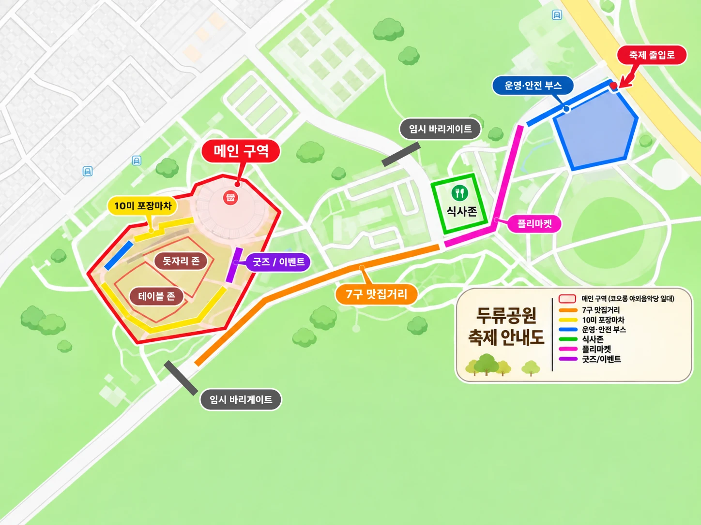

# P0-3 장소 — 세부 지침

> 구분: 고정 + 조사 · 기본 지침: 1장, 3장 (+ 9장) · 진행: **확정 v7 (2026-11-17) — 팀 축제 안내도 반영, 그늘·냉방 공간은 확인 필요** · 최종 수정: 2026-11-17
> 기준 문서: **팀 축제 안내도(2026-11-17, `P0-3_축제지도.webp`)**, 기본 지침 v1.1, main `세부지침안/B파트v4` B-1·B-8, main `세부지침안/A파트v2` A-9, 노션 A 세부 지침안 A-7(이전 근거), `local리서치v2/통합_조사결과.md` 5-1

## 1. 이 파트의 역할
- 개최 장소(두류공원)와 축제가 쓰는 구역·쓰지 않는 구역, 구역마다 확인할 시설 조건, 교통·주차를 고정해요.
- 읽는 PART: A(무대), B(먹거리 배치), C(플리마켓 배치), D(굿즈 상점), H(운영·안전), K(지도)

## 2. 확정 값

### 2-1. 장소

| 항목 | 값 | 구분 | 근거 |
| --- | --- | --- | --- |
| 개최지 | 두류공원 (대구 달서구) | 고정 | 기본 지침 1장 |
| 면적 | 1,589,339㎡ (두류공원 1,185,289㎡ + 이월드 404,050㎡) | 조사 | `[확인]` 대구시 공원현황 (통합본 5-1, 요약 기반) |
| 사용 범위 | 코오롱 야외음악당 ~ 공원순환로 | 고정 | B-1 |

### 2-2. 축제 지도 (팀 안내도, 2026-11-17)

- 팀이 만든 **축제 전체 지도**예요. 구역 배치는 이 지도를 기준으로 해요.
- 그림 안내도라서 **축척·실제 면적·길이는 이 지도에서 재지 않아요.** 실제 좌표·면적은 K(웹 지도)와 현장 실측(4-1)으로 채워요.
- 지도가 바뀌면 이 파일의 지도 이미지와 2-3 표를 같이 고쳐요.

### 2-3. 사용 구역 (지도 기준)

방문객 동선 (지도에서 읽은 순서 `[해석]`): **축제 출입로·주차장 → 운영·안전 부스 → 플리마켓 → 식사존 → 7구 맛집거리 → 메인 구역(코오롱 야외음악당)**

| 지도 색 | 구역 | 지도상 위치 | 프로그램·역할 | 최소 규모 | 담당 PART | 근거 |
| --- | --- | --- | --- | --- | --- | --- |
| 빨강 테두리 | **메인 구역** | 코오롱 야외음악당 일대 (지도 서쪽) | 사투리 토론 대회 메인 무대 + 아래 10미·굿즈·돗자리 촌·테이블 촌을 품는 구역 | 메인 무대 1개 (무대 수는 회의 안건) | A | 안내도, A-9 |
| 노랑 | 10미 포장마차 | 메인 구역 안, 바깥 둘레(북서·남쪽 가장자리) | 대구 10미 포장마차 | 40동 | B | 안내도, B-1 |
| 갈색 | 돗자리 촌 (지도 표기 "줏자리 촌") | 메인 구역 안, 무대 앞 | 관람·휴식 (돗자리) | 확인 필요 | 확인 필요 | 안내도 |
| 갈색 | 테이블 촌 | 메인 구역 안, 돗자리 촌 남쪽 | 식음·휴식 테이블 | 확인 필요 | 확인 필요 | 안내도 |
| 보라 | 굿즈/이벤트 | 메인 구역 동쪽 가장자리 (7구 쪽) | 축제 공식 굿즈 상점 + 이벤트 | 상점 1곳 | D (이벤트는 확인 필요) | 안내도, B-1 |
| 파랑 | 운영·안전 부스 | ① 축제 출입로 옆 진입 도로 ② 메인 구역 안 서쪽 | 안내·안전·응급, **스탬프 이벤트**(축제장 안 스탬프, 담당자 결정 2026-11-17) | 2곳 | H (스탬프 이벤트 담당은 7장 13번) | 안내도, 담당자 결정 |
| 주황 | 7구 맛집거리 | 공원순환로, 메인 구역 남동쪽을 지나 식사존 앞까지 | 대구 7구 맛집거리 | 50동 + 제과점 추가 | B | 안내도, B-1 |
| 분홍 | 플리마켓 | 7구 맛집거리 끝에서 북쪽 출입로 방향으로 이어진 길 | 소상공인 플리마켓 | 15동 (판매 12 + 체험·협업 3) | C | 안내도, C-1 |
| 초록 | 식사존 | 7구 맛집거리·플리마켓이 만나는 곳 북쪽 | 7구 맛집거리 음식 먹는 공간 | 확인 필요 | 확인 필요 (B 관할 아님, B-1 2-1-2) | 안내도, B-1 |
| 빨강 점 | 축제 출입로 | 지도 북동쪽 큰길 쪽, 주차장 옆 | 입·퇴장 | 1곳 (지도 기준) | H | 안내도 |
| 파랑 면 | 주차장 (P) | 출입로 안쪽 | 방문객·운영 주차 | 면수 확인 안 됨 | H | 안내도 |
| **합계 (부스)** | | | | **105동 + 제과점 + 굿즈 상점 1곳 + 운영·안전 부스 2곳** | | |

- 부스 수는 **최소 기준**이에요. 첫해는 최소 규모로 시작하고, 판매·대기·방문객 데이터로 매년 조정해요 (B-1).
- 구역의 **총 부스 수를 늘리거나 줄이려면 팀 승인**이 필요해요. 같은 총량 안에서 옮기는 재배치(예: 10미 존 안 돗자리 촌 ↔ 테이블 촌)는 B 담당 확인으로 해요 (B-1 3절 6번, 2-1-3).
- 부스 규격: 음식 부스(10미·7구·제과점) 5m × 5m, 플리마켓 부스 3m × 3m (B-1 2-1-1). 통로 폭은 K 좌표 확정 뒤 정해요.
- 구역 역할은 고정이고, 구역 안 부스 배치는 조건부로 바꿀 수 있어요 (B-1 5절).
- "확인 필요"로 둔 칸은 7장 회의 안건이에요. 에이전트가 임의로 채우지 않아요.

### 2-3-1. 사용하지 않는 구역

| 구역 | 처리 | 근거 |
| --- | --- | --- |
| 2·28 자유광장 | 사용하지 않음 (안내도에도 없음) | B-1, 안내도 |

### 2-4. 수용 규모 참고값 (목표치 아님)

| 항목 | 값 | 라벨 |
| --- | --- | --- |
| 대구치맥페스티벌 2024 첫날 방문객 | 약 20만 명 (5일 약 100만 명) | `[확인]` 대구시 뉴스룸 2024-07-08 |
| 대구치맥페스티벌 사용 구역 | 2.28 자유광장(메인), 2주차장, 코오롱 야외음악당, 잔디광장 | `[확인]` 대구시 뉴스룸 2024·2025 |
| 인파 중점관리 기준 | 순간 최대 3만 명 이상 예상 행사 | `[확인]` 행안부 (통합본 5-1) |

- 치맥은 **사용 구역이 우리와 달라요**(치맥은 2.28 자유광장이 메인, 우리는 쓰지 않음). 장소의 운영 실적 참고로만 쓰고, 방문객·부스 목표로 쓰지 않아요.
- 두류공원의 공식 수용 인원과 구역별 수용 인원은 확인하지 못했어요.

## 3. 에이전트 행동 규칙
- 2-2 지도와 2-3의 구역 배치를 기본값으로 써요. 구역을 말할 때는 지도의 이름(메인 구역, 10미 포장마차, 7구 맛집거리, 플리마켓, 식사존, 굿즈/이벤트, 운영·안전 부스, 축제 출입로)을 그대로 써요. 다른 배치를 제안하려면 사유와 대안을 적고 담당자 승인을 받아요.
- **대관·사용 가능 여부를 가정하지 않아요.** 확인 전에는 "대관 미확인"으로 표시해요.
- 구역마다 4장 확인 항목을 표로 관리하고, 확인 안 된 칸은 비워 두지 말고 "확인 안 됨 / 확인할 곳"을 적어요.
- 화기 부스는 야외음악당 관람석 반대편·바람 방향을 고려해 배치하고, 생식 품목은 냉장 설비 확인 여부로 위치를 정해요. 화기 배치 원칙은 B-8 소관이에요 (B파트v4).
- B 먹거리 부스 구역(10미·7구)에서는 불꽃 연출(화염쇼·폭죽)을 하지 않아요. 무대 등 다른 구역의 공연은 해당 파트가 안전관리계획으로 따로 검토해요 (B-8 2-4).
- 공원순환로는 일방향 보행 동선과 별도로 **비상 차량 이동로**를 확보해요. 도로 사용 구간은 차량 통제·점용 허가 여부를 먼저 확인해요 (B-1, B-8).
- 예상 순간 최대 인원이 3만 명을 넘는지 먼저 판단하고, 그에 맞는 안전관리계획 범위를 정해요. 인원 추정은 `[추정]`과 계산 근거를 함께 적어요.
- 실제 좌표·면적·지도는 K(웹 지도) 자료를 따라요.

## 4. 매년 받을 입력 · 조사할 항목

### 4-1. 구역별 확인 항목

| 확인 항목 | 굿즈/이벤트 | 메인 구역 무대 | 메인 구역 (10미·돗자리·테이블 촌) | 공원순환로 (7구·플리마켓·식사존) | 확인할 곳 |
| --- | --- | --- | --- | --- | --- |
| 면적·길이 | | | | | 두류공원관리소, 대구시 공원 담당 |
| 대관 조건·사용료·신청 시기 | | | | | 두류공원관리소, 코오롱 야외음악당 운영 주체 |
| 전기 (용량·분전반 위치) | | | | | 공원관리소, 주관사 전기 공사 견적 |
| 급수·배수 (조리 부스) | | | | | 공원관리소 |
| 화기 사용 가능 여부 | | | | | 공원관리소, 관할 소방서 |
| 차량 통제·도로 점용 | | | | | 달서구청, 관할 경찰서 |
| 그늘·야간 조명 | | | | | 현장 답사 |
| 객석 수 (음악당) | — | | — | — | 운영 주체 |

- 처음 채운 값은 매년 다시 확인해요. 바뀐 값은 기준일과 함께 고쳐요.

### 4-2. 교통·주차

| 항목 | 조사 내용 | 상태 |
| --- | --- | --- |
| 대중교통 | 가까운 도시철도역과 도보 시간, 버스 노선. 이동 구간 4개(역↔축제장, 축제장↔시내 야간, 축제장↔숙박, 일요일 귀가)는 G-6에서 관리 | 역·노선 이름은 원문 확인 필요 (G-6도 조사 전) |
| 시티투어 | 대구시티투어 도심순환 ⑥번 정류장 두류공원·이월드, 매일 9:30~17:50·1일 7회 → **저녁 동선에는 못 쓰고 다음 날 오전용** | `[확인]` G-6 2-2 (hyunhee #23, 공식) |
| 주차 | 공원 주차장 수·면수, 축제 기간 사용 가능 여부 | 확인 안 됨 |
| 야간 귀가 | 폐막(금·토 22:00, 일 20:00) 뒤 대중교통 막차 시간, 셔틀 필요 여부 | 확인 안 됨 (기본 지침 v1.1 9장 "야간 귀가 동선") |
| 숙박 이동 | 두류공원 → 주요 숙박 밀집지 이동 수단, 셔틀은 H 운영·G-6 노선 | G-5·G-6 (조사 전) |

## 5. 다른 파트 연결

| 연결 파트 | 넘겨주는 것 |
| --- | --- |
| P0-4 기간·운영 시간 | 구역별 운영 시간 제약 (야간 조명·소음) |
| A 토론대회 | 무대 위치, 객석 조건 |
| B 맛집 | 10미·7구 구역, 화기·생식 배치 조건 |
| C 플리마켓 | 플리마켓 구간 |
| D 굿즈 | 굿즈 상점 위치 |
| G 관광 | 교통, 숙박 이동, 시티투어 정류장 |
| H 운영 | 수용 규모 참고값, 안전관리계획 범위, 전기·급수·차량 통제 |
| K 웹 | 2-2 안내도와 2-3 구역 이름 (웹 지도도 같은 이름·색 사용) |
| E 부대 프로그램 | 굿즈/이벤트 구역의 "이벤트" 내용, 돗자리·테이블 촌 낮 시간 활용 |

## 6. 기본 지침·다른 문서와 다른 점

| 항목 | 이 파일 | 다른 문서 | 처리 |
| --- | --- | --- | --- |
| 구역 구성 | 팀 안내도: 메인 구역·10미·7구·플리마켓·식사존·굿즈/이벤트·운영·안전 부스 (2·28 자유광장 미사용) | 기본 지침 v1.1 1장: 메인 무대·포장마차·플리마켓·휴게·그늘 4구역 | 안내도 우선. 그늘·냉방 공간은 안내도에 따로 없음 (7장 3번) |
| 식음·휴게 공간 | 안내도에 식사존·테이블 촌·돗자리 촌 있음 | B파트v4 B-1: 식사존은 확정, B 관할은 아님 ("두지 않음"은 폐기) | **해결 (2026-11-17)**: 안내도와 B-1이 맞음. 담당 파트만 남음 (7장 6번) |
| 굿즈 상점 위치 | 메인 구역 동쪽 가장자리 "굿즈/이벤트" | B파트v4 B-1: 메인 구역 — 굿즈/이벤트 존 | **해결 (2026-11-17)**: 같은 곳. "이벤트" 내용만 남음 (7장 7번) |
| 플리마켓 위치 | 공원순환로의 7구 맛집거리와 이어진 구간 (B-1) | P0 원래 표·중간발표 2: 야외음악당 뒤 체육공원 | **해결 (2026-11-12)**: C파트v2 C-1 결정(2026-11-10)으로 공원순환로 연결 구간 확정 |
| 포장마차·장터 위치 | 음악당 둘레·공원순환로 | 2027 03_기획안 초안: 2.28 자유광장 포장마차, 잔디광장 장터, 대구문화예술회관 실내 | 03은 P세부지침안 기준으로 업그레이드 예정 |

## 7. 미확정 · 회의 필요

| # | 항목 | 이유 | 확인 주체 | 확인 기한 |
| --- | --- | --- | --- | --- |
| 2 | 무대 수 | 메인 무대 1개 기준으로 계산 중 (A파트 미확정, A-9) | 팀 회의 | 미정 |
| 3 | 그늘·냉방 공간 위치 | 안내도에 따로 표시 없음. 돗자리 촌·테이블 촌·식사존을 그늘 공간으로 볼지, 따로 둘지 | 팀 회의 | 미정 |
| 4 | 구역별 확인 항목 (4-1) | 전부 확인 안 됨 | H파트, 조사 담당 | 대관 신청 전 |
| 5 | K 지도 문서 위치 | B-1에서도 링크 추가 필요로 표시. 웹 지도가 안내도와 같은 이름·색을 쓰는지 | K파트 담당 | 미정 |
| 6 | 식사존·테이블 촌·돗자리 촌 담당 파트 | B-1 v4: 식사존은 확정됐지만 B 관할 아님. 담당 파트·규모·운영 방식 미정 | 팀 회의 | 미정 |
| 7 | 굿즈/이벤트 구역의 "이벤트" | 위치는 B-1 v4와 같음. "이벤트"가 무엇인지(E 부대 프로그램? 스탬프 이벤트?) | D·E 담당 | 미정 |
| 8 | "줏자리 촌" 표기 | "돗자리 촌"의 오타로 보고 적음. 지도 이미지 글자 수정 필요 | 지도 담당 | 다음 지도 수정 때 |
| 9 | 출입로 1곳 | 안내도에는 북동쪽 출입로 1곳뿐. 메인 구역(서쪽)·7구 남서쪽 끝 쪽 출입구, 비상 차량 이동로 표시 필요 여부 | H 담당 | 안전관리계획 전 |
| 10 | 7구 맛집거리 ↔ 메인 구역 연결 | 안내도에서 7구 길이 메인 구역 남동쪽을 지나가고, 메인 구역으로 들어가는 연결 길이 따로 없음 | 지도 담당 | 다음 지도 수정 때 |
| 11 | 주차장 | 안내도의 P가 방문객 주차장인지 운영 차량 전용인지, 면수 | H 담당 | 미정 |
| 12 | 안내도 제목 | "두류공원 축제 안내도"에 축제 이름(대사투 페스티벌)이 없음. 방문객용으로 쓸 때 이름 넣을지 | F·지도 담당 | 홍보물 제작 전 |
| 13 | 스탬프 이벤트 위치 | 운영 부스에서 하기로 함(담당자 결정 2026-11-17). 운영·안전 부스 2곳 중 어디서 할지, 안내·응급 업무와 줄이 겹치지 않게 할지 | H 담당, 팀 회의 | 미정 |

**해결된 항목 (2026-11-17)**
- 구역 확정 → 팀 축제 안내도(2-2) 기준으로 2-3 표를 다시 씀. 플리마켓 위치(C-1)와도 맞음
- 식사존이 있는지 → B파트v4 B-1도 식사존 확정으로 고침 (담당 파트는 7장 6번)
- 굿즈 상점 위치 → B파트v4 B-1도 메인 구역 굿즈/이벤트 존 (이벤트 내용은 7장 7번)

## 8. 출처
- 팀 축제 안내도 "두류공원 축제 안내도" (2026-11-17 사용자 제공, `P0-3_축제지도.webp`) — 구역 배치·동선·출입로·주차장
- main `세부지침안/G파트v2/` (커밋 ffd8908) — G-2 추천 동선, G-3 축제장 밖 쿠폰·혜택, G-4 기존 사업 협업, G-5 숙박 연계, G-6 이동 (스탬프는 축제장 안에서만, 담당자 결정 2026-11-16)
- main `세부지침안/B파트v4/` (커밋 da1331b) — B-1 구역·운영 시간·부스 규격·부스 수 변동 승인, B-2·B-4 부스 수, B-5 모집·심사(B-9 삭제, 모집 공고는 M-7), B-6 매장 카드, B-7 사투리 메뉴판, B-8 불꽃 연출 금지 범위
- main `세부지침안/C파트v2/` (커밋 c87fe59) — C-1 구성·배치, C-2 품목 원칙, C-4 수수료·정산, C-5 현장 운영, C-6 연계
- 노션 A 세부 지침안 A-1 미확정 6번, A-7 무대·장비
- `local리서치v2/통합_조사결과.md` 5-1 (두류공원 수용 규모 참고, 대구시 뉴스룸 2024-07-08·2025-07-01)
- `local리서치v2/hyunhee/D_통합표_조사결과_v2.md` (두류공원·이월드·83타워, N10 수용·대관 미확인)
- 기본 지침 v1.1 1장·4-5·9장

## 변경 이력
| 날짜 | 내용 |
| --- | --- |
| 2026-11-11 | 1차 초안 |
| 2026-11-11 | 장소 확정. 구역 세부는 지도 완성 후 갱신하기로 함 |
| 2026-11-11 | v2 확정 (7장 미확정 항목은 계속 열어 둠) |
| 2026-11-12 | v2: B파트v1·C파트v2 반영 — 플리마켓 위치 확정(C-1), 판매 12 + 체험 3 구성 추가 |
| 2026-11-16 | v3: A파트v2·E파트v1 반영 — 무대 근거 A-7→A-9, 야간 귀가 기준 시각을 금·토 22:00 / 일 20:00으로 |
| 2026-11-16 | v5: G파트v2 반영 — 교통을 G-6 이동 구간 4개와 연결, 시티투어 운영 시간(저녁 불가) 추가 |
| 2026-11-17 | v7: 팀 축제 안내도 반영 — 지도 이미지 추가(2-2), 구역 표를 지도 기준으로 다시 씀(2-3: 메인 구역·식사존·운영·안전 부스·출입로·주차장 추가), 구역 확정(옛 7장 1번) 해결, 안내도와 B-1 차이 등 미확정 7개 추가 |
| 2026-11-17 | v7: B파트v4 반영 — 식사존·굿즈 위치 B-1과 맞음(6·7번 갱신), 부스 수 변동은 늘리기·줄이기 모두 팀 승인, 부스 규격, 화기 배치는 B-8 소관, B 구역 불꽃 연출 금지. 담당자 결정: 운영·안전 부스에서 스탬프 이벤트(미확정 13번) |
