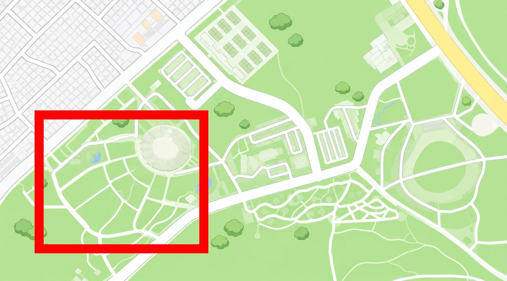
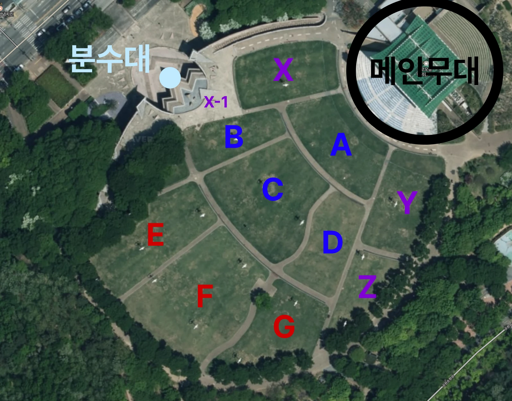

# 메인구역 지도

> **메인구역 = 메인무대 + A~G + X·Y·Z (X-1 포함)** `[확인]` 지도 담당 결정 (2026-11-18)

- 메인무대: 코오롱야외음악당 (aka. 야당) — 대구 달서구 야외음악당로 180 `[확인]` (출처 1)
- 메인무대와 그 앞 광장(잔디광장)을 통틀어 **"메인구역"** 이라 지칭 `[확인]` 지도 담당 결정
  - "잔디광장"은 음악당 소개 자료에서 앞 잔디밭을 부르는 이름 `[확인]` (출처 1)
  - ※ "광장" / "잔디광장" 중 최종 표현은 **팀회의 필요** (미확정 1번)
- 구역을 나눈 기준: 야외음악당 앞 **잔디와 인도(산책로)** 의 경계 `[확인]` 지도 담당 결정
- 참고 파트: A(사투리 콘텐츠), E(부대 프로그램) · 축제 전체 지도: [Y_축제전체_지도.md](Y_축제전체_지도.md)

> 근거 라벨: `[확인]` 출처 있는 사실·담당 결정 · `[해석]` 자료 기반 의미 · `[가설]` 검증 필요 · `[추정]` 계산·가정 기반

---

## 1. 지도

### ① 전체 지도상 메인구역 위치
전체 지도에서 **좌측(빨간 박스)** 에 위치. `[확인]` (출처 2)

### ② 메인구역 구획

### ③ 메인구역 구획 (위성지도)

> ※ ②번 지도는 네이버지도를 참고하여 GPT가 제작한 지도로, ③번 위성지도와 모양이 조금 다를 수 있음. → 구역 **이름과 배치**는 `[확인]`, 경계선 **모양**은 `[추정]` (실제 경계는 ③번 위성지도 기준)
> ※ ②번 지도의 짙은 초록 표시 = 나무가 많은 곳 `[해석]` 위성지도를 보고 표시

---

## 2. 구역별 용도

| 구역 | 지도 색 | 용도 | 비고 | 근거 라벨 |
|---|---|---|---|---|
| A · B · C · D | 파랑 | 돗자리 존 | | `[확인]` 지도 담당 결정 |
| E · F · G | 빨강 | 테이블 존 | n-2(뒤쪽 외곽)는 10미 포장마차 부스 | `[확인]` 지도 담당 결정 |
| X · Y · Z | 보라 | 부스 배치 구역 | 추가 구역 개념, 해마다 용도 변동 가능 | `[확인]` 지도 담당 결정 |
| X-1 | 보라 | X구역에 포함 | 분수대 앞 공터의 평지 (위성지도 참고) | `[확인]` 지도 담당 결정 |

### 2027 축제 기준 부스 배치 (연도별 갱신)
- **X구역 (X-1 포함)**: 운영/안전 부스, 굿즈샵/이벤트 부스 `[확인]`
- **Y구역**: X + Z구역 내 부스가 혼합 `[확인]`
- **Z구역**: 10미 포장마차 부스 `[확인]`
- **E·F·G 뒤쪽 외곽 (n-2)**: 10미 포장마차 부스 `[확인]`

> 위 4개 모두 지도 담당 결정 (2026-11-18). X·Y·Z 구역은 해마다 다른 식으로 이용될 수 있음.

---

## 3. 지칭 규칙

> 3장 규칙은 모두 `[확인]` 지도 담당 결정 (2026-11-18)

### 3-1. 앞쪽 / 뒤쪽 — 모든 구역
메인무대를 기준으로
- 메인무대와 **가까우면 앞쪽 (FRONT)**
- 메인무대와 **멀면 뒤쪽 (BACK)**

별도 구역 명칭이 아니라, 우리끼리 말할 때 이해를 편하게 하기 위한 표현. (예: "C구역 앞쪽")

### 3-2. n-1 / n-2 — E·F·G만 (n = E, F, G)
- **앞쪽 = n-1** → 테이블 존
- **뒤쪽 = n-2** → 외곽, 10미 포장마차 부스가 들어올 자리
- 용도가 달라서 따로 분리함. (A~D는 구역 안에서 목적이 크게 다를 일이 없어 따로 명칭을 정하지 않음)
- n-1과 n-2의 **구분선은 담당자가 지정**, 필요에 따라 변경 가능 (미확정 2번)
- 정확한 구역 분할보다 **지칭을 편하게 하기 위함**. 나눌 필요가 없으면 그냥 **n** 으로 지칭
- E·F·G도 앞쪽 / 뒤쪽 표현은 그대로 사용 가능

### 3-3. 내부 / 외곽 — X·Y·Z
X·Y·Z는 메인무대 옆에 붙어 있으므로, 앞쪽/뒤쪽 대신 **구심점(C구역)** 을 기준으로
- C구역과 **가까운 쪽 = 내부**
- C구역과 **먼 쪽 = 외곽**

---

## 4. 미확정·회의 필요

| 번호 | 항목 | 이유 | 확인 주체 | 확인 기한 |
|---|---|---|---|---|
| 1 | "광장" / "잔디광장" 중 공식 표현 | 둘 다 쓰이고 있어 하나로 통일 필요 | 팀회의 | 다음 팀회의 |
| 2 | E·F·G의 n-1 / n-2 구분선 위치 | 포장마차 부스 수·배치에 따라 달라짐 | 지도 담당 | 부스 배치 확정 시 |

---

## 5. 출처

| 번호 | 자료 | 위치 | 쓰는 내용 | 근거 라벨 |
|---|---|---|---|---|
| 1 | 대구 코오롱 야외음악당 소개 | [ktriptips](https://www.ktriptips.com/kor/tourspot/130411), [대구문화예술회관](https://daeguartscenter.or.kr/english/content.html?md=0332) | 주소(야외음악당로 180), 앞 잔디광장 명칭 | `[확인]` |
| 2 | 메인구역 위치 지도 | `Y_메인구역_1위치.webp` (지도 담당 제공, 2026-11-18) | 전체 지도상 메인구역 위치 | `[확인]` |
| 3 | 메인구역 구획 지도 | `Y_메인구역_2구획.webp` (지도 담당 제공, 네이버지도 참고·GPT 제작) | 구역 이름·배치 | `[확인]` 이름·배치 / `[추정]` 경계 모양 |
| 4 | 메인구역 위성지도 | `Y_메인구역_3위성.webp` (지도 담당 제공, 위성지도 기반) | 실제 잔디·인도 경계, X-1 평지, 나무 위치 | `[확인]` |

---

## 변경 기록
- 2026-11-18: 최초 작성 (메인구역 정의, 구역별 용도, 2027 부스 배치, 지칭 규칙)
- 2026-11-18: 파일명 Z_ → Y_ (지도 파일은 Y), 근거 라벨·미확정·출처 장 추가
