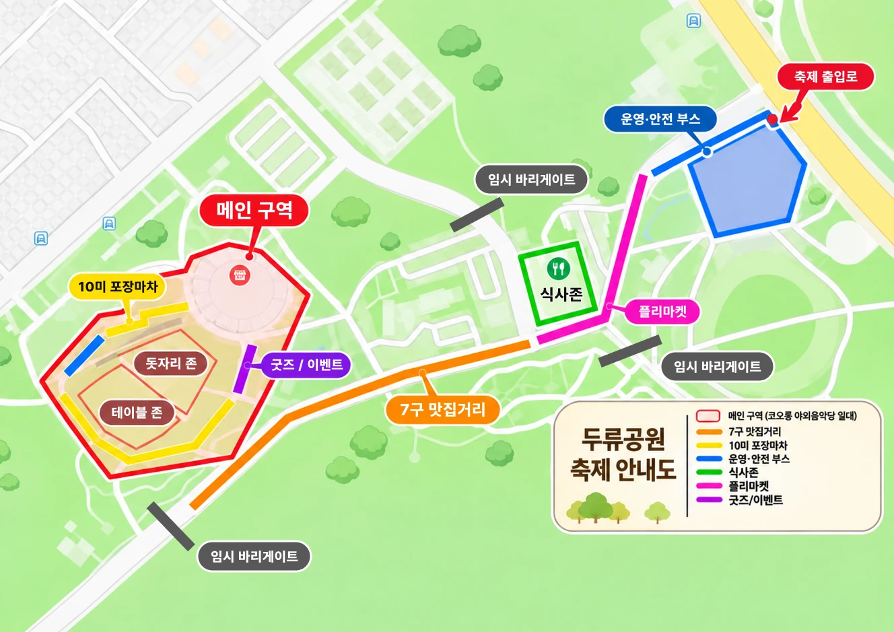
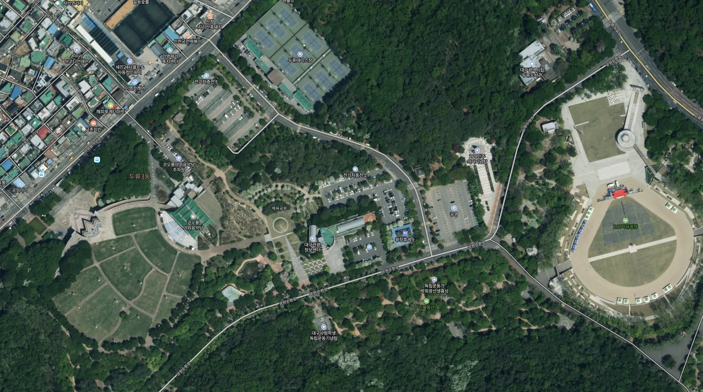
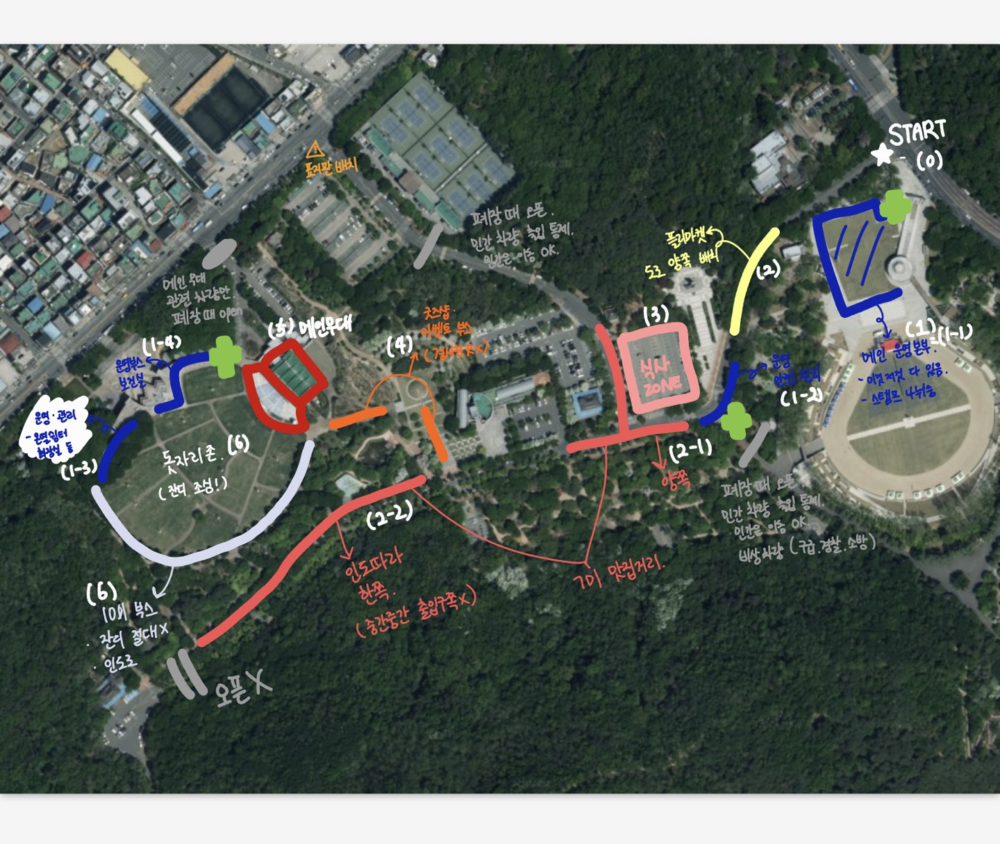
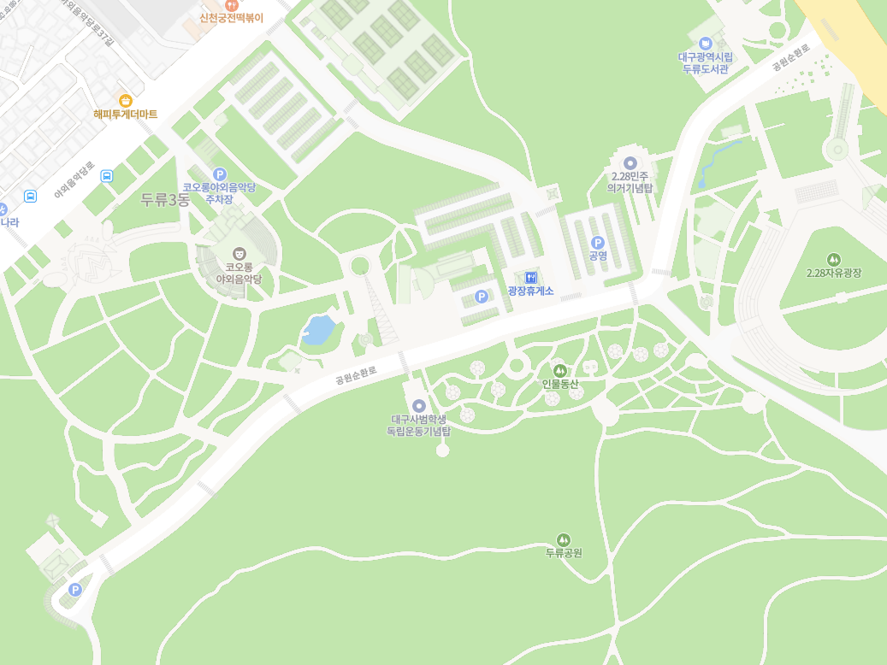

# 축제 전체 지도 (대구 사투리 페스티벌 안내 지도)

## 이전 버전과 달라진 점 (v3 → v4)

> 이전 버전: `이전버전/Y.지도_v3/Y_축제전체_지도.md` (2026-11-20 푸시)

| 위치 | v3 | v4 |
|---|---|---|
| 3-3 바리게이트 | 위치·통제·폐장 때 표 | **바리게이트를 지도에 표시하는 이유**(공식 축제장이 아님을 알림), **바리게이트 안내문**(차량 출입 제한용·사람 통행 가능·공식 출입로 아님·공식 출입로 위치 글+사진) 추가. ⑵에 대로변 쪽 안내 추가 |
| 3-4 표지판 | 차량 통제 안내문 | 3-3 안내문 중 필요한 내용(바리게이트 설치 안내, 공식 출입로 안내) 추가. **두류테니스장 주차장을 축제 공식 주차장으로 검토 중** 추가 |
| 4장 편의시설 | 더위 쉼터·의료실·화장실·물품보관소 | **3개로 분류한 후보**: ① 냉방쉼터·의무실(온열환자 처치실 겸함)·소방/응급차 ② 운영본부·종합 안내소 ③ 화장실·수유실. 물품보관소는 후보에서 빠짐 |
| 4-1 배치 원칙 | 기존 시설 사용 + 추가 배치 | **기존 화장실 위치 먼저 파악 → 그 후 이동식 화장실 추가 배치 검토** 순서 추가 |
| 5장 미확정 | 1~12 (1번 정함) | v3에서 정한 1번 삭제. **지침안에 넣거나 정할 것만 남기고 1~13으로 다시 매김** (아래 "5장 미확정 뜻·구성" 줄). 새로 생긴 것: 테니스장 주차장(10), 이름 통일(11, 정함), 잔디밭 이름(12), 본부·부스 역할(13). 굿즈샵·이벤트 담당(5) 정함 |
| 5-1 번호 | 12~17 (미확정 번호와 겹침) | **확인 1~10** (미확정과 다른 번호 체계) |
| 5-1 확인 주체 | "H파트 정리 여부 확인 → 없으면 지도 담당" | **H-5 관할 기관 확인 목록에 모두 있음** → 허가·사용은 H-5 #3·#4·#6, 화장실 확인·공문은 H-5 #5에서 관리 (5-1 확인 1·2·4~9). 테니스장 주차장(확인 10)은 H-5에 없음 |
| 5장 미확정 뜻·구성 | 실제 실행 일(공문·확인)도 섞여 있음 | **미확정 = 지침안에 넣거나 정할 것만.** 실행 일(화장실 확인·공문·사진 제작)은 빼서 5-1로. 번호 다시 매김 (1~13). 5-1 제목 "허가·공문 필요 (검토)" → **"확인·신청할 곳 (실제 축제 실행 단계)"**, 번호 "확인 1~10" |
| 6장 출처 | 1~8 | 9번 추가 (지도 담당 설명 2026-11-20·23) |
| **구역·시설 이름 통일** | 메인 출입로 / 메인 운영·관리 본부 / 메인 스테이지 / 식사존 / 돗자리존 / 의무실·의료실 / 냉방쉼터·온열쉼터 | **축제 출입로 / 운영부스 / 사투리한마당 / 밥 묵자! 존 / 야당 잔디밭 / 의료실 / 더위쉼터**. (3-1)·(3-2) 이름은 "7구 맛집거리"로 하나, 양쪽·한쪽은 설명으로. 플리마켓 설명 "소상공인 플리마켓" |
| 안내도 색 | (3) 빨강, (8) 분홍 면 | (3) **다홍**, (8) **연분홍 면** |
| 0장 | 번호는 설명용 | **(m-n) 코드 규칙** (우리끼리 번호, 안내도엔 숫자 없음, 구역은 m 기준·n은 세부 위치), 이름 구분 기호 "·" 통일 |
| 3-2 운영·관리 보충 | – | 본부·부스 할 일 아직 안 나눔, 이름 헷갈림 대책 후보만 기록 (선택은 나중) |
| 4장 종합 안내소 | 미정 | **운영부스가 안내소 역할을 함** (따로 안내소 표시 없음) |
| (4) 굿즈샵·이벤트 부스 참고 파트 | 정해야 함 | **E** (미확정 5번 정함. D로 적었다가 E로 바꿈, 2026-11-24) |
| 2026-11-24 결정 | – | 미확정 1(광장휴게소·관광정보센터 쉼터 후보로 넣음)·4(⑶ 팀 확인함)·6(B-6 참조 맞음)·7(굿즈샵·이벤트는 사투리한마당 밖)·9(도보 시간 안 넣음)·10(테니스장 주차장은 공식 아님, 근처 주차장 안내) **정함**. 2번: 편의시설 위치는 지도 확정 후 위도·경도(근사값)로. 8번: 메인구역 MD → 사투리한마당 MD로 이름 바꾸기로 함. 5-1 확인 10(테니스장 이용 확인) 삭제 |
| 2026-11-24 이름·지도 통일 | – | **축제 출입로, 밥 묵자! 존, 굿즈샵·이벤트 부스** (md·JSON 같게). 운영·관리 부스와 본부를 **하나로 통합**(안내소도 통합, 미확정 13 정함). 이름은 2026-11-25에 **운영부스**(운영·관리를 담당하는 본부가 있는 곳)로 정함. **야당 잔디밭**: MD 지칭으로 정함·지도 표시 안 함 (3-1-1, 미확정 12 정함). 무대 아이콘 = 무대를 볼 수 있는 곳, 메인무대에서 토론대회·골든벨 (3-1-2). 표지판은 지도 표시 없이 MD 설명만 |

> 축제장 전체 구역과 방문객 동선, 편의시설 배치 기준.
> 사투리한마당 내부 구획(A~G·X·Y·Z)은 [Y_메인구역_지도.md](Y_메인구역_지도.md) 참고 (구획 계획도 기준으로 위치 수정 예정).

> 근거 라벨: `[확인]` 출처 있는 사실·담당 결정 · `[해석]` 자료 기반 의미 · `[가설]` 검증 필요 · `[추정]` 계산·가정 기반

---

## 0. 지도 사용 시 주의

- **이 파일의 구역·위치 설명은 구획 계획도(2026-11-19) 기준이 최신.** `[확인]` 지도 담당 (2026-11-19)
- 아래 ① 안내도 이미지는 **아직 예전 버전(2026-11-18)** 이라 구역 위치가 다름. 네이버 일반지도 바탕의 새 안내도를 GPT로 만드는 중이고, 완성되면 교체 (미확정 3번). `[확인]` 지도 담당 (2026-11-19)
- 안내도는 **GPT로 제작** → 실제 위성지도(②)와 길 모양·거리·각도가 다를 수 있음. 실제 지형은 ② 기준. `[확인]`
- **(m-n) 코드 규칙** `[확인]` 지도 담당 (2026-11-23)
  - (m-n)은 **우리끼리 쓰는 코드 번호**. 구역을 말하거나 고칠 때 가리키려고 씀.
  - **안내도에는 숫자를 표시하지 않음.** 안내도에는 색과 이름만.
  - 안내도 구역은 **큰 숫자 m 기준**으로 나눔 (색·이름도 m 단위). **작은 숫자 n은 세부 위치** 번호.
  - 바리게이트 ⑴~⑷도 같은 방식 (안내도에는 번호 없음).
- 이름 사이 구분 기호는 **"·"** 로 통일 (예: 운영부스, 굿즈샵·이벤트 부스). `[확인]` 지도 담당 (2026-11-23)

---

## 1. 지도

### ① 축제 전체 안내도 (GPT 제작, 새 버전 제작 중)

### ② 실제 위성지도

### ③ 구획 계획도 (2026-11-19)
위성지도 위에 지도 담당이 구역·바리게이트·표지판·의료실을 직접 그린 계획도. **3장 구역 설명의 기준.** `[확인]`

> ※ 계획도의 번호 중 잔디밭의 "(6) 돗자리존"은 **(7) 잔디밭**으로 고쳐 읽음 ((6)을 두 번 적음). "(3) 식사 ZONE"은 **(8) 밥 묵자! 존**, 빨간 선 "(2-1)·(2-2)"는 **(3-1)·(3-2)**, "START"는 **축제 출입로**로 읽음. `[확인]` 지도 담당 (2026-11-19)

### ④ 일반지도 (네이버지도)
위성지도(②)와 같은 범위의 일반지도. 새 안내도의 바탕, 3장 지명의 기준. `[확인]`

> ①~④ 모두 **우측 상단 = 축제 출입로**, **좌측 = 사투리한마당**. 동선은 공원순환로를 따라 우상단 → 좌하단으로 이어짐. `[해석]`

---

## 2. 방문객 동선

**축제 출입로 → 운영부스 → 플리마켓 → 7구 맛집거리 → 사투리한마당** `[확인]`

7구 맛집거리 중간(3-1 구간)에 밥 묵자! 존이 붙어 있고, 사투리한마당에서 메인무대·10미 포장마차·잔디밭을 즐기는 형태. `[해석]`

---

## 3. 구역별 설명

> 위치는 네이버 일반지도 지명 기준. 3장 내용은 모두 `[확인]` 지도 담당 구획 계획도·설명 (2026-11-19), 지명 대응은 `[해석]`.

| 번호 | 구역 | 지도 색 | 위치 | 내용 | 참고 파트 |
|---|---|---|---|---|---|
| (0) | 축제 출입로 | 빨간 동그라미 | 우측 상단, 두류공원로(노란 큰길)와 공원순환로가 만나는 곳, 두류도서관 아래 | 공식 정상 출입로 (단 한 곳). 공원순환로는 기존 차도지만 축제 기간 차량 통제 후 축제거리로 사용 | H |
| (1) | 운영부스 | 파랑 | 축제 곳곳 (1-1~1-4) | **운영·관리를 담당하는 본부가 있는 곳** (2026-11-25). 본부와 부스를 나누지 않고 모두 "운영부스" 하나로 통합 (2026-11-24). **안내소 역할도 함** (축제 안내·길 안내 등, 따로 안내소 표시 없음) | H |
| (1-1) | 운영부스 | 파랑 | 2.28자유광장 위쪽 앞 광장 | 이것저것 다 있음. 축제 템 나눠 주는 곳 (예: 스탬프북, 축제 소개 탬플릿). 의료실 | H, M (물품 배부) |
| (1-2) | 운영부스 | 파랑 | 2.28자유광장 서쪽, 공원순환로 갈림길 옆 | 운영·안전 관리 | H |
| (1-3) | 운영부스 | 파랑 | 사투리한마당 잔디밭 서쪽 끝 | 운영·관리. 더위쉼터(온열환자를 위한 냉방시설이 있음), 화장실 등 | H |
| (1-4) | 운영부스 | 파랑 | 코오롱야외음악당 서쪽, 잔디밭 북쪽 | 운영 부스. 의료실 | H |
| (2) | 플리마켓 | 노랑 | 축제 출입로 ~ 2.28민주의거기념탑 쪽으로 내려오는 공원순환로 | 소상공인 플리마켓. **도로 양쪽** 배치 | C |
| (3) | 7구 맛집거리 | 다홍 | 아래 3-1, 3-2 (다홍 선 전체) | 7구 맛집 부스 | B |
| (3-1) | 7구 맛집거리 | 다홍 | 밥 묵자! 존 서쪽 세로 길 + 밥 묵자! 존 아래 공원순환로 | **양쪽 배치 구간**: 도로 양쪽에 부스 | B |
| (3-2) | 7구 맛집거리 | 다홍 | 대구사범학생독립운동기념탑 부근 → 좌하단 바리게이트 ⑴까지 공원순환로 | **한쪽 배치 구간**: 인도 따라 한쪽만. 중간중간 출입구 쪽은 배치 안 함 | B |
| (4) | 굿즈샵·이벤트 부스 | 주황 | 코오롱야외음악당 동쪽 길 + 원형 광장 옆 길 | 굿즈샵, 이벤트 부스. 주황 표시 중 **경사진 곳에는 배치 안 함** | **E** (미확정 5번 정함) |
| (5) | 메인무대 | **무대 아이콘만** (원 구역은 그리지 않음, 2026-11-24) | 코오롱야외음악당 | 메인무대. 토론대회·골든벨 진행 (3-1) | A, E |
| (6) | 10미 포장마차 | 연보라 | 사투리한마당 잔디밭 남쪽 테두리 바깥 인도 | 10미 포장마차. **잔디 위 설치 절대 X, 인도에만** | B |
| (7) | 야당 잔디밭 | **지도(JSON)에 표시 안 함** | 코오롱야외음악당 앞 잔디밭 (평소 이름: 야외음악당(야당) 앞 광장). 아래 3-1-1 | 메인무대 관람, 10미 포장마차 음식 먹기, 피크닉처럼 쉬기. 잔디 조심 (방문객 텐트·그늘막 설치 금지, Y_메인구역_지도 4장) | A, E |
| (8) | 밥 묵자! 존 | 연분홍 면 | **두류공원2공영주차장** (광장휴게소 오른쪽, 2.28민주의거기념탑 옆) | 차량 통제 후 사용. 앞쪽에 메인무대 중계 대형 디스플레이, 테이블+의자 → 7구 맛집거리 음식 먹기·휴식. 사투리한마당 혼잡도 분산 목적 | – |

> 구획 계획도에서 (1-2)는 "운영·안전 관리", (1-4)는 "운영 부스(보건실)"로 적혀 있음. 안내도 이름은 **운영부스**로 통일 (처음엔 "운영·관리 부스" → 본부와 합쳐 "운영·관리 본부" → 2026-11-25 **"운영부스"** 로 정함. 뜻: 운영·관리를 담당하는 본부가 있는 곳), "보건실"은 **의료실**로 바꿈. `[확인]` 지도 담당 (2026-11-19, 2026-11-24, 2026-11-25)
> 이름 통일 (2026-11-23, 2026-11-24): 플리마켓(설명: 소상공인 플리마켓), 7구 맛집거리((3-1)·(3-2)는 설명으로), **축제 출입로**(옛 메인 출입로·축제 출입로), **운영부스**(옛 운영·관리 부스·운영·관리 본부를 합침), 의료실, 더위쉼터, **밥 묵자! 존**(옛 식사존), **굿즈샵·이벤트 부스**, 사투리한마당(옛 메인구역·메인 스테이지), **야당 잔디밭**. md와 지도(JSON) 이름을 같게 씀. `[확인]` 지도 담당
> (1-1)의 참고 파트 M은 아래 3-2의 물품 배부 담당 기준. (6) 10미 포장마차의 참고 파트는 **B** `[확인]` 지도 담당 (2026-11-19).

### 3-1. 사투리한마당 범위
- **사투리한마당 = 코오롱야외음악당 일대**: (5) 메인무대, (6) 10미 포장마차, (7) 야당 잔디밭, (1-3), (1-4). `[확인]` 지도 담당 (2026-11-19)
- 안내도에서는 이 구역을 **점선 테두리**로 묶고 "사투리한마당"이라고 표시. (공식 지명은 코오롱야외음악당) `[확인]` 지도 담당 (2026-11-23)
- 사투리한마당의 **메인무대에서 사투리 토론대회와 사투리 골든벨을 진행**함. `[확인]` 지도 담당 (2026-11-24) / 프로그램 내용은 A파트
- (4) 굿즈샵·이벤트 부스는 **사투리한마당 범위에 들어가지 않음.** `[확인]` 지도 담당 (2026-11-24, 미확정 7번 정함)
- 사투리한마당 내부 구획(A~G·X·Y·Z)은 [Y_메인구역_지도.md](Y_메인구역_지도.md)를 이 구획 계획도 기준으로 위치 수정 예정. `[확인]` 지도 담당 (2026-11-19)

#### 3-1-1. 야당 잔디밭 (지칭 규칙)
- **어디:** 코오롱야외음악당(메인무대) 앞 잔디밭. 사투리한마당 안, 10미 포장마차(잔디밭 남쪽 테두리 바깥 인도)로 둘러싸인 잔디 면. 평소에는 "야외음악당(야당) 앞 광장"이라고 부름. `[확인]` 지도 담당 (2026-11-24)
- **무엇:** 방문객이 돗자리를 깔고 **메인무대를 보고, 10미 포장마차 음식을 먹고, 피크닉처럼 쉬는 곳.** 텐트·그늘막은 설치 금지 (Y_메인구역_지도 4장).
- **지칭:** MD 안에서는 **"야당 잔디밭"** 으로 부름. 대화에서 **"야당 앞", "잔디밭"** 이라고 해도 모두 **야당 잔디밭**을 가리킴. `[확인]` 지도 담당 (2026-11-24)
- **이 일대를 부를 수 있는 이름** — 웹사이트 챗봇에서 방문객이 여러 이름으로 불러도 **모두 야당 잔디밭**으로 알아듣기 위해 정리. `[확인]` 지도 담당 (2026-11-24, 목적)

| 묶음 | 부를 수 있는 이름 | 근거 라벨 |
|---|---|---|
| 우리 지칭 | **야당 잔디밭** | `[확인]` 지도 담당 |
| 지도 담당이 쓰는 말 | 야당 앞, 잔디밭 | `[확인]` 지도 담당 |
| 평소 부르는 이름 | 야외음악당 앞 광장, 야당 앞 광장, 야외음악당 앞 잔디밭, 야외음악당 잔디밭 | `[확인]` 평소 이름 / 변형 `[해석]` |
| 자료에 쓰인 이름 | 잔디광장, 광장 (코오롱야외음악당 소개 자료·Y_메인구역_지도) | `[확인]` Y_메인구역_지도 출처 1 |
| 공식 지명을 붙인 말 | 코오롱야외음악당 잔디밭, 코오롱야외음악당 앞, 두류공원 야외음악당 잔디밭 | `[해석]` 예상 표현 |
| 무대·공연 기준 말 | 메인무대 앞, 무대 앞 잔디, 공연 보는 잔디밭, 사투리한마당 잔디밭 | `[해석]` 예상 표현 |
| 예전 기획 이름 | 돗자리존, 돗자리 구역 (구획 계획도·예전 MD 표기) | `[확인]` 구획 계획도 |
| 줄임·사투리 | 야당, 야음당 | `[해석]` 예상 표현 |

> ⚠️ **"광장"만 말하면 헷갈릴 수 있음.** 운영부스(본부)가 있는 **2.28자유광장 앞 광장**도 "광장"이라 부를 수 있음. "광장"만 들어오면 앞뒤 말(무대·공연·돗자리 → 야당 잔디밭 / 본부·스탬프북·출입로 → 2.28자유광장 앞 광장)로 구분하고, 모르면 되물음. `[해석]`
> "야당"만 말하면 코오롱야외음악당 건물(메인무대)을 뜻할 수도 있음 → 무대 이야기면 메인무대, 앉기·먹기·쉬기 이야기면 야당 잔디밭. `[해석]`
- **지도(JSON)에는 구역으로 표시하지 않음.** MD 설명용 이름. `[확인]` 지도 담당 (2026-11-24)

#### 3-1-2. 무대 표시의 뜻
- 지도(JSON)의 **무대 아이콘은 "무대를 볼 수 있는 곳"** 을 뜻함. `[확인]` 지도 담당 (2026-11-24)
  - 무대 1: 메인무대 (코오롱야외음악당)
  - 무대 2: 밥 묵자! 존 (메인무대 중계 대형 디스플레이로 볼 수 있는 곳) `[해석]` 위치 대응

### 3-2. 운영·관리 보충
- **2.28자유광장 안쪽 동그라미 구역(타원형 경기장)은 사용 안 함.** `[확인]` 지도 담당 결정
- 운영부스는 축제 곳곳(1-1~1-4)에 있고, **운영·관리를 담당하는 본부가 있는 곳**. 안내도에는 파랑으로 위치만 표시. 본부와 부스를 나누지 않고 모두 **운영부스**. **운영부스가 안내소 역할도 함** (축제 안내·길 안내). `[확인]` 지도 담당 (2026-11-19, 2026-11-24)
- 안전 부스 종류(안내데스크, 의료실 등)는 다른 파트에서 정리한 목록을 따름. `[확인]`
- (1-1) 운영부스에서 하는 **스탬프북·축제 팔찌 등 참여 물품과 정보 배부·안내는 M파트가 담당**할 예정. 스탬프북 제도(양식·교환 기준·교환소 운영)는 M-6 소관 (B-6 2-4와 같은 기준) `[확인]` 지도 담당 (2026-11-18)
  - "B-6 2-4" 참조 맞음 (플리마켓 C·7구 맛집거리 B). `[확인]` 지도 담당 (2026-11-24, 미확정 6번 정함)
- **예전 "운영·관리 본부"와 "운영·관리 부스"는 나누지 않고 하나의 이름 "운영부스"로 통합.** 이름이 헷갈리는 문제도 이걸로 해결. `[확인]` 지도 담당 (2026-11-24 통합, 2026-11-25 이름 "운영부스" 확정, 미확정 13번 정함)
- 코오롱야외음악당(메인무대 건물)은 **메인무대 스태프, 방송 장비, 섭외자(연예인·뮤지컬 배우 등)가 들어오는 곳**으로 사용. `[확인]` 지도 담당 결정

### 3-3. 바리게이트

> 네 곳 모두 **차량 출입 제한용**이고, **사람은 지나갈 수 있음.** 안내도에는 회색 막대로만 표시(번호 없음). `[확인]` 지도 담당 (2026-11-19)

**바리게이트를 지도에 표시하는 이유** `[확인]` 지도 담당 (2026-11-20)
- 사람은 지나다닐 수 있지만, **이곳이 공식 축제장(공식 출입로)이 아님**을 알리기 위해 지도에 표시한다.

**바리게이트 안내문** `[확인]` 지도 담당 (2026-11-20)
- 바리게이트가 설치된 곳마다 **안내문을 부착**한다.
- 안내문 내용
  1. 차량 출입 제한용 바리게이트임
  2. 사람은 지나갈 수 있음
  3. 이곳은 **공식 출입로가 아님**
  4. **공식 출입로 위치 안내** (글 + 사진)
- 공식 출입로 안내 사진은 제작할 예정 (5-1 확인 3).

| 번호 | 위치 | 통제·이용 | 폐장 때 |
|---|---|---|---|
| ⑴ | 좌하단. 공원순환로를 따라 가면 오르막길로 이어지는데, **오르막길 시작 부근** (길 끝에 주차장). 7구 맛집거리(3-2) 끝 | 차량 출입 제한 | **열지 않음** (폐장 때도 안 여는 유일한 곳) |
| ⑵ | 테니스장 아래 샛길 (밥 묵자! 존 좌측으로 이어지는 길, 두류공원3공영주차장 입구 근처). 차량 통제를 모르고 온 사람을 줄이려고 **대로변 쪽으로 당겨** 배치 | 민간 차량 출입 제한, 사람은 이용 OK. 응급·비상 상황(응급 환자 이송, 화재 등)에 비상차량이 축제장 안까지 들어오는 **주 진입로**. **대로변 쪽에 바리게이트 설치 안내 + 공식 출입로 쪽 안내**를 둠 (3-4 표지판) | 열음 |
| ⑶ | 2.28자유광장 서남쪽 갈림길에서 **남동쪽으로 이어지는 공원순환로**. 원래도 통제하는 길로 알고 있음 | 민간 차량 출입 제한, 사람은 이용 OK. 기존 도로 통제 바리게이트 뒤에 **비상차량 배치** 예정 | 열음 |
| ⑷ | 좌상단 야외음악당로 쪽, 코오롱야외음악당 주차장 방향 길 | 방문객 차량 통제. **축제 관계자만** 이용 (주로 메인무대 스태프) | 사람이 편하게 지나가도록 바리게이트만 치움. **차량은 계속 안 됨** |

> ⑴⑵⑶은 v2 번호 그대로, ⑷는 v3에서 새로 그은 곳. `[확인]` 지도 담당 (2026-11-19)
> ⑶을 막는 것은 **팀 확인함.** `[확인]` 지도 담당 (2026-11-24, 미확정 4번 정함)

### 3-4. 표지판
- **지도(JSON)에는 표시하지 않고 MD 설명만** 둠. `[확인]` 지도 담당 (2026-11-24)
- **위치:** 테니스장 아래 바리게이트(⑵)가 있는 샛길이 큰 대로변과 만나는 곳, **대로변 쪽**. `[확인]` 지도 담당 (2026-11-19)
- **대상:** 축제 방문객
- **내용:** `[확인]` 지도 담당 (2026-11-19 / 2026-11-20)
  1. 이쪽으로는 축제장에 차량이 들어올 수 없고, 주차장 다음(바리게이트 ⑵ 위치)부터 차량을 통제한다는 안내
  2. 안쪽에 **바리게이트가 설치되어 있다**는 안내 (3-3 안내문 1~3과 같은 내용: 차량 출입 제한, 사람은 통행 가능, 공식 출입로 아님)
  3. **공식 출입로 위치 안내** (글 + 사진, 3-3 안내문 4와 같은 사진)
- **문구 예:** "두류공원 내 주차장 일부 출입 제한" `[확인]` 지도 담당 예시 (최종 문구 아님)
- 목적: 잘못 들어오는 차를 줄이고, 걸어오는 사람을 공식 출입로로 보내기. `[해석]`

**두류테니스장 주차장** `[확인]` 지도 담당 (2026-11-24, 미확정 10번 정함)
- **축제 공식 주차장으로 하지 않음.** 다른 주변 주차장처럼 **근처 주차장 안내** 정도로만 알림 (Y_오시는길 주차장 목록).
- 이 주차장은 표지판에서 말하는 "주차장 다음부터 통제"의 그 주차장 쪽. 표지판에 "근처 주차장" 정도로 안내할 수 있음. `[해석]`

---

## 4. 편의시설 배치 (작성 중)

이 지도에 아래 편의시설 위치를 표시할 예정. 후보는 **크게 3개로 분류**. `[확인]` 지도 담당 (2026-11-20)

| 분류 | 시설 | 현재 위치 | 근거 라벨 |
|---|---|---|---|
| ① 안전·의료 | 더위쉼터 (온열환자를 위한 냉방시설이 있음) | (1-3), **광장휴게소·대구관광정보센터 (쉼터 후보)**. 그 밖의 위치는 지도에 표시함, 지도 확정 후 위도·경도(근사값)로 기입 | `[확인]` 지도 담당 (2026-11-19) |
| ① 안전·의료 | 의료실 (**온열환자 처치실을 겸함**) | 3곳: (1-1) 운영부스, (1-2) 옆, (1-4) 옆. 안내도에는 초록 + | `[확인]` 지도 담당 (2026-11-19 / 2026-11-20) |
| ① 안전·의료 | 소방차·응급차 | 바리게이트 ⑶ 뒤에 비상차량 배치, ⑵가 비상차량 주 진입로 (3-3) | `[확인]` 지도 담당 (2026-11-19) |
| ② 운영·안내 | 운영부스 | (1-1) 운영부스 | `[확인]` 지도 담당 (2026-11-19) |
| ② 운영·안내 | 안내 (종합 안내) | **운영부스가 안내소 역할을 함.** 따로 안내소를 두거나 표시하지 않음 | `[확인]` 지도 담당 (2026-11-23) |
| ③ 생활 편의 | 화장실 | 기존 화장실(4-2) + (1-3). 이동식 추가 위치는 지도에 표시함, 지도 확정 후 위도·경도(근사값)로 기입 | `[확인]` 지도 담당 (2026-11-19) |
| ③ 생활 편의 | 수유실 | 지도에 표시함, 지도 확정 후 위도·경도(근사값)로 기입 | `[확인]` 지도 담당 (2026-11-24) |

> **위치 표기 규칙:** 편의시설 위치는 카카오맵 지도 확정 후 지도에 쓴 **위도·경도**로 적음. 이 값은 실제 설치 지점과 **완전히 같은 위치가 아니라 대략적인 위치를 표시한 근사값**임. `[확인]` 지도 담당 (2026-11-24)
> 분류 이름(안전·의료 / 운영·안내 / 생활 편의)은 묶음을 부르기 쉽게 붙인 것 `[해석]`. 묶음 구성은 `[확인]` 지도 담당 (2026-11-20).
> 시설 이름은 **의료실**(의무실·보건실 대신), **더위쉼터**(냉방쉼터·온열쉼터 대신)로 통일 (미확정 11번 정함). `[확인]` 지도 담당 (2026-11-23)

### 4-1. 배치 원칙
- **기존 시설 사용 + 추가 배치.** 추가 배치는 이동식 화장실 차량, 그늘 천막 등. `[확인]` 지도 담당 결정
- **화장실은 순서대로:** ① 기존 화장실 위치 파악 (4-2) → ② 그 후 이동식 화장실 추가 배치 검토. `[확인]` 지도 담당 (2026-11-20)
- **광장휴게소, 대구관광정보센터**: 화장실은 사용하고, **쉼터(더위쉼터) 후보로도 넣음.** `[확인]` 지도 담당 결정 (2026-11-24, 미확정 1번 정함)
- 2.28자유광장 안쪽 경기장은 쓰지 않으므로 쉼터 후보에서 제외. `[확인]`

### 4-2. 두류공원 기존 화장실 조사 (축제 동선 주변)

공공데이터 기반 달서구 공중화장실 목록과 위성지도로 정리. **실제 위치·칸 수·축제 기간 개방 여부는 현장 확인 필요** (5-1 확인 1).

| 화장실 | 주소 | 개방시간 (등록 기준) | 편의 설비 | 가까운 축제 구역 | 근거 라벨 |
|---|---|---|---|---|---|
| 두류도서관화장실 | 두류동 581 | 상시 | 장애인용, 기저귀 교환대, 비상벨 | (0) 축제 출입로, (1-1) 운영부스 | `[확인]` 출처 1 / 구역 대응 `[해석]` |
| 대구광역시립두류도서관 (건물 안) | 공원순환로 8 | 07:00~22:00 (첫째·셋째 월 휴관) | 장애인용, 어린이용, 기저귀 교환대, 비상벨 | (0) 축제 출입로, (1-1) 운영부스 | `[확인]` 출처 1 / 구역 대응 `[해석]` |
| 2.28 자유광장 동편 화장실 | 두류동 581-2 | 09:00~18:00 | 장애인용, 어린이용, 기저귀 교환대, 비상벨 | (1-1) 운영부스 | `[확인]` 출처 1 / 구역 대응 `[해석]` |
| 2.28 자유광장 서편 화장실 | 두류동 581-2 | 09:00~18:00 | 장애인용, 어린이용, 기저귀 교환대, 비상벨 | (1-1) 운영부스, (1-2), (2) 플리마켓 | `[확인]` 출처 1 / 구역 대응 `[해석]` |
| 2.28화장실 | 두류동 595-1 | 상시 | 장애인용, 기저귀 교환대, 비상벨 | 정확한 위치 미확인 | `[확인]` 출처 1 / 위치 `[가설]` |
| 광장휴게소 화장실 | – | 미확인 | 미확인 | (8) 밥 묵자! 존 (바로 옆), (3-1) 7구 맛집거리 | `[확인]` 위성지도 화장실 표시 / 세부 미확인 |
| 대구관광정보센터 | – | 미확인 | 미확인 | (8) 밥 묵자! 존, (3-1) 7구 맛집거리 | `[가설]` 화장실 유무 미확인 |
| 야외음악당 화장실 | – | 미확인 | 미확인 | 사투리한마당 | `[확인]` 출처 2 (있음만 확인) / 세부 미확인 |
| 두류공원로 화장실 | 두류공원로 161 | 상시 | 장애인용, 어린이용, 기저귀 교환대, 비상벨 | 정확한 위치 미확인 (공원관리사무소 주소와 같음) | `[확인]` 출처 1 / 위치 `[가설]` |

**보이는 점** `[해석]`
- **축제 출입로~운영부스 쪽**은 도서관·2.28자유광장 화장실이 몰려 있어 비교적 충분.
- **7구 맛집거리 (3-2) 한쪽 배치 구간~바리게이트 ⑴**은 확인된 기존 화장실이 없음 → 이동식 화장실 차량 후보 구간.
- **사투리한마당**은 야외음악당 화장실과 (1-3) 화장실 등이 있음. 사람이 가장 많이 모이는 곳이라 이동식 추가 검토 필요.
- 2.28자유광장 화장실은 **18:00 닫힘**으로 등록돼 있음 → 축제 저녁 시간 개방 연장을 위해 **공문 발송 필요** (5-1 확인 2). `[확인]` 지도 담당 결정 (2026-11-18)

> 조사 한계: 참고한 목록(달서구 414곳)은 이름순 앞 200곳만 확인함. 성당못·인물동산·공영주차장·관광정보센터 이름의 화장실은 뒷부분에 있을 수 있어 미확인.

---

## 5. 미확정·회의 필요

> **이 표에는 지침안을 쓰면서 넣어야 하거나 정해야 할 것만 적음.** 공문 발송·기관 확인처럼 실제 축제를 열 때 하는 일은 5-1에 "어디에 확인·신청하는지"만 연결함. `[확인]` 지도 담당 (2026-11-24)

| 번호 | 항목 | 이유 | 확인 주체 | 확인 기한 |
|---|---|---|---|---|
| 1 | ~~광장휴게소·대구관광정보센터를 쉼터 후보로 넣을지~~ | ~~화장실 외 용도로 계획에 넣을지~~ | ~~지도 담당 / 팀회의~~ | **정함** (2026-11-24, 쉼터 후보로 넣음) |
| 2 | 이동식 화장실·추가 더위쉼터·수유실 위치를 MD에 적기 | **카카오맵 지도에는 표시함** (2026-11-24). 지도 제작을 완료·확정하면 지도에 쓴 **위도·경도 값(근사값)**으로 4장에 적음 | 지도 담당 | 지도 확정 후 |
| 3 | ① 안내도를 새 안내도로 교체 | 지금 이미지는 2026-11-18 버전이라 구획 계획도와 위치가 다름. **카카오맵 지도를 완성한 뒤** 넣음 (2026-11-24) | 지도 담당 | 새 지도 완성 시 |
| 4 | ~~2.28자유광장 아래 공원순환로 통제 — 바리게이트 ⑶ 팀 확인~~ | ~~막아도 되는지 팀 확인 필요~~ | ~~팀회의~~ | **정함** (2026-11-24, 팀 확인함) |
| 5 | ~~(4) 굿즈샵·이벤트 부스 담당 파트~~ | ~~담당 파트가 정해지지 않음~~ | ~~팀회의~~ | **정함** (2026-11-24, E파트. D파트는 굿즈 자체만 맡음) |
| 6 | ~~3-2의 "B-6 2-4" 참조가 맞는지~~ | ~~파트 문자 재확인~~ | ~~지도 담당~~ | **정함** (2026-11-24, 플리마켓 C·7구 맛집거리 B 맞음) |
| 7 | ~~(4) 굿즈샵·이벤트 부스가 사투리한마당 범위에 드는지~~ | ~~(4)는 아직 안 정함~~ | ~~지도 담당~~ | **정함** (2026-11-24, 안 들어감) |
| 8 | 메인구역 MD를 **사투리한마당 MD로 이름 바꾸기**, 구획을 구획 계획도 기준으로 맞추기 | 파일 이름을 사투리한마당으로 바꾸기로 함 (2026-11-24). 다른 파트(A·B·H·P·에이전트)가 `Y_메인구역_지도.md`를 링크하고 있어 바꿀 때 링크도 같이 고쳐야 함 | 지도 담당 (다른 파트 링크는 요청) | 다음 지도 버전 |
| 9 | ~~구간별 도보 시간 넣기~~ | ~~"메인무대까지 ○분" 표기용~~ | ~~지도 담당~~ | **정함** (2026-11-24, 안 넣음 — 꼭 필요한 정보는 아님) |
| 10 | ~~두류테니스장 주차장을 축제 공식 주차장으로 넣을지~~ | ~~검토 중~~ | ~~지도 담당~~ | **정함** (2026-11-24, 공식 주차장 아님 → **근처 주차장 안내** 정도로) |
| 11 | ~~시설 이름 통일 ("의무실"↔"의료실", "냉방쉼터"↔"온열쉼터")~~ | ~~4장 후보 이름과 지도·3장 표기가 다름~~ | ~~지도 담당~~ | **정함** (2026-11-23, 의료실·더위쉼터) |
| 12 | ~~(7) 잔디밭을 축제 때 부를 이름~~ | ~~가칭이었음~~ | ~~지도 담당~~ | **정함** (2026-11-24, MD 지칭 "야당 잔디밭". 지도에는 표시 안 함. 3-1-1) |
| 13 | ~~운영·관리 본부와 운영·관리 부스의 할 일 나누기~~ | ~~할 일이 아직 안 나뉨~~ | ~~지도 담당~~ | **정함** (2026-11-24 통합, 2026-11-25 이름 "운영부스"로 확정) |

### 5-1. 확인·신청할 곳 (실제 축제 실행 단계)

> 실제 축제를 열 때 할 일. 지침에는 **어디에 무엇을 확인·신청하는지만** 적고, 진행과 기관 연락은 H파트 **H-5 관할 기관 확인 목록**에서 관리함. `[확인]` 지도 담당 (2026-11-24) / H-5 `[확인]` 출처 10
> H-5는 "판단하지 않고 목록·상태만 적는다"가 규칙이라 허가가 필요한지·되는지는 정하지 않음 (H-5 상태: 모두 "확인 필요").

| 번호 | 대상 | 왜 필요한가 | 관련 구역 | 어디서 (기관 · H-5) |
|---|---|---|---|---|
| 확인 1 | 기존 화장실 실제 위치·칸 수·축제 기간(저녁) 개방 여부 | 공공데이터는 등록 기준이라 실제와 다를 수 있음. 이동식 화장실 배치 전에 (4-1) | 4-2 화장실 | 두류공원관리소 (053-803-7470) · **H-5 #5** |
| 확인 2 | 2.28자유광장 화장실(동편·서편) 저녁 개방 연장 **공문** | 등록 개방시간 09:00~18:00이라 저녁 프로그램 시간에 닫힘 | (1-1) 운영부스 주변 | 달서구청, 시설 관리 주체 · **H-5 #5** |
| 확인 3 | 공식 출입로 안내 사진 제작 (바리게이트 안내문·표지판 부착용) | 지침에는 "사진을 붙인다" 규칙만 (3-3·3-4). 사진은 실행 때 제작 | 3-3, 3-4 | 운영 실행 담당 |
| 확인 4 | 광장휴게소·대구관광정보센터 사용(화장실·쉼터)·개방 시간 | 화장실을 축제 시간(저녁)에 쓰려면 협의 필요 가능 | (8) 밥 묵자! 존, (3-1) 7구 맛집거리 | 두류공원관리소 등 · **H-5 #4** |
| 확인 5 | 공원순환로 차량 통제 | 기존 차도를 축제거리로 쓰려면 교통 통제·도로 점용 필요 가능 | (0)~(3), 바리게이트 ⑴⑵⑶ | 달서구청, 관할 경찰서 · **H-5 #6** |
| 확인 6 | 두류공원2공영주차장 사용 | 주차장을 막고 밥 묵자! 존으로 씀 | (8) 밥 묵자! 존 | 달서구청, 관할 경찰서 · **H-5 #6** |
| 확인 7 | 두류공원3공영주차장 입구 쪽 통제 | 바리게이트 ⑵가 주차장 입구 근처 | 바리게이트 ⑵ | 달서구청, 관할 경찰서 · **H-5 #6** |
| 확인 8 | 2.28자유광장 앞 광장 사용 | 운영부스(본부) 자리 | (1-1) 운영부스 | 대구문화예술회관, 두류공원관리소 · **H-5 #3** |
| 확인 9 | 코오롱야외음악당·잔디광장 대관 | 메인무대·잔디 사용 | 사투리한마당 (5)(6)(7) | 대구문화예술회관, 두류공원관리소 · **H-5 #3** |

---|---|---|---|---|
| 17 | 공원순환로 차량 통제 | 기존 차도를 축제거리로 쓰려면 교통 통제 허가 필요 가능 (경찰서·구청 등) | (0)~(3), 바리게이트 ⑴⑵⑶ | **H-5 #6** (달서구청, 관할 경찰서 / 도로 점용 포함) |
| 18 | 두류공원2공영주차장 사용 | 주차장을 막고 밥 묵자! 존으로 쓰려면 사용 허가 필요 | (8) 밥 묵자! 존 | **H-5 #6** (달서구청, 관할 경찰서) |
| 19 | 두류공원3공영주차장 입구 쪽 통제 | 바리게이트 ⑵가 주차장 입구 근처라 이용 차량 영향 | 바리게이트 ⑵ | **H-5 #6** (달서구청, 관할 경찰서) |
| 20 | 2.28자유광장 앞 광장 사용 | 운영부스(본부) 자리로 쓰려면 광장 사용 허가 필요 | (1-1) 운영부스 | **H-5 #3** (대구문화예술회관, 두류공원관리소) |
| 21 | 코오롱야외음악당·잔디광장 대관 | 메인무대·잔디 사용 | 사투리한마당 (5)(6)(7) | **H-5 #3** (대구문화예술회관, 두류공원관리소) |
| 22 | 광장휴게소·대구관광정보센터 개방 시간 | 화장실을 축제 시간(저녁)에 쓰려면 협의 필요 가능 | (8) 밥 묵자! 존, (3-1) 7구 맛집거리 | **H-5 #4** (두류공원관리소 등, 화장실·쉼터) |

---

## 6. 출처

| 번호 | 자료 | 위치 | 쓰는 내용 | 근거 라벨 |
|---|---|---|---|---|
| 1 | 대구광역시 달서구 공중화장실 목록 (공공데이터 기반, 최신 자료 기준일 2024-12-31) | [devcomma 공중화장실 찾기](https://tools.devcomma.com/tools/public-toilet-finder/%EB%8C%80%EA%B5%AC%EA%B4%91%EC%97%AD%EC%8B%9C/%EB%8B%AC%EC%84%9C%EA%B5%AC) | 두류공원 주변 화장실 이름·주소·개방시간·설비 | `[확인]` 앞 200곳만 확인 |
| 2 | 대구 두류공원 소개 (편의시설) | [tripinfo](https://m.tripinfo.co.kr/info.html?content_type_id=12&content_id=126131), [ktriptips](https://www.ktriptips.com/kor/tourspot/126131) | 야외음악당·문화예술회관 쪽 화장실 있음, 공원관리사무소 연락처 | `[확인]` |
| 3 | 축제 전체 안내도 | `Y_축제전체_1안내도.webp` (지도 담당 제공, GPT 제작, 2026-11-18 수정본: 바리게이트 ⑶ 추가) | 예전 구역·동선 (새 안내도로 교체 예정) | `[확인]` 구역·순서 / `[추정]` 길 모양·거리 |
| 4 | 실제 위성지도 | `Y_축제전체_2위성.webp` (지도 담당 제공) | 실제 길·주차장·시설 위치, 광장휴게소 화장실 표시 | `[확인]` |
| 5 | 지도 담당 설명 | 대화 (2026-11-18) | 밥 묵자! 존(옛 식사존) 용도, 편의시설 배치 원칙 | `[확인]` |
| 6 | 구획 계획도 + 지도 담당 설명 | `Y_축제전체_3구획계획도.jpg` (지도 담당 제공, 위성사진 위에 직접 그림, 2026-11-19), 대화 (2026-11-19) | 3장 구역 (0)~(8), 사투리한마당(옛 메인 스테이지) 범위, 바리게이트 ⑴~⑷, 표지판, 의료실 | `[확인]` |
| 7 | 네이버 일반지도 | `Y_축제전체_4일반지도.png` (지도 담당 제공, 출처 네이버지도, 2026-11-19) | 3장 위치 지명 (2.28민주의거기념탑, 광장휴게소, 대구사범학생독립운동기념탑 등) | `[확인]` 지명 / `[해석]` 구획 계획도 위치와 대응 |
| 8 | 타 축제 지도·교통 안내 사례 (치맥·떡볶이·안동 탈춤·김천 김밥·진주 유등 공식 홈페이지) | 타 축제 공식 홈페이지 조사 (2026-11-19, 각 축제 링크는 hyunhee 브랜치 참고자료에 정리) | 오시는 길·주차·교통 통제·배치도·기타 안내 항목 참고 | `[확인]` 각 공식 홈페이지 |
| 9 | 지도 담당 설명 | 대화 (2026-11-20, 2026-11-23) | 바리게이트 표시 이유·안내문, ⑵ 대로변 안내, 표지판 내용, 두류테니스장 주차장 검토, 편의시설 3분류, 화장실 배치 순서, 구역·시설 이름 통일, (m-n) 코드 규칙, 색 변경 | `[확인]` |
| 10 | H파트 v4 `H05_관할기관확인목록.md` (깃허브 main `세부지침안/H파트v4/`, 2026-11-20 커밋 9d934b2) | 2026-11-24 확인 | 5-1 17~22번, 미확정 1·6번의 담당 기관·관리 위치 | `[확인]` |

---

## 변경 기록
- 2026-11-18: 최초 작성 (구역 0~6 설명, 바리게이트 ⑶ 추가 결정, 편의시설 배치 원칙, 기존 화장실 조사)
- 2026-11-18: 2.28자유광장 화장실 저녁 개방 공문 필요 추가 (미확정 8번)
- 2026-11-18: 3-1에 운영·안전 부스 참여 물품(스탬프북·팔찌) 배부는 M파트 담당 예정 추가, 5장 미확정 1번(야당 근처)에 설명 보강, 7번(2.28자유광장 아래 길 통제, 팀회의) 추가
- 2026-11-18: 5-1 허가·공문 필요 항목(9~14번) 추가, 공문 항목 번호 7 → 8 (7번 중복 정리)
- 2026-11-18: ① 안내도를 바리게이트 ⑶ 추가본으로 교체, 6-1 ⑶ 상태 수정, 미확정 2번 정함
- 2026-11-18 (v3): 3장 플리마켓 C·7구 맛집거리 B로 바로잡음, 메인구역 4-1~4-3(10미 포장마차·굿즈·이벤트·운영·안전 부스) 추가
- 2026-11-18 (v3): 정한 미확정 2번 삭제 후 번호 다시 매김(1~7), 미확정 8번(4-2 담당 파트)·9번(B-6 2-4 참조 확인) 추가, 5-1 번호 10~15로
- 2026-11-19 (v3): 구획 계획도 기준으로 3장 전체 다시 씀 — 구역 (0)~(8) 새 번호, 메인구역 → "메인 스테이지", 운영·관리 부스 (1-1)~(1-4), 7구 맛집거리 (3-1)·(3-2), 바리게이트 6-1 → 3-3 (⑷ 새로, ⑴~⑶ 내용 보강), 3-4 표지판 새로. 4장 의료실 3곳·온열쉼터 반영, 화장실 표 구역 번호 새 체계로. 미확정 1번 정함, 4·5번 내용 바꿈, 10·11번 새로. 5-1 번호 12~17로
- 2026-11-19 (v3): 1장에 ③ 구획 계획도·④ 일반지도 이미지 추가, "손글씨 지도" 표현을 "구획 계획도"로 바꿈, (6) 참고 파트 B 확인
- 2026-11-19 (v3): 지도 이미지를 이미지/ 폴더로 옮기고 이미지 경로 수정
- 2026-11-19 (v3): 출처 8번(타 축제 지도·교통 안내 사례, 참고자료/Y_지도_타축제사례.md) 추가
- 2026-11-20 (v3): 5장 12번 할 일 추가 — 구간별 도보 시간 실측 (표지판·안내도 "메인무대까지 ○분")
- 2026-11-20 (v4): 3-3 바리게이트 표시 이유·안내문 추가, ⑵ 대로변 안내 추가. 3-4 표지판 내용 보강, 두류테니스장 주차장 공식 주차장 검토 추가. 4장 편의시설 후보 3분류(물품보관소 빠짐), 4-1 화장실 배치 순서 추가. v3에서 정한 미확정 1번 삭제·번호 다시 매김(1~11), 12~14번 새로. 5-1 번호 15~20 (미확정 번호와 겹치던 것 해결). 출처 9번 추가
- 2026-11-23 (v4): 구역·시설 이름 통일 (메인 축제 출입로, 운영·관리 본부, 사투리한마당, 밥 묵자 존, 잔디밭, 의료실, 더위쉼터, 7구 맛집거리 하나로), (3) 다홍·(8) 연분홍, 0장 (m-n) 코드 규칙·"·" 표기, 3-2 본부·부스 헷갈림 대책 기록, 종합 안내소 = 운영·관리 부스 구역 안. 미확정 10번 내용 바꿈, 14번 정함, 15·16번 새로, 5-1 번호 17~22
- 2026-11-23 (v4): (7) 가칭 "야당 잔디밭", 미확정 15번 문구 고침 (축제 때 부를 이름), 11번 도보 시간은 네이버 지도 기준으로. 지도 제작 규칙은 새 파일 Y_지도제작규칙.md
- 2026-11-24 (v4): H-5 관할 기관 확인 목록 확인 — 5-1 17~22번 확인 주체를 H-5 #3·#4·#6으로, 미확정 6번(2.28 화장실 공문)은 H-5 #5에서 관리, 미확정 2번에 H-5 #4 연결. 출처 10 추가. 허가 필요 여부 자체는 H-5에서도 "확인 필요"라 확정은 아님
- 2026-11-24 (v4): (4) 굿즈샵·이벤트 부스 담당 = D파트, 미확정 7번 정함 (가로선, 다음 버전에서 삭제)
- 2026-11-24 (v4): (4) 굿즈샵·이벤트 부스 담당 D파트 → **E파트**로 바꿈 (E 담당 결정 2026-11-24: 축제장 내 굿즈샵·이벤트 부스는 E, D는 굿즈 자체). 0장 표, 3장 (4) 행, 미확정 5번
- 2026-11-24 (v4): 5장 미확정을 "지침안에 넣거나 정할 것"만 남기고 다시 매김 (2→1, 3→2, 4→3, 5→4, 7→5, 8→6, 9→7, 10→8, 11→9, 13→10, 14→11, 15→12, 16→13). 실행 일(옛 1 화장실 확인, 6 화장실 공문, 12 출입로 사진)은 5-1 "확인·신청할 곳"으로 옮기고 허가 17~22와 합쳐 확인 1~10으로. 테니스장 주차장 이용 확인은 H-5에 없어 H파트 요청으로 표시
- 2026-11-24 (v4): 미확정 1·4·6·7·9·10 정함 (가로선, 다음 버전에서 삭제), 2·3·8 내용 바꿈. 3-1·3-2·3-3·3-4·4장·4-1 본문 반영, 4장에 위치 표기 규칙(위도·경도 근사값) 추가, 5-1 확인 10 삭제
- 2026-11-24 (v4): 출처 8번의 참고자료 파일 링크를 뺌 (참고자료는 hyunhee 브랜치에만 올리고 main에는 안 올림)
- 2026-11-24 (v4): 이름 통일 — 축제 출입로, 밥 묵자! 존, 굿즈샵·이벤트 부스. 운영·관리 부스 → 운영·관리 본부로 통합(안내소 포함), 미확정 12·13 정함. 3-1-1 야당 잔디밭 지칭 규칙, 3-1-2 무대 표시의 뜻(토론대회·골든벨) 추가. 3-4 표지판은 지도에 표시 안 함
- 2026-11-24 (v4): 3-1-1에 "이 일대를 부를 수 있는 이름" 표 추가 (웹사이트 챗봇이 여러 이름을 야당 잔디밭으로 알아듣게, "광장"·"야당" 헷갈림 주의). (1)·3-2·4장에 "운영·관리 본부가 안내소 역할을 함" 명시
- 2026-11-24 (v4): (5) 메인무대는 지도에 원 구역 없이 무대 아이콘으로만 표시 (지도 담당이 일부러 지움)
- 2026-11-25 (v4): 이름을 **운영부스**로 확정 (뜻: 운영·관리를 담당하는 본부가 있는 곳). 3장 (1)·(1-1~1-4), 4장, 동선, 확인표의 "운영·관리 본부"를 운영부스로. 앞서 일괄 바꾸기로 어색해진 문장(옛 운영·관리 본부도 합침 등)을 정리. 야당 잔디밭 "(가칭)" 표기 뺌
