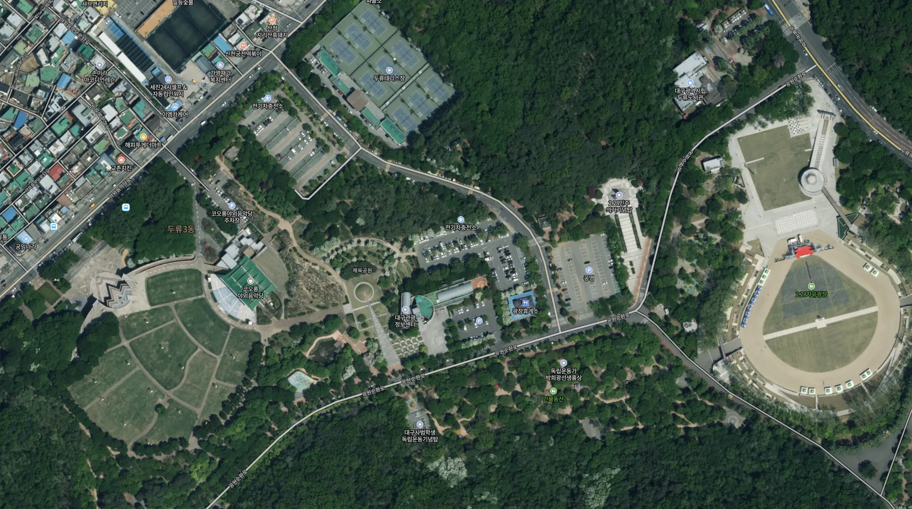
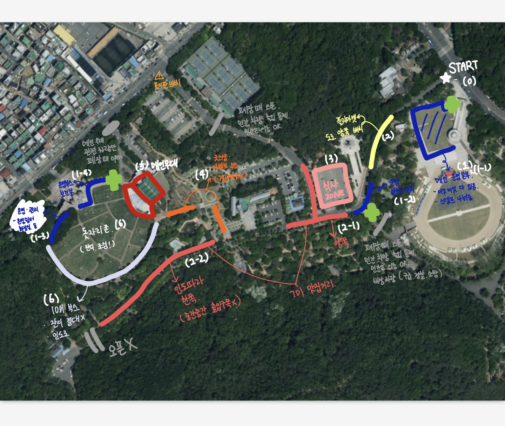
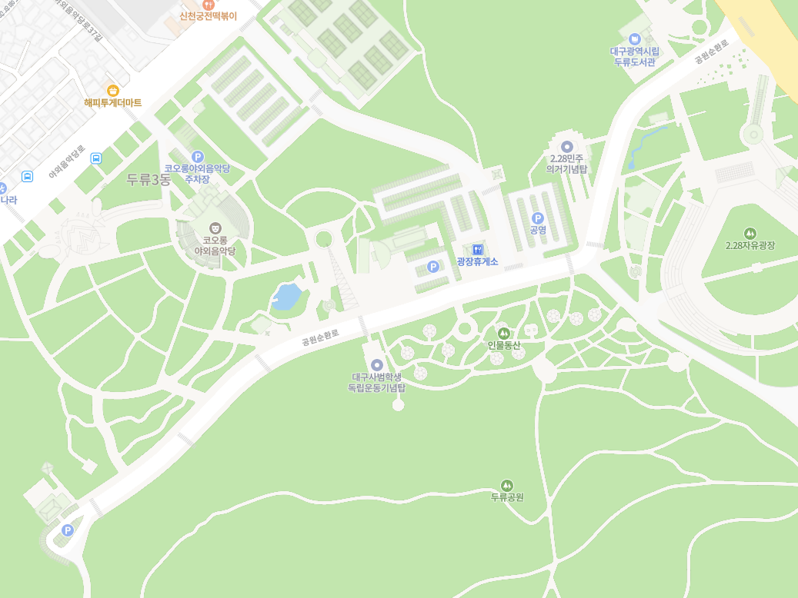

# 축제 전체 지도 (대구 사투리 페스티벌 안내 지도)

## 이전 버전과 달라진 점 (v2 → v3)

> 이전 버전: `이전버전/Y.지도_v2/Y_축제전체_지도.md` (2026-11-18 푸시)

| 위치 | v2 | v3 |
|---|---|---|
| 3장 구역 설명 전체 | 0~6번 (GPT 안내도 기준) | **구획 계획도(2026-11-19) 기준으로 다시 씀.** 번호 (0)~(8) 새 체계 |
| 구역 번호 대응 | 0 출입로 / 1 운영·안전 / 2 플리마켓 / 3 7구 / 4 메인구역 / 5 식사존 / 6 바리게이트 | (0) 메인 출입로 / (1) 운영·관리 부스 (1-1~1-4) / (2) 플리마켓 / (3) 7구 맛집거리 (3-1·3-2) / (4) 굿즈샵·이벤트 부스 / (5) 메인무대 / (6) 10미 포장마차 / (7) 돗자리존 / (8) 식사존. 바리게이트는 3-3으로 따로 |
| 플리마켓·7구 맛집거리 참고 파트 | 플리마켓 B, 7구 C | **플리마켓 C, 7구 맛집거리 B** (잘못 적은 것 바로잡음) |
| "메인구역" 이름 | 메인구역 | 지도 표기 **"메인 스테이지"** (일단 이 이름, 미확정 11번) |
| 운영·관리 부스 | 공원순환로 초입 + 2.28자유광장 앞 광장 | (1-1) 메인 운영·관리 본부 + (1-2)~(1-4) 부스로 나눠 축제 곳곳에 배치 |
| 의료실 | 위치 미정 | **3곳**: (1-1) 본부, (1-2) 옆, (1-4) 옆 |
| 7구 맛집거리 | 플리마켓 끝 ~ 바리게이트 ⑴ | (3-1) 양쪽 배치 구간 / (3-2) 한쪽 배치 구간으로 나눔 |
| 굿즈샵·이벤트 부스, 10미 포장마차, 돗자리존 | 메인구역 안 (Y_메인구역_지도 참고) | (4)·(6)·(7)로 위치 적음. (4)는 경사진 곳 배치 X, (6)은 잔디 X·인도에만 |
| 바리게이트 (6-1 → **3-3**) | ⑴⑵⑶ | ⑴ 폐장 때도 열지 않음 / ⑵ 대로변 쪽으로 당김, 비상차량 주 진입로 / ⑶ 뒤에 비상차량 배치 / **⑷ 새로** (야외음악당로 쪽, 축제 관계자만) |
| 표지판 | 없음 | **새로** (3-4): 대로변 쪽 차량 통제 안내문 |
| 4장 편의시설 | 위치 모두 미정 | 의료실 3곳, 온열쉼터·화장실 (1-3) 반영. 화장실 표의 구역 번호를 새 체계로 |
| 5장 미확정 | 1~8 (2번 정함) | v2의 2번 삭제·번호 다시 매김. **1번 정함** (⑷ 바리게이트). 8~11번 새로 |
| 5-1 허가·공문 번호 | 9~14 | **12~17** |
| 1장 지도 | ① 안내도, ② 위성지도 | **③ 구획 계획도, ④ 일반지도 추가** (이미지 파일 2개 새로) |
| 이미지 위치 | `Y.지도/` 바로 아래 | **`Y.지도/이미지/`** 폴더로 옮김 (MD 이미지 경로도 수정). 복사본 PNG 삭제 |

> 축제장 전체 구역과 방문객 동선, 편의시설(더위 쉼터·의료실·화장실·물품보관소) 배치 기준.
> 메인 스테이지 내부 구획(A~G·X·Y·Z)은 [Y_메인구역_지도.md](Y_메인구역_지도.md) 참고 (구획 계획도 기준으로 위치 수정 예정).

> 근거 라벨: `[확인]` 출처 있는 사실·담당 결정 · `[해석]` 자료 기반 의미 · `[가설]` 검증 필요 · `[추정]` 계산·가정 기반

---

## 0. 지도 사용 시 주의

- **이 파일의 구역·위치 설명은 구획 계획도(2026-11-19) 기준이 최신.** `[확인]` 지도 담당 (2026-11-19)
- 아래 ① 안내도 이미지는 **아직 예전 버전(2026-11-18)** 이라 구역 위치가 다름. 네이버 일반지도 바탕의 새 안내도를 GPT로 만드는 중이고, 완성되면 교체 (미확정 5번). `[확인]` 지도 담당 (2026-11-19)
- 안내도는 **GPT로 제작** → 실제 위성지도(②)와 길 모양·거리·각도가 다를 수 있음. 실제 지형은 ② 기준. `[확인]`
- 이 파일의 번호 (0)~(8)·⑴~⑷는 **설명용**이고 안내도에는 넣지 않음. 안내도에는 색과 이름만 표시. `[확인]` 지도 담당 (2026-11-19)

---

## 1. 지도

### ① 축제 전체 안내도 (GPT 제작, 새 버전 제작 중)

### ② 실제 위성지도

### ③ 구획 계획도 (2026-11-19)
위성지도 위에 지도 담당이 구역·바리게이트·표지판·의료실을 직접 그린 계획도. **3장 구역 설명의 기준.** `[확인]`

> ※ 계획도의 번호 중 잔디밭의 "(6) 돗자리존"은 **(7)** 로 고쳐 읽음 ((6)을 두 번 적음). 식사존 "(3)"은 **(8)**, 빨간 선 "(2-1)·(2-2)"는 **(3-1)·(3-2)**, "START"는 **메인 출입로**로 읽음. `[확인]` 지도 담당 (2026-11-19)

### ④ 일반지도 (네이버지도)
위성지도(②)와 같은 범위의 일반지도. 새 안내도의 바탕, 3장 지명의 기준. `[확인]`

> ①~④ 모두 **우측 상단 = 메인 출입로**, **좌측 = 메인 스테이지**. 동선은 공원순환로를 따라 우상단 → 좌하단으로 이어짐. `[해석]`

---

## 2. 방문객 동선

**메인 출입로 → 운영·관리 본부 → 플리마켓 → 7구 맛집거리 → 메인 스테이지** `[확인]`

7구 맛집거리 중간(3-1 구간)에 식사존이 붙어 있고, 메인 스테이지에서 메인무대·10미 포장마차·돗자리존을 즐기는 형태. `[해석]`

---

## 3. 구역별 설명

> 위치는 네이버 일반지도 지명 기준. 3장 내용은 모두 `[확인]` 지도 담당 구획 계획도·설명 (2026-11-19), 지명 대응은 `[해석]`.

| 번호 | 구역 | 지도 색 | 위치 | 내용 | 참고 파트 |
|---|---|---|---|---|---|
| (0) | 메인 출입로 | 빨간 동그라미 | 우측 상단, 두류공원로(노란 큰길)와 공원순환로가 만나는 곳, 두류도서관 아래 | 공식 정상 출입로 (단 한 곳). 공원순환로는 기존 차도지만 축제 기간 차량 통제 후 축제거리로 사용 | H |
| (1) | 운영·관리 부스 | 파랑 | 축제 곳곳 (1-1~1-4) | 운영·관리 부스 표시 | H |
| (1-1) | 메인 운영·관리 본부 | 파랑 면 | 2.28자유광장 위쪽 앞 광장 | 이것저것 다 있음. 축제 템 나눠 주는 곳 (예: 스탬프북, 축제 소개 탬플릿). 의료실 | H, M (물품 배부) |
| (1-2) | 운영·관리 부스 | 파랑 선 | 2.28자유광장 서쪽, 공원순환로 갈림길 옆 | 운영·안전 관리 | H |
| (1-3) | 운영·관리 부스 | 파랑 선 | 메인 스테이지 잔디밭 서쪽 끝 | 운영·관리. 온열쉼터, 화장실 등 | H |
| (1-4) | 운영·관리 부스 | 파랑 선 | 코오롱야외음악당 서쪽, 잔디밭 북쪽 | 운영 부스. 의료실 | H |
| (2) | 플리마켓 | 노랑 | 메인 출입로 ~ 2.28민주의거기념탑 쪽으로 내려오는 공원순환로 | 소상공인 플리마켓. **도로 양쪽** 배치 | C |
| (3) | 7구 맛집거리 | 빨강 | 아래 3-1, 3-2 (빨간 선 전체) | 7구 맛집 부스 | B |
| (3-1) | 7구 맛집거리 (양쪽) | 빨강 | 식사존 서쪽 세로 길 + 식사존 아래 공원순환로 | 도로 **양쪽** 배치 | B |
| (3-2) | 7구 맛집거리 (한쪽) | 빨강 | 대구사범학생독립운동기념탑 부근 → 좌하단 바리게이트 ⑴까지 공원순환로 | 인도 따라 **한쪽만** 배치. 중간중간 출입구 쪽은 배치 안 함 | B |
| (4) | 굿즈샵·이벤트 부스 | 주황 | 코오롱야외음악당 동쪽 길 + 원형 광장 옆 길 | 굿즈샵, 이벤트 부스. 주황 표시 중 **경사진 곳에는 배치 안 함** | 담당 파트 정해야 함 (미확정 8번) |
| (5) | 메인무대 | 진한 빨강 테두리 | 코오롱야외음악당 | 메인무대 | A, E |
| (6) | 10미 포장마차 | 연보라 | 메인 스테이지 잔디밭 남쪽 테두리 바깥 인도 | 10미 포장마차. **잔디 위 설치 절대 X, 인도에만** | B |
| (7) | 돗자리존 | 연한 파랑 면 | 코오롱야외음악당 앞 잔디밭 | 돗자리존. 잔디 조심 (방문객 텐트·그늘막 설치 금지, Y_메인구역_지도 4장) | A, E |
| (8) | 식사존 | 분홍 면 | **두류공원2공영주차장** (광장휴게소 오른쪽, 2.28민주의거기념탑 옆) | 차량 통제 후 사용. 앞쪽에 메인무대 중계 대형 디스플레이, 테이블+의자 → 7구 맛집거리 음식 먹기·휴식. 메인 스테이지 혼잡도 분산 목적 | – |

> 구획 계획도에서 (1-2)는 "운영·안전 관리", (1-4)는 "운영 부스(보건실)"로 적혀 있음. 안내도 이름은 **운영·관리 부스**로 통일, "보건실"은 **의료실**로 바꿈. `[확인]` 지도 담당 (2026-11-19)
> (1-1)의 참고 파트 M은 아래 3-2의 물품 배부 담당 기준. (6) 10미 포장마차의 참고 파트는 **B** `[확인]` 지도 담당 (2026-11-19).

### 3-1. 메인 스테이지 범위
- **메인 스테이지 = 코오롱야외음악당 일대**: (5) 메인무대, (6) 10미 포장마차, (7) 돗자리존, (1-3), (1-4). `[확인]` 지도 담당 (2026-11-19)
- 안내도에서는 이 구역을 **점선 테두리**로 묶고 "메인 스테이지"라고 표시.
- (4) 굿즈샵·이벤트 부스가 메인 스테이지 범위에 드는지는 미정 (미확정 10번).
- 메인 스테이지 내부 구획(A~G·X·Y·Z)은 [Y_메인구역_지도.md](Y_메인구역_지도.md)를 이 구획 계획도 기준으로 위치 수정 예정. `[확인]` 지도 담당 (2026-11-19)

### 3-2. 운영·관리 보충
- **2.28자유광장 안쪽 동그라미 구역(타원형 경기장)은 사용 안 함.** `[확인]` 지도 담당 결정
- 운영·관리 부스는 축제 곳곳에 배치하는 부스이고, 안내도에는 파랑으로 위치만 표시. `[확인]` 지도 담당 (2026-11-19)
- 안전 부스 종류(안내데스크, 의료실 등)는 다른 파트에서 정리한 목록을 따름. `[확인]`
- (1-1) 본부에서 하는 **스탬프북·축제 팔찌 등 참여 물품과 정보 배부·안내는 M파트가 담당**할 예정. 스탬프북 제도(양식·교환 기준·교환소 운영)는 M-6 소관 (B-6 2-4와 같은 기준) `[확인]` 지도 담당 (2026-11-18)
  - ※ "B-6 2-4" 참조가 맞는지 **확인 필요** (플리마켓 C·7구 맛집거리 B로 바로잡았으므로 파트 문자·번호 재확인, 미확정 9번)
- 코오롱야외음악당(메인무대 건물)은 **메인무대 스태프, 방송 장비, 섭외자(연예인·뮤지컬 배우 등)가 들어오는 곳**으로 사용. `[확인]` 지도 담당 결정

### 3-3. 바리게이트

> 네 곳 모두 **차량 출입 제한용**이고, **사람은 지나갈 수 있음.** 안내도에는 회색 막대로만 표시(번호 없음). `[확인]` 지도 담당 (2026-11-19)

| 번호 | 위치 | 통제·이용 | 폐장 때 |
|---|---|---|---|
| ⑴ | 좌하단. 공원순환로를 따라 가면 오르막길로 이어지는데, **오르막길 시작 부근** (길 끝에 주차장). 7구 맛집거리(3-2) 끝 | 차량 출입 제한 | **열지 않음** (폐장 때도 안 여는 유일한 곳) |
| ⑵ | 테니스장 아래 샛길 (식사존 좌측으로 이어지는 길, 두류공원3공영주차장 입구 근처). 차량 통제를 모르고 온 사람을 줄이려고 **대로변 쪽으로 당겨** 배치 | 민간 차량 출입 제한, 사람은 이용 OK. 응급·비상 상황(응급 환자 이송, 화재 등)에 비상차량이 축제장 안까지 들어오는 **주 진입로** | 열음 |
| ⑶ | 2.28자유광장 서남쪽 갈림길에서 **남동쪽으로 이어지는 공원순환로**. 원래도 통제하는 길로 알고 있음 | 민간 차량 출입 제한, 사람은 이용 OK. 기존 도로 통제 바리게이트 뒤에 **비상차량 배치** 예정 | 열음 |
| ⑷ (새로) | 좌상단 야외음악당로 쪽, 코오롱야외음악당 주차장 방향 길 | 방문객 차량 통제. **축제 관계자만** 이용 (주로 메인무대 스태프) | 사람이 편하게 지나가도록 바리게이트만 치움. **차량은 계속 안 됨** |

> ⑴⑵⑶은 v2 번호 그대로, ⑷는 이번에 새로 그은 곳. `[확인]` 지도 담당 (2026-11-19)
> ⑷로 v2의 미확정 1번(메인 스테이지 북서쪽 통제)이 정해짐. ⑶을 막아도 되는지 팀 확인은 미확정 6번.

### 3-4. 표지판
- **위치:** 테니스장 아래 바리게이트(⑵)가 있는 샛길이 큰 대로변과 만나는 곳, **대로변 쪽**. `[확인]` 지도 담당 (2026-11-19)
- **대상:** 축제 방문객
- **내용:** 이쪽으로는 축제장에 차량이 들어올 수 없고, 주차장 다음(바리게이트 위치)부터 차량을 통제한다는 안내. 잘못 들어오는 차를 줄이려는 것.
- **문구 예:** "두류공원 내 주차장 일부 출입 제한" `[확인]` 지도 담당 예시 (최종 문구 아님)

---

## 4. 편의시설 배치 (작성 중)

이 지도에 아래 시설 위치를 표시할 예정. `[확인]` 지도 담당 (2026-11-18)

| 시설 | 현재 위치 | 근거 라벨 |
|---|---|---|
| 의료실 | **3곳**: (1-1) 메인 운영·관리 본부, (1-2) 옆, (1-4) 옆. 안내도에는 초록 + | `[확인]` 지도 담당 (2026-11-19) |
| 더위 쉼터 (온열 환자 방지) | (1-3) 온열쉼터. 추가 위치는 미정 | `[확인]` 지도 담당 (2026-11-19) |
| 화장실 | 기존 화장실(4-2) + (1-3). 이동식 추가 위치는 미정 | `[확인]` 지도 담당 (2026-11-19) |
| 물품보관소 | 미정 | – |

### 4-1. 배치 원칙
- **기존 시설 사용 + 추가 배치.** 추가 배치는 이동식 화장실 차량, 그늘 천막 등. `[확인]` 지도 담당 결정
- **광장휴게소, 대구관광정보센터**: 화장실은 사용. 그 외 용도(쉼터 등)는 **가능성 열어두고 검토**. `[확인]` 지도 담당 결정
- 2.28자유광장 안쪽 경기장은 쓰지 않으므로 쉼터 후보에서 제외. `[확인]`

### 4-2. 두류공원 기존 화장실 조사 (축제 동선 주변)

공공데이터 기반 달서구 공중화장실 목록과 위성지도로 정리. **실제 위치·칸 수·축제 기간 개방 여부는 현장 확인 필요** (미확정 2번).

| 화장실 | 주소 | 개방시간 (등록 기준) | 편의 설비 | 가까운 축제 구역 | 근거 라벨 |
|---|---|---|---|---|---|
| 두류도서관화장실 | 두류동 581 | 상시 | 장애인용, 기저귀 교환대, 비상벨 | (0) 메인 출입로, (1-1) 본부 | `[확인]` 출처 1 / 구역 대응 `[해석]` |
| 대구광역시립두류도서관 (건물 안) | 공원순환로 8 | 07:00~22:00 (첫째·셋째 월 휴관) | 장애인용, 어린이용, 기저귀 교환대, 비상벨 | (0) 메인 출입로, (1-1) 본부 | `[확인]` 출처 1 / 구역 대응 `[해석]` |
| 2.28 자유광장 동편 화장실 | 두류동 581-2 | 09:00~18:00 | 장애인용, 어린이용, 기저귀 교환대, 비상벨 | (1-1) 본부 | `[확인]` 출처 1 / 구역 대응 `[해석]` |
| 2.28 자유광장 서편 화장실 | 두류동 581-2 | 09:00~18:00 | 장애인용, 어린이용, 기저귀 교환대, 비상벨 | (1-1) 본부, (1-2), (2) 플리마켓 | `[확인]` 출처 1 / 구역 대응 `[해석]` |
| 2.28화장실 | 두류동 595-1 | 상시 | 장애인용, 기저귀 교환대, 비상벨 | 정확한 위치 미확인 | `[확인]` 출처 1 / 위치 `[가설]` |
| 광장휴게소 화장실 | – | 미확인 | 미확인 | (8) 식사존 (바로 옆), (3-1) 7구 맛집거리 | `[확인]` 위성지도 화장실 표시 / 세부 미확인 |
| 대구관광정보센터 | – | 미확인 | 미확인 | (8) 식사존, (3-1) 7구 맛집거리 | `[가설]` 화장실 유무 미확인 |
| 야외음악당 화장실 | – | 미확인 | 미확인 | 메인 스테이지 | `[확인]` 출처 2 (있음만 확인) / 세부 미확인 |
| 두류공원로 화장실 | 두류공원로 161 | 상시 | 장애인용, 어린이용, 기저귀 교환대, 비상벨 | 정확한 위치 미확인 (공원관리사무소 주소와 같음) | `[확인]` 출처 1 / 위치 `[가설]` |

**보이는 점** `[해석]`
- **메인 출입로~운영·관리 본부 쪽**은 도서관·2.28자유광장 화장실이 몰려 있어 비교적 충분.
- **7구 맛집거리 (3-2) 한쪽 배치 구간~바리게이트 ⑴**은 확인된 기존 화장실이 없음 → 이동식 화장실 차량 후보 구간.
- **메인 스테이지**는 야외음악당 화장실과 (1-3) 화장실 등이 있음. 사람이 가장 많이 모이는 곳이라 이동식 추가 검토 필요.
- 2.28자유광장 화장실은 **18:00 닫힘**으로 등록돼 있음 → 축제 저녁 시간 개방 연장을 위해 **공문 발송 필요** (미확정 7번). `[확인]` 지도 담당 결정 (2026-11-18)

> 조사 한계: 참고한 목록(달서구 414곳)은 이름순 앞 200곳만 확인함. 성당못·인물동산·공영주차장·관광정보센터 이름의 화장실은 뒷부분에 있을 수 있어 미확인.

---

## 5. 미확정·회의 필요

| 번호 | 항목 | 이유 | 확인 주체 | 확인 기한 |
|---|---|---|---|---|
| 1 | ~~메인 스테이지 북서쪽(야외음악당로·버스정류장·코오롱야외음악당 주차장 쪽, 야당 근처) 통제 여부~~ | ~~방문객이 들어올 수 있고 스태프·섭외자 출입구와 겹침~~ | ~~팀회의~~ | **정함** (2026-11-19, 바리게이트 ⑷ 설치·축제 관계자만 이용) |
| 2 | 기존 화장실 실제 위치·칸 수·축제 기간(저녁) 개방 여부 | 공공데이터는 등록 기준이라 실제와 다를 수 있음. 광장휴게소·관광정보센터·야외음악당은 세부 정보 없음 | 지도 담당 → 공원관리사무소 문의 (053-803-7470) | 편의시설 배치 전 |
| 3 | 광장휴게소·대구관광정보센터의 화장실 외 용도 | 쉼터 등으로 쓸 가능성 검토 중 | 지도 담당 / 팀회의 | 편의시설 배치 전 |
| 4 | 물품보관소·이동식 화장실·추가 더위 쉼터 위치 | 의료실 3곳·(1-3) 온열쉼터는 정해짐, 나머지 미정 | 지도 담당 (안전 부스 목록은 해당 파트) | 다음 지도 버전 |
| 5 | ① 안내도를 새 안내도(네이버 일반지도 바탕)로 교체 | 지금 이미지는 2026-11-18 버전이라 구획 계획도와 위치가 다름. 새 안내도 GPT 수정 중 (제목 "대구 사투리 페스티벌 안내 지도", 번호 삭제, 표지판·의료실 위치 등) | 지도 담당 | 새 안내도 완성 시 |
| 6 | 2.28자유광장 아래(서남쪽 갈림길에서 남동쪽으로 이어지는 공원순환로) 통제 — 바리게이트 ⑶ | 지도 담당이 **막기로 정하긴 했는데, 이렇게 해도 되는지** 팀 확인 필요. 정확한 위치는 3-3 바리게이트 표 | 팀회의 | 다음 팀회의 |
| 7 | 2.28자유광장 화장실(동편·서편) 축제 기간 저녁 개방 연장 **공문 발송** | 등록 개방시간 09:00~18:00이라 저녁 프로그램 시간에 닫힘 | 지도 담당 → 관리 주체(공원관리사무소 등) 확인 후 공문 | 축제 준비 일정에 맞춰 (공문 일정 확정 시 기입) |
| 8 | (4) 굿즈샵·이벤트 부스 담당 파트 | 담당 파트가 정해지지 않음 | 팀회의 | 다음 팀회의 |
| 9 | 3-2의 "B-6 2-4" 참조가 맞는지 | 플리마켓 C·7구 맛집거리 B로 바로잡아서 파트 문자·번호가 맞는지 다시 봐야 함 | 지도 담당 → 해당 파트 파일 확인 | 다음 지도 버전 |
| 10 | (4) 굿즈샵·이벤트 부스가 메인 스테이지 범위에 드는지 | 메인 스테이지 = (5)(6)(7)(1-3)(1-4)로 정했고, (4)는 아직 안 정함 | 지도 담당 | 다음 지도 버전 |
| 11 | "메인 스테이지" 이름 확정, Y_메인구역_지도.md 이름·구획 맞추기 | "일단" 이 이름으로 씀. (5) 메인무대와 이름이 비슷함. 메인구역 MD 구획은 구획 계획도 기준으로 위치 수정 예정 | 지도 담당 / 팀회의 | 다음 지도 버전 |
| 12 | **할 일:** 구간별 도보 시간 실측 (예: 메인 출입로 → 메인무대, 식사존 → 메인무대) | 표지판·안내도에 "메인무대까지 ○분"을 적으려면 실제로 걸어서 잰 시간이 필요함. 지금은 자료 없음 | 지도 담당 (현장 답사) | 지도·표지판 제작 때 |

### 5-1. 허가·공문 필요 (검토)

> 지도에 쓰는 공간 대부분이 공공시설이라 허가·공문이 필요할 가능성이 큼. `[해석]`
> **다른 파트(H 등)에서 이미 정리했을 가능성 있음** → 정리돼 있으면 그 파트를 참고하도록 연결만 하고, 없으면 여기서 챙김. `[확인]` 지도 담당 (2026-11-18)

| 번호 | 대상 | 필요해 보이는 이유 | 관련 구역 | 확인 주체 |
|---|---|---|---|---|
| 12 | 공원순환로 차량 통제 | 기존 차도를 축제거리로 쓰려면 교통 통제 허가 필요 가능 (경찰서·구청 등) | (0)~(3), 바리게이트 ⑴⑵⑶ | H파트 정리 여부 확인 → 없으면 지도 담당 |
| 13 | 두류공원2공영주차장 사용 | 주차장을 막고 식사존으로 쓰려면 사용 허가 필요 | (8) 식사존 | 다른 파트 정리 여부 확인 → 없으면 지도 담당 |
| 14 | 두류공원3공영주차장 입구 쪽 통제 | 바리게이트 ⑵가 주차장 입구 근처라 이용 차량 영향 | 바리게이트 ⑵ | 다른 파트 정리 여부 확인 → 없으면 지도 담당 |
| 15 | 2.28자유광장 앞 광장 사용 | 운영·관리 본부 자리로 쓰려면 광장 사용 허가 필요 | (1-1) 본부 | H파트 정리 여부 확인 → 없으면 지도 담당 |
| 16 | 코오롱야외음악당·잔디광장 대관 | 메인무대·잔디 사용 | 메인 스테이지 (5)(6)(7) | 다른 파트 정리 여부 확인 → 없으면 지도 담당 |
| 17 | 광장휴게소·대구관광정보센터 개방 시간 | 화장실을 축제 시간(저녁)에 쓰려면 협의 필요 가능 | (8) 식사존, (3-1) 7구 맛집거리 | 지도 담당 (미확정 2·3번과 함께) |

---

## 6. 출처

| 번호 | 자료 | 위치 | 쓰는 내용 | 근거 라벨 |
|---|---|---|---|---|
| 1 | 대구광역시 달서구 공중화장실 목록 (공공데이터 기반, 최신 자료 기준일 2024-12-31) | [devcomma 공중화장실 찾기](https://tools.devcomma.com/tools/public-toilet-finder/%EB%8C%80%EA%B5%AC%EA%B4%91%EC%97%AD%EC%8B%9C/%EB%8B%AC%EC%84%9C%EA%B5%AC) | 두류공원 주변 화장실 이름·주소·개방시간·설비 | `[확인]` 앞 200곳만 확인 |
| 2 | 대구 두류공원 소개 (편의시설) | [tripinfo](https://m.tripinfo.co.kr/info.html?content_type_id=12&content_id=126131), [ktriptips](https://www.ktriptips.com/kor/tourspot/126131) | 야외음악당·문화예술회관 쪽 화장실 있음, 공원관리사무소 연락처 | `[확인]` |
| 3 | 축제 전체 안내도 | `Y_축제전체_1안내도.webp` (지도 담당 제공, GPT 제작, 2026-11-18 수정본: 바리게이트 ⑶ 추가) | 예전 구역·동선 (새 안내도로 교체 예정) | `[확인]` 구역·순서 / `[추정]` 길 모양·거리 |
| 4 | 실제 위성지도 | `Y_축제전체_2위성.webp` (지도 담당 제공) | 실제 길·주차장·시설 위치, 광장휴게소 화장실 표시 | `[확인]` |
| 5 | 지도 담당 설명 | 대화 (2026-11-18) | 식사존 용도, 편의시설 배치 원칙 | `[확인]` |
| 6 | 구획 계획도 + 지도 담당 설명 | `Y_축제전체_3구획계획도.jpg` (지도 담당 제공, 위성사진 위에 직접 그림, 2026-11-19), 대화 (2026-11-19) | 3장 구역 (0)~(8), 메인 스테이지 범위, 바리게이트 ⑴~⑷, 표지판, 의료실 | `[확인]` |
| 7 | 네이버 일반지도 | `Y_축제전체_4일반지도.png` (지도 담당 제공, 출처 네이버지도, 2026-11-19) | 3장 위치 지명 (2.28민주의거기념탑, 광장휴게소, 대구사범학생독립운동기념탑 등) | `[확인]` 지명 / `[해석]` 구획 계획도 위치와 대응 |
| 8 | 타 축제 지도·교통 안내 사례 (치맥·떡볶이·안동 탈춤·김천 김밥·진주 유등 공식 홈페이지) | [참고자료/Y_지도_타축제사례.md](참고자료/Y_지도_타축제사례.md) (2026-11-19 조사) | 오시는 길·주차·셔틀·교통 통제·배치도·기타 안내 항목 참고 | `[확인]` 각 공식 홈페이지 |

---

## 변경 기록
- 2026-11-18: 최초 작성 (구역 0~6 설명, 바리게이트 ⑶ 추가 결정, 편의시설 배치 원칙, 기존 화장실 조사)
- 2026-11-18: 2.28자유광장 화장실 저녁 개방 공문 필요 추가 (미확정 8번)
- 2026-11-18: 3-1에 운영·안전 부스 참여 물품(스탬프북·팔찌) 배부는 M파트 담당 예정 추가, 5장 미확정 1번(야당 근처)에 설명 보강, 7번(2.28자유광장 아래 길 통제, 팀회의) 추가
- 2026-11-18: 5-1 허가·공문 필요 항목(9~14번) 추가, 공문 항목 번호 7 → 8 (7번 중복 정리)
- 2026-11-18: ① 안내도를 바리게이트 ⑶ 추가본으로 교체, 6-1 ⑶ 상태 수정, 미확정 2번 정함
- 2026-11-18 (v3): 3장 플리마켓 C·7구 맛집거리 B로 바로잡음, 메인구역 4-1~4-3(10미 포장마차·굿즈·이벤트·운영·안전 부스) 추가
- 2026-11-18 (v3): 정한 미확정 2번 삭제 후 번호 다시 매김(1~7), 미확정 8번(4-2 담당 파트)·9번(B-6 2-4 참조 확인) 추가, 5-1 번호 10~15로
- 2026-11-19 (v3): 구획 계획도 기준으로 3장 전체 다시 씀 — 구역 (0)~(8) 새 번호, 메인구역 → "메인 스테이지", 운영·관리 부스 (1-1)~(1-4), 7구 맛집거리 (3-1)·(3-2), 바리게이트 6-1 → 3-3 (⑷ 새로, ⑴~⑶ 내용 보강), 3-4 표지판 새로. 4장 의료실 3곳·온열쉼터 반영, 화장실 표 구역 번호 새 체계로. 미확정 1번 정함, 4·5번 내용 바꿈, 10·11번 새로. 5-1 번호 12~17로
- 2026-11-19 (v3): 1장에 ③ 구획 계획도·④ 일반지도 이미지 추가, "손글씨 지도" 표현을 "구획 계획도"로 바꿈, (6) 참고 파트 B 확인
- 2026-11-19 (v3): 지도 이미지를 이미지/ 폴더로 옮기고 이미지 경로 수정
- 2026-11-19 (v3): 출처 8번(타 축제 지도·교통 안내 사례, 참고자료/Y_지도_타축제사례.md) 추가
- 2026-11-20 (v3): 5장 12번 할 일 추가 — 구간별 도보 시간 실측 (표지판·안내도 "메인무대까지 ○분")
