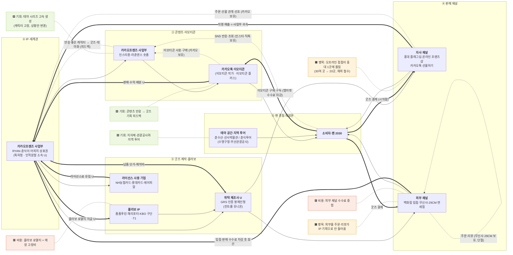

# valuechain_v0.md — 카카오(카카오프렌즈) 캐릭터 IP 밸류체인 맵 v0 (네 층)

> life-style 트랙 · 콘텐츠 산업 → 현희

- 작성: 2026-11-06 · Claude Code 초안(v0) — **사람 검증 전**. 검증·마커 근거는 [analysis.md](analysis.md)
- 근거: [stakeholders.md](stakeholders.md)(단계·이해관계자, 웹 출처 W1~W13), [activities_v0.md](activities_v0.md), [../03_onepager_v1.md](../03_onepager_v1.md), [../02_sources_v1.md](../02_sources_v1.md)
- 표기(Day10 10p): `-->` 상품·활동(실선) · `==>` 돈(굵은 선, 소비자 → 원천 방향) · `-.->` 데이터(점선, 데이터 이름·보유자) · 🟧 병목 · 🟥 비용 · 🟩 기회
- **금액·비율은 적지 않았다.** 공시에서 확인한 카카오프렌즈 단독 수치가 없기 때문 (onepager B장).

---

## 1. Mermaid

---

## 2. 단계별 근거 (onepager·출처 대조)

| 단계 | 상자 | onepager 칸 | 출처 |
|---|---|---|---|
| ① | 카카오프렌즈 사업부·상표권 | A "무엇으로", A "파트너" | `[출처 01]` 상표 5,262건(RYAN·춘식이·어피치), `[출처 02]` 별도 계열사 없음, `[출처 05]` 분할 |
| ② | 인스타툰·라춘댄스 | 원페이지에 없음 | `[W9]` `[W10]` |
| ② | 카카오톡 이모티콘·이모티콘 플러스 | A "무엇으로" | `[출처 01]`(정기결제 시스템), `[출처 06]` |
| ③ | GRS 위탁 제조 | 원페이지에 없음 | `[출처 01]` ESG 절("GRS 인증 공장 및 제조사와 협업… 주력 상품인 봉제인형") |
| ③ | 콜라보 IP·라이선스 기업 | 원페이지에 없음 (00_candidates 1장) | `[W1]~[W5]` `[W11]` |
| ④ | 홍대·프렌즈샵·선물하기·외부몰 | A "어떻게 전달" (선물하기·톡스토어만) | `[출처 01]`, `[W1]` `[W2]` `[W6]` |
| ⑤ | 테마 공간·춘식투어 | 원페이지에 없음 | `[W3]` `[W6]` `[W7]` `[W12]` |

> `[I]` 원페이지는 카카오 *전사* 공시 중심이라 ②③⑤의 근거가 거의 없다. 이번 v0는 카카오 공식 뉴스룸(S등급)으로 보강했고, 이 차이를 analysis.md 4장 '검증'에 불일치로 기록했다.

---

## 3. 돈 흐름 층 (③) — 소비자에서 원천으로

| 구간 | 시작점 → 끝점 | 중간에서 떼는 것 (이름만, 금액 없음) | 근거 |
|---|---|---|---|
| 굿즈(자사) | 팬 결제 → 홍대·프렌즈샵·선물하기 → **카카오(IP 보유자)** | 매장 운영비, 제조 납품 단가 | `[W1]` `[W8]` `[출처 01]` |
| 굿즈(외부) | 팬 결제 → 백화점·무신사·29CM·면세점 → 카카오 | **입점·판매 수수료** (+ 납품 단가) | `[W1]` · 수수료율 `[U]` |
| 콜라보 굿즈 | 팬 결제 → 판매 채널 → 카카오 → **상대 IP 보유자** | 상대 IP 로열티 (나가는 돈) | `[W1]~[W5]` · 조건 `[U]` |
| 라이선스 아웃 | 카드·향수 이용자 → NH농협카드·롯데카드·에이피알 → 카카오 | 라이선스료 (들어오는 부수 흐름) | `[W11]` · 요율 `[U]` |
| 이모티콘 | 이용자 결제·구독 → 앱마켓 → 카카오 → 작가 | 앱마켓 수수료, 작가 배분 | `[출처 01]` 구독 시스템 · 배분율 `[U]` (비공식 자료만 있어 미기재) |
| 지역 투어 | 수영구청·부산관광공사 ↔ 카카오 | 누가 누구에게 돈을 내는지 `[U]` | `[W7]` |

- **끝점:** 공식 캐릭터(라이언·춘식이)는 IP 보유자가 카카오 하나라서 돈의 끝점이 사업부로 모인다 `[I]`. 반면 이모티콘 작가 캐릭터는 끝점이 작가와 나뉜다.
- **부수 흐름:** 라이선스료(카드·향수), 이모티콘 플러스 구독 — 본류(굿즈 결제)와 별도.

---

## 4. 데이터 흐름 층 (④) — 생기는 곳 · 보유자 · 피드백

| 단계 | 생기는 데이터 | 보유자 | 앞 단계로 돌아가나? |
|---|---|---|---|
| ① IP | 상표·디자인권 목록, 캐릭터 설정 | 카카오 | — |
| ② 콘텐츠 | 인스타툰·숏폼 조회·반응 / 이모티콘 사용·구매 | 인스타·틱톡·유튜브 / 카카오 | ✅ 춘식이 사례: 인스타툰 반응 → 이모티콘 → 캐릭터 정식화 `[W9]` `[I]` |
| ③ 제작 | 생산 로트·인증(GRS) | 제조사·컨트롤 유니온 | `[U]` |
| ④ 판매 | 자사: 주문·선물 관계·선호 / 외부몰: 주문·리뷰 | 카카오 / 무신사·29CM·백화점 | ⚠️ 외부몰 데이터는 카카오로 오는지 `[U]` → **단절 후보** |
| ⑤ 경험 | 매장 방문·테마 공간 반응, 투어 참여 | 카카오 / 관광공사 | `[U]` |

- `[I]` 카카오의 진짜 강점은 **선물하기의 '관계 데이터'**(누가 누구에게 무엇을 선물하나)다 — `[출처 01]` "관계 기반 커머스는 카카오만 영위할 수 있는 차별화된 서비스". 캐릭터 굿즈가 이 데이터 위에서 팔린다는 점이 다른 캐릭터 회사(아이피엑스·아트박스)와 가장 다른 지점이다.
