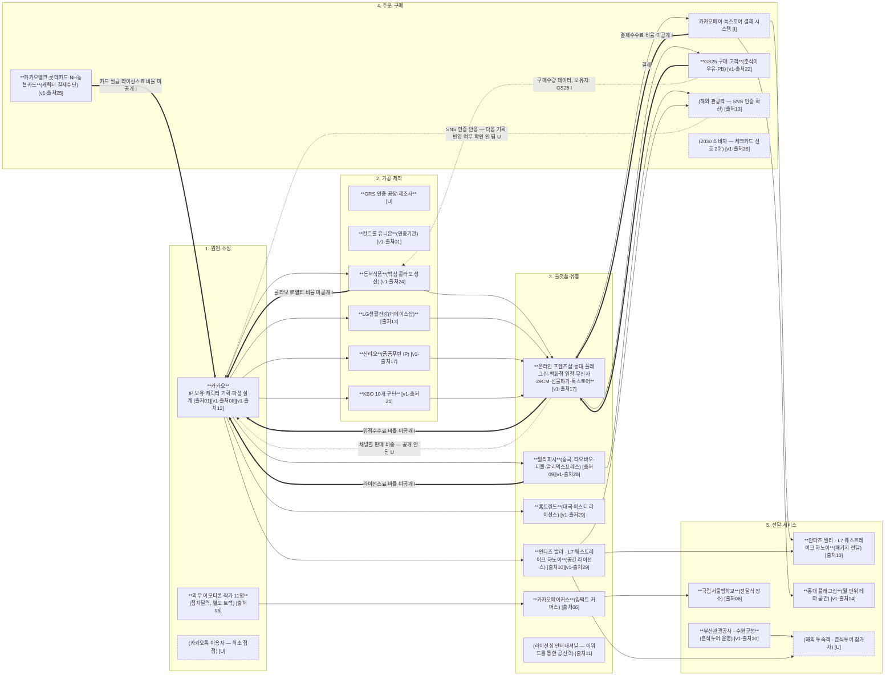

# 카카오프렌즈 — 산업 밸류체인 다이어그램 (v0)

> 확인 날짜: 2026-11-06
> 근거: `현희` 브랜치 `lifestyle_research/company/03_onepager_v1.md`(출처 01~42) + `valuechain/stakeholders/stakeholders_v2.md`(이해관계자 배치)
> 단계 5개(팀 확정): **원천·소싱 → 가공·제작 → 플랫폼·유통 → 주문·구매 → 전달·서비스**
> 표기 규칙: 상품 흐름 `-->` (실선) · 돈 흐름 `==>` (굵은 선, 라벨에 결제·수수료·정산·납품단가) · 데이터 흐름 `-.->` (점선, 라벨에 데이터 이름·보유자)
> 숫자(수수료율·금액)는 03_onepager_v1.md에 `[출처]`가 붙어 있는 것만 썼다. 비율·수수료율 자체는 어느 칸에도 공개돼 있지 않아 **금액·비율 숫자가 들어간 화살표는 하나도 없다** — 전부 라벨(무엇이 오가는지)만 표시했다.

---

---

## 단계별 근거 (03_onepager_v1.md의 칸)

| 단계 | 03_onepager_v1.md 칸 | 핵심 내용 |
|---|---|---|
| 1. 원천·소싱 | A. 사업 모델 — "무엇을" IP 활용 6갈래 ① 콘텐츠, "무엇으로" 핵심 자원(세계관) | 라이언→춘식이→춘구마로 이어지는 캐릭터 파생 설계, IP 권리(상표권 5,262건) |
| 2. 가공·제작 | A. 사업 모델 — "파트너" 표(제조 / 콜라보 IP 행), "무엇으로" 핵심 자원(IP 권리) | GRS 인증 제조사, 산리오·해리포터·KBO 등 콜라보 IP 파트너 |
| 3. 플랫폼·유통 | A. 사업 모델 — "어떻게 전달"(채널 목록), D. 산업 이슈·경쟁 — "확장 방향"(라이선스·공간 라이선스 표) | 자사+외부 채널 동시 출시, 중국·태국 마스터 라이선스, 호텔 공간 라이선스 |
| 4. 주문·구매 | B. 재무·성과 — B-3 간접 성과 지표 표(GS25·카카오뱅크 행) | 춘식이우유 월 100만 개, 카카오뱅크 체크카드 30만 장 — 둘 다 구매·결제 시점의 반응 지표 |
| 5. 전달·서비스 | A. 사업 모델 — "무엇을" IP 활용 6갈래 ⑥ 경험, C. 최근 동향 3번(부산 춘식투어) | 홍대 테마 공간, 호텔 패키지, 부산 춘식투어(수영구청·부산관광공사), 점자달력 전달식 |

---

## 메모 — 왜 금액·비율이 하나도 없는가

03_onepager_v1.md의 **B-1(카카오프렌즈 단독 숫자)**에 2018년 매출(1,051억 원)이 있긴 하지만, 이건 "단계 사이에서 얼마가 떼이는지"가 아니라 **회사 전체 매출**이라 돈 흐름 화살표 라벨로 쓸 수 없다. 라이선스료율·입점수수료율·결제수수료율처럼 **단계 사이 차감 비율**을 보여주는 숫자는 onepager_v1.md 어디에도 없다("라이선스 요율·콜라보 조건... 비공개"가 onepager_v1.md 자체의 미확인 목록에 있음). 그래서 돈 흐름 화살표는 전부 "무엇이 떼이는지"(결제·로열티·입점수수료·라이선스료)만 라벨로 달았고, 숫자는 하나도 넣지 않았다.

데이터 흐름도 마찬가지로, "어떤 데이터가 생기는지"는 추정(`[I]`)이거나 "공개 안 됨"(`[U]`)으로만 표시했다 — `signals.md`에서 이미 "데이터 단절" 신호를 근거 부족으로 못 찾았던 것과 같은 이유다.
