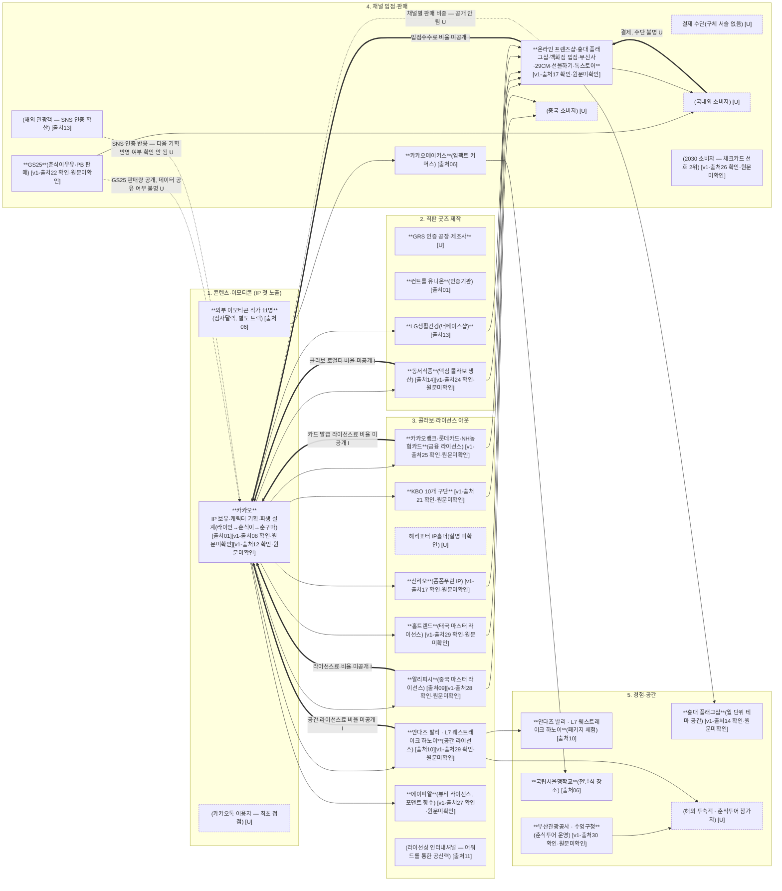

# 카카오프렌즈 — 산업 밸류체인 다이어그램 (v1)

> 확인 날짜: 2026-11-06
> 근거: `현희` 브랜치 `lifestyle_research/company/03_onepager_v1.md`(출처 01~42) + `02_sources_v1.md`(원문 확인 등급) + `valuechain/stakeholders/stakeholders_v2.md`
> **v0→v1 변경**: `analysis.md` 검증에서 5단계 틀이 onepager 근거 없는 공통 템플릿이라는 문제를 찾았고, 팀이 FigJam에서 교체를 결정했다(결정 이유는 `analysis.md` "2.5 단계 틀 교체 제안" 참고). 아래 5단계는 `03_onepager_v1.md`의 "무엇을 — IP 활용 6갈래"와 "어떻게 전달"에서 바로 가져왔다.
> 표기 규칙: 상품 흐름 `-->` (실선) · 돈 흐름 `==>` (굵은 선, 라벨에 결제·수수료·정산·납품단가) · 데이터 흐름 `-.->` (점선, 라벨에 데이터 이름·보유자). 숫자는 `[출처]`가 붙은 것만.
> `[v1-출처 n]`은 전부 `02_sources_v1.md`에서 🟡(원문 미저장, 웹 검색 요약) 등급이라 "확인·원문 미확인"을 같이 표시했다(v0 검증에서 지적된 점 반영).

---

---

## 단계별 근거 (03_onepager_v1.md의 칸)

| 단계 | 03_onepager_v1.md 칸 | 핵심 내용 |
|---|---|---|
| 1. 콘텐츠·이모티콘 | A. 사업 모델 — "무엇을" IP 활용 6갈래 ①콘텐츠 ②이모티콘, "무엇으로" 핵심 자원(세계관) | 라이언→춘식이→춘구마 파생, IP 권리(상표권 5,262건 `[출처01]`) |
| 2. 직판 굿즈 제작 | A. 사업 모델 — "무엇을" ③직판 굿즈, "파트너" 표(제조 행) | GRS 인증 제조사, 동서식품·LG생활건강 콜라보 제품 생산 |
| 3. 콜라보·라이선스 아웃 | A. 사업 모델 — "무엇을" ④콜라보 ⑤라이선스 아웃, "파트너" 표 | 산리오·KBO 등 콜라보 IP, 중국·태국 마스터 라이선스, 금융·뷰티 라이선스 |
| 4. 채널 입점·판매 | A. 사업 모델 — "어떻게 전달"(채널 목록) | 자사+외부 채널 동시 출시(온라인 프렌즈샵·홍대·백화점·무신사·29CM), GS25 판매 |
| 5. 경험·공간 | A. 사업 모델 — "무엇을" ⑥경험, C. 최근 동향 3번(부산 춘식투어) | 호텔 패키지, 홍대 테마 공간, 부산 춘식투어, 점자달력 전달식 |

---

## v0 → v1에서 고친 것

| 문제(analysis.md 검증) | v0 | v1 |
|---|---|---|
| 단계 틀이 onepager 근거 없는 공통 템플릿 | 원천·소싱→가공·제작→플랫폼·유통→주문·구매→전달·서비스 | 콘텐츠·이모티콘→직판 굿즈 제작→콜라보·라이선스 아웃→채널 입점·판매→경험·공간 (A장 "IP 활용 6갈래"·"어떻게 전달" 근거) |
| `d1`(카카오페이 결제 시스템) 근거 없음 | `[I]` 추측 노드로 존재 | `d4`"결제 수단(구체 서술 없음) [U]"로 정직하게 표시 |
| `[v1-출처 n]`이 "확인된 사실"처럼 보임 | 등급 표시 없음 | 전부 "확인·원문미확인" 병기 |
| GS25 데이터 흐름 라벨 근거 없음 | "구매수량 데이터, 보유자: GS25 [I]" | "GS25 판매량 공개, 데이터 공유 여부 불명 [U]" |
| "주문·구매" 단계 근거 약함 | 독립 4단계였음 | 삭제, 대신 "콜라보·라이선스 아웃"을 독립 3단계로 승격 |

돈·데이터 흐름 라벨은 v0와 마찬가지로 **숫자를 하나도 넣지 않았다** — onepager_v1.md에 라이선스료율·수수료율 수치가 없기 때문이다(동일한 이유, v0 메모 참고).
