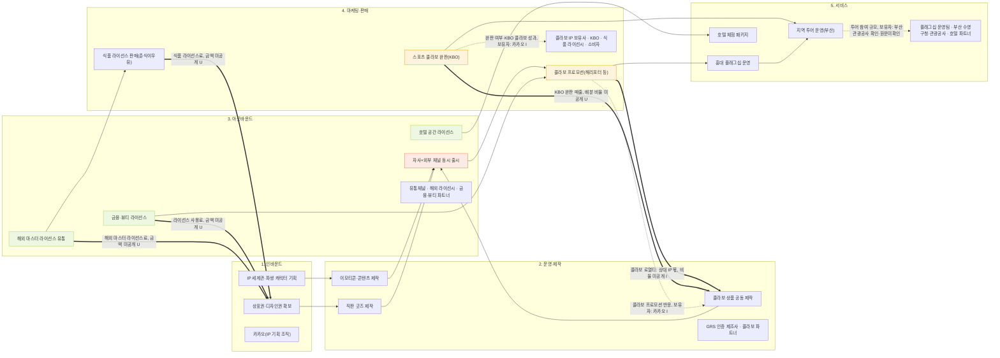

# 카카오프렌즈 — 밸류체인 네 층 맵 (4교시 초안, v0)

> 확인 날짜: 2026-11-07 · 근거: `valuechain_v2/activities_v0.md` + `stakeholders.md` + `signals.md` (전부 `03_onepager_v1.md` 기반)
> 네 층: ①활동(단계) ②이해관계자 ③돈 흐름(굵은 선, 소비자→원천 역방향) ④데이터 흐름(점선)
> 단계: 인바운드 → 운영·제작 → 아웃바운드 → 마케팅·판매 → 서비스

## 단계별 근거

| 단계 | 근거 칸(onepager_v1) | 출처 |
|---|---|---|
| 1. 인바운드 | A-무엇으로(세계관), A-무엇으로(상표권 5,262건·디자인권 177건) | `[출처01]` `[출처08, 확인·원문미확인]` `[출처12, 확인·원문미확인]` |
| 2. 운영·제작 | A-무엇을①②③④, A-파트너(GRS 인증 제조사) | `[출처01]` `[출처09, 확인·원문미확인]` `[출처10, 확인·원문미확인]` `[출처17~21, 확인·원문미확인]` |
| 3. 아웃바운드 | A-어떻게 전달, A-무엇을⑤, A-파트너 | `[출처17, 확인·원문미확인]` `[출처25, 확인·원문미확인]` `[출처27~29, 확인·원문미확인]` |
| 4. 마케팅·판매 | C-최근 동향, B-3 간접 성과 지표 | `[출처17, 확인·원문미확인]` `[출처18, 확인·원문미확인]` `[출처21, 확인·원문미확인]` `[출처22, 확인·원문미확인]` |
| 5. 서비스 | A-무엇을⑥, C-최근 동향 | `[출처14, 확인·원문미확인]` `[출처29, 확인·원문미확인]` `[출처30, 확인·원문미확인]` |

## 메모 — 왜 돈·데이터 흐름에 숫자가 하나도 없는가

- `03_onepager_v1.md`에는 콜라보 로열티 비율, 라이선스 사용료 금액, 채널별 판매 비중, 수수료 배분 같은 **정산 구조 숫자가 전혀 없다**(미공개 항목으로 명시돼 있거나, 애초에 서술 자체가 없음). 그래서 돈 흐름 화살표는 전부 "미공개" 또는 `[U]`로만 표시했다.
- 데이터 흐름 화살표 3개 중 2개는 onepager_v1에 직접 서술이 없어 `[I]`(추정)를 붙였고, 1개만 출처 번호가 있다(그마저도 🟡 확인·원문미확인).
