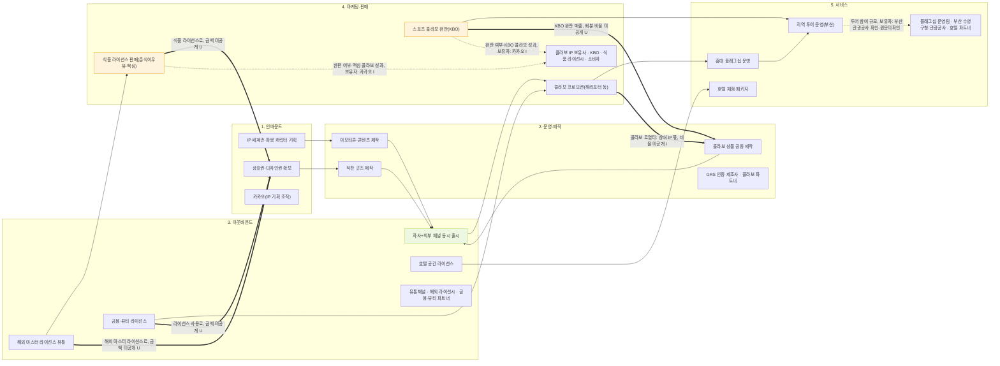

# 카카오프렌즈 — 밸류체인 네 층 맵 (4교시, v1 — analysis.md 검증 반영)

> 확인 날짜: 2026-11-07 · 근거: `valuechain_v2/activities_v0.md`(맥심 완판 추가됨) + `stakeholders.md` + `signals.md`
> v0→v1에서 고친 것: ① `opp` 마커를 근거 없는 c2·c3·c4에서 제거 ② `bottleneck` 마커를 엉뚱한 노드(d1)에서 실제 근거 노드(d3, 식품 라이선스 판매)로 이동 ③ d3 라벨에 맥심 완판 사례 반영

## v0 → v1에서 고친 것

| # | v0 | v1 | 이유 |
|---|---|---|---|
| 1 | `opp` 마커가 c2·c3·c4(라이선스 노드 3개)에 붙음 | `opp` 마커를 c1 하나로 줄임 | `signals.md`에서 "짝이 되는 AI 기회 유형"이 실제로 걸린 신호는 4건뿐이고, 그중 "D2C·직거래 서비스 시나리오"·"문서→데이터 추출 자동화" 둘 다 c1(자사+외부 채널 동시 출시)에 걸린 신호다. c2·c3·c4는 근거가 없어 제거. |
| 2 | `bottleneck` 마커가 d1(해리포터 콜라보)에 붙음 | `bottleneck` 마커를 d3(식품 라이선스 판매)로 이동 | 근거였던 "맥심 완판"(`[출처24]`)은 식품 라이선스 사례지 해리포터 콜라보와 무관. `activities_v0.md`에도 맥심 완판을 d3 쪽 활동으로 추가해 근거 노드를 맞췄다. |
| 3 | d3 라벨 "식품 라이선스 판매(춘식이우유)" | d3 라벨 "식품 라이선스 판매(춘식이우유·맥심)" | 맥심 완판 사례가 이 노드에 속한다는 걸 라벨에도 반영. |
| 4 | 데이터 흐름 화살표 2개(d2, d1 출발) | 데이터 흐름 화살표 2개(d2, d3 출발) | 마커 이동과 같은 이유로 d1→d3 변경. |

## 단계별 근거 (v0와 동일 — 변경 없음)

| 단계 | 근거 칸(onepager_v1) | 출처 |
|---|---|---|
| 1. 인바운드 | A-무엇으로(세계관), A-무엇으로(상표권 5,262건·디자인권 177건) | `[출처01]` `[출처08, 확인·원문미확인]` `[출처12, 확인·원문미확인]` |
| 2. 운영·제작 | A-무엇을①②③④, A-파트너(GRS 인증 제조사) | `[출처01]` `[출처09, 확인·원문미확인]` `[출처10, 확인·원문미확인]` `[출처17~21, 확인·원문미확인]` |
| 3. 아웃바운드 | A-어떻게 전달, A-무엇을⑤, A-파트너 | `[출처17, 확인·원문미확인]` `[출처25, 확인·원문미확인]` `[출처27~29, 확인·원문미확인]` |
| 4. 마케팅·판매 | C-최근 동향, B-3 간접 성과 지표 | `[출처17, 확인·원문미확인]` `[출처18, 확인·원문미확인]` `[출처21, 확인·원문미확인]` `[출처22, 확인·원문미확인]` `[출처24, 확인·원문미확인]` |
| 5. 서비스 | A-무엇을⑥, C-최근 동향 | `[출처14, 확인·원문미확인]` `[출처29, 확인·원문미확인]` `[출처30, 확인·원문미확인]` |
