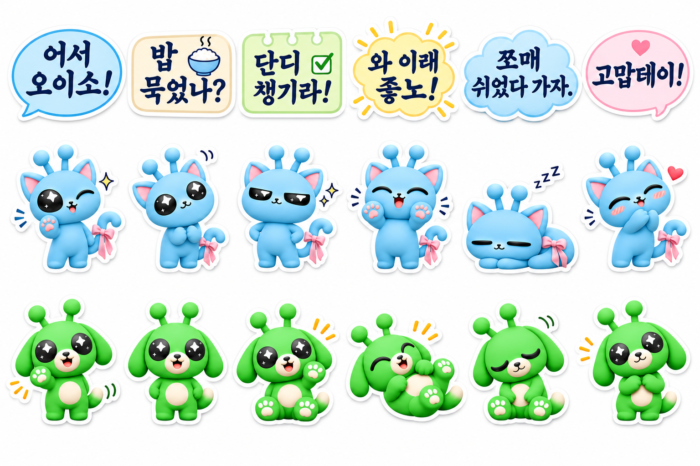

# D03-02 스티커 세트 시트

> 최신 반영: 2026-11-18 · 상품 이미지 v03 · 제작 패키지 v01
> 디자인 구성: 사용자 승인 · 제작 규격: 샘플 제안 · 최종 칼선과 실물 색상: 제조사 교정 및 승인 필요

## 최신 상품 구성

**사투리 라벨 6종과 문구 없는 캐릭터 12종을 각각 분리한 총 18종 세트**다. 라벨과 캐릭터를 한 외곽선으로 합치지 않는다. 대키미 6종, 외지몽 6종 모두 성체 기준이며 원본 이미지를 그대로 사용한다.

| 구분 | 구성 |
|---|---|
| 사투리 라벨 | 어서 오이소! / 밥 묵었나? / 단디 챙기라! / 와 이래 좋노! / 쪼매 쉬었다 가자. / 고맙데이! — **전부 J 자료집 ⚠️ 사람 확인 필요** (오이소 S-217d5, 묵었나 S-25d67, 챙기라 S-f4a94, 좋노 S-6d43e, 쪼매 쉬었다 가자 S-6e52e, 고맙데이 S-76b8e) |
| 글자 디자인 | 궁서풍 래스터 글자와 문구별 말풍선·메모·구름형 라벨. 글꼴 대체나 문구 재입력 없이 원본 사용 |
| 캐릭터 | 대키미 6종 + 외지몽 6종. 캐릭터 스티커 안에는 문구 없음 |
| 기준 이미지 | 상품 시안 v03. 이전 12종 합성형 및 18종 흰 글자 외곽형 시안은 이번 전달본에서 제외 |
| 출력 기준 | 300dpi 원본 크기, 약 20-27mm 이미지 프레임. 실제 재단 크기와 프레임은 다름 |
| 샘플 제안 | A5 가로 대지, 백색 불투명 PP 점착지와 무광 코팅, 반칼. 원단·접착·허용차는 업체 확인 대상 |

## 상품 이미지



## 업체 전달 파일

- [전체 제작 패키지 ZIP](스티커18종_제작패키지_v01.zip)
- [디자인 시트 PDF 4쪽](제작자료_v01/02_디자인시트/스티커18종_디자인시트_v01.pdf)
- [제작사양서 PDF 5쪽](제작자료_v01/03_제작사양서/스티커18종_제작사양서_v01.pdf)
- [A5 실물 크기 확인판 PDF](제작자료_v01/05_실물크기_출력확인/A5_18종_300dpi_실물크기확인_v01.pdf)
- [무손실 원본 조각 18종](제작자료_v01/04_원본조각_18종)
- [규격 목록 CSV](제작자료_v01/03_제작사양서/18종_규격목록.csv)
- [원본 좌표와 해시 manifest](제작자료_v01/03_제작사양서/원본좌표_규격_manifest.json)
- [업체 전달 안내](제작자료_v01/00_업체전달_읽어주세요.txt)
- [상품 시안 생성 프롬프트](프롬프트/생성프롬프트_v03.txt)

디자인 시트에는 전체 상품 이미지와 18종 개별 이미지가 내장되어 있다. 원본 조각은 상품 기준 이미지에서 무손실로 추출했으며, 이미지 재생성·글자 재조판·캐릭터 재작화를 하지 않는다. 문구의 철자·문장부호·줄바꿈·글자 형태와 캐릭터의 명암을 보존한다.

**본 패키지는 최종 인쇄판이나 확정 벡터 칼선 데이터가 아니다.** 제조사가 칼선과 색 변환 교정을 작성하고, 실물 샘플 확인 후 양산한다. 현재 원본에서 4-5cm급으로 확대하면 300dpi를 확보할 수 없다. 자세한 기준은 제작사양서를 따른다.

## 이전 초안 기록

아래 v01 초안은 이력 보존용이다. 이번 제작에서는 위의 최신 구성과 첨부 패키지가 우선한다. 아래의 10-12종 구성안, 이미지 대기 상태, 문구 후보 및 규격은 현행 확정안이 아니다.

<details>
<summary>2026-11-17 이전 v01 초안 펼치기</summary>

# D03-02. 스티커 세트 시트

> 구분: 고정(형태·규격·캐릭터) + 연도별(문구·대화 구성) · 진행: 초안 (팀 검토 전) · 최종 수정: 2026-11-20 
> 목차: [D00_목차.md](../../D00_목차.md) · 공통 규칙: [D03_품목별수치.md](../D03_품목별수치.md) · 양식: [_품목시트_양식.md](../_품목시트_양식.md) · 같은 구조의 앞 시트: [D03-01 아크릴 키링](../D0301_아크릴키링/D0301_아크릴키링_시트.md)
> **샘플 이미지는 나중에 따로 넣어요.** 이 시트는 이미지 없이 내용(1~7장)을 먼저 완성했어요. 8~9장은 `이미지 대기`예요.

## 0. 이전 버전과 달라진 점

- **2026-11-20 수정, 담당자 답 반영:** 굿즈 문구는 **사투리만** 써요 (D01 2-4). 상품 면·포장 카드·행택에서 **표준어 뜻풀이를 뺐어요**. 뜻 칸은 J03 검수용 내부 기록이에요. 외지몽의 표준어 대사(질문·반응)는 캐릭터 대사 예외라 그대로 둬요. 사후 온라인 판매는 2026-11-20에 확정으로 바뀌었어요 (D06).
- 첫 버전이에요.
- 공통 지침서 v01 3절의 "사투리 & 마스코트 스티커 세트"(두 캐릭터의 대화·표정과 사투리를 하나의 세트로 구성)를 구체화했어요.
- 캐릭터 버전은 키링과 같이 **성체 기준**이에요 (2026-11-17 담당자 결정, 굿즈는 성체).
- 이 시트의 낱장 수·크기·칼선·접착·표면 값은 **전부 작성자 제안이나 업체 확인 필요값**이에요. 담당자 결정은 "스티커 세트"라는 품목과 성체 기준까지예요.

## 1. 상품 정보

| 항목 | 내용 |
|---|---|
| 상품 ID | D0302_스티커 |
| 시트 버전 | v01 |
| 작업일 | 2026-11-17 |
| 상태 | 초안 |
| 이번 변경점 | 첫 버전. 이미지 없이 내용만 작성 |
| 상품 목적 | 가장 낮은 가격대에서 대키미·외지몽을 접하고 사투리를 알아가게 하는 입문 굿즈. 노트북·다이어리·휴대폰 케이스 등에 붙여 일상에서 쓴다 `[가설]` (검증: 첫 회차 판매율, D05) |
| 판매 단위 | **1세트 = 낱장 여러 장이 든 시트 1~2매** (제안) |

**세트의 세 가지 재료**

| 종류 | 무엇 | 역할 |
|---|---|---|
| **캐릭터 표정형** | 대키미 또는 외지몽(성체)의 표정·동작 | 귀여움과 수집 |
| **사투리 문구형** | 사투리 문구만 (표준어 뜻풀이 없음, D01 2-4) | 알아가는 재미 |
| **대화 쌍** | 대키미 말(사투리) → 외지몽 반응을 짝으로 구성 | 두 캐릭터 관계 (대키미 = 설명하는 토박이, 외지몽 = 배우는 여행자, D01 2-2절) |

**품목군 · SKU · 사이즈 · 생산 개수는 구분해서 적는다.**

| 구분 | 값 | 상태 |
|---|---|---|
| 품목군 수 | 1 (스티커 세트) | 확정 |
| 디자인 옵션 | 세트 1종 (고정 구성) | 제안 |
| SKU 수 | 1 (세트 구성이 하나면). 대키미 세트·외지몽 세트로 나누면 2 | 제안, 미확정 5 |
| 낱장 수 | 한 세트 약 10~12장 | 디자인 제안값 (구성은 4장) |
| 시트 수 | 1~2매 | 업체 확인 필요값 |
| 제작 수량 | 입력 필요 | 미정 (첫 해 임의 설정, D04 2-3절) |

## 2. 기준 자료

| 항목 | 값 |
|---|---|
| 캐릭터 버전 | **성체** (2026-11-17 담당자 결정) |
| 캐릭터 기준 이미지 (대키미) | `Mascot/마스코트 디자인 스펙시트/성체 대키미&외지몽 디자인 자료/대키미/캐릭터 디자인/대키미_고정외형_v00/레퍼런스_이미지/대키미_캐릭터_원본설정보드.png` |
| 캐릭터 기준 이미지 (외지몽) | 키링 시트와 동일: `외지몽_패드_측면폭_통합_v02/레퍼런스_이미지/외지몽_캐릭터_원본설정보드.png` + 같은 폴더 `외지몽_승인정면_v04.png` (정리 내용은 [키링 시트 2장](../D0301_아크릴키링/D0301_아크릴키링_시트.md)) |
| 로고 기준 파일 | `Daegu Mascot Lifestyle/dgeolla_Brand logo/01_확정_로고/대구_얼라들_로고_승인원본.png`. **낱장 스티커에는 넣지 않고 포장(봉투·카드)에만 노출** (제안, 키링과 동일 원칙) |
| 기존 상품 참고 파일 | 없음 |
| 참고 역할 | 캐릭터 정체성 = 성체 원본설정보드 / 문구 = 아래 문구 기록 |

- 표정·동작은 보드에 없는 표정을 만들 때 **원본 보드의 눈·입 구조를 지키고 한두 요소만 바꾼다**. 이미지로 얻은 표정은 사람이 H01~H02로 확인한다 (D01).
- 외지몽 표정은 현재 영상 제작 쪽(`결과v05`, 표정 참고 `결과v02`)에 별도 이력이 있다. 이 시트는 그 영상 자료를 기준으로 삼지 않고 **스틸 보드만** 쓴다 (`02_승인상태와버전연결.md`에서 번호 대응 금지).

### 문구 기록 (D01 2-4절 양식)

**사투리 문구는 한 곳에서만 정한다.** 키링에서 쓴 문구는 [키링 시트 문구 기록](../D0301_아크릴키링/D0301_아크릴키링_시트.md)(COPY-KEY-NNN)의 ID를 그대로 가져온다. 스티커에서만 쓰는 새 문구는 `COPY-STK-NNN`으로 적는다. **전부 제안이며 J03 대구 지역 담당자 확인 전에는 확정이 아니다.**

| 문구 ID | 원문·줄바꿈 (제안) | 뜻 (내부 기록용) | 화자 | 종류 | 근거·확인자 | 상태 |
|---|---|---|---|---|---|---|
| COPY-KEY-002 | 뭐하노? | 뭐 하니? | 대키미 | 사투리 문구형 | 키링 문구 재사용. **⚠️ 사람 확인 필요 — S-4eaf3** | 제안 |
| COPY-KEY-003 | 밥 묵었나? | 밥 먹었니? | 대키미 | 사투리 문구형 | 키링 문구 재사용. **⚠️ 사람 확인 필요 — S-25d67** | 제안 |
| COPY-KEY-004 | 정구지 | 정구지는 부추 | 대키미 | 단어형 | 키링 문구 재사용 | 제안 |
| COPY-KEY-005 | 찌짐 | 찌짐은 전(부침개) | 대키미 | 단어형 | 키링 문구 재사용. **⚠️ 사람 확인 필요 — S-f2451** | 제안 |
| COPY-KEY-006 | 얼라 | 얼라는 아기 | 대키미 | 단어형 | 키링 문구 재사용 | 제안 |
| COPY-STK-001 | 퍼뜩 온나 | 빨리 와 | 대키미 | 대화 쌍 ① 말 | 작성자 제안. **⚠️ 사람 확인 필요 — S-37f53** | 제안 |
| COPY-STK-002 | (눈 동그랗게) 퍼뜩…? | 빨리…? | 외지몽 | 대화 쌍 ① 반응 | 작성자 제안. **⚠️ 사람 확인 필요 — S-839c7(퍼뜩)** | 제안 |
| COPY-STK-003 | 마이 무라 | 많이 먹어라 | 대키미 | 대화 쌍 ② 말 | 작성자 제안 (COPY-KEY-010과 같은 문구). **⚠️ 사람 확인 필요 — S-d7a6d** | 제안 |
| COPY-STK-004 | (볼 가득) 맛있다! | 맛있다! (표준어 반응) | 외지몽 | 대화 쌍 ② 반응 | 작성자 제안. 외지몽은 표준어로 반응 | 제안 |

- 대화 쌍에서 **대키미 = 사투리, 외지몽 = 모르는 표정이나 표준어 반응**으로 역할을 지킨다 (D01 2-2절).
- "뭘 보노?"는 키링에서 후보 전용이므로 스티커에서도 이번 세트에 넣지 않는다.
- 표정 스티커(문구 없음)는 문구 기록이 필요 없다.

## 3. 고정할 요소 / 변경 가능한 요소 / 금지 사항

| 구분 | 내용 |
|---|---|
| 고정 | 성체 · 대키미(고양이형 외계인)·외지몽(강아지형 외계인)의 종, 귀, 더듬이 2개(끝 구슬 각 1개), 눈(큰 별 1 + 작은 반짝임 2), 대표색(대키미 하늘색 #6DCFF5 / 외지몽 초록 #008C3A, 보드 원본 대조 전) · 승인 문구의 표기와 줄바꿈 · 포장의 로고 구조 |
| 변경 가능 | 표정·동작 · 낱장 크기 배분 · 낱장 테두리(흰 테두리 유무) · 문구 세트(연도별) · 배경 장식(별·행성 등 작은 요소) |
| 금지 | 성체와 아기 혼합 · 종·역할 뒤바꾸기 · 더듬이 개수·구슬 변경 · 임의 몸색 변경 · 승인 전 문구를 승인 문구처럼 사용 · 외지몽이 대키미보다 유창하게 사투리를 하는 설정 · 방수·내구 등 성능을 이미지로 보증 |

- 공통 금지는 D01 3-2절을 따른다.
- 산·더위 소재는 문구 스티커의 작은 장식으로만 쓴다 (D01 2-3절).

## 4. 면·그래픽 배치

| 면 | 들어가는 그래픽 | 로고 노출 | 비고 |
|---|---|---|---|
| **스티커 시트 앞면** | 낱장 10~12장을 한 장에 배치 (캐릭터 표정형 + 사투리 문구형 + 대화 쌍) | 아니오 | 낱장은 크기를 섞어 배치 |
| 시트 뒷면 | 박리지(접착 보호 종이). 필요하면 세트 이름만 인쇄 | 선택 (제안: 박리지 뒷면 작은 로고) | 업체 확인 필요 |
| **포장 (봉투·카드)** | 상품명, "대구 얼라들" 로고, 캐릭터 소개 | **예** | 표준어 뜻풀이는 낱장에도 카드에도 넣지 않는다 (D01 2-4절) |

**낱장 구성안 (제안, 샘플 이미지는 나중에 만든다)**

| 안 | 구성 | 낱장 수 | 확인할 점 |
|---|---|---|---|
| A | 표정형 4(대키미 2·외지몽 2) + 문구형 4 + 대화 쌍 2쌍(4장) = **12장** | 12 | 시트 안에서 크기 배분이 균형 있는지 |
| B | 표정형 6(대키미 3·외지몽 3) + 문구형 5 = **11장** | 11 | 대화 쌍이 없어 "두 캐릭터 관계" 요소가 약함 |
| C | 대화 쌍 중심: 쌍 4개(8장) + 문구형 2 = **10장** | 10 | 쌍 구성이 이야기 느낌을 주는지 |

- 비교안은 구성 한두 요소만 바꿔 비교한다 (D03 2-6절). 선택은 사람이 한다 (미확정 2). 작성자 추천은 **A**: 귀여움·사투리·관계 세 재료가 모두 들어간다. `[해석]`

## 5. 치수·소재·공법

모두 제안값이며 **근거 없는 "생산 가능" 판정은 쓰지 않는다.**

| 항목 | 값 (단위 포함) | 상태 | 근거·확인자 |
|---|---|---|---|
| 품목 | 스티커 세트 | **확정** | 담당자 결정 (2026-11-17) |
| 시트 크기 | A6 안팎 (약 105 × 148 mm) 1~2매 | 디자인 제안값 | 작성자 제안. 업체 규격 확인 필요 |
| 낱장 크기 | 가장 긴 변 약 20~60 mm 혼합 | 디자인 제안값 | 작성자 제안 |
| 재질 | 종이·비닐 중 확인 필요 | 업체 확인 필요값 | 업체 확인 필요 |
| 접착 | 확인 필요 (재부착 여부, 접착 대상) | 업체 확인 필요값 | |
| 표면 마감 | 무광·유광 등 확인 필요 | 업체 확인 필요값 | 색 재현에 영향 |
| 칼선 | 낱장 외곽 칼선 (시트 낱개 절단) vs 키스컷 | 업체 확인 필요값 | 칼선 위치는 도안에서 지정해야 함 |
| 인쇄 | CMYK 여부, 색 재현 | 업체 확인 필요값 | 하늘색 #6DCFF5, 초록 #008C3A 재현 확인 |
| 낱장 테두리 | 흰 테두리 약 2 mm | 디자인 제안값 | 칼선 오차 흡수 |
| 포장 | 투명 봉투 + 카드 | 제안 | 카드 크기는 업체·F와 협의 |

- 업체 템플릿을 받은 뒤 재단선·도련·칼선 두께를 확정한다. 작은 낱장에서 얼굴 디테일이 뭉개지면 도안을 임의로 생략하지 않고 크기·구도 조정을 제안한다 (D01 2-5절).

## 6. 작업 카드 (이미지 생성 전에 채움)

```yaml
작업_ID: D03-02_v01_A
생성도구: ChatGPT
첨부한_참조파일: 대키미_캐릭터_원본설정보드.png, 외지몽_캐릭터_원본설정보드.png (위 2장 경로)
품목: 스티커 세트 · 구성안 A · 시트 앞면
목적: 상품_샘플이미지
상태: 검토용_시안
선택_캐릭터버전: 성체
캐릭터_기준파일: 두 원본설정보드
로고_기준파일: 이번면_미노출
기존상품_참고파일: 없음
참고역할: 캐릭터정체성=원본설정보드
문구_원문과줄바꿈: 위 문구 기록 중 COPY-KEY-002~006, COPY-STK-001~004 (글자는 후편집 합성)
규격: A6 안팎 시트 (디자인 제안값), 낱장 12장
재질과공법: 업체 확인 필요
필수_시점: 시트 앞면 정면
고정할것: 두 캐릭터의 종·귀·더듬이·눈·대표색
이번에_바꿀것: 구성안 A 배치
출력_파일명: D0302_스티커_세트_성체_A_v01_정면.png
미정사항: 재질·접착·칼선은 업체 확인 필요
```

| 작업 ID | 바뀌는 항목 |
|---|---|
| D03-02_v01_B | 구성안 B. 파일명 `…_세트_성체_B_v01_정면.png` |
| D03-02_v01_C | 구성안 C |
| D03-02_v01_P | **포장 카드** (로고 포함, 표준어 뜻풀이 없음). 로고 승인 원본 첨부 |

- 한 시트 안에 낱장이 12개라 AI 이미지에서 캐릭터 정체성이 흐트러지기 쉽다. **낱장 단위로 나눠 생성하고 시트 배치는 후편집으로 조립**하는 방식을 제안한다 (미확정 6).

## 7. 프롬프트

- **생성 프롬프트:** D03 공통 생성 프롬프트 + 위 작업 카드. 이 품목에서만 추가하는 문장:
  - `스티커 시트 샘플이다. 낱장 스티커가 흰 테두리와 칼선으로 구분된 인쇄물이며, 입체 인형이나 실물 소품이 아니다.`
  - `각 낱장에서 캐릭터는 귀·더듬이 2개(끝 구슬 각 1개)·눈을 첨부 보드와 같게 유지한다. 표정과 동작만 바꾼다.`
  - `사투리 글자는 아래 원문을 한 글자도 바꾸지 않는다. 글자가 깨지면 실패이며 최종 글자는 후편집으로 합성한다.`
  - `배경은 밝은 중립색이고, 샘플 컷의 표기는 "검토용 시안"으로 한다.`
- **수정 프롬프트:** D03 수정 프롬프트 양식을 쓴다. 자주 나올 오류:

| 예상 오류 | 수정 문장 |
|---|---|
| 낱장마다 캐릭터가 조금씩 다름 (H01, H02) | 낱장을 하나씩 따로 생성하고 시트는 후편집으로 조립 |
| 사투리 글자 깨짐 (H04) | 같은 프롬프트를 되풀이하지 않고 글자만 후편집으로 합성 (3회 반복 규칙) |
| 외지몽이 사투리를 유창하게 말하는 구도 (H01) | `외지몽은 모르는 표정이거나 표준어로 반응한다. 대키미만 사투리를 한다.` |
| 칼선·흰 테두리 누락 (H05) | `각 낱장에 흰 테두리 약 2 mm와 칼선 윤곽을 둔다.` |
| 대표색이 다름 (H03) | `대키미 #6DCFF5 / 외지몽 #008C3A` |

- 프롬프트 원문은 `프롬프트/` 폴더에 `D0302_스티커_<안>_v01.txt`로 저장한다.

## 8. 검수 (D01 H01~H07)

**이미지 대기.**

| ID | 항목 | 결과 | 확인자 (AI / 사람) | 오류 위치·메모 |
|---|---|---|---|---|
| H01 | 캐릭터 버전·종·정체성 | 이미지 대기 | - | 낱장마다 확인 |
| H02 | 귀·더듬이·얼굴·꼬리 | 이미지 대기 | - | |
| H03 | 색상·로고 | 이미지 대기 | - | 낱장 로고 없음, 포장 카드에서만 확인 |
| H04 | 문구 정확성 | 이미지 대기 | - | 문구 기록과 대조 |
| H05 | 상품 구조·면의 일관성 | 이미지 대기 | - | 칼선·흰 테두리, 낱장 간 일관성 |
| H06 | 선택 규격·작업 조건 | 이미지 대기 | - | |
| H07 | 원본·상태·근거 표시 | 이미지 대기 | - | |

**품목별 실물 샘플 확인 항목**

- [ ] 칼선 위치와 낱장 분리 (뜯을 때 찢어짐 여부)
- [ ] 접착력과 박리지 분리, 접착 대상(종이·플라스틱·유리 등)
- [ ] 표면 마감(무광·유광)과 색 재현, 작은 글자 읽힘
- [ ] 흰 테두리와 칼선 오차
- [ ] 포장 상태와 낱장 구겨짐

- 방수·내구 등 성능은 이미지로 인증하지 않고 업체 확인 자료로 판단한다 (D03 2-10절).

## 9. 결과 기록

**이미지 대기.**

| 작업 ID | 기준 파일·버전 | 결과 파일 | 검수 결과·오류 위치 | 이번 수정 | 사람 선택 | 남은 확인 |
|---|---|---|---|---|---|---|
| D03-02_v01_A | 두 성체 원본설정보드 | 이미지 대기 | 이미지 대기 | - | 미선택 | 이미지 대기 |

## 10. 선택 결과 · 미정 사항 · 다음 작업

- 선택안: **미선택**
- 미정 사항:

| # | 항목 | 이유 | 확인 주체 | 확인 기한 |
|---|---|---|---|---|
| 1 | 사투리·대화 문구 확정 | 모두 제안. 내부 기록용 뜻도 일반 지식 기반 | J03 대구 지역 담당자 + 담당자 | 이미지 생성 전 |
| 2 | 낱장 구성안 선택 (A/B/C) | 비교안만 있고 선택 전 | 담당자 | 샘플 이미지 후 |
| 3 | 시트 크기·낱장 크기·재질·접착·표면·칼선 | 제안값, 업체 템플릿 필요 | 담당자 + 제작 업체 | 디자인 확정 전 |
| 4 | 표정 스티커 목록 (어떤 표정을 넣을지) | 아직 정하지 않음. 원본 보드의 표정 범위 안에서 정해야 함 | 담당자 + 캐릭터 담당 | 샘플 이미지 전 |
| 5 | 대키미·외지몽 세트를 나눌지 (SKU 1 vs 2) | D02 SKU·가격에 영향 | 담당자 | D02 라인업 확정 전 |
| 6 | 낱장별 생성 후 후편집 조립 방식 채택 | 도구 한계 대응 제안 | 담당자 | 샘플 이미지 전 |
| 7 | 키링과 문구 중복 허용 범위 | 같은 문구를 키링·스티커에 모두 쓰면 가격·구매 동기에 영향 | 담당자 | 문구 확정 전 |

- 다음 작업: 문구 검수(J03) → 샘플 이미지(나중에) → H01~H07 검수 → 선택안 → 가격 조사(D02 2-6절) → 업체 견적.

## 11. 출처

| 자료 | 위치 | 쓰는 내용 | 상태 |
|---|---|---|---|
| 공통 지침서 v01 | `Mascot/goods/굿즈 지침서/로컬축제 굿즈 지침서/로컬축제굿즈_공통 지침서_v01.md` | 3절 스티커 세트, 7절 문구 규칙 | 검토용 초안 |
| 성체 원본 설정 보드 | `Mascot/마스코트 디자인 스펙시트/성체 대키미&외지몽 디자인 자료/` | 캐릭터 기준 | 경로 확인 |
| 대구 얼라들 로고 | `Daegu Mascot Lifestyle/dgeolla_Brand logo/01_확정_로고/` | 포장 카드 로고 | 경로 확인 |
| D03-01 키링 시트 | `../D0301_아크릴키링/D0301_아크릴키링_시트.md` | 문구 ID 재사용 | 초안 |
| 담당자 결정 | 2026-11-17 대화 | 스티커 세트 품목, 성체 기준 | 확정 |


</details>
