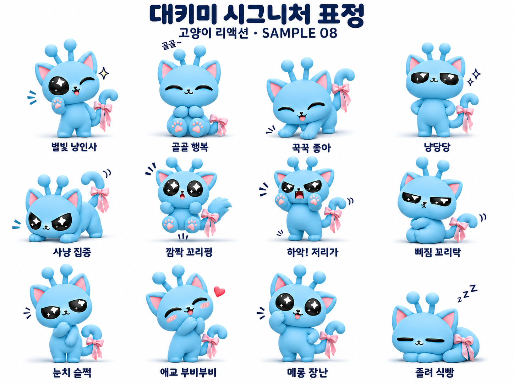

# 대키미 성체 · 시그니처 표정과 자세 디자인 시트

버전 v01 · 작성일 2026-11-18 · 시각 기준: 시그니처 표정 샘플 08

## 1. 이 자료의 사용법

이 문서와 같은 폴더의 **`대키미_표정자세_레퍼런스_v08.png`를 함께 첨부**한다. 문서만 입력하거나 문서 속 이미지 링크만 전달하면 이미지가 생성 도구에 전달되지 않을 수 있다.



이 두 파일로 캐릭터 외형, 표정, 자세, 재질 방향을 전달하도록 구성했다. 생성 도구마다 해석이 달라 픽셀 단위 동일 재현을 보장하는 자료는 아니다. 사진에서 작게 보이거나 가려진 구조는 아래 명시적 규칙을 따른다. 정밀 3D 모델링 도면이나 실제 제작 치수표는 아니다.

### 입력 순서

1. 레퍼런스 PNG와 이 문서를 함께 첨부한다.
2. 8장의 공통 프롬프트를 입력한다.
3. 9장의 원하는 표정 번호·지시문을 덧붙인다.
4. 단독 캐릭터, 원페이지, 투명 배경 중 출력 방식을 지정한다.
5. 11장의 기준으로 결과를 검수한다.

### 기준 우선순위

| 항목 | 적용 기준 |
|---|---|
| 얼굴형·성체 비율·종·기본 그림체 | 첨부 사진의 대키미. 다른 고양이 캐릭터나 아기 버전으로 재디자인하지 않는다. |
| 표정과 자세 | 사진에서 해당 이름으로 표시된 칸과 6장의 표정별 규칙을 함께 사용한다. |
| 개수·숨은 구조 | 안테나·젤리패드·리본 구성은 이 문서의 명시적 규칙이 우선한다. |
| 표면 명암 | 사진의 넓고 부드러운 입체감을 따르되, 잔존하는 국소 얼룩·물결 반사는 재현하지 않는다. |
| 뒤꿈치·눈꺼풀·볼 | 사용자가 지정한 수정 의도를 기록한 6장의 규칙이 우선한다. 사진의 모호한 표현을 해부학적 고정형으로 복사하지 않는다. |

## 2. 캐릭터 정체성과 고정 실루엣

대키미는 **하늘색 몸, 분홍 귀 안쪽, 별빛 눈, 구슬 안테나 두 개, 분홍 비단 꼬리 리본**을 가진 고양이형 성체 마스코트다. 부드러운 3D 스타일이며 전체적인 인상은 친근하고 장난스럽다.

| 부위 | 고정 규칙 |
|---|---|
| 머리 | 가로로 넓고 볼·턱선이 부드럽게 이어지는 사진의 윤곽. 완전한 공·타원이나 부푼 볼 두 덩어리로 바꾸지 않는다. |
| 머리와 몸 비율 | 사진의 넓은 머리와 짧고 둥근 성체 몸의 관계를 유지한다. 감정에 따라 머리만 키우거나 몸통을 줄이지 않는다. |
| 몸통 | 짧고 충분한 폭과 부드러운 배 볼륨. 잘록한 허리, 긴 목, 길쭉한 몸을 만들지 않는다. |
| 팔·다리 | 짧고 둥글다. 팔을 들거나 뒤꿈치를 들어도 팔다리 길이를 늘이지 않는다. |
| 손발 | 둥근 덩어리형 손발. 필요할 때 작은 엄지 구분만 허용한다. 사람 손가락·발가락 홈·손톱·발톱을 추가하지 않는다. |
| 귀 | 끝으로 모이는 삼각형 고양이 귀 두 개. 안쪽은 분홍색. 귀를 강아지형·토끼형으로 바꾸지 않는다. |
| 안테나 | 머리 위 줄기 정확히 2개, 각 줄기 끝 구슬 1개. 한 캐릭터에 줄기 2개·구슬 2개다. |
| 꼬리 | 몸 뒤 하단에서 이어지는 긴 고양이 꼬리. 기본형은 끝이 부드럽게 말린다. 포즈에 따라 세움·감음·흔들림을 허용한다. |
| 얼굴 색 영역 | 코·입 주변과 턱까지 하늘색. 흰 주둥이·크림색 볼·흰 배 무늬가 없다. |

안테나는 머리 기울기와 함께 움직인다. 줄기가 귀에서 나오거나, 두 줄기가 하나로 합쳐지거나, 구슬이 떨어져 떠 있거나, 한 개가 빠져서는 안 된다. 표정 시트에서는 두 줄기와 두 구슬을 각각 확인할 수 있게 배치한다.

기존 성체 설정의 전체 키는 안테나 구슬 최고점부터 발바닥까지 103cm다. 이는 세계관상 크기이며, 이 시트의 작은 그림에서 새 정밀 치수를 역산하지 않는다.

## 3. 눈·코·입과 감정 표현

### 눈

- 기본 눈은 검정 광택이 있는 둥근 삼각형 계열이다. 코 쪽 아래 모서리가 좁아지는 사진의 형태와 눈 사이 간격을 유지한다.
- 완전히 뜬 눈마다 **큰 밝은 4갈래 별 1개 + 작은 반짝임 2개**, 총 3개가 있다. 작은 반짝임은 큰 별보다 밝기·크기가 낮다.
- 눈을 감으면 부드러운 곡선의 감은 눈으로 표현한다. 감은 눈 위에 별을 붙이지 않는다. 반쯤 감은 눈에서는 눈꺼풀이 하이라이트를 자연스럽게 가린다.
- 눈꺼풀은 얼굴에 통합된 둥근 곡면이다. 눈을 검정 칼날·쐐기·평면 스티커처럼 만들지 않는다.
- 별도의 굵은 눈썹, 속눈썹, 아이라인을 추가하지 않는다.

### 코와 입

- 코는 작고 가로로 납작한 검정 형태다. 아래로 이어지는 고양이형 입 구조와 코·입 간격을 유지한다.
- 입은 감정에 맞춰 작은 미소·오므림·O자·하악질·혀 빼꼼으로 바뀔 수 있다. 입을 사람 입술이나 얼굴을 가로지르는 거대한 입으로 바꾸지 않는다.
- 혀는 작고 분홍색이다. 메롱도 짧게 내밀며 길고 두꺼운 혀가 얼굴을 덮지 않는다.
- 작은 윗송곳니 두 개는 하악질 표정에만 허용한다. 다른 표정에 치열을 추가하지 않는다.
- 기본 홍조는 없다. 애교 표정에만 일시적인 연한 분홍 홍조를 허용한다.

## 4. 색·재질·조명 — 표면 얼룩 재발 방지

| 요소 | 기준 |
|---|---|
| 몸 기본색 | 기존 브랜드색 #6DCFF5 계열의 하늘색. 조명 아래 화면색은 달라질 수 있다. |
| 귀 안쪽·패드·리본 | 기존 기본색 #FDB6C1 계열의 연분홍. 재질과 겹침 때문에 보이는 색은 다를 수 있다. |
| 파란 몸 표면 | 매끈하고 균일한 저광택·반무광 3D 재질. 이마·볼·배의 명암은 넓고 연속적으로 이어진다. |
| 검정 눈 | 몸과 구분되는 은은한 광택. 별 모티프와 반사광을 구분한다. |
| 조명 | 넓고 부드러운 스튜디오 주광과 약한 보조광. 12종을 만들면 같은 조명 방향과 세기로 통일한다. |
| 접촉 그림자 | 턱 아래, 팔과 몸이 닿는 곳, 발밑처럼 구조상 필요한 곳에만 부드럽게 넣는다. |

**지워야 할 것:** 피부 안의 불규칙한 밝고 어두운 얼룩, 구름 무늬, 물결 모양 광택, 대리석 무늬, 물 반사무늬, 밝은 띠, 국소 흰 반점, 울퉁불퉁한 잔굴곡, 점토 입자, 거친 노이즈, 비닐 같은 강한 반사.

**유지할 것:** 실제 형태를 설명하는 넓고 부드러운 그라데이션, 팔다리 겹침 그림자, 코와 입의 작은 입체감, 검정 눈의 광택, 리본의 자연스러운 천 주름. 얼룩을 없앤다고 완전한 단색 평면으로 만들지 않는다.

사진에 남아 있는 국소적인 피부 명암 오차는 디자인 무늬가 아니다. 표면은 하나의 깨끗한 하늘색 재질로 해석한다. 단순 확대·선명화로 얼룩까지 강화하지 않는다.

## 5. 손발 젤리패드와 꼬리 리본

### 젤리패드

양손 손바닥과 양발 발바닥, 총 네 곳에 존재한다. **각 부위마다 큰 패드 1개와 작은 패드 4개**가 있다.

- 큰 패드: 모서리가 둥글고 말랑한 삼각형. 작은 패드: 큰 패드 위쪽에 완만한 부채꼴로 놓이는 작은 타원 네 개.
- 작고 거의 평평한 낮은 볼륨이며, 주변에 하늘색 여백을 충분히 남긴다. 손발 전체를 분홍색으로 채우지 않는다.
- 패드는 손바닥·발바닥과 함께 회전하고 원근과 가림을 따른다. 보이지 않는 면을 억지로 보여주지 않는다.
- 손등·발등·손목·무릎·꼬리에 패드를 붙이지 않는다. 손발 크기나 몸 비율을 바꿔 패드를 과시하지 않는다.
- 골골 행복의 양발바닥, 깜짝 꼬리펑의 들어 올린 양발바닥, 하악질의 들어 올린 양손바닥은 패드 확인이 가능한 대표 자세다.

### 꼬리 리본

- 꼬리 끝이 말리기 시작하는 지점 바로 아래에 자연스럽게 묶는다.
- 중앙 매듭 1개, 고리 2개, 긴 자락 2개. 꼬리에 붙어 함께 움직이며 공중에 따로 뜨지 않는다.
- 귀 안쪽과 같은 연분홍 계열의 얇은 비단 느낌. 은은한 비침과 절제된 윤기, 부드러운 주름을 사용한다.
- 한쪽 고리·자락 쌍은 꼬리 앞쪽, 다른 쌍은 살짝 뒤쪽으로 이어지는 자연스러운 겹침을 따른다. 정면 대칭 나비 장식으로 굳히지 않는다.
- 꼬리 자세에 따라 리본의 각도와 가림이 바뀐다. 자락은 중력과 움직임을 따르며 꼬리를 관통하지 않는다.

## 6. 표정·자세 12종 상세 기준

사진은 왼쪽 위부터 오른쪽으로 읽는다. 각 표정은 얼굴만 교체하는 방식이 아니라 눈·입·귀·안테나·몸·꼬리가 함께 감정을 표현한다.

| 번호·위치 | 이름 | 얼굴 | 몸·손발·꼬리 및 효과 |
|---|---|---|---|
| 01 · 1행 1열 | 별빛 냥인사 | 한쪽 눈을 자연스럽게 윙크. 다른 눈은 별빛 눈을 뜬다. 작은 고양이형 미소. | 두 발로 서서 한 손을 볼 옆에 들어 손바닥 패드를 보인다. 꼬리는 위로 세워 끝을 둥글게 말린다. 윙크한 눈 바깥에 작은 4갈래 별 하나. |
| 02 · 1행 2열 | 골골 행복 | 양쪽 눈을 편안한 곡선으로 감고 작은 닫힌 미소. | 몸통 폭을 유지하며 편히 앉는다. 양발은 별개의 정상적인 발로 앞을 향해 양쪽 발바닥 패드를 보인다. 양손은 가슴 앞에 편안히 모은다. 꼬리는 발 옆에 따로 놓는다. 머리 위에 작은 ‘골골~’. 물결 효과선은 넣지 않는다. |
| 03 · 1행 3열 | 꾹꾹 좋아 | 양쪽 눈은 부드러운 감은 곡선. 작은 즐거운 입과 혀. 검정 칼날형 눈 금지. | 사진처럼 앞으로 기대어 양손으로 번갈아 꾹꾹 누르는 고양이 자세. 한 손과 다른 손의 압력 차이가 느껴지게 한다. 꼬리는 위로 세운다. 꾹꾹이 자체는 이 사진의 낮은 자세를 따른다. |
| 04 · 1행 4열 | 냥당당 | 살짝 내려온 눈꺼풀과 작은 닫힌 미소. 귀엽게 자신만만한 인상. | 두 발로 서서 양손을 허리 옆에 둔다. 턱을 조금 들고 꼬리는 위로 둥글게 말린다. 몸과 다리를 길게 늘이지 않는다. |
| 05 · 2행 1열 | 사냥 집중 | 눈을 집중하듯 좁히고 시선은 전방 한곳. 작은 닫힌 입. | 사진처럼 낮게 엎드린 고양이 준비 자세. 앞쪽에 체중을 두고 뒤쪽을 살짝 높이며 꼬리 끝이 반응한다. 먹잇감이나 장난감을 새로 넣지 않는다. |
| 06 · 2행 2열 | 깜짝 꼬리펑 | 양쪽 별빛 눈을 크게 뜨고 입은 작은 O자. | 작게 놀라 뛰어오른 자세. 양발바닥 패드가 보인다. 꼬리는 기본보다 적당히 도톰하게, 보통 꼬리 지름의 약 1.4~1.6배를 출발점으로 삼고 사진의 최종 규모를 우선한다. 적은 수의 짧고 부드러운 털 갈래만 둔다. 거대한 너구리 꼬리·깃털 덩어리·날카로운 결정 모양 금지. 파란색 유지, 줄무늬 없음. |
| 07 · 2행 3열 | 하악! 저리가 | 좁힌 눈과 약간 뒤로 향한 귀. 작게 벌린 하악질 입에 작은 윗송곳니 두 개. | 반드시 두 발로 서서 양팔을 들고 손바닥 패드를 앞으로 보인다. 원래의 짧은 다리·넓은 몸통 유지. 발 앞부분을 바닥에 둔 채 뒤꿈치만 조금 드는 위협 동작. 사진에서는 뒤꿈치 들림이 약하므로 길어진 다리나 평평한 발을 고정 규칙으로 해석하지 않는다. 꼬리는 보통의 매끈한 꼬리, 털을 세우지 않는다. |
| 08 · 2행 4열 | 삐짐 꼬리탁 | 볼에 공기를 머금은 작은 오므린 입, 삐진 눈매. 하부 볼이 얼굴과 한 덩어리로 은근히 부푼다. | 앉아서 팔짱을 끼고 살짝 돌아앉은 태도. 꼬리 끝을 옆으로 탁 움직이는 작은 곡선 효과는 허용. 볼에 공·빵·패치를 붙인 것 같은 분리된 두 덩어리 금지. |
| 09 · 3행 1열 | 눈치 슬쩍 | 시선을 옆으로 돌리고 작은 어색한 미소. 양쪽 눈꺼풀의 미세한 차이로 눈치를 본다. | 두 발로 서서 어깨를 조금 모으고 손 하나를 가슴 앞에 든다. 머리를 살짝 기울인다. 안테나는 두 개 모두 별개로 확인되게 한다. |
| 10 · 3행 2열 | 애교 부비부비 | 양쪽 눈을 즐겁게 감고 작은 미소, 일시적인 연한 볼 홍조. | 머리와 상체를 한쪽으로 기울이고 두 손을 볼 쪽에 모아 비비고 싶은 애교를 표현. 작은 분홍 하트 하나. 피부 안의 얼룩이나 광택 무늬로 홍조를 표현하지 않는다. |
| 11 · 3행 3열 | 메롱 장난 | 양쪽 눈을 모두 뜨고 작은 혀끝을 짧게 내민다. 한쪽 아래 눈꺼풀을 아주 살짝만 당기는 장난. | 한 손을 눈 바로 아래 볼에 가볍게 댄다. 다른 손은 옆구리 부근. 눈 밑의 붉은 속살, 늘어진 눈구멍, 튀어나온 눈알 금지. 눈 당김을 크게 만들지 않고 손 접촉과 짧은 메롱으로 읽히게 한다. |
| 12 · 3행 4열 | 졸려 식빵 | 거의 감긴 편안한 눈과 아주 작은 닫힌 미소. | 고양이 식빵 자세로 손발을 몸 아래에 넣는다. 다리와 손발을 추가하거나 몸을 빵 소품으로 바꾸지 않는다. 꼬리는 옆으로 감고 리본은 보인다. 작은 zzz 허용. 가려진 패드는 보이지 않아도 된다. |

하악질의 두 발 서기 규칙을 사냥 집중·꾹꾹이·식빵에까지 적용하지 않는다. 표정마다 지정된 자세를 따른다.

## 7. 고정할 것과 바꿀 수 있는 것

**고정:** 종, 성체 외형, 얼굴 윤곽, 머리·몸 비율, 짧은 팔다리, 안테나 두 개와 구슬 두 개, 귀 구조, 눈의 고유 모티프, 하늘색 얼굴·몸, 네 곳의 젤리패드 구성, 기본 꼬리와 분홍 비단 리본, 매끈한 표면 재질.

**요청에 따라 변경 가능:** 시선, 눈의 개폐, 작은 입 모양, 고개·귀·안테나의 자연스러운 기울기, 팔·다리의 관절 자세, 꼬리의 방향·말림, 리본의 주름과 가림, 배경·소품·의상. 새 의상이나 소품은 요청이 있을 때만 넣는다.

깜짝 꼬리펑의 작은 털 갈래와 하악질의 작은 송곳니는 해당 표정의 예외다. 모든 대키미에 털·이빨을 추가하는 규칙이 아니다.

## 8. 복사해서 사용하는 공통 생성 프롬프트

아래 블록과 9장의 표정별 문장을 함께 사용한다. ‘첨부 사진’은 반드시 실제 PNG 첨부를 뜻한다.

```text
첨부한 대키미 성체 표정·자세 레퍼런스 PNG와 디자인 시트만을 기준으로 같은 캐릭터를 재현한다. 사진은 외형·표정·자세의 시각 기준이고, 문서는 개수·구조·표면 재질·동작의 명시적 기준이다. 새 고양이 캐릭터나 아기 버전으로 재디자인하지 않는다.

사진의 넓은 머리, 볼과 턱선, 눈 간격, 작은 검정 코와 고양이형 입, 짧고 둥근 성체 몸통과 팔다리 비율을 유지한다. 머리·몸·다리를 감정에 맞춰 늘이거나 줄이지 않는다. 하늘색 얼굴과 몸에 흰 주둥이나 배 무늬를 만들지 않는다. 분홍 안쪽을 가진 삼각형 고양이 귀 두 개, 안테나 줄기 정확히 두 개와 각 끝의 둥근 구슬 한 개씩을 유지한다. 두 안테나는 자연스럽게 기울되 합쳐지거나 빠지지 않는다.

뜬 눈은 안쪽 아래가 좁아지는 둥근 삼각형 검정 광택 눈이다. 각 눈에 큰 밝은 4갈래 별 하나와 작은 반짝임 두 개를 둔다. 감은 눈은 부드러운 곡선으로 만들고 별은 눈꺼풀에 가려진다. 검정 칼날형 눈, 굵은 눈썹·속눈썹·아이라인, 사람 입술·손가락·발가락 분할은 만들지 않는다.

양손 손바닥과 양발 발바닥에 귀 안쪽과 같은 연분홍 젤리패드를 유지한다. 부위마다 둥근 삼각형 큰 패드 하나와 그 위쪽 작은 타원 네 개다. 작고 거의 평평한 볼륨, 충분한 하늘색 여백을 유지한다. 패드는 원근과 가림을 따르고 손등·발등에는 없다. 손발이나 몸 비율을 바꿔 패드를 보여주지 않는다.

긴 고양이 꼬리 끝이 말리기 시작하는 지점 바로 아래에 연분홍 비단 리본을 유지한다. 중앙 매듭 하나, 고리 두 개, 긴 자락 두 개이며 꼬리를 감싸 묶이고 중력과 움직임에 맞게 드리워진다. 몸과 조화되는 은은한 비침과 윤기로 표현한다.

핵심 재질: 파란 피부는 균일하고 매끈한 저광택·반무광 3D 표면이다. 넓은 부드러운 스튜디오광으로 이마·볼·배에 연속적인 넓은 명암을 만든다. 피부 안의 불규칙한 얼룩, 구름 무늬, 물결형 반사, 밝은 띠, 대리석 무늬, 국소 흰 반점, 가짜 잔굴곡, 점토 입자와 비닐 광택을 제거한다. 사진에 남은 피부 얼룩을 디자인 무늬로 복사하지 않는다. 눈의 검정 광택·리본 주름·필요한 접촉 그림자는 유지한다. 입체감을 없애는 완전한 평면 단색으로 바꾸지 않는다.

표정·자세: [9장에서 선택한 표정별 문장을 붙여넣기]
출력: [단독 캐릭터 / 12종 원페이지]
배경: [흰색 / 실제 투명 알파 / 요청한 장면]
효과·문구: [레퍼런스 효과 유지 / 효과·문구 없이 캐릭터만]

원본과 같은 성체 정체성, 자연스러운 눈·입·귀·안테나·꼬리의 연동, 깨끗한 표면과 정확한 신체 개수를 우선한다. 요청하지 않은 소품·무늬·장식을 추가하지 않는다.
```

## 9. 표정별 추가 프롬프트

공통 프롬프트의 ‘표정·자세’에 아래 문장 하나를 붙여넣는다. 번호는 사진의 칸 순서와 같다.

1. **별빛 냥인사:** 사진 1행 1열. 두 발로 서서 한 손바닥을 볼 옆으로 들어 인사한다. 한쪽 눈을 윙크하고 다른 눈의 별빛은 유지한다. 윙크 눈 바깥에 작은 4갈래 별 하나. 작은 미소, 위로 선 말린 꼬리, 손바닥 젤리패드.
2. **골골 행복:** 사진 1행 2열. 편히 앉아 눈을 곡선으로 감고 작은 닫힌 미소를 짓는다. 손은 가슴 앞, 양발은 앞을 향한 별개의 작은 발이며 각 발바닥에 큰 패드 하나와 작은 네 개. 꼬리는 발과 구분한다. 머리 위 작은 ‘골골~’, 물결 효과선 없음.
3. **꾹꾹 좋아:** 사진 1행 3열. 앞으로 기대어 양손으로 번갈아 꾹꾹 누른다. 두 눈은 자연스러운 감은 곡선, 작은 즐거운 입. 꼬리는 위로 말리고, 손끝 부근에 작은 압력 표현만 허용한다.
4. **냥당당:** 사진 1행 4열. 두 발로 서서 짧은 다리와 넓은 몸통을 유지한다. 손은 허리 옆, 턱은 조금 높이고 눈꺼풀은 살짝 내린다. 작게 닫힌 자신만만한 미소와 위로 말린 꼬리.
5. **사냥 집중:** 사진 2행 1열. 몸을 낮추고 앞쪽에 체중을 실어 한곳을 집중해서 본다. 입은 작게 닫고 눈을 부드럽게 좁힌다. 뒤쪽을 살짝 높이고 꼬리 끝이 반응한다. 소품이나 먹잇감은 없다.
6. **깜짝 꼬리펑:** 사진 2행 2열. 두 눈을 크게 뜨고 O자 입으로 작게 뛰어오른다. 양발바닥 패드를 보인다. 꼬리는 보통보다 적당히 도톰하고 짧은 부드러운 털 갈래 몇 개만 있다. 몸만큼 거대한 꼬리·너구리 줄무늬·깃털 덩어리·결정형 가시를 만들지 않는다.
7. **하악! 저리가:** 사진 2행 3열. 짧은 다리와 넓은 몸통을 유지한 두 발 서기. 양팔을 들어 손바닥 패드를 앞으로 보이고 작은 윗송곳니 두 개가 보이는 하악질을 한다. 앞발끝은 바닥에 붙인 채 발뒤꿈치만 살짝 든다. 정강이·허벅지·발목을 길게 늘이지 않는다. 네 발로 엎드리지 않는다. 꼬리는 매끈한 기본형.
8. **삐짐 꼬리탁:** 사진 2행 4열. 팔짱을 끼고 앉아 눈을 삐지듯 좁힌다. 입을 작게 오므려 공기를 머금고 하부 볼이 한 얼굴 표면으로 은근하게 부푼다. 볼에 공 두 개를 붙이지 않는다. 꼬리 끝이 옆으로 탁 움직인다.
9. **눈치 슬쩍:** 사진 3행 1열. 두 발로 서서 머리와 어깨를 살짝 기울이고 한 손을 가슴 앞에 둔다. 옆으로 슬쩍 보는 시선과 작은 어색한 미소. 안테나는 두 줄기·두 구슬 모두 분리해 보이게 한다.
10. **애교 부비부비:** 사진 3행 2열. 두 눈을 즐겁게 감고 손을 볼 가까이에 모으며 머리와 몸을 한쪽으로 기울인다. 작은 미소와 연한 일시적 홍조, 작은 분홍 하트 하나. 피부 얼룩이나 물결형 반사는 없다.
11. **메롱 장난:** 사진 3행 3열. 양쪽 별빛 눈을 모두 뜨고 작은 혀끝을 짧게 내민다. 한 손으로 눈 바로 아래 볼을 가볍게 만지며 아래 눈꺼풀을 아주 조금만 당긴다. 붉은 눈 밑 속살·늘어진 눈구멍·눈알 돌출·긴 혀는 없다. 다른 손은 옆구리 부근.
12. **졸려 식빵:** 사진 3행 4열. 양손과 발을 몸 아래로 넣은 고양이 식빵 자세. 거의 감은 편안한 눈과 아주 작은 닫힌 미소. 꼬리를 옆으로 감고 리본이 보인다. 작은 zzz 허용. 가려진 패드를 억지로 보이지 않는다.

## 10. 출력 방식별 지시

### A. 표정 하나만 생성

```text
첨부 시트 전체를 다시 그리지 말고 선택한 표정 한 캐릭터만 크게 생성한다. 안테나 구슬, 귀, 손발, 꼬리와 리본 자락이 잘리지 않도록 주변 여백을 둔다. 표정 이름·제목·다른 캐릭터는 넣지 않는다. 얼굴형·성체 비율·작고 낮은 패드·균일한 피부 재질을 우선 검수한다.
```

### B. 동일한 12종 원페이지 재현

```text
사진과 같은 흰색 가로형 4열×3행 구성으로 12종을 배치한다. 순서는 6장 표 그대로다. 캐릭터 축척, 조명과 재질을 통일하고 꼬리·안테나·리본이 이웃 칸과 겹치지 않게 여백을 둔다. 제목은 ‘대키미 시그니처 표정’, 각 칸 아래에는 표정 이름을 정확히 표기한다. 임의의 SAMPLE 번호나 새 문구는 넣지 않는다.
```

### C. 스티커·영상 합성용 개별 이미지

```text
선택한 대키미 한 캐릭터를 실제 알파 채널이 있는 투명 배경 PNG로 생성한다. 체크무늬를 배경 그림으로 그리지 않는다. 제목·설명·이름·바닥면·넓게 퍼지는 바닥 그림자는 제외한다. 기본은 캐릭터만 출력하며, 별·하트·골골 문구·zzz 등 효과를 포함할지는 별도로 지정한다. 반투명 리본과 가장자리의 부드러운 알파를 자연스럽게 보존하고 흰 테두리 번짐이나 잘린 꼬리를 만들지 않는다. 재단용 흰 외곽선은 요청할 때만 추가한다.
```

투명 이미지·화이트 배경 시트·인쇄 재단선 파일은 서로 다른 산출물이다. 이 레퍼런스 PNG 자체는 흰 배경 원페이지이며, 개별 투명 PNG나 인쇄용 벡터 원본이 아니다. 실제 굿즈는 인쇄 크기·재단선·업체 요구 색상 형식을 별도로 확인한다. 정지 표정 이미지는 영상 합성에 사용할 수 있지만 움직임 리깅 데이터는 포함하지 않는다.

### 권장 제작 순서

첫 표정을 단독으로 충분히 크게 생성해 피부 재질·얼굴형·패드를 확인한다. 같은 기준으로 나머지를 개별 생성한 뒤 최종 원페이지로 배치한다. 이미 생성된 작은 원페이지를 반복 편집하며 확대하면 표면 오차가 누적될 수 있으므로, 수정할 때는 원본 레퍼런스와 이 시트의 고정 규칙을 다시 제공한다.

## 11. 최종 검수 체크리스트

- [ ] 원본 대키미 성체의 넓은 얼굴형과 짧은 몸·팔다리 비율인가?
- [ ] 안테나는 매 캐릭터 줄기 2개·구슬 2개이며 서로 합쳐지거나 빠지지 않았는가?
- [ ] 눈의 형태·간격과 뜬 눈의 별빛 모티프가 유지되는가? 감은 눈 위에 별이 남지 않았는가?
- [ ] 이마·볼·배에 불규칙한 얼룩·물결 광택·밝은 띠가 없는가? 입체감은 넓고 부드럽게 이어지는가?
- [ ] 네 곳의 패드 구조가 존재하고 보이는 손바닥·발바닥은 큰 1개+작은 4개인가?
- [ ] 손등·발등 패드, 거대한 발, 사람 손가락·발가락 분할이 없는가?
- [ ] 골골 행복의 발 두 개와 꼬리가 서로 구분되는가?
- [ ] 꾹꾹이의 눈이 칼날 모양이 아닌 자연스러운 감은 눈인가?
- [ ] 꼬리펑만 적당한 털 갈래가 있고 꼬리 크기가 몸을 압도하지 않는가?
- [ ] 하악질은 두 발 서기이며 다리를 늘이지 않고 뒤꿈치만 움직이는가?
- [ ] 삐짐 볼이 피부와 연속된 공기 머금기이며 붙인 공처럼 보이지 않는가?
- [ ] 메롱은 양쪽 눈을 뜨고 혀·눈꺼풀 당김이 작고 자연스러운가?
- [ ] 리본은 매듭 1개·고리 2개·자락 2개로 꼬리에 묶여 자연스럽게 처지는가?
- [ ] 용도에 맞는 배경·알파·여백·효과 포함 여부이며, 제목이나 샘플 문구가 의도치 않게 남지 않았는가?

## 12. 제작 근거

시각 기준은 이 문서에 동봉한 시그니처 표정 샘플 08이다. 표정 명칭과 동작은 해당 시트 및 2026-11-17~18 사용자 수정 요청을 반영했다. 색상·성체 키·젤리패드·리본 구조는 프로젝트의 대키미 성체 통합 스펙을 이어받았다. 사진으로 확인되지 않는 3D 깊이·정확한 물성 계수·곡선 좌표는 새 공식값으로 만들지 않았다.
