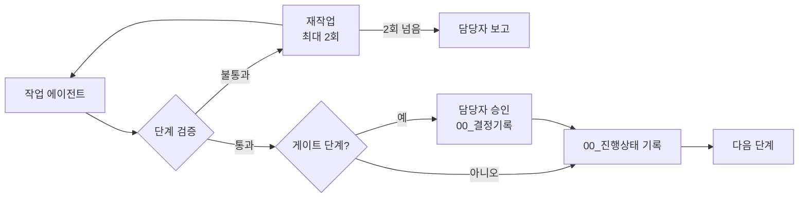
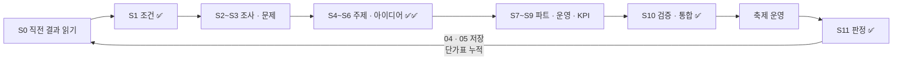

# 순환형 축제 에이전트 — 구성 로직도

> 에이전트 파일은 숨김 폴더(`.claude/`)에 있어서 잘 안 보여요. 이 파일은 구조를 한눈에 보여 주는 안내판이에요. 실행에는 영향이 없어요.
> 기준: main · 2026-11-18 · 구성도 v3.1

## 1. 한 줄 요약
축제 기획 담당자는 **오케스트레이터 하나하고만** 대화해요. 오케스트레이터가 단계마다 작업 에이전트를 부르고, 단계 사이마다 검증 에이전트가 결과를 검사해요. 결정과 진행 상태는 파일에 남아 다음 해로 이어져요.

## 2. 에이전트 4묶음

| 묶음 | 파일 수 | 파일 | 하는 일 |
|---|---|---|---|
| ① 오케스트레이터 | 1 | [CLAUDE.md](CLAUDE.md) | 담당자 창구. 요청 판단 → 라우팅 → 단계 검증 → 게이트 → 기록 · 보고 |
| ② 기획 단계 | 5 (각자) | [retro-reader](.claude/agents/retro-reader.md) · [researcher](.claude/agents/researcher.md) · [strategist](.claude/agents/strategist.md) · [idea-scorer](.claude/agents/idea-scorer.md) · [flow-designer](.claude/agents/flow-designer.md) | 직전 결과 읽기 · 조사 · 문제 정의와 연도 주제 · 채점 · 동선과 스탬프 지점 |
| ③ 파트 | 1 (공통) | [part-agent](.claude/agents/part-agent.md) + 세부지침안 폴더 | 파트 글자(A~K · Y)를 받아 그 파트 지침대로 기획. Y(지도)는 읽기 · 확인만 |
| ④ 검증 | 6 (각자) | [conflict-checker](.claude/agents/conflict-checker.md) · [duplicate-finder](.claude/agents/duplicate-finder.md) · [format-checker](.claude/agents/format-checker.md) · [evidence-auditor](.claude/agents/evidence-auditor.md) · [ethics-reviewer](.claude/agents/ethics-reviewer.md) · [reviewer](.claude/agents/reviewer.md) | 검사만. 고치지 않음 |

## 3. 파트 에이전트 = 공통 1개 + 세부지침안 폴더

`part-agent.md` 는 일하는 틀(지침 찾기 → 기획 → 반환 6칸)만 갖고 있어요. 파트마다 다른 내용은 main `세부지침안/` 에 있어요. **세부지침안 폴더 하나가 곧 파트 에이전트 하나예요.**

| 파트 | 이름 | 읽는 폴더 | 상태 |
|---|---|---|---|
| A | 사투리 콘텐츠 | [세부지침안/A파트v5](../세부지침안/A파트v5/) | 있음 |
| B | 10미 · 7구 | [세부지침안/B파트v5](../세부지침안/B파트v5/) | 있음 |
| C | 소상공인 플리마켓 | [세부지침안/C파트v3](../세부지침안/C파트v3/) | 있음 |
| D | 굿즈 | [세부지침안/D파트v1](../세부지침안/D파트v1/) | 있음 |
| E | 부대 프로그램 | [세부지침안/E파트v2](../세부지침안/E파트v2/) | 있음 |
| F | 홍보 | [세부지침안/F파트v1](../세부지침안/F파트v1/) | 있음 |
| G | 관광 연계 | [세부지침안/G파트v2](../세부지침안/G파트v2/) | 있음 |
| H | 운영 (예산 · 인력 · 일정 · 안전 · 규제 · 스탬프 운영) | H-1~H-11 | **있음** (H파트v4 초안) |
| I | 성과 | [세부지침안/I파트v1](../세부지침안/I파트v1/) | 있음 |
| J | 사투리 사전 · 검수 | [세부지침안/J파트v3](../세부지침안/J파트v3/) | 있음 |
| K | 웹 | — | **없음** → 질문 필요로 돌아옴 |
| P | 공통 기본 정보 (모든 에이전트가 읽음) | [세부지침안/P파트](../세부지침안/P파트/) | 있음 |
| Y | 지도 원본 (파트 서브에이전트, 읽기 · 배치 확인만) | [세부지침안/Y.지도](../세부지침안/Y.지도/) | 있음 |

- 파트가 새 버전으로 올라가면 [지침/세부지침안_버전.md](지침/세부지침안_버전.md) 의 그 줄만 고쳐요. 위 표도 같이 고쳐 주세요.

## 4. 단계마다 도는 로직



## 5. 단계별로 누가 일하고 누가 검사하나

| 단 | 단계 | 작업 | 단계 검증 | 게이트 |
|---|---|---|---|---|
| 1 | S0~S1 준비 | retro-reader → 오케스트레이터 (조건 정리) | evidence-auditor · format-checker | ✅ 조건 |
| 2 | S2 조사 | researcher · part-agent F · G · J (병렬) | evidence-auditor | |
| 3 | S3~S4 방향 | strategist (문제 정의 → 연도 주제) | evidence-auditor → ethics-reviewer | ✅ 연도 주제 |
| 4 | S5~S6 아이디어 | part-agent A · E → idea-scorer | ethics-reviewer · 재계산 비교 | ✅ 채택 |
| 5 | S7 파트 기획 | part-agent A~G (병렬) → J 검수 · G 이어받기 | duplicate-finder · format-checker · ethics-reviewer | |
| 6 | S8 운영 | flow-designer → part-agent H · K | conflict-checker | |
| 7 | S9 KPI | part-agent I | conflict-checker | |
| 8 | S10 전체 검증 | — | 검증 5개 (병렬) → reviewer | |
| 9 | S10 통합 | 오케스트레이터 → 03_기획안 | — | ✅ 기획안 |
| — | 축제 운영 | 사람 | — | |
| 10 | S11 결과 판정 | part-agent I → 오케스트레이터 (04 · 05 · 단가표) | evidence-auditor | ✅ 판정 → 다음 해 |

자세한 표: [지침/호출순서.md](지침/호출순서.md) · 부분 요청: [지침/라우팅표.md](지침/라우팅표.md)

## 6. 해마다 도는 순환



| 순환 장치 | 파일 (main) | 하는 일 |
|---|---|---|
| 결정기록 | `대사투/<연도>/00_결정기록.md` | 담당자 결정 · 게이트 승인 |
| 진행 상태 | `대사투/<연도>/00_진행상태.md` | 현재 단계 · 재작업 횟수 · ⚠ 파일 → 이어 하기 |
| 갱신 경고 | 각 산출물 맨 위 ⚠ | 결정이 바뀌면 영향 파일 다시 하기 |
| 재작업 고리 | 00_진행상태 | 단계 검증 불통과 → 최대 2회 |
| 연도 학습 | `대사투/<연도>/04 · 05`, `대사투/공통/단가표.md` | 다음 해 S0 · H 예산이 읽음 |
| 첫해 수치 | `local 리서치/가정값/[가정]_…` | 팀이 넣는 예산 · 방문객 · 단가 |

## 7. main 전체 배치 — 누가 쓰는지 폴더로 나눔

```text
main/
├── 순환형축제에이전트/   [실행]  오케스트레이터 + 서브에이전트 (이 폴더)
├── 세부지침안/          [입력]  파트 서브에이전트의 내용 — 팀만 씀, 에이전트는 읽기만
│   └── Y.지도/         [입력]  지도 원본 (2026-11-20 루트에서 옮김) — 읽기만
├── local 리서치/        [입력]  팀 조사 자료 · 통합_조사결과 · 가정값/ — 읽기만
├── 대사투/             [출력]  에이전트 결과물
│   ├── 2027/           00_결정기록 · 00_진행상태 · 01~05 · 03_파트/ · 검토/
│   └── 공통/단가표.md   해마다 누적
├── 웹/                 [결과물 코드]  안내페이지/ · supabase/
└── 발표자료/            [팀]
```

## 8. 폴더 안 파일 지도

```text
순환형축제에이전트/
├── CLAUDE.md                 ① 오케스트레이터
├── 에이전트_구성로직도.md      ← 지금 이 파일
├── 사용법.md                  담당자용 사용법
├── 지침/                      기본지침v2 · 호출순서 · 라우팅표 · 원본지정표 · 근거규칙 · 반환형식 · 세부지침안_버전
├── 양식/                      00_결정기록 · 00_진행상태 · 01~05
└── .claude/                   (숨김 폴더)
    ├── agents/                ② 5개 · ③ 1개 · ④ 6개
    └── skills/                /festival-start · research · plan · review
```
