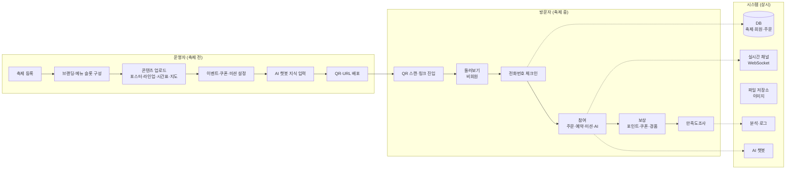
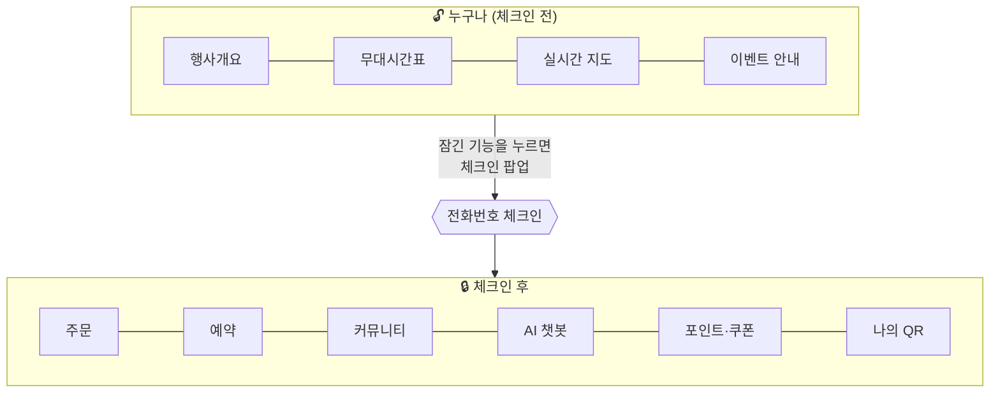
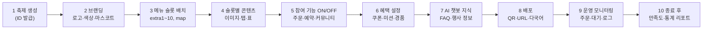
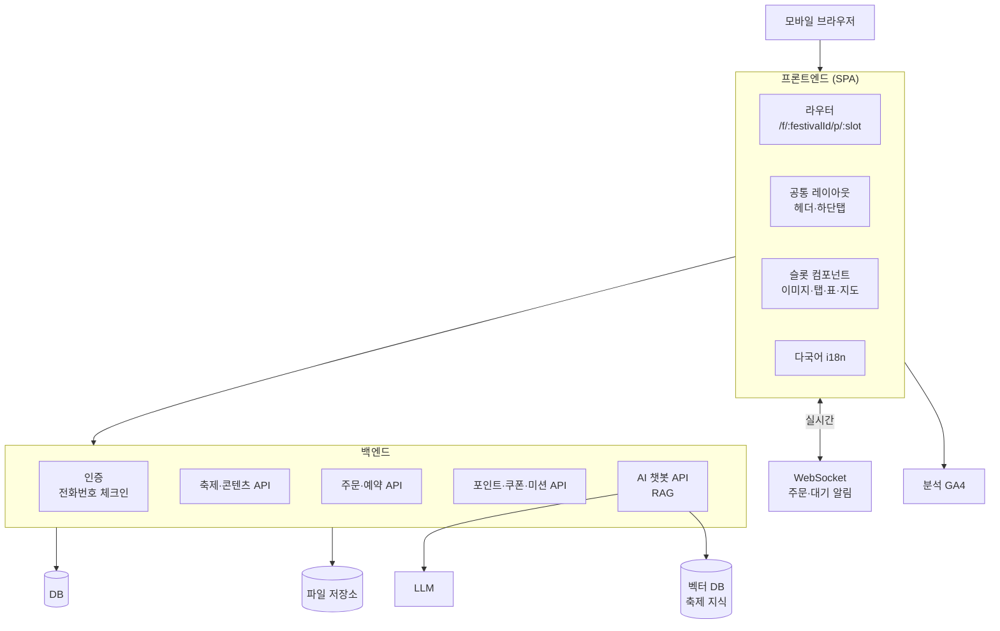
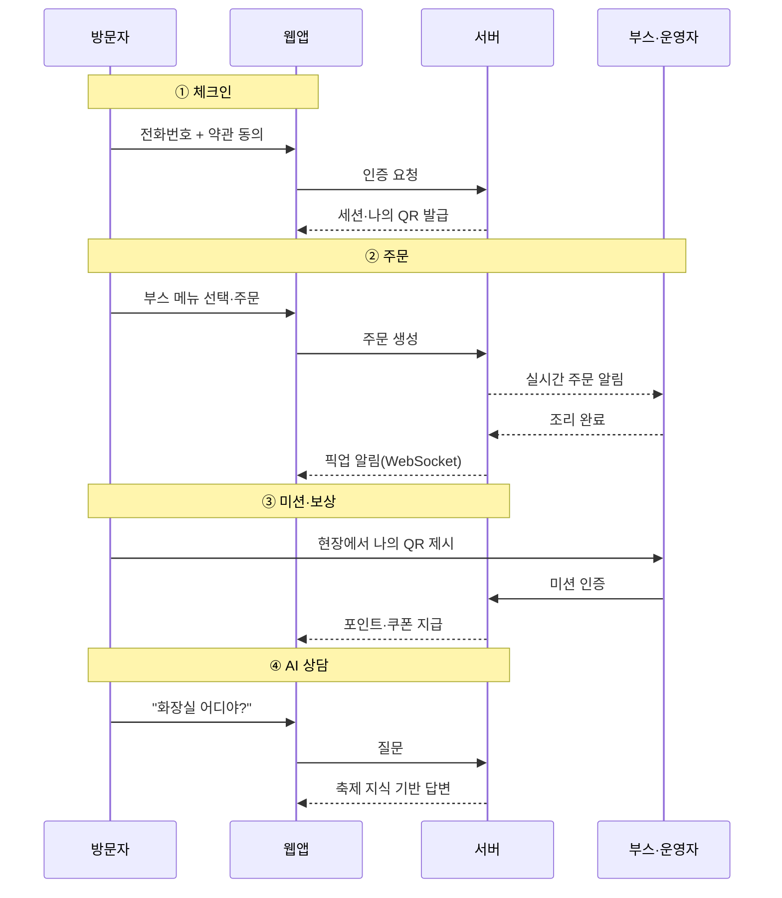

# 축제 웹앱 전체 워크플로우

> 참고 사례: COMM.IN 「떡볶이 먹고 들썩들썩!」 제6회 떡볶이 페스티벌 앱 (`app.commin.ai/klass/5738`)
> 2026.10.23~25 · 대구iM뱅크PARK
>
> 이 문서는 위 앱의 구조와 기능을 바탕으로 **비슷한 축제 웹앱을 직접 구현할 때의 흐름**을 정리한 것입니다.
> 표시 규칙: ✅ 화면에서 직접 확인함 · 🔒 체크인 뒤에만 열려 확인하지 못함(추정)

---

## 0. 한 줄 요약

**QR 하나로 들어와서 → 둘러보고 → 전화번호로 체크인하고 → 주문·예약·미션·AI 상담으로 참여하고 → 만족도조사로 끝나는** 설치 없는 모바일 웹앱입니다.
운영자는 템플릿 슬롯에 콘텐츠를 끼우기만 하면 축제마다 새 앱을 만들 수 있습니다.

---

## 1. 전체 그림 (3개 층)

---

## 2. 방문자 여정 (Visitor Journey)

### 단계별 흐름

| 단계 | 방문자가 하는 일 | 화면·기능 | 로그인 필요 |
|---|---|---|---|
| ① 진입 | 현장 QR·포스터·SNS 링크로 들어옴 | 앱 설치 없이 모바일 웹이 열림 | ✗ |
| ② 둘러보기 | 축제 정보 확인 | 홈, 행사개요(포스터·주최/후원·라인업) ✅, 무대시간표 ✅, 실시간 지도 ✅, 이벤트 안내 ✅ | ✗ |
| ③ 체크인 | 기능을 열기 위해 본인 확인 | 전화번호 입력 + 약관·개인정보 동의(2단계) ✅ | — |
| ④ 참여 | 축제를 "사용" | 주문하기 🔒, 뽀기랜드 입장예약 🔒, 커뮤니티 🔒, AI 뽀기 상담 🔒, 미션 수행 🔒 | ✓ |
| ⑤ 보상 | 혜택 받기 | 마이 포인트·쿠폰 🔒, 나의 QR(현장 인증) 🔒, 제휴 쿠폰(이월드·택시) ✅ | ✓ |
| ⑥ 마무리 | 피드백 남기기 | 만족도조사 | △ |

### 핵심 설계 포인트: "열린 정보 / 잠긴 기능"

- 정보는 다 열어 두어서 **처음 들어오는 사람이 막히지 않게** 합니다.
- 참여 기능을 누르는 순간 체크인 팝업이 뜹니다. 그래서 **방문자 데이터(전화번호)를 자연스럽게 모을 수 있습니다.**
- 하단 탭 6개(홈·행사개요·무대시간표·커뮤니티·나의QR·만족도조사)는 늘 같은 자리에 고정되어 있습니다.

---

## 3. 운영자 워크플로우 (Admin Flow, 추정)

URL 구조(`/klass/{축제ID}/p/extra1~10`, `/p/map`)를 보면 **슬롯형 템플릿 빌더**로 보입니다.

| 단계 | 산출물 | 비고 |
|---|---|---|
| 축제 생성 | 축제 ID, 기본 URL | 축제 하나 = 앱 하나 |
| 브랜딩 | 로고, 대표 색상, 마스코트(뽀기) | 홈 카드 일러스트에 마스코트를 반복해서 씀 |
| 메뉴 슬롯 | 하단 탭 + 홈 카드 구성 | 빈 슬롯은 "등록된 콘텐츠가 없습니다"로 표시 ✅ |
| 콘텐츠 | 포스터, 라인업 지도, 시간표 이미지 | **현재는 대부분 이미지** → 검색·AI가 읽기 어려움 |
| 참여 기능 | 주문·예약·커뮤니티 | 실시간 처리(WebSocket) |
| 혜택 | 후원사 경품, 제휴 쿠폰, 숏폼 공모전 | 후원사 노출과 지역 관광 연계 |
| AI 지식 | 챗봇이 답할 행사 정보 | 🔒 확인 못 함 |
| 배포 | QR 코드, 다국어 | 🇰🇷 버튼으로 언어 전환 ✅ |

---

## 4. 시스템 아키텍처 (구현 기준)

참고 앱에서 확인한 스택을 그대로 쓰거나, 팀 상황에 맞게 바꿀 수 있도록 함께 적었습니다.

| 구분 | 참고 앱에서 확인 | 우리 팀 대안 |
|---|---|---|
| 프론트 | Vue 3 + Quasar | Next.js / React |
| DB·설정 | Firebase / Firestore | **Supabase**(민주 브랜치에 `supabase/` 있음) |
| 실시간 | STOMP(WebSocket) | Supabase Realtime |
| 파일 | AWS S3 | Supabase Storage |
| 분석 | Google Analytics 4 | GA4 / PostHog |
| 미디어 | YouTube 임베드, Markdown | 동일 |

---

## 5. 데이터 흐름 (핵심 4가지)

---

## 6. 구현 순서 제안 (MVP → 확장)

| 단계 | 범위 | 완료 기준 |
|---|---|---|
| **1. 정보형 MVP** | 홈, 행사개요, 시간표, 지도, 다국어 | 로그인 없이 축제 정보를 모두 볼 수 있음 |
| **2. 체크인** | 전화번호 인증, 약관, 나의 QR | 체크인한 사용자만 잠긴 메뉴에 들어갈 수 있음 |
| **3. 참여** | 미션·포인트·쿠폰, 이벤트 | QR 인증으로 포인트가 쌓임 |
| **4. 거래** | 주문, 예약(대기열), 실시간 알림 | 주문 → 부스 → 픽업 알림까지 이어짐 |
| **5. AI** | 축제 지식 챗봇(RAG) | 시간표·위치·메뉴 질문에 정확히 답함 |
| **6. 운영 도구** | 관리자 슬롯 편집, 통계, 만족도 | 코드 수정 없이 새 축제를 만들 수 있음 |

---

## 7. 참고 앱 대비 개선 포인트

1. **콘텐츠를 이미지가 아닌 데이터로**: 라인업과 시간표를 표·JSON으로 저장하면 검색, 필터, AI 답변, 다국어 번역이 모두 쉬워집니다.
2. **AI는 체크인 전에도 일부 열기**: 지금은 체크인을 해야 AI 챗봇을 쓸 수 있습니다. 길 찾기·시간표 같은 간단한 질문은 체크인 전에도 답하게 하면 처음 들어온 방문자를 붙잡을 수 있습니다.
3. **축제 밖으로 확장**: 주변 맛집·관광 동선 추천, 그리고 여러 축제를 한곳에서 찾는 허브 기능을 더합니다(대구 로컬축제 에이전트의 차별점).
4. **실시간 혼잡도**: 지도에 부스별 대기 시간을 겹쳐 보여 줍니다.

> 파트별 상세 명세와 다른 주제에 적용하는 방법은 `03_파트별_기능명세_범용템플릿.md`에 있습니다.
