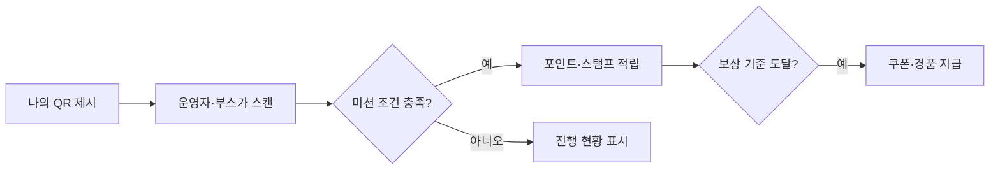
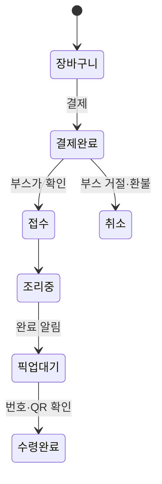
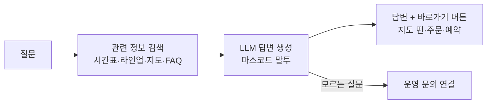

# 파트별 기능 명세 — 다른 주제에도 쓰는 범용 템플릿

> 참고 사례: COMM.IN 떡볶이 페스티벌 앱 (`app.commin.ai/klass/5738`)
> 목적: 이 앱의 기능을 **파트(모듈) 단위로 떼어내서**, 축제가 아닌 다른 주제(박람회, 전시, 대학 축제, 컨퍼런스, 스포츠 경기, 관광지 등)에도 그대로 끼워 쓸 수 있게 정리했습니다.
>
> 표시 규칙: ✅ 참고 앱에서 직접 확인함 · 🔒 체크인 뒤라서 확인하지 못함(추정)

---

## 0. 사용법

1. **[1. 주제 치환표](#1-주제-치환표)**에서 내 주제의 단어를 정합니다(예: "부스" → "작품", "무대" → "세션룸").
2. **[2. 모듈 선택 매트릭스](#2-모듈-선택-매트릭스)**에서 내 주제에 필요한 모듈만 고릅니다.
3. 고른 모듈의 명세(3장)를 복사하고 `{{변수}}`를 내 주제 값으로 바꿉니다.
4. 각 모듈 끝의 **체크리스트**로 빠진 것이 없는지 확인합니다.

### 공통 변수 (모든 모듈에서 씀)

| 변수 | 뜻 | 떡볶이 페스티벌 값 |
|---|---|---|
| `{{EVENT}}` | 행사·서비스 이름 | 제6회 떡볶이 페스티벌 |
| `{{EVENT_ID}}` | 행사 고유 ID | 5738 |
| `{{PERIOD}}` | 기간 | 2026.10.23~25 |
| `{{VENUE}}` | 장소 | 대구iM뱅크PARK 일원 |
| `{{MASCOT}}` | 마스코트·캐릭터 | 뽀기 |
| `{{UNIT}}` | 참여 단위(가게·부스·작품) | 떡볶이 맛집 부스 |
| `{{STAGE}}` | 프로그램이 열리는 공간 | 들썩들썩 스테이지, 뽀기 스테이지 |
| `{{ZONE}}` | 별도 예약 구역 | 뽀기랜드 |
| `{{SPONSOR}}` | 후원·제휴사 | 오뚜기, 해태, 스프라이트, 이월드 |
| `{{USER}}` | 이용자 호칭 | 방문객 |

---

## 1. 주제 치환표

같은 구조를 주제별로 어떻게 부르는지 정리한 표입니다.

| 범용 개념 | 축제(원본) | 박람회·전시 | 대학 축제 | 컨퍼런스 | 스포츠 경기 | 관광지·상권 |
|---|---|---|---|---|---|---|
| `{{UNIT}}` 참여 단위 | 맛집 부스 | 참가 기업 부스 | 학과 주점·동아리 | 스폰서 부스 | 매점·굿즈샵 | 가게·명소 |
| 라인업 | 전국 떡볶이 맛집 | 참가사 목록 | 공연 아티스트 | 연사 목록 | 출전 선수·팀 | 가맹점 목록 |
| `{{STAGE}}` 시간표 | 무대 공연 | 세미나·시연 | 공연 무대 | 세션 트랙 | 경기·이벤트 타임 | 투어·체험 일정 |
| 지도 | 행사장 배치도 | 홀 배치도 | 캠퍼스 지도 | 층별 룸 안내 | 경기장 좌석·편의시설 | 골목·코스 지도 |
| 주문 | 떡볶이 주문 | 샘플·자료 신청 | 주점 메뉴 주문 | 굿즈·도시락 | 매점 주문 | 포장 주문 |
| `{{ZONE}}` 예약 | 뽀기랜드 입장 | 시연·상담 예약 | 체험존 | 워크숍 좌석 | 팬존·포토존 | 체험 프로그램 |
| 미션·스탬프 | 뽀기 플레이 랩 | 부스 투어 스탬프 | 학과 스탬프 랠리 | 세션 출석 | 응원 미션 | 골목 스탬프 투어 |
| 커뮤니티 | 방문 후기 | 참가 후기·네트워킹 | 분실물·사진 | Q&A·네트워킹 | 응원 게시판 | 리뷰 |
| AI 챗봇 | AI 뽀기 | 전시 안내 봇 | 축제 안내 봇 | 세션 추천 봇 | 경기 안내 봇 | 동선 추천 봇 |

---

## 2. 모듈 선택 매트릭스

● 필수 · ○ 권장 · – 선택

| 모듈 | 축제 | 박람회 | 대학축제 | 컨퍼런스 | 스포츠 | 관광 | 난이도 |
|---|---|---|---|---|---|---|---|
| A. 공통 레이아웃·브랜딩 | ● | ● | ● | ● | ● | ● | 하 |
| B. 진입·다국어 | ● | ● | ○ | ● | ○ | ● | 하 |
| C. 정보 콘텐츠(개요·라인업) | ● | ● | ● | ● | ● | ● | 하 |
| D. 시간표 | ● | ● | ● | ● | ● | ○ | 하 |
| E. 실시간 지도 | ● | ● | ● | ○ | ● | ● | 중 |
| F. 체크인·회원 | ● | ● | ○ | ● | ○ | ○ | 중 |
| G. 나의 QR·미션·포인트·쿠폰 | ● | ○ | ● | ○ | ○ | ● | 중 |
| H. 주문 | ● | – | ● | ○ | ● | ○ | 상 |
| I. 예약·대기열 | ○ | ● | ○ | ● | ○ | ○ | 상 |
| J. 커뮤니티 | ○ | ○ | ● | ● | ○ | ○ | 중 |
| K. 이벤트·제휴 혜택 | ● | ○ | ○ | ○ | ● | ● | 하 |
| L. AI 챗봇 | ● | ● | ○ | ● | ○ | ● | 상 |
| M. 만족도조사 | ● | ● | ○ | ● | ○ | ○ | 하 |
| N. 관리자(운영 도구) | ● | ● | ● | ● | ● | ● | 상 |
| O. 분석·로그 | ○ | ● | – | ● | ○ | ○ | 중 |

---

## 3. 모듈별 명세

각 모듈은 같은 틀로 적었습니다: **목적 → 원본 사례 → 화면·기능 → 데이터 → 다른 주제 적용 → 체크리스트**

---

### A. 공통 레이아웃·브랜딩

**목적**: 어느 화면에 있든 같은 자리에서 같은 메뉴를 찾게 해서 길을 잃지 않게 합니다.

**원본 사례** ✅
- 상단: 축제 로고(왼쪽), 언어 전환 🇰🇷과 더보기 ⋮(오른쪽)
- 하단 고정 탭 6개: 홈 · 행사개요 · 무대시간표 · 커뮤니티 · 나의QR · 만족도조사
- 홈은 카드형: 체크인 카드 → 이벤트 배너 → 2열 카드(주문·혜택) → 지도 → 예약 → AI
- 마스코트 "뽀기"를 카드마다 일러스트로 반복해서 씀

**화면·기능**
| 요소 | 규칙 |
|---|---|
| 하단 탭 | 4~6개, 아이콘 + 짧은 라벨, 현재 탭은 강조색 |
| 홈 카드 | 위에서부터 **개인화(체크인) → 홍보 → 핵심 행동 → 정보** 순서 |
| 빈 슬롯 | "등록된 콘텐츠가 없습니다" 문구 표시 ✅ |
| 브랜딩 | `{{MASCOT}}`, 대표 색 1개, 보조 색 1~2개 |

**데이터**
```json
{ "event_id": "{{EVENT_ID}}", "name": "{{EVENT}}", "logo_url": "", "primary_color": "#E8412C",
  "mascot": "{{MASCOT}}", "tabs": ["home","overview","schedule","community","my_qr","survey"],
  "home_cards": [{ "slot": "extra4", "title": "", "image": "", "link": "", "requires_checkin": false }] }
```

**다른 주제 적용**
- 컨퍼런스: 탭 = 홈 · 세션 · 연사 · 네트워킹 · 내 티켓 · 설문
- 관광 상권: 탭 = 홈 · 코스 · 가게 · 리뷰 · 스탬프 · 설문

**체크리스트**
- [ ] 하단 탭이 모든 화면에서 같은 자리에 있는가
- [ ] 체크인이 필요한 카드에 표시(자물쇠 등)가 있는가
- [ ] 모바일 폭(360~430px)에서 가로 스크롤이 생기지 않는가

---

### B. 진입·다국어

**목적**: 앱 설치 없이 QR이나 링크 하나로 바로 들어오게 합니다.

**원본 사례** ✅ 모바일 웹 URL `/klass/{{EVENT_ID}}`, 상단 국기 버튼으로 언어 전환

**화면·기능**
- 진입 경로: 현장 QR, 포스터, SNS, 문자 링크 → 모두 같은 URL로
- 경로를 추적하는 파라미터: `?src=poster|sns|booth_12`
- 언어: 한/영/중/일. 라벨은 i18n 파일로, **콘텐츠도 언어별 필드로** 저장

**데이터**
```json
{ "i18n": { "ko": { "tab.home": "홈" }, "en": { "tab.home": "Home" } },
  "content": { "title": { "ko": "행사개요", "en": "Overview" } } }
```

**다른 주제 적용**: 외국인이 많은 박람회와 관광지는 다국어가 필수입니다. 대학 축제는 한국어만으로 충분합니다.

**체크리스트**
- [ ] QR 하나로 첫 화면까지 3초 안에 열리는가
- [ ] 이미지 속 글자도 언어별로 준비했는가(가능하면 이미지 대신 텍스트로)

---

### C. 정보 콘텐츠 (개요·주최/후원·라인업)

**목적**: "무슨 행사이고 누가 나오는지"를 한 번에 알려 줍니다.

**원본 사례** ✅
- 행사개요 화면 안의 하위 탭 3개: **행사개요(포스터)** / **주최·후원사** / **떡볶이 라인업(전국 맛집을 지역별로 표시한 지도 이미지)**
- ⚠️ 모두 **이미지 한 장**이라서 검색, 필터, AI가 읽을 수 없습니다.

**화면·기능 (개선안)**
| 하위 탭 | 형태 |
|---|---|
| 개요 | 대표 이미지 + 텍스트 요약(기간, 장소, 입장료, 문의) |
| 주최·후원 | 로고 그리드, 누르면 링크 |
| 라인업 | **카드 리스트 + 필터**(지역·카테고리), 카드를 누르면 상세(메뉴·위치·가격) |

**데이터**
```json
{ "lineup": [{ "id": "u01", "name": "", "region": "대구", "category": "", "description": "",
               "image": "", "menu": [{ "name": "", "price": 0 }], "map_pin_id": "p01" }] }
```

**다른 주제 적용**
- 박람회: 라인업 = 참가 기업(업종 필터, 부스 번호)
- 컨퍼런스: 라인업 = 연사(트랙 필터, 세션 연결)
- 스포츠: 라인업 = 팀·선수 명단

**체크리스트**
- [ ] 라인업을 이미지가 아닌 데이터로 저장했는가
- [ ] 라인업 카드 → 지도 핀 → 주문으로 이어지는가

---

### D. 시간표

**목적**: "언제, 어디서, 무엇을 하는지"를 보여 줍니다.

**원본 사례** ✅ 날짜 탭(10/23 금 · 10/24 토 · 10/25 일) × **무대 2열**(들썩들썩 스테이지 / 뽀기 스테이지) × 30분 단위 행. 두 무대에 걸친 프로그램(커뮤니티쇼)은 칸을 합쳐서 표시. 역시 이미지로 올라와 있습니다.

**화면·기능 (개선안)**
- 날짜 탭 → 시간대 × `{{STAGE}}` 표
- **지금 진행 중** 강조, 곧 시작하는 프로그램 알림(체크인 사용자)
- 프로그램을 누르면 상세(출연자·설명), "알림 받기" 버튼

**데이터**
```json
{ "sessions": [{ "id": "s01", "date": "2026-10-23", "start": "12:00", "end": "12:30",
                 "stage": "{{STAGE}}", "title": "보이는 라디오", "type": "공연|버스킹|시상",
                 "performer_ids": [], "span_stages": false }] }
```

**다른 주제 적용**
- 컨퍼런스: 무대 = 트랙/룸, 개인 일정표에 담기 기능 추가
- 스포츠: 무대 = 경기장, 프로그램 = 경기·하프타임 이벤트

**체크리스트**
- [ ] 무대가 여러 곳이어도 휴대폰에서 가로 스크롤 없이 읽히는가
- [ ] 현재 시각을 기준으로 "지금" 표시가 되는가

---

### E. 실시간 지도

**목적**: 행사장 안에서 위치를 찾고 동선을 정하게 돕습니다.

**원본 사례** ✅ `/p/map` — 행사장 전체를 그린 일러스트 지도에 부스 핀, **화장실 필터 버튼**, **레이어 숨김 버튼**이 있습니다.

**화면·기능**
| 기능 | 설명 |
|---|---|
| 일러스트 지도 | 실제 지도 대신 행사장 그림 1장(확대·이동 가능) |
| 핀 레이어 | `{{UNIT}}`, 무대, 화장실, 의무실, 출입구, 쓰레기통 |
| 필터 | 카테고리별 켜기·끄기 |
| 핀 → 상세 | 라인업 카드, 주문 버튼으로 연결 |
| (확장) 혼잡도 | 핀 색으로 대기 시간 표시(초록/노랑/빨강) |

**데이터**
```json
{ "map": { "image": "", "width": 2000, "height": 2800 },
  "pins": [{ "id": "p01", "x": 0.42, "y": 0.31, "type": "unit|stage|toilet|exit|medical",
             "ref_id": "u01", "wait_minutes": null }] }
```
> 좌표는 이미지 크기에 대한 **비율(0~1)**로 저장하면 지도 이미지를 바꿔도 핀이 틀어지지 않습니다.

**다른 주제 적용**
- 관광 상권: 일러스트 대신 실제 지도(카카오·네이버), 핀 = 가게, 코스 선 그리기
- 스포츠: 좌석 구역 + 매점 + 화장실

**체크리스트**
- [ ] 화장실·출입구처럼 꼭 필요한 시설이 필터 한 번에 보이는가
- [ ] 핀을 누르면 상세나 행동(주문·예약)으로 이어지는가

---

### F. 체크인·회원

**목적**: 참여 기능을 열고, 방문자를 식별하고, 데이터를 모읍니다.

**원본 사례** ✅ 잠긴 메뉴를 누르면 하단 시트 「입장 정보 확인」이 뜹니다. **2단계**: ① 전화번호 + 서비스 약관 동의 + 개인정보 수집 동의 → ② (확인 못 함, 인증번호로 추정 🔒)

**화면·기능**
| 항목 | 규칙 |
|---|---|
| 인증 수단 | 전화번호 + 문자 인증번호(OTP) — 비밀번호 없음 |
| 동의 | 필수 2개(약관, 개인정보), 선택 1개(마케팅) |
| 범위 | 행사 단위 회원(행사가 끝나면 데이터 보관 기한 적용) |
| 진입점 | 홈 "체크인하기" 버튼 + 잠긴 기능을 누를 때 |

**데이터**
```json
{ "visitor": { "id": "", "event_id": "{{EVENT_ID}}", "phone_hash": "", "locale": "ko",
               "consents": { "terms": true, "privacy": true, "marketing": false },
               "checked_in_at": "", "qr_token": "" } }
```

**다른 주제 적용**
- 컨퍼런스: 전화번호 대신 **티켓 번호·이메일**로 체크인
- 대학 축제: 학번 인증 또는 체크인 없음(정보형만)

**체크리스트**
- [ ] 전화번호를 원문 그대로가 아니라 해시·암호화해서 저장하는가
- [ ] 개인정보 보관 기한과 파기 정책이 적혀 있는가
- [ ] 체크인을 마치면 원래 누르려던 기능으로 돌아가는가

---

### G. 나의 QR · 미션 · 포인트 · 쿠폰

**목적**: 현장 행동(부스 방문·구매)을 디지털 보상으로 바꿔서 참여를 늘립니다.

**원본 사례**
- 하단 탭 "나의QR" 🔒, 홈 "마이 포인트·쿠폰" 🔒
- 「떡페가 쏜다!」 ✅: **뽀기 플레이 랩 미션 수행 시** 또는 **굿즈샵 일정 금액 이상 구매 시** 후원사 경품(해태 신당동 떡볶이 과자 1일 1000개, 오뚜기 컵볶이) 지급

**화면·기능**

| 요소 | 설명 |
|---|---|
| 나의 QR | 방문자 고유 QR(짧게 만료되는 토큰으로 위조 방지) |
| 미션 | 부스 N곳 방문, 무대 관람, 구매 금액, SNS 인증 |
| 포인트 | 미션 보상, 쿠폰과 교환 |
| 쿠폰 | 제휴처 할인, 1회 사용, 사용하면 QR로 확인 |
| 재고 | 경품 하루 수량 제한(예: 1일 1000개) |

**데이터**
```json
{ "missions": [{ "id": "m01", "title": "", "type": "visit|purchase|watch|sns", "target": 3, "reward_points": 100 }],
  "progress": [{ "visitor_id": "", "mission_id": "m01", "count": 1, "done": false }],
  "coupons":  [{ "id": "c01", "title": "", "partner": "{{SPONSOR}}", "daily_stock": 1000, "expires_at": "" }],
  "wallet":   [{ "visitor_id": "", "coupon_id": "c01", "status": "issued|used" }] }
```

**다른 주제 적용**
- 박람회: 부스 5곳 스탬프 → 경품 응모
- 관광 상권: 골목 가게 스탬프 투어 → 지역 상품권
- 컨퍼런스: 세션 3개 출석 → 수료증·굿즈

**체크리스트**
- [ ] 같은 미션을 반복해서 포인트를 쌓는 어뷰징을 막았는가
- [ ] 경품 재고가 다 떨어지면 자동으로 "마감" 표시가 되는가

---

### H. 주문

**목적**: 줄 서지 않고 휴대폰으로 주문하고, 완료 알림을 받게 합니다.

**원본 사례** 🔒 홈 카드 "주문하기 — 전국 떡볶이 맛집을 한자리에서 만나보세요". 실시간 통신(STOMP WebSocket)을 쓰는 것으로 보아 주문 상태를 실시간으로 알려 주는 것으로 추정합니다.

**화면·기능**

- 방문자: `{{UNIT}}` 선택 → 메뉴 → 장바구니 → 결제 → 주문번호 → 픽업 알림
- 부스(운영 화면): 주문 목록, 상태 변경 버튼, 품절 처리

**데이터**
```json
{ "orders": [{ "id": "", "visitor_id": "", "unit_id": "u01", "items": [{ "menu": "", "qty": 1, "price": 0 }],
               "total": 0, "status": "paid|accepted|cooking|ready|picked|canceled",
               "pickup_no": "A-023", "created_at": "" }] }
```

**다른 주제 적용**
- 스포츠: 좌석으로 배달하는 매점 주문
- 대학 축제: 주점 테이블 주문(테이블 QR)
- 박람회: 필요 없는 경우가 많음 → 자료·샘플 신청으로 대체

**체크리스트**
- [ ] 결제는 PG사(테스트 모드부터 시작) 연동인가
- [ ] 알림이 끊겨도 주문 상태 화면을 새로고침하면 최신 상태가 보이는가
- [ ] 부스 운영 화면이 태블릿에서 한 손으로 쓸 만한가

---

### I. 예약·대기열

**목적**: 인원 제한이 있는 구역의 입장을 시간대별로 나눕니다.

**원본 사례** 🔒 "뽀기랜드 입장예약 — 뽀기랜드에서 즐겁게 놀아보세요"

**화면·기능**
- 시간대(회차) 목록 → 남은 자리 표시 → 예약 → 입장 QR
- 현장 대기열: 번호표 발급 → 내 차례가 가까워지면 알림
- 노쇼 처리: 일정 시간이 지나면 자동 취소, 대기자에게 넘김

**데이터**
```json
{ "slots": [{ "id": "", "zone": "{{ZONE}}", "date": "", "start": "", "capacity": 30, "booked": 12 }],
  "bookings": [{ "id": "", "slot_id": "", "visitor_id": "", "party_size": 2, "status": "booked|entered|no_show|canceled" }] }
```

**다른 주제 적용**: 박람회 시연·상담 예약, 컨퍼런스 워크숍 좌석, 관광지 체험 프로그램

**체크리스트**
- [ ] 두 사람이 동시에 마지막 자리를 예약해도 정원을 넘지 않는가(트랜잭션)
- [ ] 1인당 예약 수 제한이 있는가

---

### J. 커뮤니티

**목적**: 방문자끼리 후기와 사진을 나누면서 행사 열기를 퍼뜨립니다.

**원본 사례** 🔒 하단 탭 "커뮤니티", 체크인해야 씀. 무대 프로그램 "커뮤니티쇼"와 이어지는 것으로 보입니다.

**화면·기능**
- 글·사진 올리기, 좋아요, 댓글
- 운영자 공지 고정, 신고·차단(`CsUserBlock` 모듈 확인 ✅)
- 무대 연계: 인기 글을 "커뮤니티쇼"에서 소개

**데이터**
```json
{ "posts": [{ "id": "", "visitor_id": "", "body": "", "images": [], "likes": 0, "pinned": false, "hidden": false }],
  "reports": [{ "post_id": "", "reporter_id": "", "reason": "" }] }
```

**다른 주제 적용**: 대학 축제 분실물 게시판, 컨퍼런스 Q&A(연사에게 질문), 스포츠 응원 게시판

**체크리스트**
- [ ] 욕설 필터와 신고 → 자동 숨김 기준이 있는가
- [ ] 운영자가 바로 숨김·삭제할 수 있는가

---

### K. 이벤트·제휴 혜택

**목적**: 후원사를 노출하고, 지역 관광과 연계하고, 재방문을 끌어냅니다.

**원본 사례** ✅ 「떡페 200% 즐기기」 하위 탭: **떡페×오뚜기×해태 / 이월드 50% 쿠폰 / 대구로 택시 쿠폰 / 숏폼 공모전 / 스프라이트 EVENT**. 홈 상단에는 "스프라이트 무료 증정 EVENT" 배너가 있습니다.

**화면·기능**
| 유형 | 예시 | 연결 모듈 |
|---|---|---|
| 후원사 경품 | 미션 보상으로 과자·음료 | G |
| 지역 제휴 쿠폰 | 테마파크·택시 할인 | G(쿠폰) |
| 공모전 | 숏폼 영상 공모 | J(커뮤니티)·외부 SNS |
| 홈 배너 | 메인 후원사 강조 | A |

**데이터**
```json
{ "promotions": [{ "id": "", "type": "giveaway|coupon|contest|banner", "partner": "{{SPONSOR}}",
                   "title": "", "image": "", "how_to": "", "start": "", "end": "", "coupon_id": null }] }
```

**다른 주제 적용**: 관광 상권은 주변 숙박·교통 할인, 스포츠는 스폰서 굿즈, 박람회는 참가사 경품 추첨

**체크리스트**
- [ ] 이벤트 설명이 이미지만이 아니라 텍스트(참여 방법·기간·수량)로도 있는가
- [ ] 후원사별 노출·사용 수를 리포트로 뽑을 수 있는가

---

### L. AI 챗봇

**목적**: 방문자의 질문에 24시간 즉시 답해서 안내 부스 부담을 줄입니다.

**원본 사례** 🔒 홈 카드 "궁금한 것은 AI `{{MASCOT}}`에게 물어보세요". 체크인 뒤에만 열립니다.

**화면·기능**

| 설계 항목 | 기준 |
|---|---|
| 지식 원천 | C·D·E·K 모듈의 **데이터**(이미지가 아니라 텍스트·JSON이어야 함) + FAQ |
| 말투 | `{{MASCOT}}` 캐릭터 말투(친근, 짧게) |
| 행동 연결 | 답변에 "지도에서 보기", "주문하기" 버튼 붙이기 |
| 공개 범위 | 위치·시간 질문은 체크인 없이 허용, 개인 주문 조회는 체크인 필요 |
| 안전 | 행사와 관계없는 질문·개인정보 요청은 정중히 거절, 모르면 지어내지 말고 문의 안내 |
| 실시간 | 지금 공연, 대기 시간 같은 실시간 데이터는 API로 조회 |

**데이터**
```json
{ "faq": [{ "q": "화장실 어디예요?", "a": "", "pin_id": "p_toilet_1" }],
  "chat_logs": [{ "visitor_id": "", "question": "", "answer": "", "sources": [], "resolved": true }] }
```

**다른 주제 적용**
- 컨퍼런스: "AI 세션 추천" — 관심사를 말하면 일정을 짜 줌
- 관광 상권: "2시간 코스 짜 줘" — 동선 추천(**대구 로컬축제 에이전트의 핵심 차별점**)

**체크리스트**
- [ ] 답변에 근거(시간표·라인업 항목)를 붙이는가
- [ ] 답하지 못한 질문 로그를 모아 FAQ를 보강하는가

---

### M. 만족도조사

**목적**: 행사가 끝난 뒤 개선점을 모으고 성과를 증명합니다.

**원본 사례** 하단 탭 "만족도조사"(상시 노출)

**화면·기능**
- 5문항 이내: 전체 만족도(1~5), 재방문 의향, 가장 좋았던 것·아쉬운 것, 자유 의견
- 참여 보상: 포인트·쿠폰(G 모듈 연계)
- 시점: 행사 마지막 날, 또는 주문을 받은 뒤 30분 후 푸시

**데이터**
```json
{ "survey_responses": [{ "visitor_id": "", "score": 5, "revisit": true, "best": "", "worst": "", "comment": "" }] }
```

**체크리스트**
- [ ] 1인 1회 응답 제한이 있는가
- [ ] 결과를 바로 차트로 볼 수 있는가(O 모듈)

---

### N. 관리자 (운영 도구)

**목적**: 개발자 없이 운영자가 새 행사를 만들고 운영하게 합니다.

**원본 사례** (추정) URL 슬롯 구조 `/klass/{ID}/p/extra1~10`, `/p/map`, 빈 슬롯 안내 문구 → **템플릿 + 슬롯 편집형 빌더**

**화면·기능**
| 메뉴 | 기능 |
|---|---|
| 행사 설정 | 이름·기간·장소·브랜딩·언어 |
| 슬롯 편집 | 탭·홈 카드 순서, 슬롯 종류(이미지/탭/표/지도/외부 링크) |
| 콘텐츠 | 라인업·시간표·핀을 표 형태로 입력(엑셀 업로드) |
| 혜택 | 미션·쿠폰·이벤트 등록, 재고 |
| 운영 | 실시간 주문·예약 현황, 공지 푸시, 커뮤니티 관리 |
| 부스 계정 | 부스별 주문 처리 전용 화면 |
| 리포트 | 방문·체크인·주문·쿠폰·만족도 통계 |

**권한**
| 역할 | 할 수 있는 일 |
|---|---|
| 총괄 관리자 | 전체 |
| 운영 스태프 | 공지·커뮤니티·QR 스캔 |
| 부스 | 자기 부스의 주문·메뉴·품절 처리 |

**체크리스트**
- [ ] 지난 행사를 복제해서 새 행사를 만들 수 있는가
- [ ] 엑셀로 라인업·시간표를 한 번에 올릴 수 있는가

---

### O. 분석·로그

**목적**: 운영 판단과 후원사 리포트에 쓸 숫자를 모읍니다.

**원본 사례** ✅ Google Analytics 4(gtag), 자체 로깅 모듈(`CSLoggingHelper`)

**핵심 지표**
| 지표 | 정의 |
|---|---|
| 방문 수 | 고유 방문자(진입 경로별) |
| 체크인 전환율 | 체크인 수 ÷ 방문 수 |
| 미션 완료율 | 미션 1개 이상 완료 ÷ 체크인 수 |
| 주문 수·객단가 | 부스별, 시간대별 |
| 쿠폰 사용률 | 사용 ÷ 발급(후원사별) |
| AI 해결률 | 해결된 질문 ÷ 전체 질문 |
| 만족도 | 평균 점수, 재방문 의향 비율 |

**체크리스트**
- [ ] 이벤트 이름 규칙을 정했는가(`checkin_complete`, `order_paid` 등)
- [ ] 개인을 식별할 수 있는 정보를 분석 도구로 보내지 않는가

---

## 4. 전체 데이터 모델 한눈에 보기

```mermaid
erDiagram
  EVENT ||--o{ UNIT : has
  EVENT ||--o{ SESSION : has
  EVENT ||--o{ PIN : has
  EVENT ||--o{ PROMOTION : has
  EVENT ||--o{ VISITOR : has
  UNIT ||--o{ MENU : sells
  UNIT ||--o| PIN : located_at
  VISITOR ||--o{ ORDER : places
  VISITOR ||--o{ BOOKING : makes
  VISITOR ||--o{ MISSION_PROGRESS : tracks
  VISITOR ||--o{ WALLET : owns
  VISITOR ||--o{ POST : writes
  VISITOR ||--o| SURVEY_RESPONSE : answers
  ORDER }o--|| UNIT : to
  BOOKING }o--|| SLOT : for
  WALLET }o--|| COUPON : holds
  PROMOTION ||--o| COUPON : issues
```

---

## 5. 새 주제 적용 예시 — "대구 골목 상권 스탬프 투어"

| 단계 | 결정 |
|---|---|
| 변수 | `{{EVENT}}`=대구 골목 투어, `{{UNIT}}`=골목 가게, `{{STAGE}}`=체험 프로그램, `{{MASCOT}}`=대구 캐릭터 |
| 고른 모듈 | A, B, C(가게 목록), E(실제 지도 + 코스), F(간편 체크인), G(스탬프), K(지역 쿠폰), L(코스 추천 AI), M, N |
| 뺀 모듈 | H(주문), I(예약), J(커뮤니티) → 2차에 추가 |
| 핵심 흐름 | QR 진입 → AI에게 "2시간 코스" 요청 → 지도 코스 → 가게에서 QR 스탬프 → 5개 모으면 쿠폰 |
| MVP 범위 | A·B·C·E → F·G → L |

> 전체 흐름과 구현 순서는 `01_전체워크플로우.md`, 한 장 요약은 `02_원페이지_워크플로우.png`에 있습니다.
