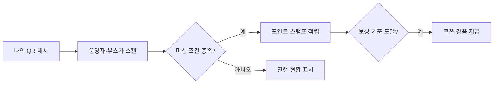

### G. 나의 QR · 미션 · 포인트 · 쿠폰

**목적**: 현장 행동(부스 방문·구매)을 디지털 보상으로 바꿔서 참여를 늘립니다.

**원본 사례**
- 하단 탭 "나의QR" 🔒, 홈 "마이 포인트·쿠폰" 🔒
- 「떡페가 쏜다!」 ✅: **뽀기 플레이 랩 미션 수행 시** 또는 **굿즈샵 일정 금액 이상 구매 시** 후원사 경품(해태 신당동 떡볶이 과자 1일 1000개, 오뚜기 컵볶이) 지급

**화면·기능**

| 요소 | 설명 |
|---|---|
| 나의 QR | 방문자 고유 QR(짧게 만료되는 토큰으로 위조 방지) |
| 미션 | 부스 N곳 방문, 무대 관람, 구매 금액, SNS 인증 |
| 포인트 | 미션 보상, 쿠폰과 교환 |
| 쿠폰 | 제휴처 할인, 1회 사용, 사용하면 QR로 확인 |
| 재고 | 경품 하루 수량 제한(예: 1일 1000개) |

**데이터**
```json
{ "missions": [{ "id": "m01", "title": "", "type": "visit|purchase|watch|sns", "target": 3, "reward_points": 100 }],
  "progress": [{ "visitor_id": "", "mission_id": "m01", "count": 1, "done": false }],
  "coupons":  [{ "id": "c01", "title": "", "partner": "{{SPONSOR}}", "daily_stock": 1000, "expires_at": "" }],
  "wallet":   [{ "visitor_id": "", "coupon_id": "c01", "status": "issued|used" }] }
```

**다른 주제 적용**
- 박람회: 부스 5곳 스탬프 → 경품 응모
- 관광 상권: 골목 가게 스탬프 투어 → 지역 상품권
- 컨퍼런스: 세션 3개 출석 → 수료증·굿즈

**체크리스트**
- [ ] 같은 미션을 반복해서 포인트를 쌓는 어뷰징을 막았는가
- [ ] 경품 재고가 다 떨어지면 자동으로 "마감" 표시가 되는가
