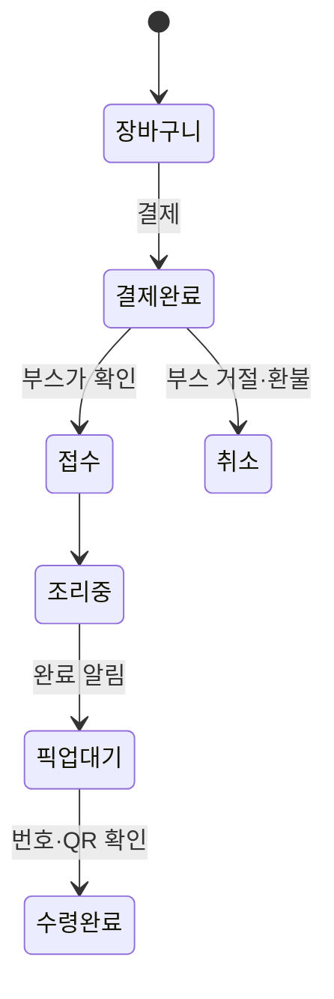

### H. 주문

**목적**: 줄 서지 않고 휴대폰으로 주문하고, 완료 알림을 받게 합니다.

**원본 사례** 🔒 홈 카드 "주문하기 — 전국 떡볶이 맛집을 한자리에서 만나보세요". 실시간 통신(STOMP WebSocket)을 쓰는 것으로 보아 주문 상태를 실시간으로 알려 주는 것으로 추정합니다.

**화면·기능**

- 방문자: `{{UNIT}}` 선택 → 메뉴 → 장바구니 → 결제 → 주문번호 → 픽업 알림
- 부스(운영 화면): 주문 목록, 상태 변경 버튼, 품절 처리

**데이터**
```json
{ "orders": [{ "id": "", "visitor_id": "", "unit_id": "u01", "items": [{ "menu": "", "qty": 1, "price": 0 }],
               "total": 0, "status": "paid|accepted|cooking|ready|picked|canceled",
               "pickup_no": "A-023", "created_at": "" }] }
```

**다른 주제 적용**
- 스포츠: 좌석으로 배달하는 매점 주문
- 대학 축제: 주점 테이블 주문(테이블 QR)
- 박람회: 필요 없는 경우가 많음 → 자료·샘플 신청으로 대체

**체크리스트**
- [ ] 결제는 PG사(테스트 모드부터 시작) 연동인가
- [ ] 알림이 끊겨도 주문 상태 화면을 새로고침하면 최신 상태가 보이는가
- [ ] 부스 운영 화면이 태블릿에서 한 손으로 쓸 만한가
