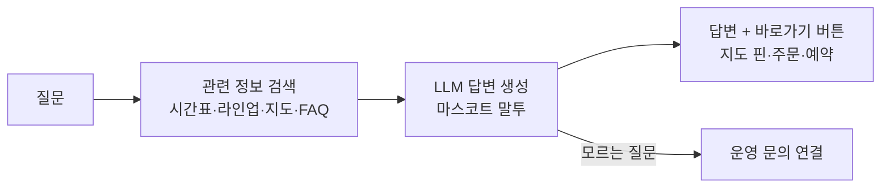

### L. AI 챗봇

**목적**: 방문자의 질문에 24시간 즉시 답해서 안내 부스 부담을 줄입니다.

**원본 사례** 🔒 홈 카드 "궁금한 것은 AI `{{MASCOT}}`에게 물어보세요". 체크인 뒤에만 열립니다.

**화면·기능**

| 설계 항목 | 기준 |
|---|---|
| 지식 원천 | C·D·E·K 모듈의 **데이터**(이미지가 아니라 텍스트·JSON이어야 함) + FAQ |
| 말투 | `{{MASCOT}}` 캐릭터 말투(친근, 짧게) |
| 행동 연결 | 답변에 "지도에서 보기", "주문하기" 버튼 붙이기 |
| 공개 범위 | 위치·시간 질문은 체크인 없이 허용, 개인 주문 조회는 체크인 필요 |
| 안전 | 행사와 관계없는 질문·개인정보 요청은 정중히 거절, 모르면 지어내지 말고 문의 안내 |
| 실시간 | 지금 공연, 대기 시간 같은 실시간 데이터는 API로 조회 |

**데이터**
```json
{ "faq": [{ "q": "화장실 어디예요?", "a": "", "pin_id": "p_toilet_1" }],
  "chat_logs": [{ "visitor_id": "", "question": "", "answer": "", "sources": [], "resolved": true }] }
```

**다른 주제 적용**
- 컨퍼런스: "AI 세션 추천" — 관심사를 말하면 일정을 짜 줌
- 관광 상권: "2시간 코스 짜 줘" — 동선 추천(**대구 로컬축제 에이전트의 핵심 차별점**)

**체크리스트**
- [ ] 답변에 근거(시간표·라인업 항목)를 붙이는가
- [ ] 답하지 못한 질문 로그를 모아 FAQ를 보강하는가
