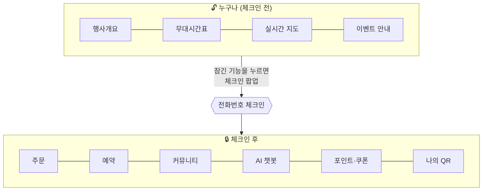

## 2. 방문자 여정 (Visitor Journey)

### 단계별 흐름

| 단계 | 방문자가 하는 일 | 화면·기능 | 로그인 필요 |
|---|---|---|---|
| ① 진입 | 현장 QR·포스터·SNS 링크로 들어옴 | 앱 설치 없이 모바일 웹이 열림 | ✗ |
| ② 둘러보기 | 축제 정보 확인 | 홈, 행사개요(포스터·주최/후원·라인업) ✅, 무대시간표 ✅, 실시간 지도 ✅, 이벤트 안내 ✅ | ✗ |
| ③ 체크인 | 기능을 열기 위해 본인 확인 | 전화번호 입력 + 약관·개인정보 동의(2단계) ✅ | — |
| ④ 참여 | 축제를 "사용" | 주문하기 🔒, 뽀기랜드 입장예약 🔒, 커뮤니티 🔒, AI 뽀기 상담 🔒, 미션 수행 🔒 | ✓ |
| ⑤ 보상 | 혜택 받기 | 마이 포인트·쿠폰 🔒, 나의 QR(현장 인증) 🔒, 제휴 쿠폰(이월드·택시) ✅ | ✓ |
| ⑥ 마무리 | 피드백 남기기 | 만족도조사 | △ |

### 핵심 설계 포인트: "열린 정보 / 잠긴 기능"

- 정보는 다 열어 두어서 **처음 들어오는 사람이 막히지 않게** 합니다.
- 참여 기능을 누르는 순간 체크인 팝업이 뜹니다. 그래서 **방문자 데이터(전화번호)를 자연스럽게 모을 수 있습니다.**
- 하단 탭 6개(홈·행사개요·무대시간표·커뮤니티·나의QR·만족도조사)는 늘 같은 자리에 고정되어 있습니다.
