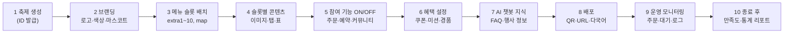

## 3. 운영자 워크플로우 (Admin Flow, 추정)

URL 구조(`/klass/{축제ID}/p/extra1~10`, `/p/map`)를 보면 **슬롯형 템플릿 빌더**로 보입니다.

| 단계 | 산출물 | 비고 |
|---|---|---|
| 축제 생성 | 축제 ID, 기본 URL | 축제 하나 = 앱 하나 |
| 브랜딩 | 로고, 대표 색상, 마스코트(뽀기) | 홈 카드 일러스트에 마스코트를 반복해서 씀 |
| 메뉴 슬롯 | 하단 탭 + 홈 카드 구성 | 빈 슬롯은 "등록된 콘텐츠가 없습니다"로 표시 ✅ |
| 콘텐츠 | 포스터, 라인업 지도, 시간표 이미지 | **현재는 대부분 이미지** → 검색·AI가 읽기 어려움 |
| 참여 기능 | 주문·예약·커뮤니티 | 실시간 처리(WebSocket) |
| 혜택 | 후원사 경품, 제휴 쿠폰, 숏폼 공모전 | 후원사 노출과 지역 관광 연계 |
| AI 지식 | 챗봇이 답할 행사 정보 | 🔒 확인 못 함 |
| 배포 | QR 코드, 다국어 | 🇰🇷 버튼으로 언어 전환 ✅ |
