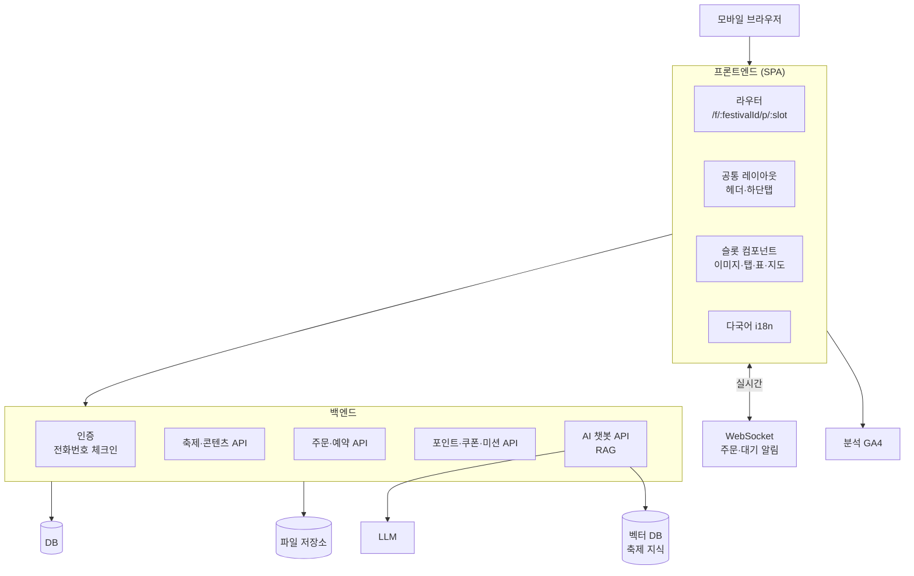

## 4. 시스템 아키텍처 (구현 기준)

참고 앱에서 확인한 스택을 그대로 쓰거나, 팀 상황에 맞게 바꿀 수 있도록 함께 적었습니다.

| 구분 | 참고 앱에서 확인 | 우리 팀 대안 |
|---|---|---|
| 프론트 | Vue 3 + Quasar | Next.js / React |
| DB·설정 | Firebase / Firestore | **Supabase**(민주 브랜치에 `supabase/` 있음) |
| 실시간 | STOMP(WebSocket) | Supabase Realtime |
| 파일 | AWS S3 | Supabase Storage |
| 분석 | Google Analytics 4 | GA4 / PostHog |
| 미디어 | YouTube 임베드, Markdown | 동일 |
